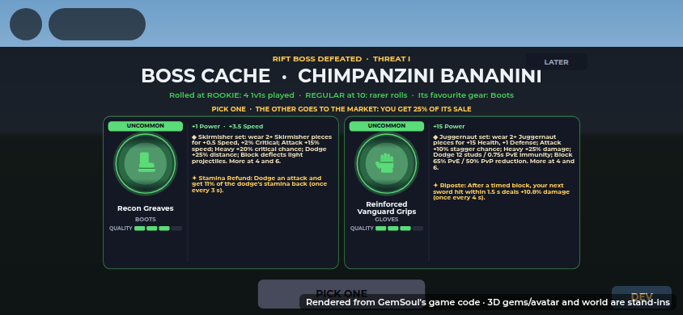
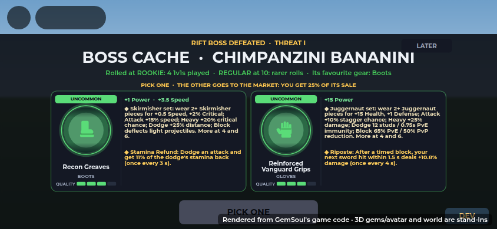
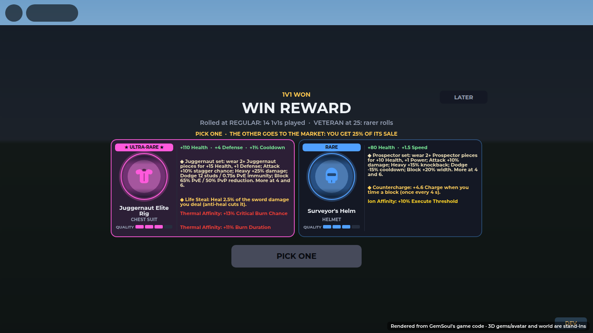
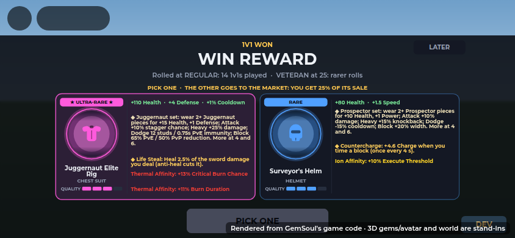

# Rewards: two pieces, keep one (2026-10-26)

Every reward in the game is the same thing: **two pieces of gear rolled at
random, you keep one**. The other goes up on the Market from a vault
(the **Arena Vault**, or the **Rift Vault** for a boss's), and **when it
sells you get 25% of its price** (a commission, paid even if you're
offline when it sells, the next time you're on). No free gems come with a
reward any more, the boss's own gem included.

**The more 1v1 you play, the rarer the rolls.** Every 1v1 you finish
(won, lost or drawn; queued Ranked or Casual, not a challenge or your
first fight) counts toward your **plays**, and your plays put you on a
ladder. Each piece is rolled on its own at your band's odds:

| Band | From plays | Common | Uncommon | Rare | Ultra-Rare | Legendary |
| --- | --- | --- | --- | --- | --- | --- |
| Rookie | 0 | 50% | 35% | 13% | 2% | 0% |
| Regular | 10 | 35% | 38% | 20% | 6% | 1% |
| Veteran | 25 | 20% | 35% | 32% | 11% | 2% |
| Elite | 50 | 8% | 27% | 40% | 21% | 4% |
| Champion | 100 | 0% | 15% | 42% | 35% | 8% |
| Warlord | 200 | 0% | 5% | 35% | 45% | 15% |
| Legend | 400 | 0% | 0% | 25% | 50% | 25% |

A reward can have a **floor**: a roll under it comes up to it (a 50-win
streak's cache is never under Ultra-Rare). A piece's quality goes by its
rarity (Common 1, Uncommon and Rare 2, Ultra-Rare 3, Legendary 4), or the
source's quality if that's higher. (Plays start from your 1v1 wins on a
save from before.)

Where rewards come from:

- **Every 1v1 you win** (queued, Ranked or Casual): a **WIN REWARD**, at
  your band's odds. Not for beating the same player twice running (no
  trading wins with a friend). At most **12** wait unclaimed; past that
  you're told to claim some, and none come until you do. The match result
  says "WIN REWARD: PICK ONE OF TWO" with your band and how far the next
  is, and the pick opens by itself a few seconds after.
- **Ranked win streaks:** an **Arena Cache** at each milestone (below).
- **Bosses beaten:** a **boss cache** (below).

Every reward's screen shows the band it was rolled at ("Rolled at
REGULAR: 12 1v1s played · VETERAN at 25: rarer rolls"). Pick one, CLAIM
IT: it goes into your bags, the other to the Market.

The ladder lives in `src/shared/RewardRoll.luau`.

## Ranked win streaks: Arena Caches

Win Ranked 1v1 matches in a row. Every milestone opens an **Arena Cache**
(two pieces at your band's odds, keep one, at least the milestone's floor)
and pays its coins and (at the big milestones) a title straight away.

Every ten wins is also an **arena tournament** won: the 1st, 5th and 10th
win of each run restore your pick's swings (10%, 25%, 50%). See
[swing-restores.md](swing-restores.md).

| Streak | Name | Floor | Gear quality (at least) | Coins | Title |
| --- | --- | --- | --- | --- | --- |
| 10 | Contender | Rare | 2 | 2,500 | |
| 20 | Challenger | Rare | 2 | 5,000 | |
| 30 | Gladiator | Rare | 3 | 7,500 | GLADIATOR |
| 40 | Vanquisher | Rare | 3 | 10,000 | |
| 50 | Warlord | Ultra-Rare | 3 | 15,000 | WARLORD |
| 60 | Juggernaut | Ultra-Rare | 4 | 20,000 | |
| 70 | Ironclad | Ultra-Rare | 4 | 25,000 | |
| 80 | Dreadnought | Ultra-Rare | 4 | 30,000 | |
| 90 | Conqueror | Ultra-Rare | 4 | 40,000 | |
| 100 | Centurion | Ultra-Rare | 4 | 60,000 | CENTURION |
| 150 | Untouchable | Legendary | 4 | 100,000 | UNTOUCHABLE |
| 200 | Arena Legend | Legendary | 4 | 150,000 | ARENA LEGEND |

(250 to 1000 come later: add rows to `Shared.ArenaStreak.Milestones`.)

- **Pieces:** each card spells out everything the piece carries
  (`CacheLottery.gearDetails`, *2026-10-27*): every stat it rolled (Health,
  Power, Defense, Speed, Critical, Cooldown, whichever it has); for armour,
  its **set**: the family and what wearing two or more of it gives you (the
  card used to say only "Armor Identity", the placeholder name of "wear
  matching pieces for set bonuses"), or for a sword its perk; its
  signature, if it has one; and every elemental affix with its bonus
  ("Ion Affinity: +13% Arc Damage"), in its element's colour, not "2
  elemental affixes". One or two pieces (every reward now) get wide cards,
  the picture, name and quality on the left and the list beside them, so
  the screen still reads on a phone; an old six-piece cache keeps upright
  cards with the list under the quality bar.

  A wide card is only as tall as its picture column (216 px), and its list
  is set as big as fits beside it (15 px down to 11 px,
  `StreakRewards.WIDE_SIZES`); only a list too long even at 11 px makes the
  card taller. *2026-10-27*: the cards used to be at least 272 px tall with
  11 px text, so a short list left a big empty block under it. The
  signature's mark is now ◆ like the set's: Roblox's fonts drew ✦ as an
  empty box.

  | Before | After |
  | --- | --- |
  |  |  |

  
  

  Gear is
  drawn from the swords, shields, helmets, armour, gloves and boots of its
  rarity (tiers 1 to 5), never the same one twice. The only weapons are
  the standard swords and their variations (`ExpandedItemTraits.rollable`):
  never a gun, hammer, axe, cleaver, lance or twin blades. A reward has at
  most one sword (`ArenaStreak.MaxWeapons`), so the other piece is armour
  or a shield. Each card is drawn in its rarity's colour.
- **What counts:** Ranked 1v1 wins only. A loss ends the streak. Beating the
  same player twice in a row doesn't add.
- **Once a season:** each milestone pays once per season; a second streak to
  the same mark that season pays nothing more.
- **The commission:** each leftover's listing carries your cut
  (`MarketBoard.vaultList`'s commission). When it sells, a "Commission" note
  goes to your Market mailbox and is paid when you're next settled up, once
  only, even if the note is seen again.
- **Claiming:** a reward waits, saved, until you open it. A gold "ARENA
  CACHE READY" button (or "WIN REWARD READY", "N REWARDS READY") shows in
  the lobby; it also opens by itself right after the match that earned it.
- **The Arena Vault:** leftovers are listed on the Market under
  "Arena Vault · <name>'s <N>-win cache" (or "<name>'s win reward"). Gear
  by rarity and quality (1 to 4): Common 600 to 1,200 coins, Uncommon
  1,500 to 3,000, Rare 4,000 to 7,500, Ultra-Rare 8,000 to 15,000,
  Legendary 20,000 to 40,000 (you get 25% of that). If the Market can't be
  reached, they wait and go up when you next join.
- **Old caches:** a cache saved before this change (free gems and six
  pieces of gear, keep three) still opens and claims as it was.

All the numbers live in `src/shared/ArenaStreak.luau`.

## Boss caches

Beat a boss in the **Rift** or the **pathway dungeon** and everyone who
fought it gets a **boss cache** of their own: a reward like every other,
with nothing to share or roll against each other. Who's still standing at
the kill gets one; in the dungeon, a squadmate already down doesn't.

- **Two pieces of gear, keep one,** at your band's odds and at least the
  boss's threat's floor and quality. **One of the two is its favourite
  kind** (a sword boss always offers a sword).
- **The other goes up on the Market from the Rift Vault**
  ("Rift Vault · <name>'s <boss> cache"), with your 25% cut, priced like
  the Arena Vault's.
- **Threat also makes the boss tougher** in the Rift: its health times
  0.85, 1 or 1.2, and its level (and its adds') 0, 4 or 8 over the last
  cave's.

| Threat | Floor | Gear quality (at least) | Boss health |
| --- | --- | --- | --- |
| I | Uncommon | 2 | x0.85 |
| II | Rare | 3 | x1 |
| III | Ultra-Rare | 3 | x1.2 |

| Boss | Element | Threat (its step on its Rift's ladder) | Favourite gear |
| --- | --- | --- | --- |
| Bombardiro Drago | Thermal | I | Helmets |
| Tung Tung Tung Sahur | Thermal | III | Weapons |
| Paperotti Gemelli | Cryo | I | Boots |
| Tralalero Tralala | Cryo | II | Shields |
| Frigo Camelo | Cryo | III | Armors |
| Chimpanzini Bananini | Ion | I | Boots |
| Gattini Gemellini | Ion | II | Gloves |
| Cappuccino Assassino | Ion | III | Weapons |
| Ranocchio Avocadino | Corrosive | I | Shields |
| Brr Brr Patapim | Corrosive | III | Helmets |

A boss's threat is its step on its biome's Rift ladder (see
[rift.md](rift.md#the-ladders)): I is built to beat alone, III for 2 to 4
of you, and each opens once you've beaten the one before.

The screen is headed **RIFT BOSS DEFEATED · THREAT II** (or **DUNGEON BOSS
DEFEATED**) over **BOSS CACHE · <the boss>**, with a line in the element's
colour: the band it was rolled at, then "Its favourite gear: Helmet". It opens
by itself three seconds after the kill (the Rift's way home is still open
for 20 seconds; nothing attacks you then). LATER keeps it: a gold **BOSS
CACHE READY** button (**N CACHES READY** with others waiting) opens it any
time. In a fight with the combat kit out, the screen frees the cursor.

The tables live in `src/shared/BossLoot.luau` (threats) and
`src/shared/DungeonRules.luau` (each boss's `Threat` and `Loot`).

## The roll

The first time a cache opens, the whole grid rolls at once
(`src/client/Modules/CacheLottery.luau`). Every card has its own round reel,
the mining find's display (`MiningReveal`) made small, and they all spin
together. Each slows as its turn comes and lands in order, 0.4 s apart.

- **Gem reels** (an old cache's free gems) roll through gems of every
  rarity, like a real find, and land on yours.
- **Gear reels** roll through the cache's own armour and weapons in 3D and
  land on each piece. Its quality bar fills in (out of 4), then the list
  of everything it carries appears.

While it rolls, each card shows the rarity and name rolling past. Tapping a
card or the button lands everything at once. Once all have landed, the same
grid is the pick screen. The pieces are rolled on the server when the
reward is earned, so the reels only reveal them. Opening a cache again in
the same session shows it already landed.

Every piece is shown in 3D: gems from their data, gear from a preview the
server builds on its mannequin (the same as the Market's,
`Equipment.groupPreviews`, group "A"). Gear has its look (finish, visor and
roll) rolled when the cache is rolled, at its own tier as the Forge does, so
the model you see is exactly the piece you get. Previews are built when the
cache list loads. The gear reels wait for them (3 s at most from opening;
the gems spin meanwhile), so they roll the real models.

## Testing it (DEV panel)

Test admins get an **ARENA CACHE** row in the DEV panel with
**10 · 20 · 30 · 40 · 50**, rolled at your own band. Each button rolls a fresh test cache for that
milestone and opens it, roll and all (`DevStreakCache` in
`Systems/ArenaStreaks`).

- Test caches pay no coins or title, and don't count as paid for the season.
- The piece you keep goes into your bags, so you can see it in your inventory.
- The other goes up on the Market from the Arena Vault, as any cache's
  does.
- A new test cache replaces the last one.

Under it, a **BOSS CACHE** row with **I · II · III** rolls a test boss
cache from a random boss of that threat (`DevBossCache`),
first in line and opened the same way. It also replaces the last test
cache.
