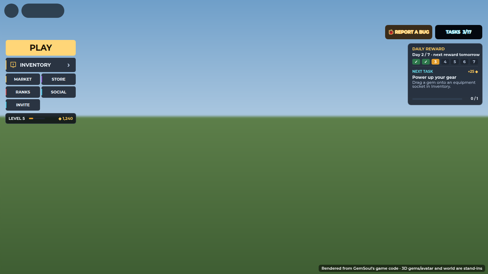
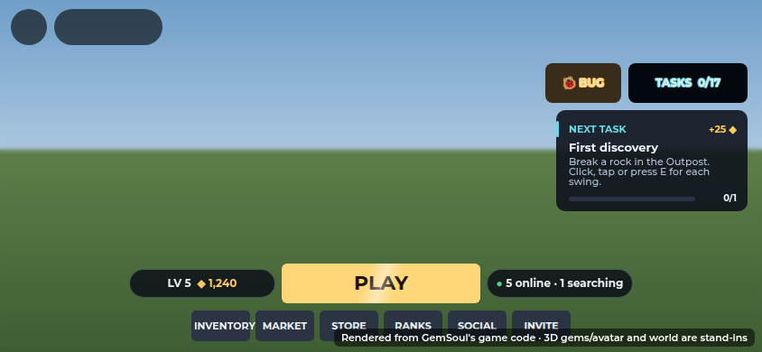

# Beta launch

The public beta needs launch settings that can't leak test tools or test
prices. It also needs a focused set of modes, a way to see where new players
drop off, and a clear "what next" in the lobby. Everything below is in code.
What still needs people playing on a published server is listed at the end.

## One switch: the stage

`STAGE` at the top of `src/shared/Config.luau` sets every launch setting
together. It is set to `"Beta"`.

| Stage | Saves | DEV tools | Cosmetics for coins |
| --- | --- | --- | --- |
| `"Playtest"` | off: every join starts as a new player | everyone | 25 coins each, on top of the normal way |
| `"Beta"` | load and save | Owners and Testers only | no |
| `"Live"` | load and save | Owners and Testers only | no |

- **Who has the DEV tools.** Owners and Testers are `Playtest.Owners` and
  `Playtest.Testers`. They can still replay the first-time flow from the DEV
  panel (New player, then Restore save).
- **The build label** (`Playtest.Build`) is `Beta 1 · 2026-10-16`. It appears
  on the dashboard and on every bug report. Give it a new name each time you
  publish.
- **Progress carries into launch.** `DataStoreName` stays
  `GemSoul_PlayerData_v2`, so beta progress is kept at launch. Changing the
  name starts everyone over.
- **For a friends-only test server**, set `STAGE = "Playtest"`.

## Modes in the beta

`Config.Features` switches whole activities off. The server refuses them and
the menus leave them out.

| Flag | Beta | What it covers |
| --- | --- | --- |
| `Mining` | on | Outpost rocks and the Moon Mine |
| `Market` | on | The Market board and trading |
| `Dungeons` | **off** | See below |
| `Mechs` | on | The Motor Pool mechs (off: no mechs are parked) |

**What `Dungeons` covers:**
- the PLAY menu's Squad Dungeon card;
- Social's dungeon buttons;
- `DungeonFind`, `PartyDungeon` and `PartyRaid`.

**While `Dungeons` is off:**
- 1v1 Practice takes the Dungeon card's space in the PLAY menu.
- Social's party card is just "PARTY".
- The two dungeon tasks leave the Tasks list.
- Owners can still run dungeon tests from the DEV panel.

When dungeons pass a full entry-to-reward test, set `Dungeons = true`.

So the beta leads with mining, gems and gear, then 1v1:
- Practice against a rival;
- Casual and Ranked against players.

## Onboarding funnel

`src/server/Systems/Funnel.luau` logs each new player's first session to
Roblox's onboarding funnel (Creator Dashboard, Analytics, Funnels). Each step
is logged once per account:

| # | Step | When |
| --- | --- | --- |
| 1 | Joined | A new account's profile loads |
| 2 | Style | Picked a fighting style (the picker tells the server) |
| 3 | Element | Picked an element, and the starter kit is rolled |
| 4 | Kit | The kit is on, after the reveal |
| 5 | First fight | The first fight is over (won, lost or left) |
| 6 | Lobby | Back in the Outpost after the first fight |
| 7 | First rock | Broke a rock |
| 8 | First gem | A rock dropped a gem |
| 9 | Socketed | Put a gem in a gear socket |
| 10 | Surge ready | Put a gem in Q, E or R |
| 11 | Second duel | Played another duel after the first fight |

- **Who is counted.** Only accounts that join as new players. Their profile
  gets a `Funnel` record of the steps already logged, so a rejoin never logs
  a step twice. Players from before this change are never counted.
- **The client.** It can only report step 2, and only by name.
- **A failed send** prints a warning and doesn't stop the game.

## The lobby: next task and bug reports

(The lobby has grown since: daily challenges, a live feed and a welcome-back
banner. See [lobby.md](lobby.md).)

**Next task.** The right-hand panel shows the next task, with:
- its one-line hint;
- how far along you are;
- the coins it pays.

Tapping it opens the Tasks window. The task is the first one left on the
current Tasks page (`TrainingRewards.nextTask`). So it walks a new player
through the beta loop:
1. mining: break a rock, find a gem;
2. socketing: drag a gem onto gear, then into Q, E or R;
3. fighting: hit, guard, cast a Surge, beat a rival.

On a phone the panel is one slim strip: the task's name and reward. Once all modes are open, the old
"ARENA · ALL MODES OPEN" line no longer appears.

**REPORT A BUG**, beside TASKS, opens the feedback form straight away (on a
phone, where the corner is kept clear, it's SOCIAL's Feedback button). Each
report carries the build and where the player was. Owners read them under
Social, Feedback, Reports.

## Tests

| Suite | Checks | What it covers |
| --- | --- | --- |
| `tests/run_funnel.py` (new) | 19 | Order; each step once; client-reported steps; the lobby only after the first fight; rejoins; returning players; failed sends |
| `run_dungeons.py`, `run_dungeon_queue.py`, `run_duels.py` | | Closed dungeons and raids are refused; Owners' dungeon tests still run |
| `run_training_rewards.py` | | Closed pages are skipped; the tracker's next task |
| `run_lottery_ui.py` | | The picker reports the style step |
| `run_outpost.py` | | Mining counts for Tasks |

**Suites that were failing and now pass:**
- `run_dungeons` and `run_expedition`: their harnesses didn't load
  `ArmorSignatures` and `MinerRoster`, which the game code now needs.
- `run_outpost`: brought up to date with the current lobby: no Field ring
  rocks, retired secrets, and the Motor Pool's mech bays.
- `run_augment_ui`: now runs twice, with Rig Maneuvers on and with them
  retired (the live setting).

**Still failing, left as they are:**
- `run_fighter_rig`: the Slash's blade tip now reaches 4.6 studs up, against
  a 4-stud limit. It began with the "movement update" commit. If the higher
  swing is intended, raise the limit in `tests/fighter_rig_cases.luau`.
- `run_client_boot`: a test harness that isn't committed yet
  (`tests/run_client_boot.py`).

## Before going public: needs people and devices

**Saving on a published server:**
- Mine, enchant, earn XP, change gear, leave and rejoin.
- Repeat with a dropped connection and a server change.
- Check for lost or duplicated items.

**The whole loop with several players:**
- Join, then style, element, first fight, lobby.
- Then mine, enchant, a 1v1, rewards, back to the lobby, rejoin.

**Transitions:**
- Enter a match while seated in a mech.
- Open menus while driving.
- Die, respawn, and leave the Arena.
- Each time, check the camera, the controls and that the HUD clears.

**Starter balance:**
- Skirmisher survivability.
- All three styles and all four elements.
- Stun chains and resource costs.
- Ranked's even stats.

**Real phones under load:** several players mining, rolling gems, driving
and fighting at once. Check:
- loading;
- touch controls and readable menus;
- frame rate;
- recovering from a disconnect.

**Economy:**
- Market deals and reward claims must survive a reconnect without
  duplicating.
- Robux products stay off (all ids 0) until delivery and failed-save
  recovery are verified.

**The store page:**
- description, controls and screenshots;
- what a beta means for players' progress;
- that bugs are reported with REPORT A BUG.
