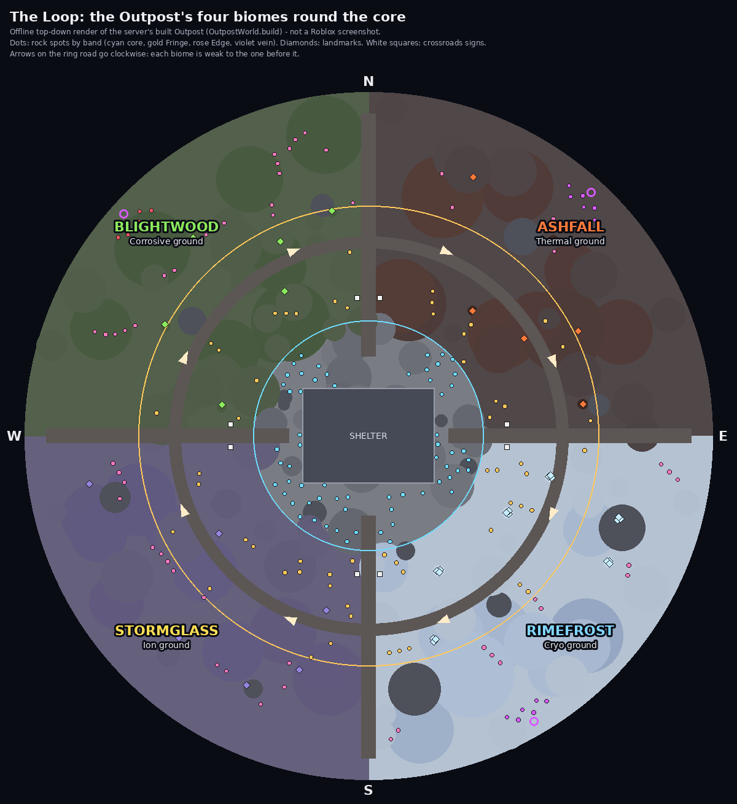
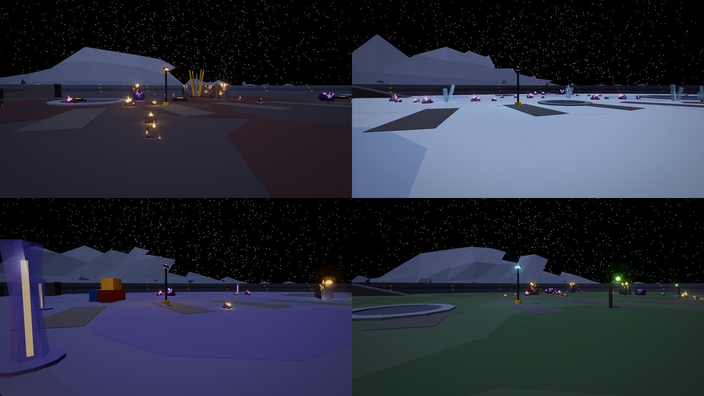
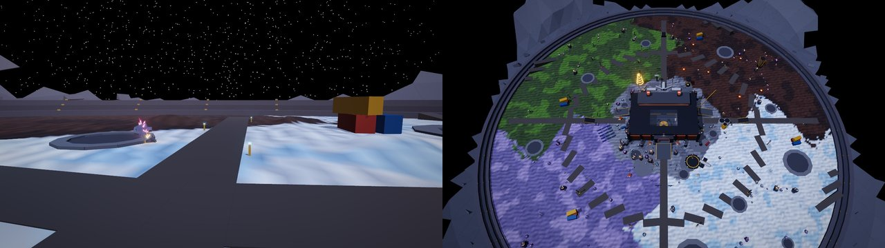
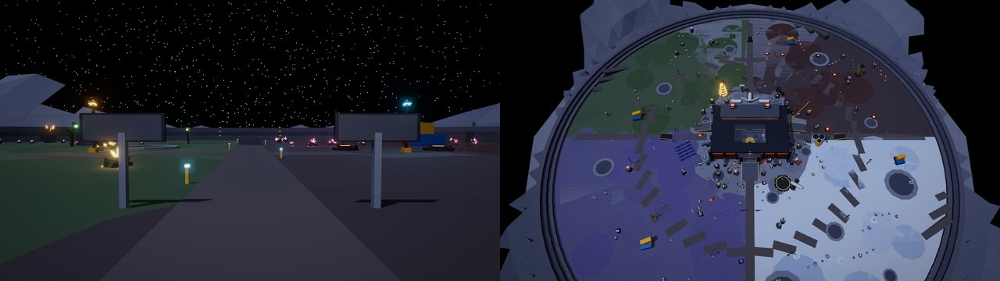

# The Loop: four biomes round the core

Out past the Outpost's core, the quarry is four biomes, one for each
element and about a quarter of the quarry each. Four haul roads (the
**Spokes**) run out of the core due north, east, south and west, and the
ring road at 260 studs runs round through all four. Each biome has its own:
- ground (Roblox terrain), lie of the land, rocks, landmarks, light and fog;
- gems, wild kaiju and critters, which lean toward its element.

The borders between biomes don't follow the roads. Each sways off its spoke
in its own way and merges into the next biome over a mixed seam.

Going round **clockwise** from the north-east, each biome is weak to the one
before it. So what you catch and mine in one biome does well in the next:

**Ashfall** (Thermal) → **Rimefrost** (Cryo) → **Stormglass** (Ion) →
**Blightwood** (Corrosive) → back to Ashfall.

(`Shared.ElementMatchup`: Thermal beats Cryo, Cryo beats Ion, Ion beats
Corrosive, Corrosive beats Thermal.)

The pictures are offline renders of what the server builds
(`OutpostWorld.build`). The map is a flat top-down drawing of the terrain
and parts, and the 3D views come from the trailer renderer. They are **not
Roblox screenshots**:
- Roblox draws each terrain material's texture and blends neighbouring
  materials smoothly; the renders show each 4-stud column's colour, so the
  seams look blockier there than in the game.
- The signs' text isn't drawn.
- The renders' fog only stands in for the game's.

## The four

| Biome | Where | Element | Ground (terrain) | Lie of the land | Landmarks |
| --- | --- | --- | --- | --- | --- |
| **Ashfall** | North-east | Thermal | Cracked lava with patches of basalt | Cinder mounds here and there, up to 6 studs | Smouldering vents, an ember in each throat; every other one smokes |
| **Rimefrost** | South-east | Cryo | Snow with patches of glacier ice | Long drifts, all blown the same way, up to 4.5 | Clusters of ice spires on a drift of frost |
| **Stormglass** | South-west | Ion | Violet salt with patches of limestone | Thin ridges of salt, up to 4 | Pylons of storm glass with a charge running up the core |
| **Blightwood** | North-west | Corrosive | Mud with patches of leafy growth | Soft hummocks close together, up to 3.5 | Dead trees in the mud, a spore pod swelling on a branch |

The core is the **Hub**: grey regolith (slate with patches of concrete),
flat, with all four elements alike.

### How it's built

- **The ground is Roblox terrain**, laid once when the Outpost is built
  (`OutpostWorld`, `biomeTerrain`). It's one 4-stud column at a time out to
  452 studs, under the quarry walls. Each column's material comes from
  `Frontier.ground`. Its colours are set with `Terrain:SetMaterialColor`.
- **It's flush with the quarry floor** (y 0). The old floor part is still
  underneath to stand on, but hidden.
- **The borders sway.** Each border is on its spoke at the spoke's mouth, so
  the crossroads signs point the right way. Further out it swings off by up
  to about 18°, in two waves of its own (`Frontier.border`). No two borders
  are alike, so the biomes aren't mirror images.
- **The seams mix.** Either side of a border, over 14 to 40 studs (the
  width swells and narrows along it), the two grounds mix in blotches.
  Roblox blends the materials where they meet.
- **The core's edge is ragged.** It wobbles round 150 studs, and the
  regolith gives way to a biome's ground over about 24 studs.
- **The land rises only in the open.** Each biome's relief starts 6 studs
  clear of anything standing and is fully up 26 studs clear. That keeps it
  flat under:
  - every rock spot, vein site and Rift Gate;
  - the buildings, craters, light masts, ramps and container stacks;
  - every road, the ring road included, and the quarry's walls.

  It's also flat within 20 studs of the core's edge.
- **Landmarks: 6 per biome**, deep in its own ground (where its look counts
  95% or more), at least 44 studs apart and clear of everything else.
- **Rocks** grow in their biome's basalt. Their crystals keep their band's
  colour, so you can still read a rock's luck.

## What leans

| | In a biome | In the core |
| --- | --- | --- |
| **Mined gems** | Its element 60% of the time; the other three share the rest (about 13% each). Rarity, luck and everything else are as before | All four alike |
| **Wild kaiju** | Born its element 60% of the time | All four alike |
| **Critters** | An encounter's critters are its own kind 60% of the time: Tung Tung Tung Sahur in Ashfall, Tralalero Tralala in Rimefrost, Brr Brr Patapim in Blightwood | (No rifts in the core) |
| **Stormglass's critters** | Its own kind is the ranged Bombardiro Crocodilo. It never comes alone and always comes last, so a wave of two or more there has more of them at the back (a 6-wave has 2), and the rest are any of the others | |

Notes:
- Which biome you're in follows the swaying borders (`Frontier.biomeAt`);
  on a seam it's whichever side of the border you're on.
- A rock's lean comes from where it grows; a vein's rocks lean too.
- A rift's critters lean toward the biome of whoever it opened at; a
  wandering rift's lean toward the ground it opens over.
- Gems from elsewhere (the Rift, dungeons, the store) don't lean.

The numbers are `Frontier.Biome`:
- `Bias` 0.6, for gems and wild kaiju;
- `Critter` 0.6, for critters;
- `Blend` 60 studs, how far the light takes to come in.

The ground's numbers are `Frontier.Ground`.

## Finding your way

- **No signs, no title cards** (since 2026-10-22,
  [plain-signs.md](plain-signs.md)): the crossroads signs and the banner
  that named a biome as you crossed into it are gone. The ground, the light
  and the fog tell you where you are.
- **The way out**: 8 lone rocks stand at the spokes' mouths, two to each
  road, a step either side of it. They lead out of the core into the first
  rocks of each biome.
- **The light and fog**: there's a slight fog over the whole quarry. The
  far side softens, but the sky stays black: the Atmosphere has density
  and no haze (`Scenes.OutpostFinish.Fog`). As you walk out, three things
  shift toward the biome's:
  - the screen's grade;
  - the outdoor light;
  - the fog's colour (`Fog`: ash brown, icy blue, violet, spore green).

  The shift starts 30 studs inside the core's edge and is complete 30
  studs past it. Across a seam it's a mix of the two biomes. It eases in a
  little at a time, and it's left alone while you're in the Rift.

The server sets each player's biome as the `FrontierBiome` attribute (the
biome's Id, or nothing in the core), next to `FrontierBand`.

## Spanish

The names and lines are in `Shared.LangEs`:

| English | Spanish |
| --- | --- |
| Ashfall | Cenizal |
| Rimefrost | Escarcha |
| Stormglass | Vidriotormenta |
| Blightwood | Bosque Marchito |

So is each ground ("Terreno térmico"). No sign or banner names a biome any
more.

## Where it lives

| File | What |
| --- | --- |
| `src/shared/Frontier.luau` | The rules: `Spokes`, `Biomes` (each one's Id, name, ground label, element, angle, colours, screen tint, outdoor light, fog, and its `Terrain`: two materials, its relief and height), `Biome` (`Bias`, `Critter`, `Blend`), `Ground` (cell, reach, sway, seams, the core's edge, the Hub's ground, each material's colour), `border(k, r)`, `biomeAt(offset)` (nothing in the core), `biomeMix(offset)` (each biome's weight there), `ground(x, z)` (the material, whose ground, how high the land would rise), `pickElement(home, rng)`; the stepping stones at the spokes' mouths (`Outcrop.Stones`) |
| `src/server/World/OutpostWorld.luau` | Lays the ground in terrain, flat where anything stands (`biomeTerrain`; `OutpostWorld.Terrain` for offline tests); each biome's landmarks (`biomeGround`); the spoke roads and ramps; rocks in the biome's stone |
| `src/shared/GemRoller.luau` | `roll(rng, luck, rarity, base, home, bias)`: a gem's element leans toward `home` |
| `src/shared/Kaiju.luau` | `wave(count, rng, home, bias)`: an encounter's critters lean toward the biome's own kind |
| `src/server/Systems/OutpostServer.luau` | A rock's gem leans toward its spot's biome; each rock gets its biome's stone |
| `src/server/Systems/GemGenerator.luau`, `Gems.luau` | Pass the lean (`Home`, `Bias`) through to `GemRoller` |
| `src/server/Systems/KaijuWilds.luau` | Wild kaiju born in a biome lean to its element; `pickWave` and `pickCritter` lean toward its critter |
| `src/server/Systems/FrontierServer.luau` | Each player's biome (`FrontierBiome`); a rift's critters lean toward the biome it opens in |
| `src/client/Modules/Scenes.luau` | The Outpost's slight fog (`OutpostFinish.Fog`) |
| `src/client/Modules/FrontierHud.luau` | The light and fog blend (`biomeLight`); no biome banner |
| `src/client/Modules/QuarryLife.luau` | The road lights along each spoke |

## Tests

| Suite | What it checks |
| --- | --- |
| `run_frontier` | Four spokes, due north, east, south and west, and the matchup chain round the Loop. The borders: on their spokes at the mouths, swaying more than 6° further out, never into a biome's middle, no two alike. Across a border the biome changes; on one, an even mix; a seam's width past it, all one biome's. The ground: the core's regolith and flat, each biome's two materials deep in it, both neighbours' across its border, the land never above its Height, the same every time. `pickElement` at 60%; `GemRoller` leaning toward the biome. No sign or banner line for a biome; the light and fog, the Outpost's in the core, the biome's in it, half and half on a border |
| `run_moon_quarry_scene` | The ground laid once, in terrain, on its grid, out under the walls; every column the material `Frontier.ground` says, none a hole; the land rising somewhere but never past 6 studs; each biome's materials there and coloured; the core regolith. Flat under every rock spot, along every spoke and round the ring road. The floor part hidden under it. The landmarks deep in their own ground, a glow among them (all but Rimefrost's), 8 signs, 4 spokes and their ramps |
| `run_kaiju` (`kaiju_cases`) | Waves in each biome: its own kind 57–63% of the melee critters, the others alike. In Stormglass, at least one ranged critter in every swarm, always at the back, and more of them than elsewhere |
| `run_quarry_life` | The road lights along every spoke |
| `run_lang` | Every name and line has its Spanish |
