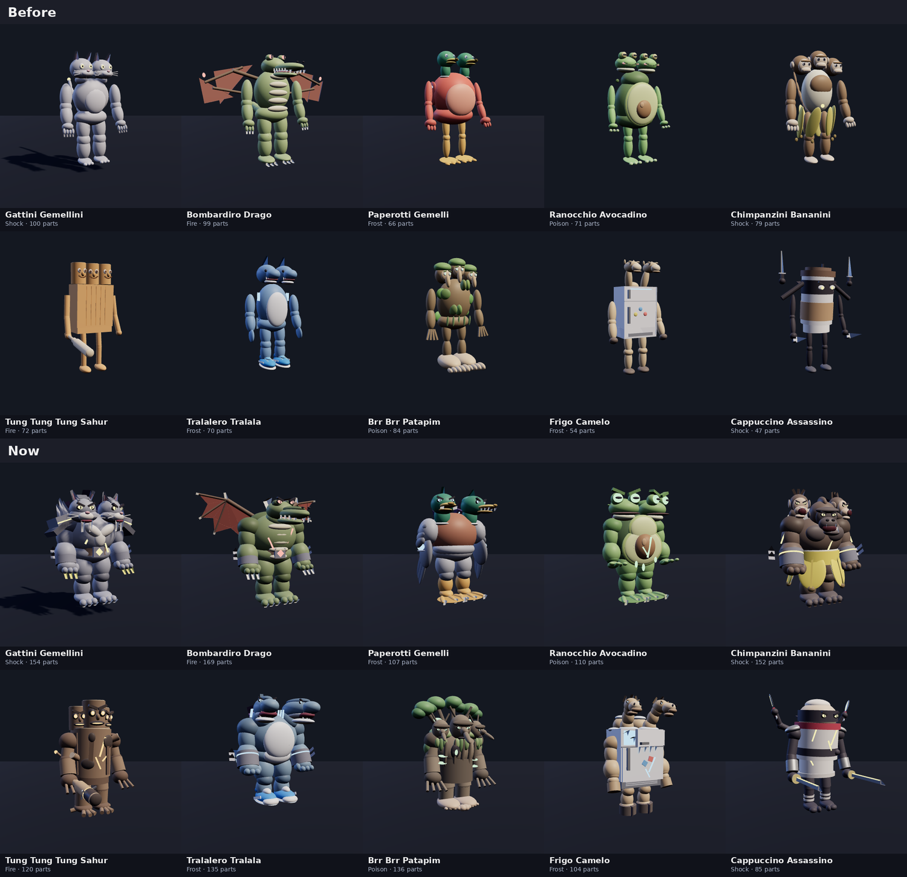
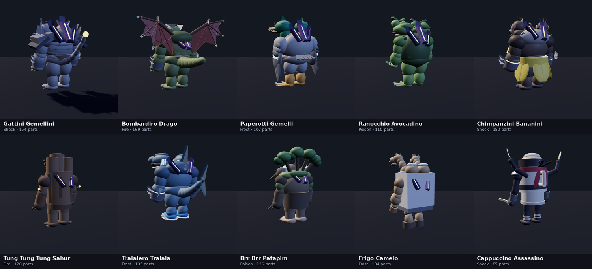
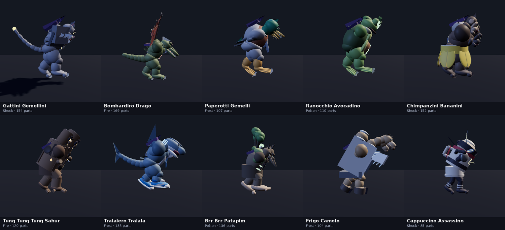

# The dungeon bosses, rebuilt as rift titans

The ten dungeon bosses (`DungeonRules.Bosses`: the last room of a dungeon,
an open expedition's middle camp, the Rift's boss) are rebuilt from scratch.
Their names, elements, stats and animations don't change. Only their
bodies do (`Server.BrainrotBosses`). Their moves changed later: see
[creature-moves.md](creature-moves.md).

The images here are offline renders (three.js) of the game's own boss code
on Duelist's combat skeleton, not Roblox screenshots. Neon reads paler in
them than it glows in Roblox.

## What was wrong

They looked like mannequins in costumes:

- **The same body under each one.** Upright human proportions, thin arms
  and legs of stacked eggs, and small heads on top.
- **Toy colours.** Flat bright plastic, with nothing on them to say they're
  bosses or where they came from.
- **Heads in a row.** Two or three heads stood side by side, facing the same
  way, and in a three-quarter view they hid behind each other.

## The look now

Each is a hulking brute that the Rift has broken into:

- **Built like titans.** A deep chest and a hunch of shoulders, forearms
  heavier than the upper arms, big clawed hands or fists, short heavy legs.
  Wood, cups and fridges are built of their own shapes instead.
- **Bigger, angrier heads.** Dark sockets, eyes glowing in the boss's
  element, heavy brows, fangs.
- **The Rift in them.** Dark violet crystal breaks out of their backs, each
  shard with a glowing seam in their element, and glowing veins crack their
  hides.
- **Iron where it fits.** The cat wears spiked pauldrons, bracers and a belt
  with a glowing stone. The dragon has the bracers and the belt, and the apes
  and the shark have bracers.
- **Deeper colours.** Greys, slate, olive, bark and fur instead of bright
  plastic.
- **Heads turned out.** Twin and triple heads now look out to their own
  sides, so each one shows from any angle.

| Boss | Now |
| --- | --- |
| Gattini Gemellini | Two sabre cats of storm-grey stone: tabby stripes, sabre fangs, whiskers, ruffs of fur. Huge clawed paws, spiked iron, a long tail crackling at its tip. |
| Bombardiro Drago | A crocodile brute. A long armoured head with horns and a jaw that snaps on fire, bony plates down its back, great bat wings with scalloped membranes and talons, a heavy tail. |
| Paperotti Gemelli | A war-duck with a chestnut breast and grey flanks. Two drake heads with white collars and serrated bills, folded wings with a glowing speculum, a curled drake's tail, orange webbed feet. |
| Ranocchio Avocadino | Two toads riding a halved avocado. The cut face is pear-shaped, with a fat stone split by glowing poison and drips. The toads have bulging glowing eyes and warts, and throats that swell. Webbed frog feet. |
| Chimpanzini Bananini | A silverback roaring low between two screaming chimps that ride its shoulders. Its long arms are in bracers, and the banana is still whole round its waist, its peel split down in five petals. |
| Tung Tung Tung Sahur | A charred log golem: uneven bark, lopped branches, ember cracks. Three log heads with fire in their eyes and grins, branch arms with twig claws, stump legs on roots, and a great nail-studded bat smouldering at its end. |
| Tralalero Tralala | A two-headed shark brute with a white belly and a tall dorsal fin. Open jaws on rows of teeth, glowing gills, fins on its forearms, a crescent tail fin, and big blue sneakers lit along their soles. |
| Brr Brr Patapim | An old treant. A mantle of moss hangs in strands, leafy branches rise off its back, and three long-nosed bark faces have moss beards and twig horns. Glowing shelf fungus and a glowing hollow, root claws, two huge bare feet. |
| Frigo Camelo | A fridge for a body: its freezer door hangs open on a glowing frozen inside with ice spiking out, under a crust of frost and icicles. Camel humps sit on top, two camel heads on long curving necks, hooves. |
| Cappuccino Assassino | A cracked cup, the Rift glowing through the cracks, with a head of foam wrapped in a black mask. A red scarf streams behind and there's a katana in each fist, their edges alight. Two more arms out of its back twirl kunai. Thin legs, tabi. |

## How they move

As before, they fight with the standard fighting poses (`RivalPose`) on the
invisible R15 skeleton, at 1.8 times size. On top of those poses, their parts
still move (`CreatureMotion`):

- Heads look about one by one and lunge on a blow.
- Jaws, beaks, the toads' throats, the camels' lips and the shark jaws snap.
- Wings flap.
- Tails sway, with the shark's tail fin and the cat's crackling tip.
- Moss strands, the treant's branches and the cup's scarf and mask tails stir.
- The cup's extra arms twirl their kunai.

The Sahur still holds its bat the way its bat poses expect.

A head that looks out to its side is built turned about its neck. Its joint
is turned with it, so it looks about from there.

## Cost

| | Parts, skeleton included |
| --- | --- |
| Before | 63 to 116 (budget 120) |
| Now | 101 (the cup) to 185 (the dragon), budget 200 |

| Boss | Parts |
| --- | --- |
| Gattini Gemellini | 170 |
| Bombardiro Drago | 185 |
| Paperotti Gemelli | 123 |
| Ranocchio Avocadino | 126 |
| Chimpanzini Bananini | 168 |
| Tung Tung Tung Sahur | 136 |
| Tralalero Tralala | 151 |
| Brr Brr Patapim | 152 |
| Frigo Camelo | 120 |
| Cappuccino Assassino | 101 |

There is one boss at a time in a room, so this is about 70 more parts on
screen at most. None of them collide, touch or take queries, and all are
massless, as before.

## Files

- `src/server/Systems/BrainrotBosses.luau`: the ten bodies. Shared pieces
  are titan arms and legs, branch arms, paws, webbed feet, hooves, spiked
  iron, rift crystal and veins, tails, wing and fin triangles, and heads
  turned out to their sides.
- `tests/brainrot_boss_cases.luau`: the part budget goes from 120 to 200.

## Tests

| Suite | What it covers |
| --- | --- |
| `tests/run_brainrot_bosses.py` | All ten build whole, identical whether built turned or straight. Nothing loose, colliding or off the body, the skeleton hidden, under 200 parts. Each has its 1, 2 or 3 heads moving one by one. Head, wing and knife motion is bounded and reacts to a blow. |
| `tests/run_rift.py` | The Rift's bosses, fights and world |
| `tests/run_creature_motion.py`, `tests/run_dungeons.py` | Creature motion and the boss rooms |

## Playtest

This is tested offline (Lune and the renderer). In Roblox, check:

- At 1.8 times, the bosses' reach and size against the rooms' pillars and
  doors (the dragon's wings and the treant's branches are the widest).
- The turned heads looking about don't clip each other.
- The Sahur's bat sits in its fist through its swings.
- The frame rate in a boss room with three or four players.
