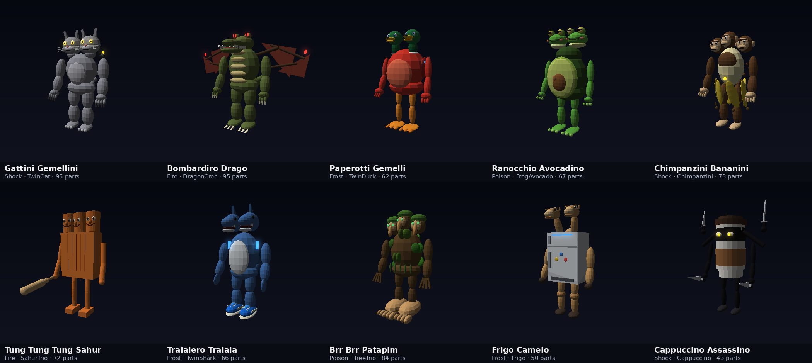
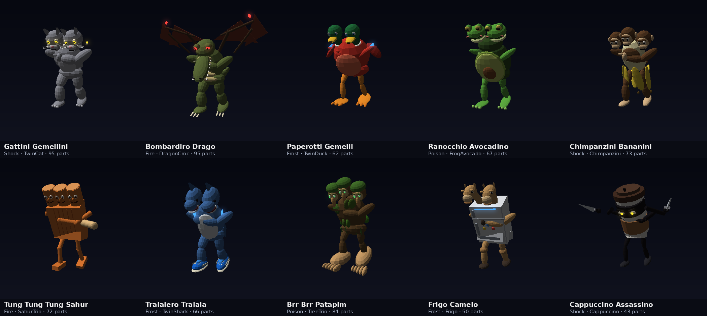

# Bosses, swarms and fairer drops

This round:

- Arena Caches roll only swords and shields as gear, plus armour.
- Every cache leaves armour for the Market.
- Knock-downs happen only in the lobby.
- The dungeons get ten new bosses.
- Critters come as swarms.
- The croc-plane is ranged only.
- Kaiju and critters fight smarter.

The boss images are offline renders of the game's own boss code
(`BrainrotBosses` on Duelist's combat skeleton, posed by `RivalPose`, heads
and wings moved by `CreatureMotion`). The renderer is flat-shaded, not
Roblox's.

## Arena Caches: swords, shields and armour

The only weapons a cache rolls are the standard swords and their variations
(the sword line: Frontier Sword, Cryo-Edge Saber, Volt-Spark Blade, Radium
Cleaver, Solarbrand, Scout Shortsword, Impact Falchion, Void-Edge Sword,
Saga Runeblade, Omega Greatblade). It never rolls a gun, hammer, axe,
cleaver, lance or twin blades (`ExpandedItemTraits.rollable`). The rest is
shields, helmets, armour, gloves and boots.

A cache holds at most one sword (`ArenaStreak.MaxWeapons`). You keep three
of the six, so at least two of the three left over are armour or a shield.
They go up on the Market from the Arena Vault, and you get 25% when one
sells. The DEV panel's test caches now do this too. Before, their leftovers
were dropped, so a test cache never showed anything reaching the Market.

## Knock-downs only in the lobby

A lethal blow became a knock-down whenever you were in the Outpost. That
included Arena rivals and 1v1s started from the lobby, because the
Outpost flag stays on through a match. Now a knock-down needs the lobby and
no match: no `CombatSession`, `MatchId`, `DungeonId` or `Expedition` on you
(`Spar.knocksDown`). Spars, critters and wild kaiju in the Outpost still
knock you down. Rivals, 1v1s, dungeons and expeditions are fought to the
end.

## The dungeon bosses

They have since been rebuilt as rift titans, with the same names, elements
and moves: see [boss-titans.md](boss-titans.md). The pictures and the
"What it is" column here are their first bodies.

The last room of a dungeon, and an open expedition's middle camp, is always
one of these ten (`DungeonRules.Bosses`), at 1.8 times size. They come from
the picture you sent, without the teacup ballerina and the cows on spider
legs. The ninja coffee cup is in. If "the teacup" meant the cup, it's one
line to drop it.

| Boss | Element | Weak to | Moves | What it is |
| --- | --- | --- | --- | --- |
| Gattini Gemellini | Ion | Corrosive | Servo Flurry, Stim Dodge, Thruster Leap | two stone cats, yellow eyes, a long tail |
| Bombardiro Drago | Thermal | Cryo | Armor Piercer, Thruster Leap, Kinetic Ram | a crocodile with bat wings and fire in its eyes |
| Paperotti Gemelli | Cryo | Ion | Kinetic Ram, Stim Dodge, Pneumatic Jab | two mallards on a round red body, webbed feet |
| Ranocchio Avocadino | Corrosive | Thermal | Thruster Leap, Tremor Slam, Pneumatic Jab | two frogs on a halved avocado, stone and all |
| Chimpanzini Bananini | Ion | Corrosive | Servo Flurry, Breach Hammer, Thruster Leap | three monkeys on a peeled banana |
| Tung Tung Tung Sahur | Thermal | Cryo | Hydraulic Slam, Breach Hammer, Tremor Slam | three log heads on a plank, and the bat |
| Tralalero Tralala | Cryo | Ion | Servo Flurry, Stim Dodge, Kinetic Ram | two shark heads, white belly, blue sneakers |
| Brr Brr Patapim | Corrosive | Thermal | Tremor Slam, Seismic Breaker, Riposte Stance | three long-nosed faces on a mossy trunk, huge bare feet |
| Frigo Camelo | Cryo | Ion | Kinetic Ram, Seismic Breaker, Riposte Stance | a fridge on camel legs, two camel heads |
| Cappuccino Assassino | Ion | Corrosive | Servo Flurry, Armor Piercer, Stim Dodge | a ninja coffee cup with four knives |

How the elements were picked:

- Fire for the dragon and the logs.
- Frost for the fridge, the ducks and the sharks.
- Poison for the frog, the avocado and the mossy tree.
- Shock for the cats, the banana monkeys and the caffeinated cup.

Each is weak to the same element as the room fighters of its element.

**Animations.** They fight with the standard animations. Each boss's parts
are welded to the invisible R15 combat skeleton every fighter uses. They
walk, wind up, strike, guard, flinch and reel in the same fighting poses as
the room fighters (`RivalPose`). The Sahur trio swings its bat in Sahur's
bat poses. On top of that, their parts move (`CreatureMotion`):

- **Heads** look about on their own. Two or three heads never move as one.
  They bob as it walks and lunge in on a blow.
- **Wings** flap, faster on the move, and beat hard on a blow.
- **Jaws and beaks** snap on a blow.
- **Tails** sway.
- **Moss and the ninja mask's tails** stir.
- **The cup's two extra arms** twirl their knives and chop down on a blow.

Since then, they breathe while standing and swing their arms as they walk.
Each has its own gait. See [brainrot-polish.md](brainrot-polish.md).

They were light: 63 to 116 parts each, skeleton included (now 101 to 185,
budget 200). None of them collides with or blocks anything. The owner's "TUNG TUNG" dungeon test
(F8) now meets the three-headed Sahur.

## Critters come as swarms

| | Before | Now |
| --- | --- | --- |
| A critter's health / bite (level 1) | 60 / 4 | 30 / 1.6 |
| An encounter, Fringe | 1 or 2 | 3 or 4 |
| An encounter, Edge | 2 or 3 | 5 or 6 |
| Stirred up / swarming | +1 / +2 | +2 / +3 |
| At once round you (Fringe / Edge) | 2 / 3 | 5 / 7 (stirred up, up to 9 / 11) |
| In the whole Outpost | 12 | 22 |
| Wandering rifts' critters at once | 3 | 6 |
| EXP each | 6 + 2 per level | 2.5 + 0.8 per level |
| Coins each (Fringe / Edge) | 2 / 4 | 1 / 2 |

A swarm hits about as hard as one or two critters used to, from all sides,
and pays about what one used to. It trickles in: one critter per rift,
the rifts opening 1.1 to 1.8 s apart and at least 16 studs from each other
(`Frontier.Swarm`, `Frontier.Rift.Apart`; see
[frontier.md](frontier.md#rifts)). The numbers are in `Kaiju.Bug` and
`Frontier`.

The Outpost's cap went from 12 to 22, so more brainrot bodies are about at
once. They're the thinned moon bugs (67 to 167 parts). Watch the frame rate
with a full Outpost in Studio. If it drops, `Frontier.Caps.Server` is the
one number to lower.

## The croc-plane: ranged only, never alone, always last

Bombardiro Crocodilo is the swarm's ranged one (`Kaiju.BugMoves.Crocodilo`,
`Ranged`):

- **It never bites.** It fights only with its bombs. It lobs one every 2.2 s
  and casts its Carpet Bomb from up to 24 studs.
- **It keeps its distance:** 14 studs off its foe. Close in past 8 and it
  jets back out, once every 2 seconds at most. It's untouchable for a moment
  as it goes.
- **It never comes alone.** Only a swarm of three or more has one, in 7 of
  10 swarms, plus one more for every five critters. A lone critter is never
  the croc (`Kaiju.wave`).
- **It comes last.** It's at the back of the swarm and hops out of the rift
  a second after the rest. A wandering rift's croc comes out after the
  others too.

## Smarter fights

**Critters** (`KaijuWilds`):

- **The swarm pounces together.** Once three or more of its fighters are on
  one kaiju, every 4 to 7 seconds they all leap in at once. They come from
  up to 8 studs out, whether they've got their breath back or not
  (`Kaiju.Bug.Rush`).
- **They work round behind you.** A critter alone on a foe that faces it
  circles toward its back.
- **Hurt, they turn wary.** Under 35% health one circles wider, takes 1.8
  times as long to come back in, and hops clear more often.

**Your kaiju** (`KaijuServer`, `KaijuFighter`, `KaijuFight`):

- **They dive the bomber.** A Crocodilo counts 8 studs nearer when they
  share out the swarm.
- **They finish off the weak.** A critter under a quarter of its health
  counts 5 studs nearer.
- **Heavies sweep.** A heavy (stomp, slam, tail lash) hits every critter in
  reach inside its arc. Each one besides its foe takes 60% of the blow. A
  stomp or slam covers 150°, a tail lash 220°.
- **Surrounded, they sweep more.** With three or more foes in reach, a
  light blow becomes a sweeping heavy 60% of the time.

## Tests

| Suite | What it covers |
| --- | --- |
| `tests/run_brainrot_bosses.py` (new) | The ten, against the picture's heads and the Roster's weaknesses. Their moves are real maneuvers. Boss rooms and open camps always field one, other rooms never do, and all ten come up. Each body: built turned and moved, it's identical to one built straight. Its skeleton is hidden. No part collides, hangs loose or sits off its body. It's under the part budget. Its heads move one by one. Head, wing and knife motion is bounded and reacts to a blow. |
| `tests/run_kaiju.py` | Swarm make-up: a ranged one is never alone, always last, and never too many. The weaker critter. The croc never bites, jets back from a kaiju closing in, and keeps its distance. Swarms come through in full, the ranged one last, out of wandering rifts too. The pounce: all three at once, once each, every bite landing. A hurt critter turning wary. A lone critter working round behind. Kaiju diving the bomber and finishing the weak. A heavy sweeping the one beside it and missing the one behind. A crowd turning lights into sweeps. |
| `tests/run_frontier.py` | Swarm sizes, the new caps and fair shares, EXP and the swarm's timing |
| `tests/run_dungeons.py` | Boss rooms use the bosses; the Sahur test mode meets the trio |
| `tests/run_arena_streak.py` | Every milestone's caches over 25 rolls: swords only as weapons, at most one, armour left over; test caches vault their leftovers |
| `tests/run_spar.py` | `Spar.knocksDown`: in the lobby, yes; in a rival match, 1v1, dungeon or expedition started from it, no |
