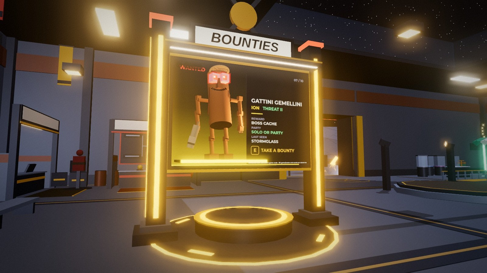
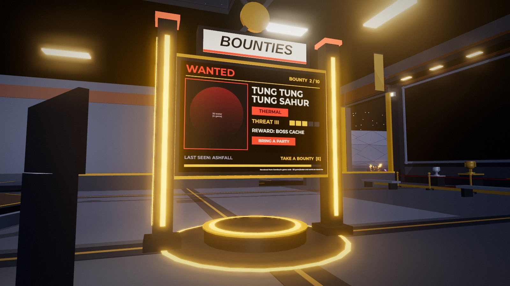
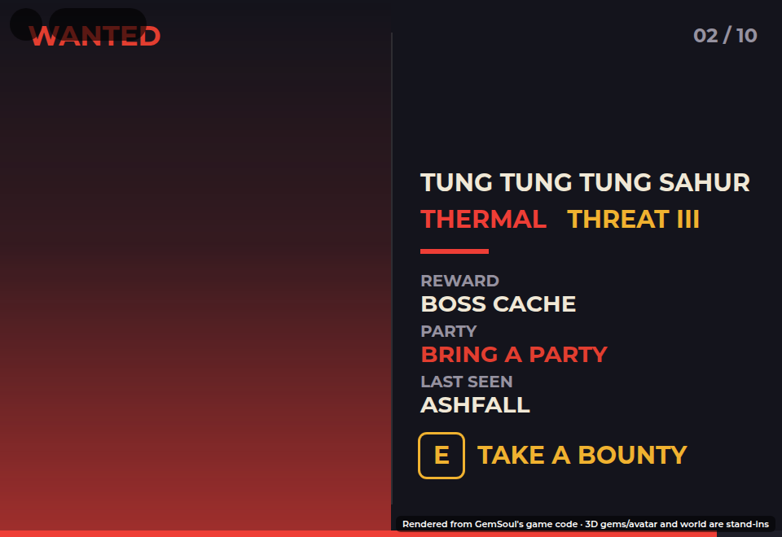

# The bounty board on the hall floor (2026-10-29)

Out on the Shelter's floor, where the yellow inlay bands cross between the
Hall of Fame and Brutus's booth, now stands a **double-sided bounty
board**: a big screen on two lit pylons, a BOUNTIES lightbox and crossed
blades on top, a glowing amber ring on the floor round its plinth.

Each face shows **one bounty**, a WANTED poster:

- the boss itself: a 3D figure of its body standing on a lit ledge out of
  the screen, over its element's glow (the same bodies as the bounty
  office's portraits, `ReplicatedStorage.RiftPortraits`; a ViewportFrame
  doesn't draw on a board out in the world, so it's a real figure),
- its name and element, its threat (THREAT and a numeral, green to red),
- what it pays (a boss cache), whether to bring a party, and where it was
  last seen (its biome),
- `TAKE A BOUNTY [E]` along the bottom.

*(Offline renders from the game's own geometry; the faces are drawn by the
UI harness, with a stand-in portrait where the game shows the boss's 3D
model.)*

## How it turns

Both faces change every **12 seconds** (`Bounties.Board.Period`), with a
quick flash. The front walks through every bounty in turn, each biome's
ladder after the last; the back shows the one **halfway round the list**,
so the two sides are never the same bounty. It runs off the server's
clock, so everyone in the hall sees the same two at the same time
(`Bounties.boardAt(now)`).

## Taking one

Walk up to either face and press **E** ("Take a bounty"): it opens the
bounty board window, the same one Marlo's counter opens (every Rift boss,
a tab per biome). Bounties can be taken from anywhere once it's open.

## How it's built

Like the Kennel's pen, the board is built by **each player's client**
(`Client.BountyBoard`, mounted by `OutpostScene` in the Shelter's frame):
the Shelter's server-built parts are at their budget. It's only there while
you're in the Outpost and within 260 studs of it. The faces are
SurfaceGuis that ignore the hall's lighting (`LightInfluence = 0`), so
they glow. The server builds every boss's portrait when it starts, so the
first turn of the board doesn't wait on them.

Its spot (28, 32 in the Shelter's frame) is clear of the Hall of Fame, the
bounty office, Brutus's booth, the rope, INFO-9, the main door and the
Kennel: `tests/bounty_board_cases.luau` checks that, and that the faces
never match.

Spanish: "Recompensa", "Aceptar una recompensa", "SOLO O EN GRUPO".
