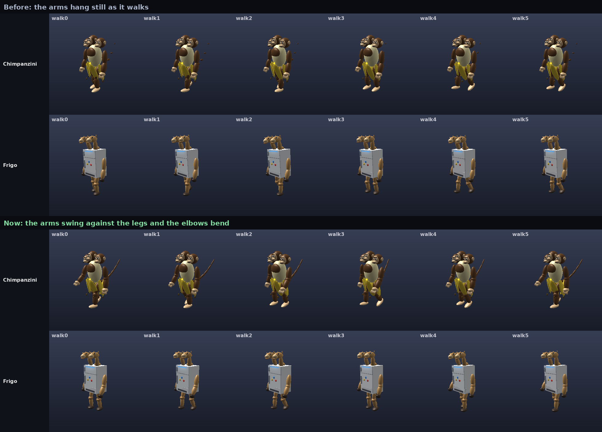
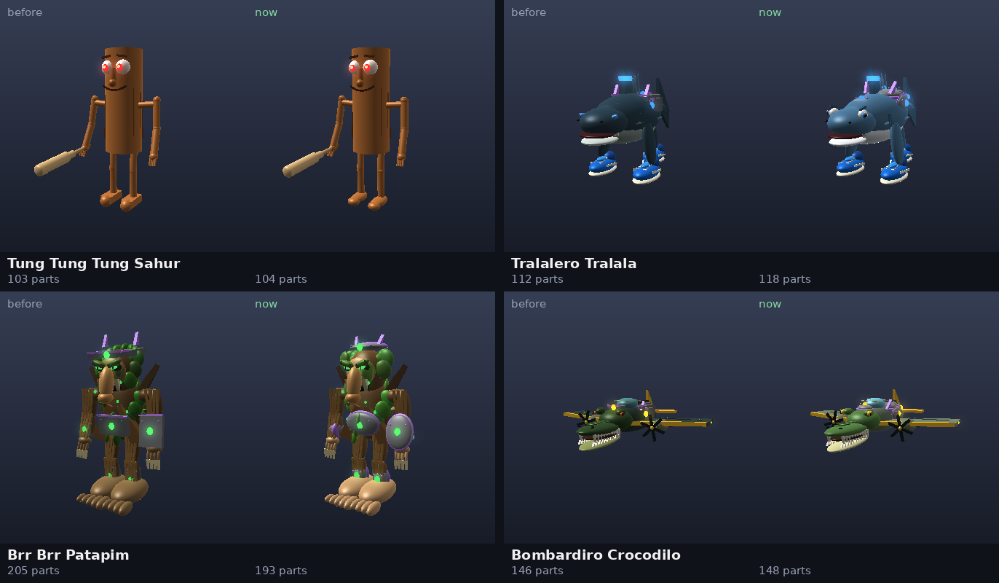
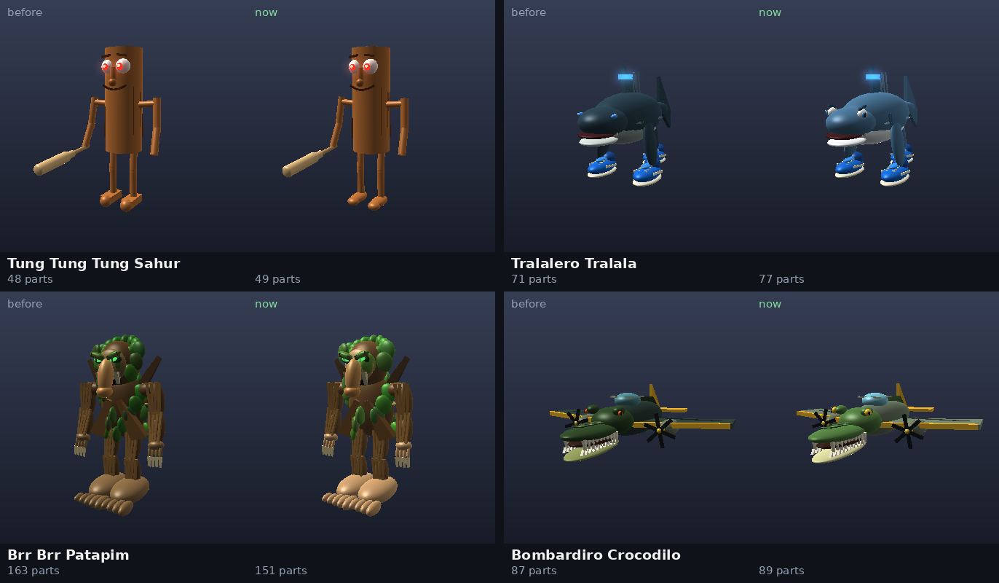
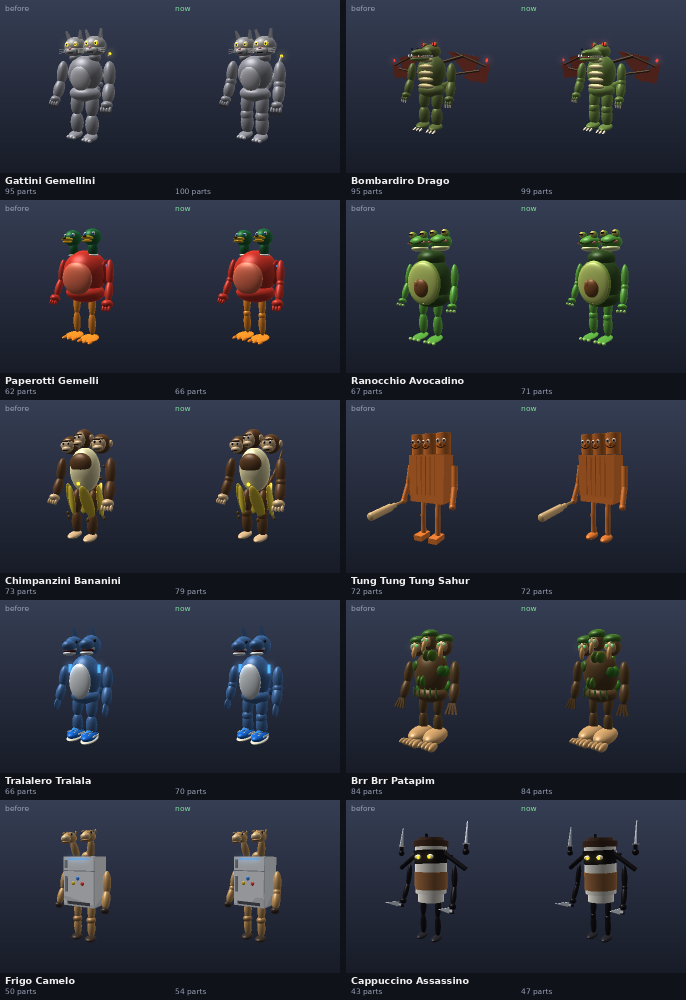

# Brainrot polish: smoother moves, better looks

This round covers every brainrot character:

- the four room fighters (Tung Tung Tung Sahur, Tralalero Tralala, Brr Brr
  Patapim, Bombardiro Crocodilo);
- the ten dungeon bosses;
- the moon bugs, the Outpost's critters, which are thinned room fighters.

What changed:

- **Standing still, they breathe.** Before, they stood frozen and then
  jumped.
- **The bosses swing their arms as they walk.**
- **Each one walks its own way.**
- **No gaps at the bosses' elbows and knees.**
- **Tails are one smooth curve.**
- **The room fighters look better:** rounded armour, brighter colours and
  livelier eyes.

The images are offline renders of the game's own code: the bodies from
`BrainrotSkins` and `BrainrotBosses`, posed by `RivalPose`, with heads, wings
and tails moved by `CreatureMotion`. "Before" is the last commit's code, "now"
is this one's, with the same camera. The renderer is not Roblox's, so check
the motion in a Studio playtest.

## The animations

### Standing still: no more frozen idle

Every client poses the bodies near it (`BodyPoses`, through
`RivalPose.update`). To keep the work down, it rewrote a joint only when the
joint moved more than 0.002 radians **in one frame**. An idle breath moves
about 0.0006 radians a frame, so it was never written. A standing creature
stood dead still until something bigger moved it, then snapped.

Now the movement is measured from the angle **last written**
(`RivalPose.WriteStep`, 0.0015 radians). A slow breath or sway builds up over
a few frames and is written in small, even steps. A body that really is
still is still never rewritten. A new rig-pose test checks this: an idle
creature is written regularly, not every frame, and never jumps.

While standing, a creature now:

- breathes, its chest and shoulders rising and falling;
- bobs its head with each breath;
- shifts its weight slowly from side to side.

### Walking: each one its own gait

Before, only Sahur and Patapim swung their arms. Every boss walked with its
arms hanging still. Now each body has a gait (`RivalPose.Gaits`, by its
shape):

| | What it sets |
| --- | --- |
| Arm, Elbow | How far the arms swing against the legs, and how much the elbows bend into the swing |
| Stride, Knee | How far the hips swing, and how high a foot lifts |
| Length | The ground one full stride covers, so the feet keep pace and don't slide |
| Roll, Lean | The body rocking side to side, and leaning forward |
| Breath, BreathRate, Sway | Standing: how deep and fast it breathes, and its weight shifting |

Some of the gaits:

- **The ducks** waddle, rocking the most, in short steps.
- **The monkeys** swing their arms widest, lean in and lift their knees high.
- **The frogs** lift their knees highest and breathe fast.
- **The fridge** walks stiffly, with long, slow steps.
- **The tree trio** lumbers forward, leaning, with long strides.
- **The ninja cup** strides with its arms pumping.
- **Tralalero and the croc plane** don't swing arms: a shark's fins are on
  its legs, and a plane's wings are its arms.

Any other shape gets a standard walk with arm swing.

### No gaps, smooth tails

- **Elbows and knees.** Each boss limb now has a rounded joint at the elbow
  and knee, the same colour as the limb, so no gap opens as it bends.
- **Tails** (the cats, the shark twins and the monkeys) were a string of
  separate balls. Each is now one continuous, tapering curve, turned along
  its own length. The cats' and the monkeys' tails have seven pieces each.
- **Patapim's armour crown** now sits on its head, so it turns as the head
  turns instead of staying put.

## The looks

### Room fighters

**Armour** (every armoured fighter and boss version). Each piece used to be
a flat slab. Now each is a rounded metal plate with:

- a rim set back behind it;
- a glowing socket for the element;
- two rivets.

The rim is gold at tier 5, purple at tier 4, and steel blue below that.
Pieces on the back and sides of the shark and the croc face out, the way
those bodies lie.

| Fighter | What changed |
| --- | --- |
| Tung Tung Tung Sahur | Rounded feet and toes; the log's top shows its end grain |
| Tralalero Tralala | Brighter blues; a white belly and jaw; cartoon eyes (white, coloured iris, pupil, a glint and a brow) |
| Brr Brr Patapim | Lighter bark and face; brighter leaf hood, brows and hanging moss; 26 moss tufts, brighter, instead of 38 |
| Bombardiro Crocodilo | Brighter green and metal; a pale jaw; bigger gold eyes with a slit and a glint; a brighter cockpit and back scales |

### Moon bugs

The critters are the room fighters thinned down, so they carry the same new
colours, eyes and feet. As before, they have no armour, no eye lights and
none of the smallest specks. They are 67 to 167 parts each, skeleton
included, under their budget of 180.

### Bosses

The bosses changed less in looks than in motion:

- the joints and tails above;
- Bombardiro Drago is a brighter olive with a paler belly;
- the Sahur trio's feet are rounded.

## Cost

| | Parts |
| --- | --- |
| Bosses, skeleton included | 63 to 116 (budget 120) |
| Moon bugs | 67 to 167 (budget 180) |

Patapim, as a fighter and as a bug, has fewer parts than before. Most of
the others gained a few: joint balls, eye parts, armour rims.

Posing costs a little more. A standing creature's joints are now written
every few frames, which is the breathing. Before, they were never written.
A body that isn't moving is still left alone, and bugs are still posed only
within 100 studs.

## Tests

| Suite | What it covers |
| --- | --- |
| `tests/run_rig_pose.py` | New: an idle creature breathes. It is written regularly but not every frame, and never jumps. |
| `tests/run_creature_motion.py` | Gaits, reverse and idle, combat poses, bounded detail motion |
| `tests/run_brainrot_bosses.py` | The ten bosses: identical whether built turned or straight, nothing loose or off the body, under budget, heads moving one by one |
| `tests/run_kaiju.py` | Moon bugs: budget, shadows, no armour or lights, nothing loose, the face kept |
| `tests/run_dungeons.py` | Boss rooms and the Sahur test mode |

`tools/render_boss_previews.py --check` passes again. Its stand-in for
Roblox's Vector3 learned to subtract and divide, which the new armour and
tails use.
