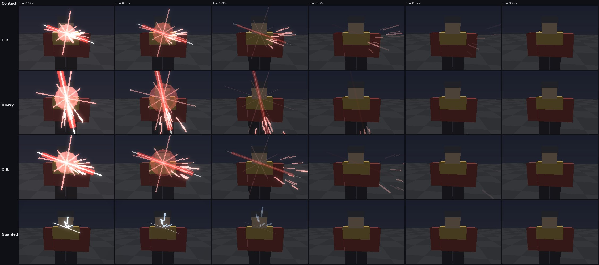
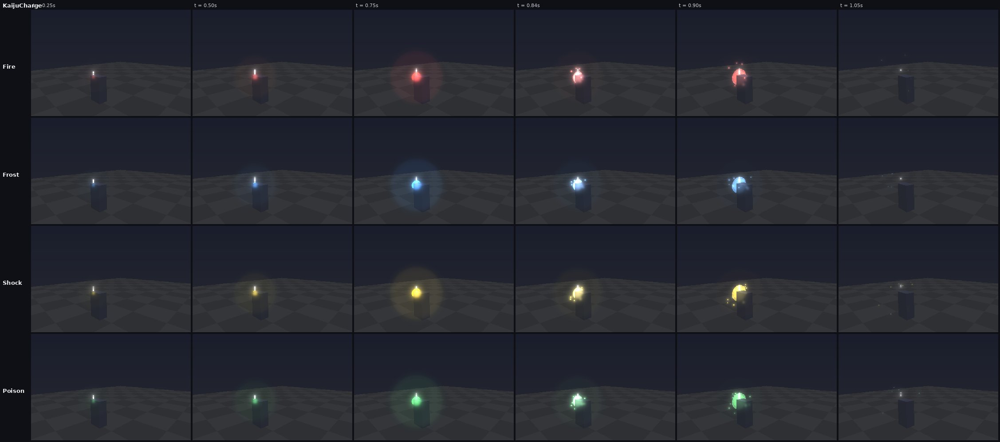
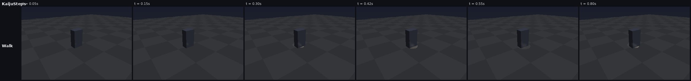

# Combat feel: your blade landing, and kaiju that move like animals

Two things felt flat. Landing a sword blow didn't feel like anything, and
the kaiju slid about with stiff poses and little sign of a cast coming.
This round fixes both. Everything here is presentation only. Damage, timing
and rules haven't changed.

The renders below come from `tools/vfx_sim.luau` and `tools/vfx_render.py`
(the real client modules, run offline on a virtual clock). They are
stand-ins for the game: grey blocks in place of the real bodies, with no
Roblox lighting and no bloom.

## Your sword

Why it felt flat:

- **Your swing waited on the server.** The first-person swing only started
  when the server answered, a full round trip after you let go. Every blow
  felt late.
- **Nothing happened on contact.** The blade swept on through the target
  as if it had missed: no stop, no jolt, no flash on what you hit. The
  sound and the number were the same as anyone else's hit.

What it does now:

| | |
|---|---|
| **Swings at once** | The swing, its whoosh and its crescent play the moment you let go (`Combat.client`: `own.swing`). The server's reply no longer restarts it. |
| **Hit stop** | When the blade connects, the swing stops dead for a beat as it bites, then carries on (`FirstPersonCombat`: `View.contact`). A cut holds about 65 ms, a heavy 100 ms. Crits, kills and each combo step hold a little longer, up to 170 ms. If the server's word comes before the blade reaches the cut, the stop waits for the blade. |
| **The bite** | While it holds, the blade shudders and presses into the cut. |
| **View kick** | Your view jars one way and springs back (`CombatFx.kick`): across with a cut, down with a heavy chop. Crits and kills jar harder. |
| **Hit flash** | What you hit flashes white-hot, then fades through your gem's colour (`HitFlash`, a small pool of Highlights within `OutlineBudget`'s room). |
| **Contact spark** | A white-hot streak laid along the cut, a hard four-point flare, and sparks thrown on the way the blade was going (`CombatVfx.contact`). |
| **Contact thud** | A meaty layered thud (`Contact`, or `HeavyContact` for a heavy or a kill) that climbs in pitch through a combo. |
| **Damage numbers** | Your own numbers wait for the bite and come up bigger, with a stronger pop. |
| **Controller rumble** | A short rumble on a gamepad. |
| **Guarded blows** | A blow on a guard stops short and rings off it (`Deflect`). The blade bounces back, a blue-white glint and sparks fly back at you, and nothing flashes. |

How it fits together:

- The server sends **`Contact`** to the swinger alone (`CombatServer`'s
  `attack`), once per melee swing that met someone. It carries what it hit
  (model and position) and `{ Heavy, Crit, Blocked, Kill, Combo, Element }`.
- `SwordFeel.tune` turns that into numbers: the stop, the shudder, the kick,
  the spark's size, the flash, the sound and the rumble.
- The tests in `tests/run_sword_feel.py` pin those numbers down, and
  `tests/combat_cases.luau` checks that Contact goes only to the swinger,
  with what the blade hit and whether it was guarded.

## Kaiju

| | |
|---|---|
| **Blows with weight** | A blow carries a touch past its pose (a back-out ease), holds a beat as it lands (`Motion.Hold`, 60 ms), then settles. The wind-up and the blow crossfade so they never stack. |
| **Anticipation** | A heavy shivers at the top of its wind-up, just before it comes down. |
| **Casting** | The body trembles and swells as a cast gathers. |
| **Charge-up** | An orb of the kaiju's element swells at its mouth over the wind-up, with motes drawn in and its light growing. It bursts as the cast is let go, with a flash and a ring (`KaijuMotionFx.charge` / `release`). A cast cut off by a hit just fizzles out. |
| **Walking** | `CreatureMotion.gait`: the weight dips onto each foot as it lands and rolls from side to side, and the body leans into a run and twists against the stride. It banks into turns. Standing still, it breathes and shifts its weight. |
| **Footsteps** | Dust kicks up and a ring spreads along the ground at each footfall. Big kaiju also thud, and giants shake your screen when they're close. Hovering kinds don't leave footprints. |
| **Getting hit** | A blow snaps the body back hard and eases out, and the body flashes. This covers any creature: kaiju, critters and bosses. |

The kaiju changes are tested in `tests/kaiju_models_cases.luau`. They check
that a blow carries through, holds and settles, that a cast trembles, and
that the walk dips, rolls, leans and banks within limits.
