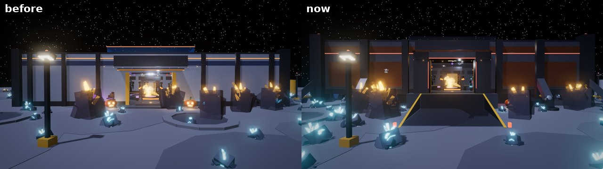
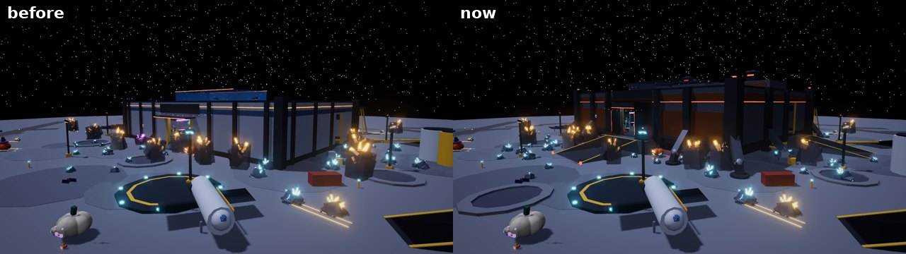
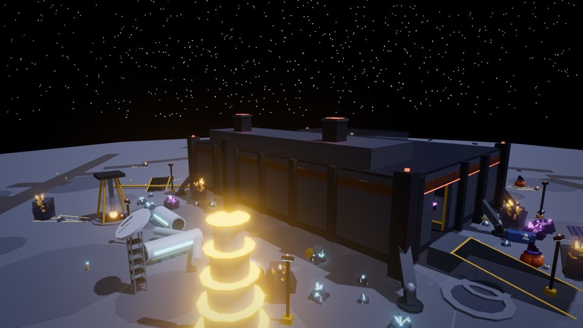
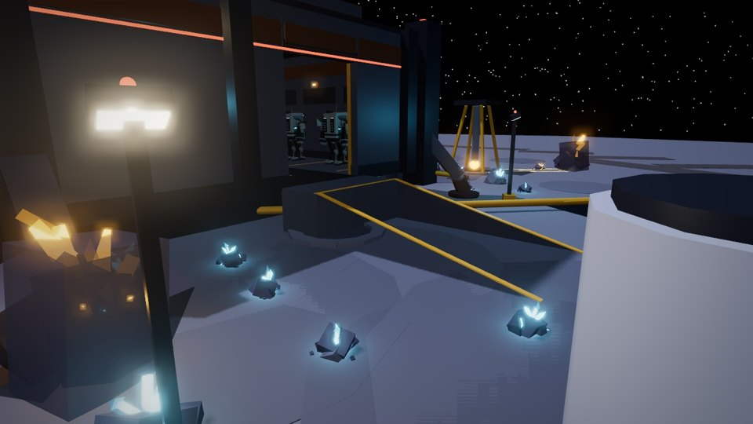
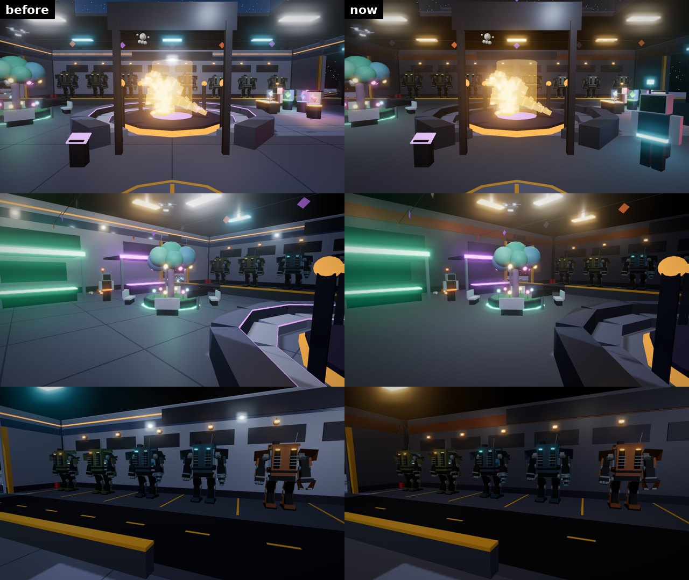
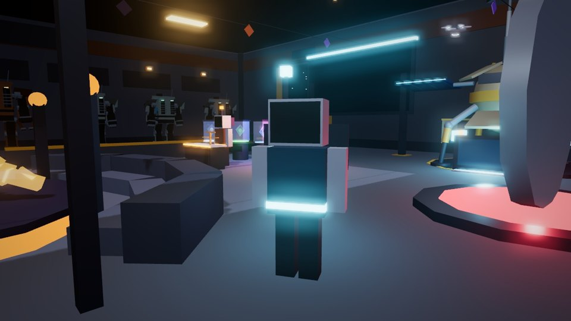

# The FOB as a barracks: legs, ramps, a worn interior and INFO-9

The Saga Shelter (the FOB players arrive in) is rebuilt in the spirit of a
Terran barracks: an armoured block standing on landing legs, ramps down from
its doors, a darker and more worn inside, and an info rep who answers
questions and hands out tips.

The pictures here are offline renders of the parts the server builds
(`Server/World/OutpostWorld`, exported with Lune and drawn in three.js). They
are stand-ins, not Roblox screenshots: sign text isn't drawn and the lighting
is an approximation of the game's.

## Outside

- **Up on legs.** The floor stands `Shared.Outpost.ShelterLift` (8) studs
  over the quarry floor. Eight landing legs hold it up: one from each corner
  tower, one from each side's middle rib and two from the front. Each leg
  is a heavy thigh from high on the wall down to a steel knee, a yellow
  piston from under the floor's edge, and a shin down to a broad pad. Under
  the middle sits a keel, set 12 studs in from the walls, so the legs stand
  clear in open shadow and nobody can get in under the hall.
- **Armour, rust and red lights.** The walls are dark gunmetal plate. A band
  of rusted plate runs under the roof, with more rusted plates set into the
  front. Red running lights run along the front and sides, and each corner
  tower has a red beacon. The pale walls, glass window bands and orange neon
  trim are gone.
- **A gatehouse.** The main door sits in an armoured gatehouse out over the
  landing: two piers lit red down their inner edges, a lintel and a sloped
  brow. The SAGA SHELTER sign above it now reads "Forward Operating Base".
- **A second storey.** An armoured upper deck sits over the garage, with
  two exhaust stacks glowing red on top.

## Ramps

- **The main ramp.** It runs from a landing at the door down to the quarry:
  38 studs wide and `ShelterRamp` (40) studs long, with hazard stripes down
  its sides and red beacons at its foot. The giant pumpkins now stand on the
  ground either side of the landing.
- **The garage ramps.** One runs from each garage door (east and west), 24
  studs wide, so the mechs drive straight out of the lane and down. The
  slope is lift + 0.8 over 40 studs (about 0.22), gentle enough that a
  mech's hull never catches. `tests/mech_pilot_cases.luau` drives a mech up
  this slope straight on, up it at an angle, and back down. The same test
  with an 8-stud ramp gets the mech caught, so the check really does test
  the slope.
- **Clear around them.** Rocks, wild kaiju (`site.KeepOut`) and the welcome
  rocks keep off the ramps and away from the legs' feet. The welcome rocks
  now flank the main ramp and its foot. One crater moved off the ramp, and
  the fuel tanks moved out of the east ramp's path.

## Inside

The inside is working kit, not a showroom:

- matte concrete underfoot (no pale polished tiles or seams);
- plate walls with the rusted band;
- warm work lights instead of cold white panels;
- the stands are plain plate, without the violet neon edges;
- the skylight is dulled and tinted, without the orange trim.

The Outpost's metal sheen (`Client.Scenes.OutpostFinish.Specular`) drops
from 0.35 to 0.18. The arena's glow, the hologram, the Store and Market
colours and the Halloween decorations stay.

## INFO-9, the info rep

*Since then (2026-10-20): INFO-9 and the crew talk like base staff, INFO-9 has 41 field tips and a "Threats and safety" topic, and the crew wear visors instead of faces. See [fob-serious.md](fob-serious.md).*

INFO-9 (`Shared.Vendors.InfoBot`) is a robot built like the rest of the crew.
It stands by an INFO kiosk between the arena and the door, facing where
players arrive. Talk to it (E) for:

- **Give me a tip.** One of 15 tips and insights (`Vendors.Tips`), in turn
  from a random start. Topics include:
  - richer rocks further out;
  - the Rift Veins;
  - healing with a kaiju's own element;
  - AUTO HEAL's order;
  - battle rows for Razorbacks and for Bulwarks and Carapaces;
  - win streaks;
  - skins being looks only;
  - selling spares safely;
  - mechs on the ramps.
- **Mining and gems.** How mining works, the odds (60 / 25 / 11 / 3.5 / 0.5),
  why to mine further out, and what to do with spare gems.
- **Kaiju.** How they fight, how to heal them, what happens when one is
  knocked out, and how kaiju battles work.
- **Swings, mechs and more.** Running out of swings, catching kaiju, driving a mech,
  and what invites give.

A topic is an option with `Options` of its own. The dialogue
(`Client/Dialogue.client.luau`) shows a topic's questions in place of the
menu, with a Back button, so no menu ever runs past five rows on a phone.
The answers keep to the rules as they stand (`Shared.GemRoller`,
`Shared.Kaiju`, `Shared.Frontier`, `Shared.Coupons`), so if those change,
change these too. Every line and tip is in Spanish (`Shared.LangEs`).

## Where things are

- `Shared.Outpost.ShelterLift` and `ShelterRamp` set the height and the ramp
  length. The server hands `Shared.Outpost` to `OutpostWorld.Rules`, and the
  offline tests hand it in too. The client mounts the Shelter's life
  (`ShelterLife`, `StoreDisplays`) in the raised frame.
- `site.Shelter` now carries `Lift`, `Ramps` (each footprint and its slope's
  half width, the main door's first) and `Feet`.
- The Outpost scenery stays under its part budget: 3,976 of 4,000. Trimming
  the floor seams, neon bands, stand trim, some lane marks and two bunting
  flags per strand paid for the legs, ramps, deck and kiosk.

## Tests

| Suite | What it checks |
| --- | --- |
| `run_moon_quarry_scene` | Spawn on the raised floor; three solid ramps at the rules' slope, from the floor to the ground; all eight feet on the ground; no rock on a ramp; welcome rocks beside the ramp or past its foot; mech bays and cockpits relative to the floor; the matte finish |
| `run_mech_pilot` | Up the ramp, up it at an angle, back down |
| `run_outpost` | The crew of six (the OG five and INFO-9) on the raised floor; topics fit the dialogue; every INFO-9 line has Spanish |
| `run_shelter_life`, `run_store_displays` | Built in the raised frame, as the client does |
| `run_quarry_life` | The lifter clears the taller Shelter |
