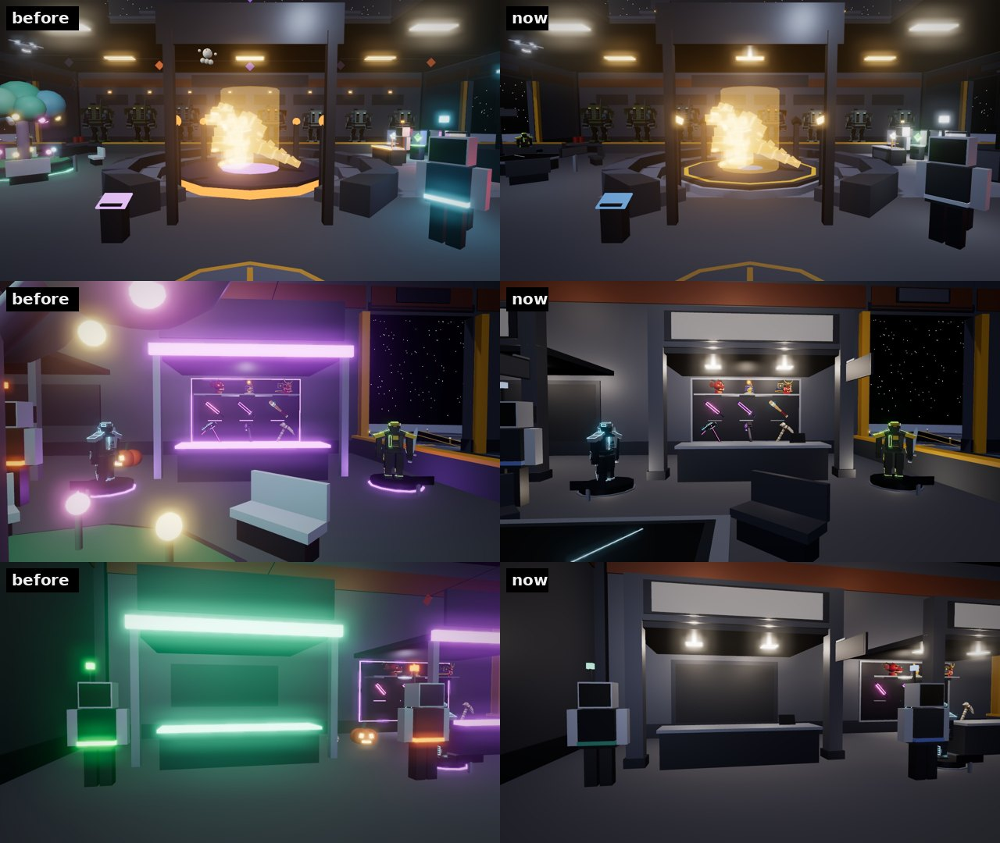
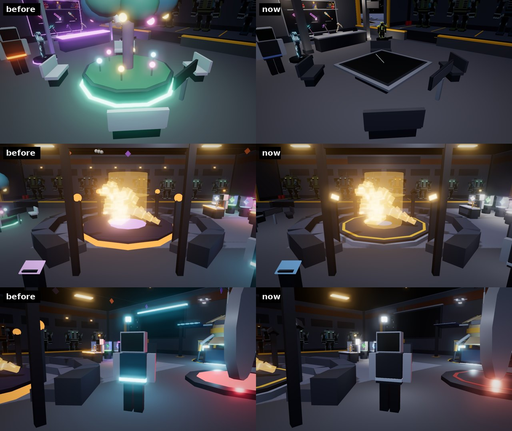
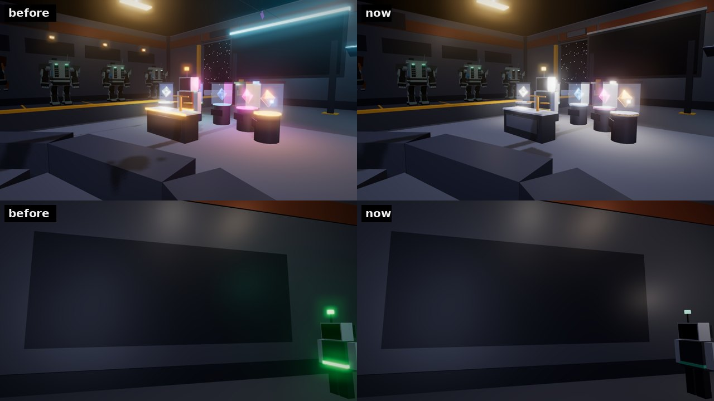
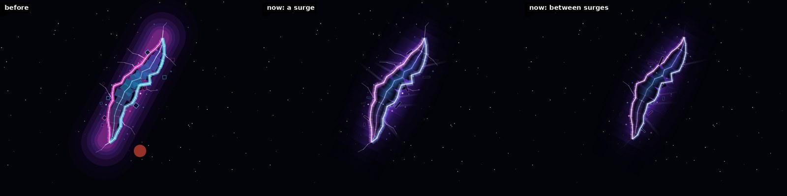

# The FOB as a working base: serious crew, real shopfronts, one sign system, an empty sky

*Since then (2026-10-22): plain one-word signs, and the Shelter's floor cleared (no PROBE-7 station, duel gate, stands or survey table; PROBE-7 and Brutus are crew; the Gem Gallery is next to the Market). See [plain-signs.md](plain-signs.md).*

The Saga Shelter (the FOB players arrive in) read as friendly and a bit
generated: neon-violet and neon-green booths, a candy-coloured tree with
glowing fruit, bunting and ghosts, emoticon faces on the crew, chirpy
lines and taglines strung together with dots. This round makes it a
working base in the spirit of a Terran outpost: plain materials, warm work
light, one sign system, staff who talk like staff, and nothing in the sky
but stars and the rift.

The pictures are offline renders of the parts the server and client build
(`Server/World/OutpostWorld`, `Client/ShelterLife`, `Client/StoreDisplays`,
exported with Lune and drawn in three.js; the rift from `Client/SkyRift`'s
own GUI, drawn in a browser). They are stand-ins, not Roblox screenshots:
sign text and the survey map aren't drawn in the 3D renders, and the
lighting is an approximation of the game's.

## The direction

- **Materials, not glow.** Gunmetal plate, steel, concrete, dark glass.
  Neon is kept for things that really are lights (lamps, the hologram, the
  refill cells, the Uplink's field), never for trim.
- **One sign system** (`signPanel` / `signFace` in OutpostWorld). Every sign
  is a dark face in a steel frame, a bar of its station's colour down the
  left, the name in warm-white condensed capitals (Oswald) and one plain
  line under it in grey. No taglines of keywords strung with dots.
- **Station colours are markings.** Each station has one colour, used for
  its signs' bar, its lightbox block, its crew member's visor and belt, and
  nothing else (`OutpostWorld`'s `STATION`, the same in `Shared.Vendors`):

  | Station | Colour |
  | --- | --- |
  | Store (Saga Outfitters) | steel blue |
  | Market (Miners' Market) | teal |
  | Gem Buyer | pale gold |
  | Arena | signal red |
  | Information | neutral white |
  | Quarry, garage | hazard yellow |
  | Exits | green |

- **The season stays outside.** Two giant pumpkins at the foot of the
  landing and the pumpkin patches in the quarry. Inside, the base is all
  business.

## The shops

The Store and the Market are now **shopfronts**, built alike
(`storefront` in OutpostWorld):

- an alcove in the west wall with a ceiling, behind a steel portal of two
  columns and a fascia;
- on the fascia, a **lightbox**: dark lettering on a lit warm-white face,
  the station's colour in a block beside the name ("SAGA OUTFITTERS",
  "MINERS' MARKET");
- a double-sided **blade sign** ("STORE", "MARKET") standing out from a
  column, so the shop reads from down the hall;
- a counter with a brushed steel top and a till (a small screen with the
  station's colour across its top);
- two warm downlights in the ceiling. The violet and green neon strips,
  coloured point lights and glowing counter tops are gone.

The Store's stands (`Client.StoreDisplays`) lost their violet: the back
wall is framed in steel and washed in warm light, the plinths have steel
collars, the turntables steel rims and a warm light, and the price plates
use the Store's blue.

Behind the Market's counter, the big "PLAYER MARKET / GEMS AND GEAR FROM
EVERY MINER" banner is replaced by the **escrow lockers**: a wall of 24
numbered doors, each with a handle and a status lamp, where sold gear waits
for its buyer.

PROBE-7 keeps its shape. Its wings lost their cyan neon edge, its screen's
light is softer, its turning name is in the sign face, and its screen reads
"PROBE-7 / SWING REFILLS". The leaderboard is "MINER STANDINGS" in the same
style (grey headings, a colour bar per column), its cyan neon bar now steel.

## The hall

- **The survey table** replaces the Moon Garden (`surveyTable`). A low
  steel table with the quarry's survey under its glass: the crater wall,
  the Edge and the Fringe as rings at their real distances
  (`Shared.Frontier`), the Shelter in the middle, "QUARRY SURVEY" in the
  corner. A scan line sweeps round it (`ShelterLife`, once every
  `SweepTurn` seconds). The four benches stay, in steel.
- **The kaiju arena** is a steel stage with a hazard line round its edge
  (no orange neon disc or violet floor glow), floodlights on its pylons
  instead of glowing balls, and the projector's lens in the middle. Its
  sign says "KAIJU
  ARENA / CHALLENGE FROM ANY MINER'S CARD" (it said "COMING SOON"), and the
  hologram's line no longer says the arena opens soon.
- **Gone:** the bunting, the ghosts over the arena, the pumpkins by the
  booths and the door, the jack-o'-lanterns over every bay, the cobweb,
  the bats, the witch's hats and the string lights. The pendant lamps over
  the arena are industrial shades instead of glowing balls.
- **The arrival rose** is painted on the floor, no light at its heart.
- **The Uplink** keeps its gate, with a red ring painted on its pad
  instead of a pink neon disc, a quieter field and a softer light.

- **The Gem Gallery**: the plinths' neon rings are steel collars with a
  thin band of the rarity's colour, and the cases are lit from the cap in
  white like a museum case, so the gem gives the colour. Its heading reads
  "GEM GALLERY / MINING ODDS BY RARITY". Ilsa's desk lost its glowing edge.
- **The field guide** (was "HOW IT WORKS") on the wall by the door: six
  numbered rows, the subject in its station's colour:

  | | | |
  | --- | --- | --- |
  | 01 | QUARRY | Every rock you break yields one gem. |
  | 02 | FRONTIER | Luck rises past 150 studs. So does rift activity. |
  | 03 | KAIJU | Your team fights beside you. Heal them once clear. |
  | 04 | SWINGS | Arena Uplink win streaks restore swings. |
  | 05 | MECHS | Bays 01 to 08. Exit by either garage door. |
  | 06 | QUESTIONS | INFO-9, by the arena. |

- **Signs, rewritten** (no "·" lists, no exclamation):

  | Where | Before | Now |
  | --- | --- | --- |
  | Over the door, outside | SAGA SHELTER / FORWARD OPERATING BASE · MECH GARAGE · STORE · MARKET | SAGA SHELTER / FORWARD OPERATING BASE 07 |
  | Over the door, inside | TO THE QUARRY / MINE ROCKS · KITE CRITTERS · CATCH KAIJU | QUARRY ACCESS / RIFT ACTIVITY BEYOND 150 STUDS |
  | Garage | MECH GARAGE / HOP IN AT ANY BAY · DRIVE OUT EITHER DOOR | MECH GARAGE / BAYS 01 TO 08, EXIT BY EITHER GARAGE DOOR |
  | Bays | BAY 1 | BAY 01 |
  | Uplink | 1V1 ARENA UPLINK / WIN STREAKS RESTORE YOUR SWINGS | ARENA UPLINK / RANKED 1V1 DUELS |
  | Gem Buyer | GEM BUYER / COINS FOR YOUR SPARE GEMS | GEM BUYER / SPARE GEMS BOUGHT AT MARKET RATE |
  | Kiosk | INFO / FAQS · TIPS | INFORMATION / INFO-9 |

The scenery is lighter for it: 3,711 parts against the 4,000 budget (it was
about 3,976).

## The crew

- **Uniform.** Every crew member wears the same charcoal tunic; their
  station's colour is a painted belt and a **visor** (one slit across the
  screen, brightest in the middle) instead of an emoticon face (`^_^`,
  `$_$`, `o_O`). `Builder.vendor` draws the visor when a vendor has
  `Visor`. Nameplates are Gotham (name in white, role in the station
  colour) instead of the arcade pixel font. They're small tags, the same
  size on a phone as on a computer: the name at 14 px over the role at
  11 px, gone past 50 studs (*2026-10-27*; they had filled a 220 by 54
  box with scaled text, too big on a phone).
- **The dialogue box** has the game's window look (`IronUi.window`): navy,
  a hairline edge, the speaker's colour as a short bar under the name, the
  words in plain Gotham in an inset. The purple gradient, the thick gold
  border, the green terminal text and the "►" on every reply are gone.
- **Their lines.** Staff on a working base: short, plain and exact, no
  jokes and no exclamation marks. Every fact is checked against the rules
  (and `tests/outpost_cases.luau` checks every INFO-9 line has Spanish).
  For example:
  - Ilsa: "Ilsa, gem buyer. I grade loose gems and pay coins on the spot,
    at the Market rate. Gems your loadouts use are never part of an offer."
  - Brutus: "Brutus, arena master. The Uplink runs ranked 1v1 duels.
    Consecutive wins restore your swings; one loss resets the count."
  - Garrick: "The quarry is through the main door. Every rock you break
    yields one gem. The richer ground is farther out, and so is the rift
    activity."
  - Ilsa's offer: "Spare Commons: 12. My offer: 96 coins."

## INFO-9

INFO-9 is "INFO-9, base information. Choose a topic, or ask for a field
tip." Its topics (four questions each, so with Back they fit five rows):

- **Give me a field tip**: one of **41** tips (was 15), in turn from a
  random start, in five groups: mining, threats, kaiju, combat and the
  base. New ones cover gem raids, trips, what can be stolen, the Core
  keeping your gems safe, lobby healing, health outlines, catching,
  wandering rifts and Rift Charged, perfect hits, parries, element
  matchups, sparring, the Store's turning stands, mechs and daily
  challenges.
- **Mining and gems**: how mining works, the odds, why mine farther out,
  spare gems.
- **Kaiju**: how they fight, healing, knock-outs, catching.
- **Threats and safety** (new): rift critters, gem raids, recovering
  health, running out of swings.

One stale tip is gone: "A Star Geode brings luck of its own" (only
Regolith Chunks and Crystal Boulders grow in the lobby).

## The sky

- **No planets.** The gas giant, the blue home world and the red moon are
  gone from `OutpostWorld`'s sky: it is only the 260 stars on their dome,
  and the rift. `tests/sky_rift_cases.luau` checks nothing else comes back.
- **The rift, redrawn** (`Client.SkyRift.draw`; the shape, timing and
  tests are the same):
  - its glow is three long soft bands, each fading out to both sides and,
    in eleven slices, to both ends, instead of seven hard-edged rounded
    rings (no banding, no blob at the ends);
  - one light: the rift's violet, from deep in the black to white-hot at
    the tear, its torn sides a shade warmer and a shade cooler instead of
    hot magenta against cyan;
  - the edges are a soft glow round a white-hot line;
  - inside, a nebula flows down the tear, soft across its width (dark at
    the torn edges, brightest down the middle), with a soft white filament;
  - seven faint shafts of light break out sideways;
  - the shards are dark slivers of the sky lit only along their rims,
    each its own long shape, instead of outlined squares.

## Spanish

Every crew line, INFO-9 answer and tip is in `Shared.LangEs` (111 lines).
World signs stay in English, as before (the client's translator only sees
the player's screen).

## Tests

- `tests/shelter_life_cases.luau`: the survey table, its map and four
  benches, and the scan going round just over the glass (was the garden's
  fireflies); drones clear of the pendants.
- `tests/sky_rift_cases.luau`: no planet in the sky, the sky only stars.
- `tests/outpost_cases.luau`, `run_store_displays`, `run_moon_quarry_scene`
  (3,711 parts), `run_lang` pass.
