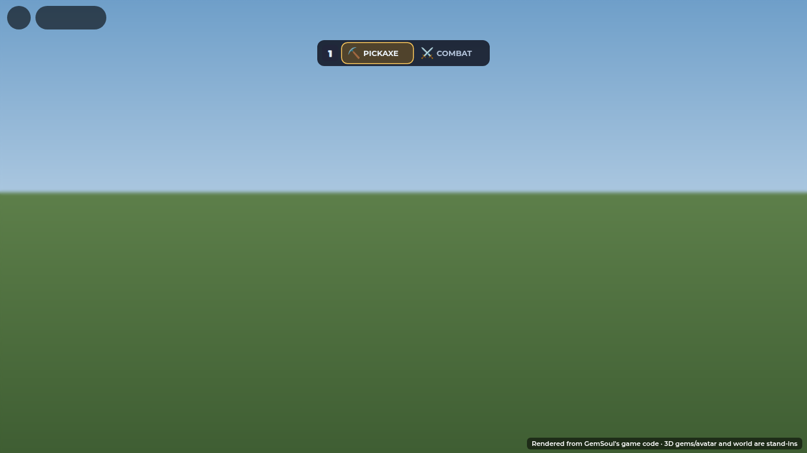

# Friendly sparring

In the Outpost, press **1** to swap your pickaxe for your combat kit. Press 1
again to put it away. On a gamepad it's D-pad up, and on a phone you tap the kit
bar. With your kit out you fight exactly as in a duel: first-person view, every
move, your gear and gems. The difference is that only other players who also
have their kit out can hit you or be hit by you. Anyone still holding a pickaxe
is left out of it completely.

The kit bar sits at the top center and shows which one is in your hands:

Swapping flashes the kit's name, with a draw or sheathe sound:

While you spar, the lobby HUD, mining hint and Outpost prompts step aside, and
the fight HUD takes over. For the first few seconds a line under the bar
explains the rule:

## Nobody dies

A blow that would take you to 0 health knocks you down instead. You fall, the
screen tints red, and it counts down who did it and when you're back up:

Three seconds later you get up where you fell. You're at full health with a
1.5 s guard, so nobody can knock you straight back down. A downed player can't
hit or be hit. The player who landed the blow gets a banner, and anyone nearby
(within 90 studs) sees a short toast:

## Putting it away

You can't sheathe in the middle of an exchange. For 3 s after you're hit, and
while you're down, 1 answers *Still in the fight: put it away in N s.*

The kit goes away by itself whenever sparring stops making sense:

- you leave the Outpost;
- an Arena session, match, dungeon or expedition starts;
- you sit in a seat or climb into a machine;
- you respawn;
- you leave the game.

If you were knocked down at that moment, you're healed first, so nobody walks
off at 1 health.

The kit can't come out until you've finished the starter intro, while you're
seated, or while another fight is on. The reply tells you why.

Putting the kit away always hands the mouse back, free and showing, with
the camera back in third person. While your kit is out, Shift belongs to the
fight (Shift + click is the off-hand attack), so it can't also switch on
Roblox's Shift Lock behind the first-person view. That used to leave the mouse
locked in the middle of the screen once the kit was away.

On a phone the key cap is hidden and the bar is the button:

Other players with their kit out show a small ⚔ over their heads, but only
while yours is away. Once you're sparring, the fight HUD's own targeting takes
over.

## How it's built

| Piece | What it does |
| --- | --- |
| `src/shared/Spar.luau` | The rules, as pure functions: who can hit whom, why the kit can't come out, how long before it can go away |
| `src/server/Systems/SparServer.luau` | The `Spar` request (on/off), the knock-down in place of a death, getting up, and putting the kit away automatically |
| `CombatServer` | `canPvP` follows `Spar.canHit` for sparring players; a lethal blow asks `onSparLethal` first; a downed player's input is ignored. Sparring counts as equal ground (no tree perks), as in the Arena |
| `OutpostServer` | No mining with the kit out, and no social prompts on a sparring player |
| `src/client/Modules/SparKit.luau` | Key 1 / D-pad up, the kit bar, the swap flash, the knocked-down overlay and fall, the KO banner and toast, the ⚔ badge |
| `Combat.client`, `TargetLock`, `BodyPoses`, `FighterSpacing`, `FightSpacing` | Treat a spar as a fight: first-person view and HUD, lock only onto sparring players, face your foe, no jumping (Space is dodge) |

Player attributes: `Spar` (kit out), `SparDown` (server time you get back up),
`SparHurt` (server time you were last hit).

## Verification

`tests/run_spar.py` runs the real `CombatServer` and `SparServer` with service
mocks. Its 56 checks cover:

- the rule matrix;
- miners neither hitting nor being hit;
- teammates sparring;
- real blows landing;
- the sheathe lock;
- the knock-down (including the message's names);
- a downed player neither hitting nor being hit;
- getting up at full health;
- every automatic put-away: leaving, an Arena session, a seat, a respawn;
- healing on leaving while down;
- no jumping.

The screenshots above are rendered from `SparKit`'s own UI code.

Not yet playtested in Studio. Check these in a two-player test:

- the fall and get-up physics;
- the switch in and out of first person;
- that a miner's click near a spar never lands.
