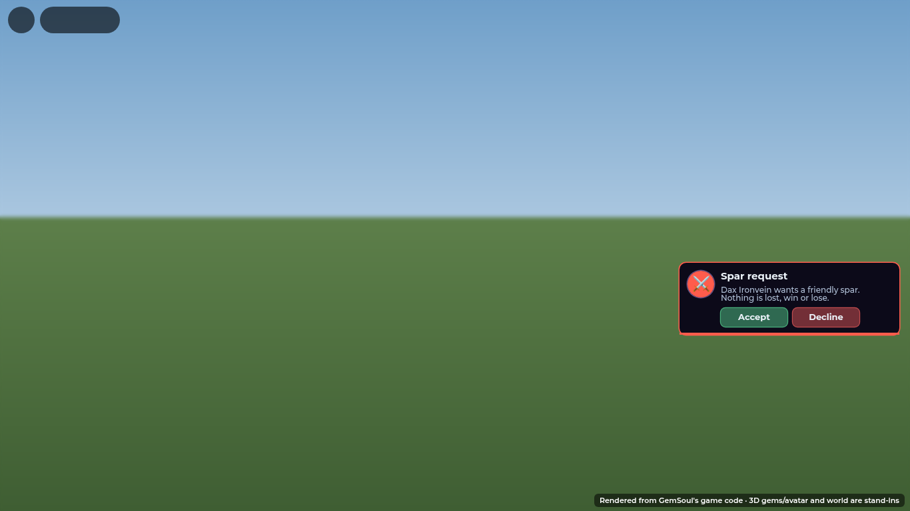
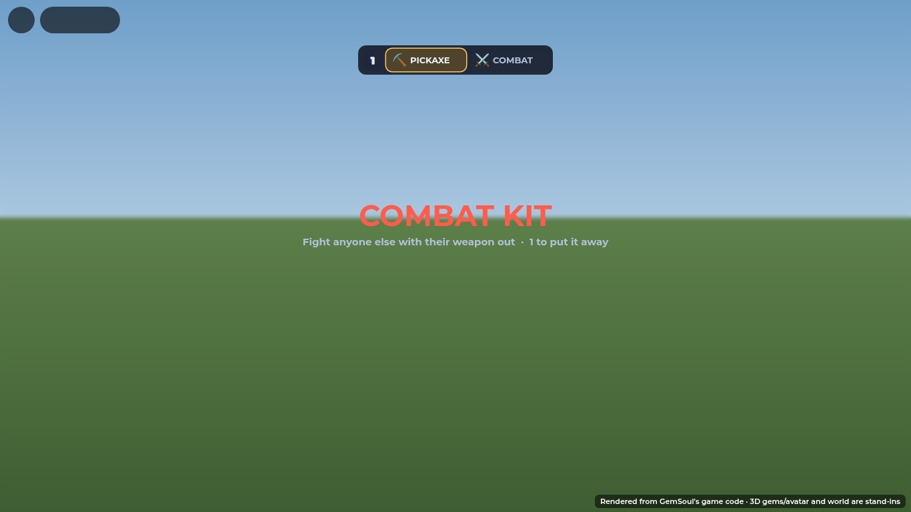
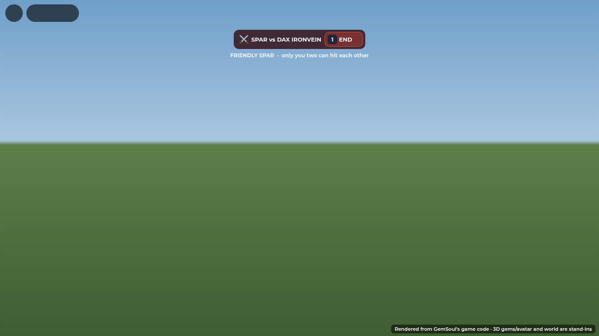
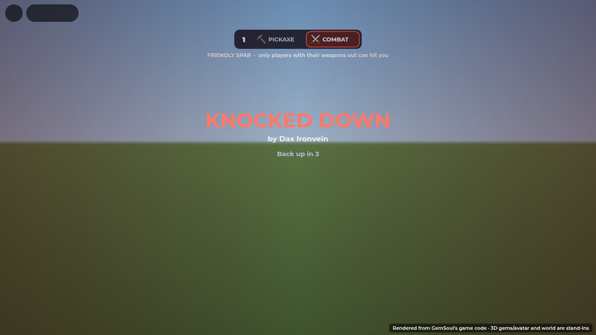
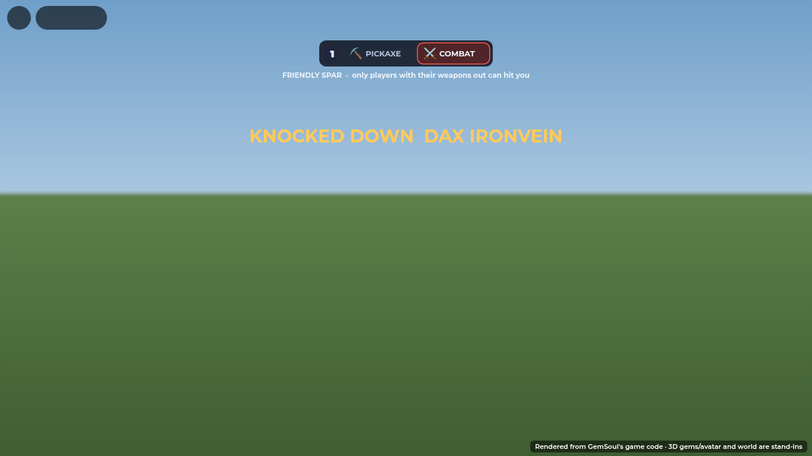
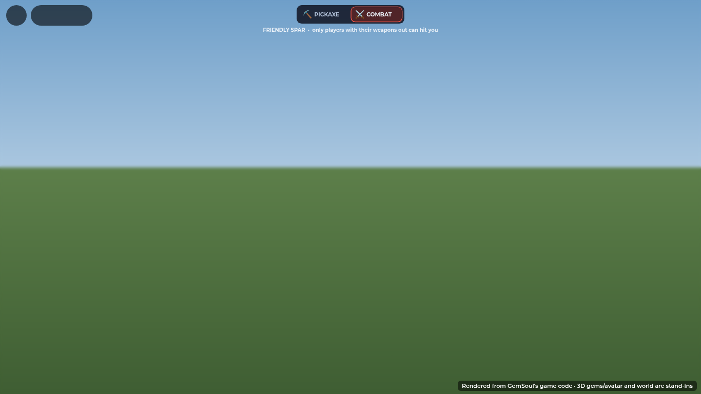

# Friendly sparring

In the Outpost you can spar with another player, but only if you both agree.
There are two ways to ask:

- **Press Z** ("Ask to spar") over the player. On a gamepad it's Y; on a
  phone, tap the prompt.

**1** is your kit switch: it takes your combat kit out to fight critters and
wild kaiju beside your kaiju (**KIT OUT**: only creatures can hit you), and
puts it away again for your pick (**MINE**). On a gamepad it's D-pad up; on a
phone, the **FIGHT / MINE** button just left of PLAY (it stays there with your
kit out, and the fight's health bars keep to its right). It works the
same in the Outpost and in the Rift, but not while you're down. In a spar, 1
ends the spar.

The other player gets a card with Accept and Decline. It stays up for 20
seconds:

When they accept, both of you swap your pickaxes for your combat kits. There's
no switch to press: the kit comes out when a spar starts and goes away when it
ends. You fight exactly as in a duel: first-person view, every move, your gear
and gems. The difference is that **only the two of you** can hit each other.
Nobody else can hit either of you, or be hit by you, whether they're mining or
in a spar of their own.

When the spar starts, you see your partner's name, with the sound of a
blade being drawn:

While you spar, the lobby HUD, mining hint and Outpost prompts step aside, and
the fight HUD takes over. A bar at the top center says who you're fighting,
with END (the 1 key, or click it). For the first few seconds a line under it
gives the rule:

## Asking and answering

- **A no.** If they decline, you're told, and you have to wait 15 seconds
  before asking them again.
- **No answer.** The request lapses after 20 seconds, you're told they
  didn't answer, and the same 15-second wait applies.
- **Asking each other.** If you both ask, that counts as a yes and the spar
  starts straight away.
- **One open request per person.** You can't send a second request while the
  first is still open, and there's a 1.5 s gap between any two requests.
- **Only nearby players.** You can only ask someone within 30 studs.
- **Only free players.** The other player has to be in the Outpost, free (not
  in a fight, a seat or the starter intro), and not already sparring.
- **Several requests at once.** If several people ask the same player, the
  one they accept wins. The others are told that player is sparring with
  someone else, and their cards come down.
- **The asker gets busy.** If the asker starts another spar, enters a fight
  or leaves, their open requests are taken down.
- **A yes that can't start.** If someone accepts while they're in a seat, the
  accept is refused and the asker is told the spar couldn't start.

## Nobody dies in a spar

Only in the lobby (`Spar.knocksDown`: never with a `CombatSession`,
`MatchId`, `DungeonId` or `Expedition` on you). A fight that takes you out
of the lobby (a rival, a 1v1, a dungeon, an expedition) is fought to the
end as ever, even when you started it from the Outpost. A critter or a wild
kaiju in the Outpost doesn't knock you down either: its finishing blow
**kills** you, and you're robbed out past the core and back at base after
(**YOU WERE KILLED**: [frontier.md](frontier.md)).

In a spar, a blow that would take you to 0 health knocks you down instead. You fall, the
screen tints red, and it counts down who did it and when you're back up:

Three seconds later you get up where you fell. You're at full health with a
1.5 s guard, so nobody can knock you straight back down. A downed player can't
hit or be hit. The player who landed the blow gets a banner, and anyone nearby
(within 90 studs) sees a short toast:

## Ending it

Press **1** (or END on the bar) to end the spar. It ends for both of you, and
your partner is told. You can't end it in the middle of an exchange: for 3 s after you're
hit, and while you're down, 1 answers *Still in the fight: you can stop in N s.*

The spar also ends for both of you whenever it stops making sense for either:

- one of you leaves the Outpost;
- an Arena session, match, dungeon or expedition starts;
- one of you sits in a seat or climbs into a machine;
- one of you respawns;
- one of you leaves the game;
- you drift more than 150 studs apart.

The partner is told why. If either of you was knocked down at that moment,
you're healed first, so nobody walks off at 1 health.

Ending a spar always hands the mouse back, free and showing, with the camera
back in third person **where it was before the fight**: as far back, at the
same pitch, behind the way you're facing, and free to zoom again. Leaving
first person, Roblox's camera stays at its closest (6 studs in the Outpost,
not the 18 you arrive at), and a phone has no wheel to pull it back out, so
`FirstPersonCombat` holds the zoom at the old distance until the camera is
there, then lets go. The zoom you get back is the Outpost's own (6 to 40),
never the arrival camera's short hold at 18: a fight started while the
arrival camera was still settling used to keep that as the closest you could
zoom (`ThirdPerson.range`). While your kit is out, Shift belongs to the fight
(Shift + click is the off-hand attack), so it can't also switch on Roblox's
Shift Lock behind the first-person view. That used to leave the mouse locked
in the middle of the screen once the kit was away.

On a phone the key cap is hidden and END is the button:

Players in a spar show a small ⚔ over their heads, but only while you're not
sparring yourself. Once you are, the fight HUD's own targeting takes over, and
it only ever locks onto your partner. On desktop it doesn't lock by itself in a
spar: you aim with the mouse and press X to lock on (see
[target-lock.md](target-lock.md)).

## How it's built

| Piece | What it does |
| --- | --- |
| `src/shared/Spar.luau` | The rules, as pure functions: who can hit whom (`canHit`, `paired`), why you can't spar or ask (`startProblem`, `askProblem`), how long before a spar can end |
| `src/server/Systems/SparServer.luau` | Requests: `SparAsk`, `SparRespond`, and `Spar` with `false` to end. Open requests, waits and expiry; starting both kits; knock-downs instead of deaths; getting up; ending a spar for both, on request or automatically |
| `CombatServer` | `canPvP` follows `Spar.canHit` for sparring players: partners only. A lethal blow asks `onSparLethal` first; a downed player's input is ignored. Sparring counts as equal ground (no tree perks), as in the Arena |
| `OutpostServer` | The "Ask to spar" prompt (Z) on each visitor, beside Duel (G) and Party (F); no mining with the kit out, and no prompts on a sparring player |
| `SocialUI` | The Accept / Decline card (`SparAsk`), taken down when the request is withdrawn (`SparAskOver`) or once you're sparring |
| `src/client/Modules/SparKit.luau` | 1 / D-pad up (ask the nearest player, or end the spar), the spar bar (only while sparring: your partner and END), the flash when a spar starts or ends, the knocked-down overlay and fall, the KO banner and toast, the ⚔ badge |
| `Combat.client`, `TargetLock`, `BodyPoses`, `FighterSpacing`, `FightSpacing` | Treat a spar as a fight: first-person view and HUD, lock only onto your partner, face them, no jumping (Space is dodge) |

Player attributes:

- `Spar`: kit out.
- `SparWith`: your partner's UserId.
- `SparDown`: the server time you get back up.
- `SparHurt`: the server time you were last hit.

Social remote events (to the client):

- `SparAsk`: someone asks you to spar. It carries their UserId, name and the
  seconds the request stays open.
- `SparAskOver`: that request was withdrawn. It carries the asker's UserId.

## Verification

`tests/run_spar.py` runs the real `CombatServer` and `SparServer` with service
mocks. Its 153 checks cover:

- the rules, including request problems and pairing;
- asking (twice, too soon, too far, yourself, someone absent, garbage input);
- declining, the wait after a no, and asking again later;
- accepting, and asking each other;
- requests that run out;
- requests withdrawn when the asker takes another spar or enters a fight;
- two players asking the same one;
- a yes from a seat;
- partners fighting and nobody else: two spars side by side never cross, and
  miners stay out;
- real blows landing on the partner only;
- the sheathe lock;
- the knock-down, a downed player neither hitting nor being hit, and getting
  up at full health (with no guard once the spar is over);
- ending the spar for both;
- every automatic end: leaving, an Arena session, a seat, a respawn, drifting
  apart, leaving the game. Each of these ends it for both, with the partner
  told why;
- healing on an end while down;
- no jumping.

Every one of 12 deliberate breaks in the rules or the server is caught by
these checks.

`tests/run_target_lock.py` checks that the lock never takes someone sparring
with another player.

`tests/run_first_person.py` checks the way back out of first person: the
zoom held at the distance it had and let go once the camera is there, the
camera behind you at the pitch it had, the Outpost's own zoom range back
(not the arrival's hold), going back in before it got there (a knock-down),
and never stamping over a zoom something else set meanwhile.
`tests/run_arrival_camera.py` checks that a fight started while the arrival
camera is settling lets go of its hold.

The screenshots are rendered from the game's own UI code. That includes the
request card, from the real `SocialUI`, where Accept sends `SparRespond` and
a withdrawn request takes the card down.

Not yet playtested in Studio. Check these in a two- or three-player test:

- the Z prompt and the card;
- the fall and get-up physics;
- the switch in and out of first person;
- that a third player's click near a spar never lands.
