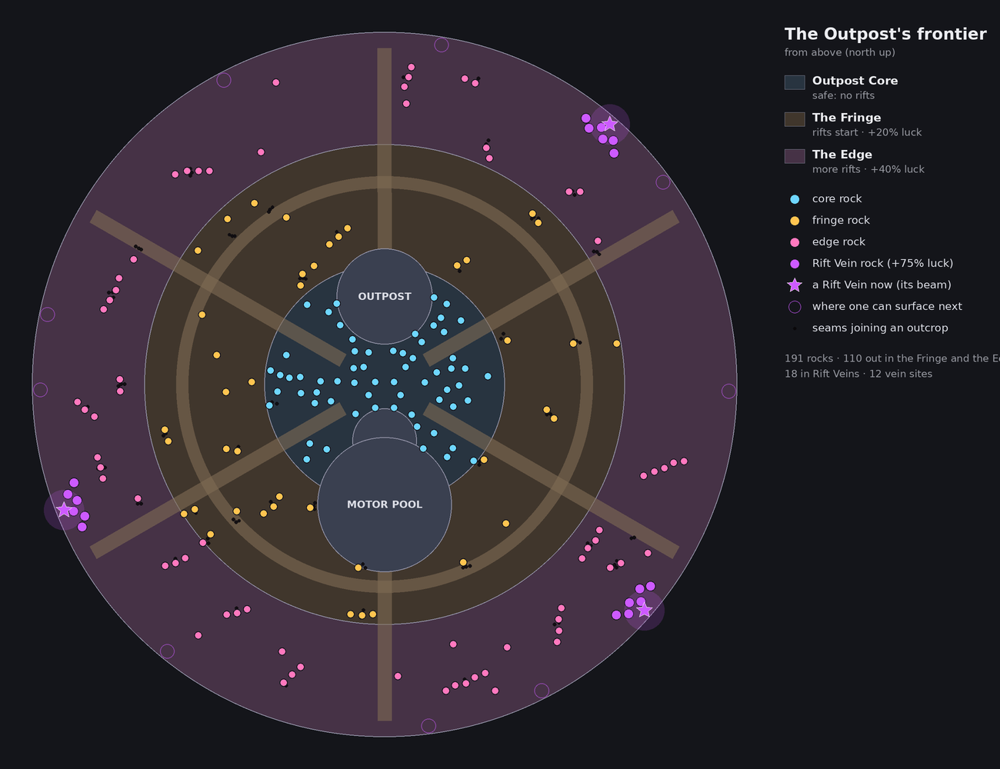
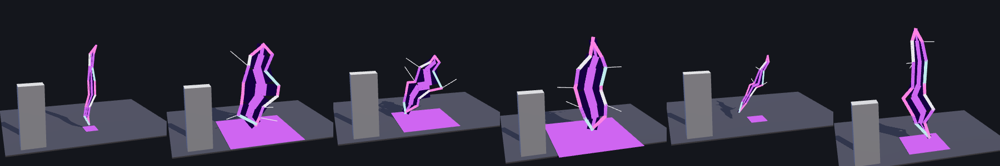
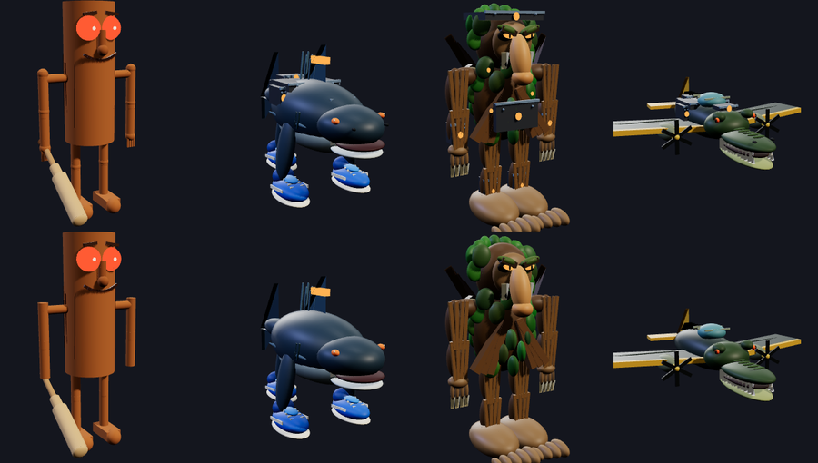

# The frontier

The Outpost gets more dangerous and richer the further out you go. Near
the outpost you're safe. Further out, the rocks pay better, but rifts tear
open in the air and the brainrot critters hop out of them at you. Out
there the rocks grow in outcrops, and three Rift Veins, the richest rocks
of all, glow by the walls and move on when they're mined out. You mine your
way out, kite what comes through, and run back in when it gets too hot.

## The three bands

Each band is measured across the ground from the middle of the Outpost.

| Band | From the middle | Rifts | Luck on every gem | Crystals |
| --- | --- | --- | --- | --- |
| **Outpost Core** | 0–150 studs | None: safe | None | Cyan |
| **The Fringe** | 150–300 | One or two critters at a time | +20% | Gold |
| **The Edge** | 300 to the walls | Two or three at a time | +40% | Rose |
| **Rift Vein** | Three spots by the walls | (in the Edge) | +75% | Violet |
| **Guarded vein** | One of the three | (in the Edge) | +110% | Red |

The rocks are the same everywhere: the lobby mix of chunks and boulders (62
to 38), with no Monoliths or Geodes. A boulder takes more swings for the
same one gem, so more boulders out there would only have made the frontier
slower. Going out pays in luck instead: it goes on top of the rock's own
luck on every gem it pays, so the outer rocks roll better gems. A rock's
label shows its band and luck, e.g. `THE EDGE · +40% LUCK`.

A gem's luck, all told, tops out at 100% (`GemGenerator`). So a Legendary
comes from about 5.6% of rocks in the core, 7.3% in the Fringe, 8.5% at the
Edge and 10.1% on a vein. On the guarded vein the cap takes most of the
extra 35%: 10.7%. Its guardian's Gemsoul and coins are the real prize.

When you cross into a band, its name and a line about it show at the top of
the screen in its colour. The same band's banner won't show again for 20
seconds, so walking back and forth across a boundary doesn't keep showing
it. Arriving in the Outpost doesn't show one.

## Outcrops

Past the core's rocks, from 100 studs out to 412, the rocks grow in
**outcrops**: 46 of them, at least 36 studs apart. An outcrop is a short
row of rocks (one every 13.5 to 15 studs) along a grain of its own, with
dark seams in the ground joining them, so you can see it's one outcrop:

- two or three rocks near the core, up to five out at the Edge;
- thicker on rich ground. Three soft waves of richness cross the quarry, a
  different way each server, so some stretches are crowded and others
  bare;
- about one rock in seven out there grows alone, between the outcrops. The
  first six of those lead out of the core, so the way out starts close.

Outcrops stay clear of the roads, the buildings, the motor pool and the
Rift Veins. A mined rock grows back in the same spot, so an outcrop stays
an outcrop.

## Rift Veins

Three **Rift Veins** glow by the walls. Each is six rich violet rocks in two
staggered rows round a **dormant rift**: a scar in the ground, a tear above
it that never opens fully, and a violet beam 180 studs tall that you can
see from anywhere in the Outpost.

A Rift Vein doesn't stay put:

- **its rocks don't grow back.** When the last of its six goes, it moves on
  a few seconds later;
- **if nobody mines it out, it moves anyway**, every 10 minutes or so (give
  or take a minute). While someone is mining it, it waits for them (another
  20 seconds at a time);
- it surfaces at one of 12 places round the walls, never one another vein
  has, and at least 70° round from the other two, so they stay spread out.
  Fresh rocks grow there, and its scar, tear and beam go with it;
- everyone in the Outpost gets a banner as it surfaces: **RIFT VEIN** "A
  Rift Vein surfaced to the north-east" (which way, from the middle).

So the richest rocks are always somewhere new to head for, and nobody can
camp them.

### The guarded vein

One of the three is **guarded**. Its rocks are red, +110% luck (+35% on
a vein's), and its beam is red, so you can tell it from afar. A wild kaiju
of level 16 to 20, a head taller than you, keeps a beat 30 studs in front of
it: pacing, sniffing about, napping. It looks over anyone who comes close
and roars at them now and then, but leaves them be. The first swing at its
vein stirs it, the second makes it roar, the third wakes it, and it goes
for the miners as well as their kaiju (a plain miner is
knocked down, not killed). Beat it or tame it and the vein is yours until
it moves on. A beaten guardian pays 40 coins on top of its Gemsoul. When
the vein moves, a fresh guardian sleeps at the new site, and the banner
says "A guarded Rift Vein surfaced to the …". The other two veins, and the
two packs of wild kaiju roaming the quarry for taming, stay open to
everyone. The rest
is in [kaiju.md](kaiju.md#the-vein-guardian).

## Rifts

Every critter comes through a rift of its own: a ragged tear in the air,
never symmetrical and never the same shape twice. A tear:

1. **opens and crackles** for a second and a half: it splits along a
   crooked crack, with the crackle and its critter's own sound (Sahur's
   bonk, Tralalero's whoosh, Patapim's frost, the croc's bomb), so you
   know what's coming and where;
2. **lets the critter out**: it hops out at whoever drew it;
3. **lingers** (1.8 s): a dark void with glowing lips and hairline cracks
   off them;
4. **seals** (half a second) with a last flash.

Rifts open 14–24 studs away, within 100° of where you're facing, on open
ground level with you: never on top of a boulder or a container stack (the
server tries a few spots). If one opens off your screen, an arrow at the
screen's edge points at it until its critter is out. They never open in the
core or past the walls.

### Mining noise

Mining is what draws critters, not standing about. Every swing out past
the core makes noise, and a little more trickles in each second you're out
there. The ring of twenty dots on the right of your screen shows it filling;
nearly full, it turns red.

| Where | An encounter about every | Standing about | Critters at once |
| --- | --- | --- | --- |
| The core | never | never | 0 |
| The Fringe | 30 to 40 swings | 7 minutes | 1 or 2 |
| The Edge | 15 to 20 swings | 3 minutes | 2 or 3 |

Each swing's share of the noise varies (60% to 140%), so encounters don't
come like clockwork, and the next can't come within 8 seconds of the last.
A mech's strike makes as much noise as the swings it spends, and its pilot
is fair game: a critter that knocks them down throws them out of the
cockpit. Back in the core, the noise dies down over a minute or so.

Caps: two critters at once on one player in the Fringe, three at the Edge,
twelve in the whole Outpost, shared fairly between everyone out there.
Critters still on their way through a rift count. If more would come than
the cap allows, only enough open to reach it. (Each critter is a whole
brainrot body, so the caps are kept low; see [Performance](#performance).)

No rifts open round you while you're sparring, knocked down, or in a fight,
a dungeon or an expedition.

### Wandering rifts

Every 40 to 80 seconds the frontier tears open by itself, 35 to 70 studs from
someone out there. Its tear lingers longer, and two or three critters roam
round it for a minute, going for anyone who comes within about 22 studs, and
for the player it opened near once they're within 30. Go round it, or bring
your kaiju. At most three critters are out of wandering rifts at once (of
the twelve). If nobody is near when they'd hop out, it seals empty.

Kill every critter from one and everyone who helped is **Rift Charged**:
gems 10% luckier for 60 seconds. A tag under the noise ring counts it down.

### The critters

They're the moon bugs from [kaiju.md](kaiju.md): the brainrot characters
shrunk down. One that came through a rift:

- is **level 1–4 in the Fringe and 9–13 at the Edge**, whoever is near, so
  the Edge is a real step up (a kaiju of about level 8 and up). Its level
  is on its nameplate;
- goes for whoever drew it, even a miner who isn't hunting, then for
  anything else close by (kaiju, hunters, other players out there);
- follows its prey up to 120 studs from its rift;
- gives up once its prey is back in the core (12 studs inside it), or is in
  a spar or a fight;
- with nobody to fight for 4 seconds, or after 90 seconds anyway, opens a
  rift of its own and slips back through it. Every critter does, even one
  nobody drew.

A critter's finishing blow doesn't kill you in the Outpost: it knocks you
down for a few seconds, as in a spar, and you get up healed.

Ones from the Edge are tougher: a quarter more health and a fifth more
damage.

What one pays:

- **EXP** for every kaiju that fought it: 6 + 2 per level, half again from
  the Edge, a quarter after your first 60 critters of the day. A kaiju
  left at home earns nothing.
- **Coins** for whoever did the most to it: 2 from the Fringe, 4 from the
  Edge, up to 300 a day.

### What you do about them

- **Let your kaiju handle them**: it fights them on its own.
- **Bonk them** with your pick: the mine button (or a click) hits a critter
  within 6 studs before any rock. Each bonk takes 12% of its health and
  knocks it back 10 studs, every 0.6 seconds, and costs no swings. A miner
  alone kills a Fringe bug in about 8 to 10 seconds.
- **Hunt**: press HUNT and fight them yourself.
- **Run back in**: past the core's edge they give up and go back through
  their rifts.

## Performance

The Outpost was already a big scene: about 8,600 parts, nearly 4,700 of
them in its ~190 rocks, each rock with its own light. Rifts added a stream
of creatures on top of that, and the Outpost lagged. What keeps it light:

- **Moon bugs are built light.** Each critter is a whole brainrot body, and
  rifts create and remove them every few seconds, so every one is sent to
  every player. Built for a dungeon, they were 121 to 214 parts each, every
  part casting a shadow. As moon bugs they wear no armour, lose the details
  too small to see at their size (grain, rivets, laces, spores; never the
  face), carry no lights, and only their bigger parts cast shadows: 66 to 179
  parts, about 20 to 50 of them casting shadows (`BrainrotSkins.thin`).
- **Fewer at once**: two round a player in the Fringe, three at the Edge,
  twelve in the whole Outpost (it was three, six and thirty), shared
  fairly, with critters still on their way counted.
- **Fewer encounters**: they come from mining, about 1 in 35 swings in the
  Fringe and 1 in 17 at the Edge, instead of every 5 to 10 seconds out there.
- **Only the rocks near you are lit.** Each rock's light is on within 70
  studs of the camera and off further out, where the crystals' neon still
  glows (`OutpostScene`). Instead of ~190 lights, about 13 on average (29 at
  most, in the busy core).
- **Creatures' joints are found once**, when a body arrives (and as streaming
  brings in the rest of it), instead of every creature's every part being
  re-read twice a second (`CreatureAnimation`).
- **Moon bugs are fully posed only within 100 studs** (220 for everyone
  else: `BodyPoses.BugRange`).
- **A dormant rift breathes 15 times a second**, not every frame, its light
  holds still, and its glow on the ground is placed once (`RiftTear`). An
  open one, which lasts three seconds, moves every frame.
- **A tear is only built near you** (within 220 studs): a rift across the
  Outpost costs your screen nothing (`RiftTear`).
- **A critter's death only blows up near you**: past 140 studs there's no
  blast at all, and a critter's is its 40 biggest pieces (`ElementalDeath`).
- **Bug joints are animated within 100 studs** (kaiju's within 180:
  `CreatureAnimation`).
- **One enemy's error doesn't stop the rest**: each thinks on its own, an
  error logged now and then (`Enemies`).

## In the code

| Where | What |
| --- | --- |
| `Shared.Frontier` | The rules: bands, colours and luck, the outcrops (`outcrops`, on rich ground: `field`), the Rift Veins' sites, rocks and moves (`veinSites`, `veinAt`, `pickSite`, `compass`), the guarded one and its guardian (`Veins.Guarded`, `Guardian`), pressure, how many come at once, where a rift opens, its timeline and openness, each tear's ragged shape |
| `Shared.Outpost` | The Fringe, Edge, Vein and Guarded zones (the same rock mix, more luck) |
| `OutpostWorld` | Lays out the vein sites, the outcrops and their seams, and the three Rift Veins before the rest of the field; a vein's scar, cracks and beam (`veinMarks`, the guarded one's red); crystals tinted by band (`rock(size, cframe, rng, tint)`) |
| `OutpostServer` | Grows each rock with its zone, tint and luck; a mined rock grows back in the same spot, except a vein's; moves a vein when it's mined out or its time comes (`moveVein`, `onVeinMoved`, and `VeinNews` on `workspace`); a swing at a vein's rock (`onVeinSwing`); every swing's noise (`onSwing`); the pick's bonk (`OutpostBonk`); Rift Charged luck |
| `FrontierServer` | Each player's band (`FrontierBand`) and noise (`FrontierNoise`), encounters, wandering rifts and Rift Charged (`RiftCharged`), the rifts in `workspace.Rifts` (anchors with `OpenAt`, `HopAt`, `CloseAt`, `EndAt`, `Seed`, `Height`, `Critter`, `Prey`; the scars carry `Dormant`, and move with their veins: `moveScar`) |
| `KaijuWilds` | `spawnBug`: a critter out of a rift at its level, at its prey (`prey`), roaming a wandering rift; slipping back (`rift`); its pay; `bonk`; the vein guardian (`veinSwing`, `veinMoved`) |
| `Duelist.creatureBody`, `BrainrotSkins.thin` | A moon bug's body: no armour, nothing too small to see, no lights, few shadows |
| `SparServer`, `CombatServer` | A critter's finishing blow in the Outpost knocks you down instead |
| `RiftTear` (client) | Draws each tear from its anchor: the lips, the void, the cracks, light, sparks and sound |
| `FrontierHud` (client) | The banner as you cross into a band or a vein surfaces, the noise ring, arrows to rifts off screen, the Rift Charged tag |
| `OutpostScene` (client) | The band and luck on a rock's label; the mine button bonks a critter close by |

Tests: `tests/run_frontier.py` checks the rules (bands and zones, the luck
going up band by band on the same rock mix, the outcrops (none on top of
each other, on their grain, bigger further out, inside the frontier, the
lone rocks and the stepping stones out of the core; the rich ground), the
vein sites and their rocks, picking a vein's next site, the compass, the
guarded vein's luck and its guardian's numbers, mining noise, fair
shares, critter levels and EXP, how many come at once, where rifts open (wandering ones too), the timeline, that tears are ragged and
lopsided, the pieces each tear is drawn from, the banners, the noise ring
and the arrows). `tests/run_kaiju.py` runs the server side: who rifts open
round, swings drawing them, the warning, the caps, edge levels, a pilot's
strikes, a critter hopping out at its prey (a miner too), giving up and
slipping back, a stray leaving, wandering rifts roaming and Rift Charged,
the pay, the bonk, rifts opening round a container stack rather than on
it, and the vein guardian; and builds every moon bug (`tests/moon_bug_cases.luau`:
its part and shadow budget, no armour or lights, nothing left hanging loose,
its whole face). `tests/run_outpost.py` and
`tests/run_moon_quarry_scene.py` cover the zones, luck, regrowth and the
built layout: the outcrops clear of the roads and buildings with room
round every rock, their seams, the three veins and their beams (the
guarded one's rocks and beam its own), a swing at a vein reaching its
guardian, and a vein moving (mined out or on time, not while it's being mined; fresh rocks, its
scar, the banner, nothing growing back where it was).
