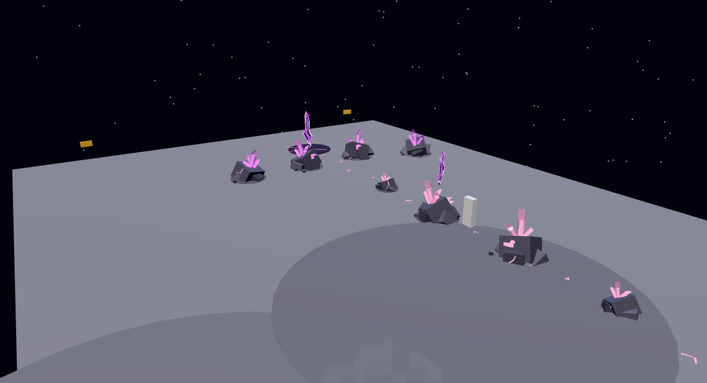
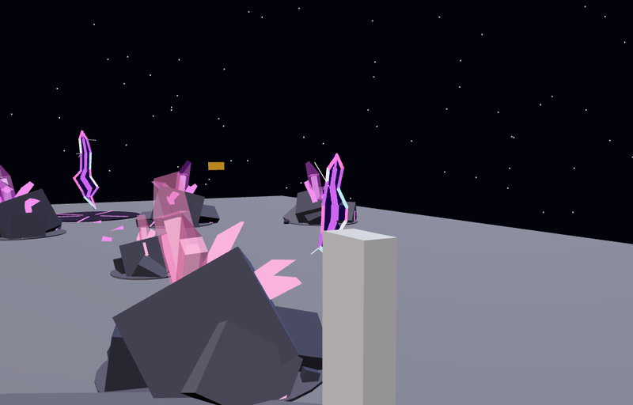

# The frontier

The Outpost gets more dangerous and richer the further out you go. Near
the outpost you're safe. Further out, the rocks pay better, but rifts tear
open in the air and the brainrot critters hop out of them at you. Candy
trails of rocks lead out to the walls, so mining pulls you outward. You
mine your way out, kite what comes through, and run back in when it gets
too hot.

## The three bands

Each band is measured across the ground from the middle of the Outpost.

| Band | From the middle | Rifts | Rocks | Crystals |
| --- | --- | --- | --- | --- |
| **Outpost Core** | 0–150 studs | None: safe | The lobby mix (chunks and boulders), no extra luck | Cyan |
| **The Fringe** | 150–300 | One or two critters at a time | Half chunks, half boulders, +8% luck | Gold |
| **The Edge** | 300 to the walls | Two or three at a time | More boulders (65%), +16% luck | Rose |
| **Rift Vein** | A trail's last four rocks | (in the Edge) | Mostly boulders (85%), +25% luck | Violet |

The luck goes on top of the rock's own luck on every gem it pays, so the
outer rocks roll better gems. There are still only chunks and boulders
everywhere: the lobby has no Monoliths or Geodes. A rock's label shows its
band and luck, e.g. `THE EDGE · +16% LUCK`.

When you cross into a band, its name and a line about it show at the top of
the screen in its colour. The same band's banner won't show again for 20
seconds, so walking back and forth across a boundary doesn't keep showing
it. Arriving in the Outpost doesn't show one.

## Candy trails

Six trails of rocks run out from the core to the walls, between the haul
roads and clear of the outpost and the motor pool. Each trail:

- has a rock about every 17 studs, from 80 studs out to 400, wandering a
  little either side;
- has glowing crumbs between its rocks, so you can see where it goes next;
- has crystals that change from cyan to gold to rose as you go out;
- ends in a **Rift Vein**: four rich violet rocks fanned round a
  **dormant rift**, a scar in the ground with a tear above it that never
  opens fully and stays.

A mined rock grows back in the same spot, so a trail stays a trail. The
rest of the rocks fill the field round the outpost as before.

## Rifts

Every critter comes through a rift of its own: a ragged tear in the air,
never symmetrical and never the same shape twice. A tear:

1. **opens** (half a second): it splits along a crooked crack, with a
   crackle and a flash;
2. **lets the critter out** (0.7 s in): it hops out at whoever drew it;
3. **lingers** (1.8 s): a dark void with glowing lips and hairline cracks
   off them;
4. **seals** (half a second) with a last flash.

Rifts open 14–24 studs ahead of you, up to 70° either side of the way you're
heading. They never open in the core or past the walls.

### Pressure

Rifts only open round a player out past the core. Each player has a hidden
pressure that builds every second they spend out there:

| Where | A second adds | Heading outward |
| --- | --- | --- |
| The Fringe | 0.8 | 1.28 |
| The Edge | 1.6 | 2.56 |
| The core | drains 2 a second | |

At 10, rifts open: in the Fringe, one (75%) or two; in the Edge, two (60%)
or three. They open a third of a second apart. Then the pressure
starts again from somewhere between 0 and 3, so the rifts don't come at
regular intervals. In the Edge, heading outward, that's every few seconds.
Standing still in the Fringe, it's about every ten.

Caps: two critters at once on one player in the Fringe, four in the Edge,
twelve in the whole Outpost. If more would come through than the cap
allows, only enough open to reach it. (Each critter is a whole brainrot
body, so the caps are kept low; see [Performance](#performance).)

No rifts open round you while you're driving a machine, sparring, knocked
down, or in a fight, a dungeon or an expedition.

### The critters

They're the moon bugs from [kaiju.md](kaiju.md): the brainrot characters
shrunk down. One that came through a rift:

- goes for whoever drew it, even a miner who isn't hunting, then for
  anything else close by (kaiju, hunters, other players out there);
- follows its prey up to 120 studs from its rift;
- gives up once its prey is back in the core (12 studs inside it), or is in
  a machine, a spar or a fight;
- with nobody to fight for 4 seconds, or after 90 seconds anyway, opens a
  rift of its own and slips back through it.

A critter's finishing blow doesn't kill you in the Outpost: it knocks you
down for a few seconds, as in a spar, and you get up healed.

Ones from the Edge are tougher: a quarter more health, a fifth more damage,
and half again the EXP for your kaiju.

### What you do about them

- **Kite them** into your kaiju: it fights them on its own.
- **Hunt**: press HUNT and fight them yourself.
- **Run back in**: past the core's edge they give up and go back through
  their rifts.

## Performance

The Outpost was already a big scene: about 8,600 parts, nearly 4,700 of
them in its ~190 rocks, each rock with its own light. Rifts added a stream
of creatures on top of that, and the Outpost lagged. What keeps it light:

- **Moon bugs are built light.** Each critter is a whole brainrot body, and
  rifts create and remove them every few seconds, so every one is sent to
  every player. Built for a dungeon, they were 121 to 214 parts each, every
  part casting a shadow. As moon bugs they wear no armour, lose the details
  too small to see at their size (grain, rivets, laces, spores; never the
  face), carry no lights, and only their bigger parts cast shadows: 66 to 179
  parts, about 20 to 50 of them casting shadows (`BrainrotSkins.thin`).
- **Fewer at once**: two round a player in the Fringe, four at the Edge,
  twelve in the whole Outpost (it was three, six and thirty).
- **Only the rocks near you are lit.** Each rock's light is on within 70
  studs of the camera and off further out, where the crystals' neon still
  glows (`OutpostScene`). Instead of ~190 lights, about 13 on average (29 at
  most, in the busy core).
- **Creatures' joints are found once**, when a body arrives (and as streaming
  brings in the rest of it), instead of every creature's every part being
  re-read twice a second (`CreatureAnimation`).
- **Moon bugs are fully posed only within 100 studs** (220 for everyone
  else: `BodyPoses.BugRange`).
- **A dormant rift breathes 15 times a second**, not every frame, its light
  holds still, and its glow on the ground is placed once (`RiftTear`). An
  open one, which lasts three seconds, moves every frame.

## In the code

| Where | What |
| --- | --- |
| `Shared.Frontier` | The rules: bands, colours and luck, the trails, Rift Veins and crumbs, pressure, how many come at once, where a rift opens, its timeline and openness, each tear's ragged shape |
| `Shared.Outpost` | The Fringe, Edge and Vein zones (rock mix and luck) |
| `OutpostWorld` | Lays out the trails, crumbs, Rift Veins and scars before the rest of the field; crystals tinted by band (`rock(size, cframe, rng, tint)`) |
| `OutpostServer` | Grows each rock with its zone, tint and luck; a mined rock grows back in the same spot |
| `FrontierServer` | Each player's band (`FrontierBand`) and pressure, the incursions, the rifts in `workspace.Rifts` (anchors with `OpenAt`, `HopAt`, `CloseAt`, `EndAt`, `Seed`, `Height`; the scars carry `Dormant`) |
| `KaijuWilds` | `spawnBug`: a critter out of a rift, at its prey (`prey`); slipping back (`rift`) |
| `Duelist.creatureBody`, `BrainrotSkins.thin` | A moon bug's body: no armour, nothing too small to see, no lights, few shadows |
| `SparServer`, `CombatServer` | A critter's finishing blow in the Outpost knocks you down instead |
| `RiftTear` (client) | Draws each tear from its anchor: the lips, the void, the cracks, light, sparks and sound |
| `FrontierHud` (client) | The banner as you cross into a band |
| `OutpostScene` (client) | The band and luck on a rock's label |

Tests: `tests/run_frontier.py` checks the rules (bands and zones, the six
trails clear of the roads and buildings, the Rift Veins, crumbs, pressure,
how many come at once, where rifts open, the timeline, that tears are
ragged and lopsided, the pieces each tear is drawn from, the banners).
`tests/run_kaiju.py` runs the server side: who rifts open round, the
caps, incursions, a critter hopping out at its prey (a miner too), giving
up and slipping back; and builds every moon bug (`tests/moon_bug_cases.luau`:
its part and shadow budget, no armour or lights, nothing left hanging loose,
its whole face). `tests/run_outpost.py` and
`tests/run_moon_quarry_scene.py` cover the zones, luck, regrowth and the
built trails.
