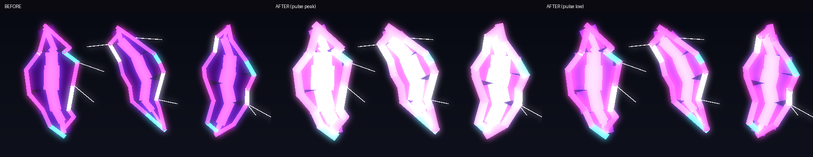
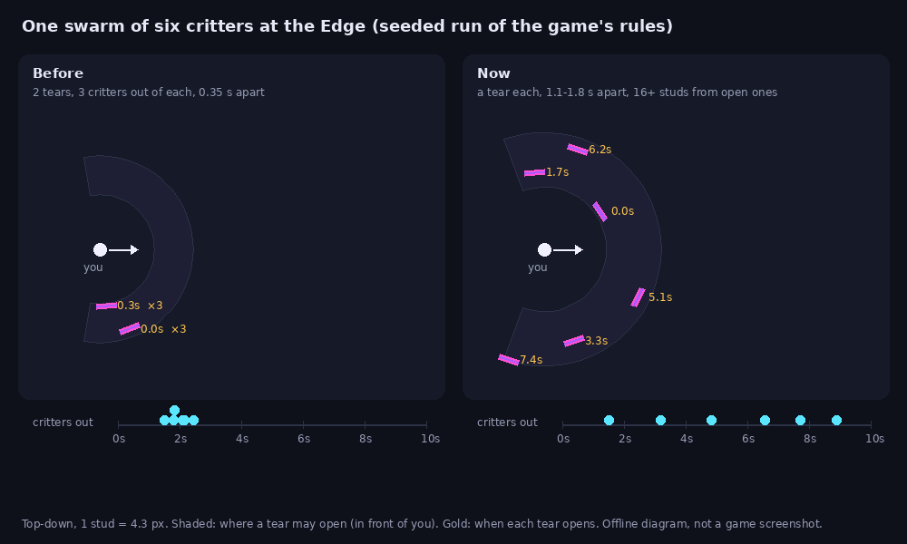
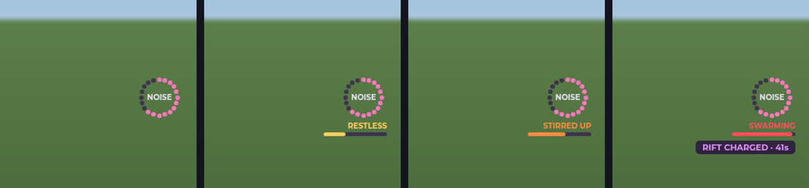
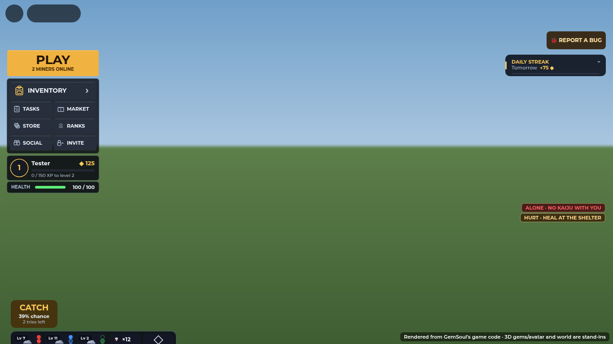
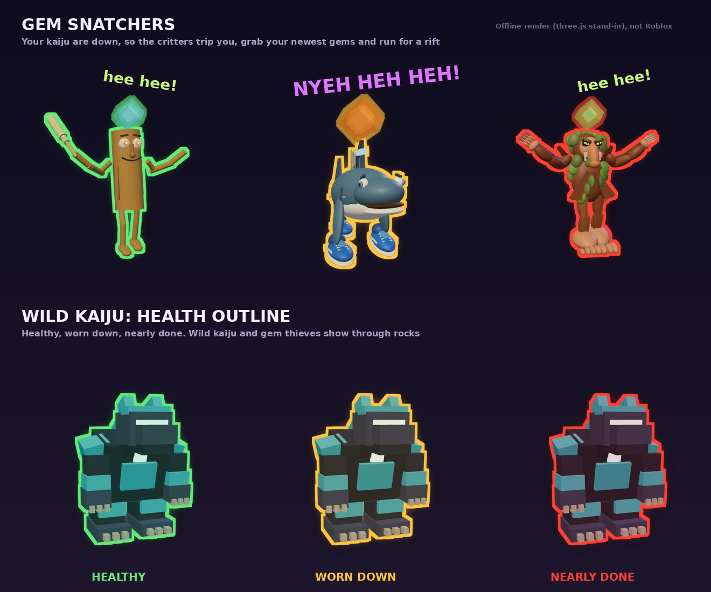
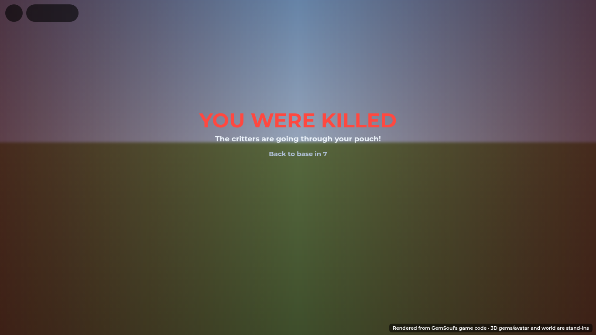
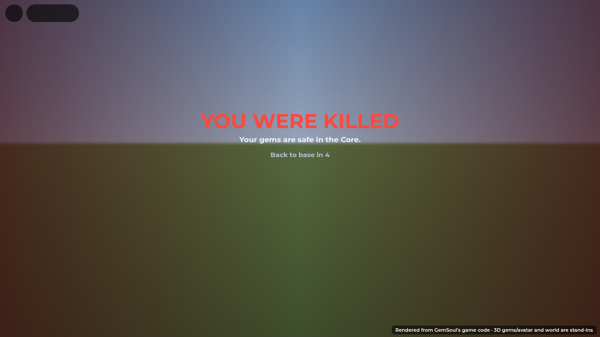

# The frontier

The Outpost gets more dangerous and richer the further out you go. Near
the outpost you're safe. Further out, the rocks pay better, but rifts tear
open in the air and the brainrot critters hop out of them at you. Out
there the rocks grow in outcrops, and three Rift Veins, the richest rocks
of all, glow by the walls and move on when they're mined out. You mine your
way out, kite what comes through, and run back in when it gets too hot.

The quarry outside the core is also **the Loop**: four biomes, one for each
element, about a quarter of the quarry each, between four roads due north,
east, south and west. Each has its own ground in Roblox terrain, and their
borders sway and mix. Out there, gems, wild kaiju and critters lean 60%
toward the biome's element. See [docs/biomes.md](biomes.md). (The map above is
from before the Shelter and the Loop, when there were six roads. The bands
are as drawn; for today's roads and buildings, see the map in
`docs/biomes.md`.)

## The three bands

Each band is measured across the ground from the middle of the Outpost.

| Band | From the middle | Rifts | Luck on every gem | Crystals |
| --- | --- | --- | --- | --- |
| **Outpost Core** | 0–150 studs | None: safe | None | Cyan |
| **The Fringe** | 150–300 | One or two critters at a time | +20% | Gold |
| **The Edge** | 300 to the walls | Two or three at a time | +40% | Rose |
| **Rift Vein** | Three spots by the walls | (in the Edge) | +75% | Violet |
| **Guarded vein** | One of the three | (in the Edge) | +110% | Red |

The rocks are the same everywhere: the lobby mix of chunks and boulders (62
to 38), with no Monoliths or Geodes. A boulder takes more swings for the
same one gem, so more boulders out there would only have made the frontier
slower. Going out pays in luck instead: it goes on top of the rock's own
luck on every gem it pays, so the outer rocks roll better gems. A rock's
label shows its band and luck, e.g. `THE EDGE · +40% LUCK`.

A gem's luck, all told, tops out at 100% (`GemGenerator`). So a Legendary
comes from about 5.6% of rocks in the core, 7.3% in the Fringe, 8.5% at the
Edge and 10.1% on a vein. On the guarded vein the cap takes most of the
extra 35%: 10.7%. Its guardian's Gemsoul and coins are the real prize.

Crossing into a band shows nothing on the screen: no title card (since
2026-10-22, [plain-signs.md](plain-signs.md)). The rocks and the critters
tell you where you are.

## Outcrops

Past the core's rocks, from 100 studs out to 412, the rocks grow in
**outcrops**: 72 of them, at least 36 studs apart, reaching 522 studs from
the center. The expanded quarry supports 30 wild kaiju in ten packs of three and
9 landmarks per biome, with outer-ring scenery beyond the old 440-stud
radius. The central safe area remains unchanged. An outcrop is a short
row of rocks (one every 13.5 to 15 studs) along a grain of its own, with
dark seams in the ground joining them, so you can see it's one outcrop:

- two or three rocks near the core, up to five out at the Edge;
- thicker on rich ground. Three soft waves of richness cross the quarry, a
  different way each server, so some stretches are crowded and others
  bare;
- about one rock in seven out there grows alone, between the outcrops. The
  first eight of those stand at the four roads' mouths, two to each road,
  so the way out of the core into each biome starts close.

Outcrops stay clear of the roads, the buildings, the motor pool and the
Rift Veins. A mined rock grows back in the same spot, so an outcrop stays
an outcrop.

## Rift Veins

Three **Rift Veins** glow by the walls. Each is six rich violet rocks in two
staggered rows round a **dormant rift**: a scar in the ground with glowing
cracks, and a **Rift Gate** over it, a jagged arch of slate with fire at its
feet and the tear hanging in it. The gate is a way into the critters' own
world: see `docs/rift.md`. (It replaced the violet beam that stood here.)

A Rift Vein doesn't stay put:

- **its rocks don't grow back.** When the last of its six goes, it moves on
  a few seconds later;
- **if nobody mines it out, it moves anyway**, every 10 minutes or so (give
  or take a minute). While someone is mining it, it waits for them (another
  20 seconds at a time);
- it surfaces at one of 12 places round the walls, never one another vein
  has, and at least 70° round from the other two, so they stay spread out.
  Fresh rocks grow there, and its scar, gate and tear go with it;
- no banner as it surfaces (*2026-10-26*: big words across the middle of
  the screen were too much); its tear and glow show where it went.

So the richest rocks are always somewhere new to head for, and nobody can
camp them.

### The guarded vein

One of the three is **guarded**. Its rocks are red, +110% luck (+35% on
a vein's), and its cracks glow red. A wild kaiju
of level 16 to 20, a head taller than you, keeps a beat 30 studs in front of
it: pacing, sniffing about, napping. It looks over anyone who comes close
and roars at them now and then, but leaves them be. The first swing at its
vein stirs it, the second makes it roar, the third wakes it, and it goes
for the miners as well as their kaiju (a plain miner it
finishes is killed, and robbed out here: see below). Beat it or catch it and the vein is yours until
it moves on. A beaten guardian pays 40 coins on top of its Gemsoul. When
the vein moves, a fresh guardian sleeps at the new site, and the banner
says "A guarded Rift Vein surfaced to the …". The other two veins, and the
two packs of wild kaiju roaming the quarry for catching, stay open to
everyone. The rest
is in [kaiju.md](kaiju.md#the-vein-guardian).

## Rifts

**Bright and pulsing** (since 2026-10-26, `RiftTear.Pulse`): a tear is
never a dark hole. Between its lips the other side glows violet, its
heart white-hot; about once a second the whole tear pulses: its lips
swell and whiten, its heart flares, and its light and the glow on the
ground breathe with it. Every critter portal wears the same violets, in
the Outpost and in the Rift alike (`RiftTear.Palettes.Rift`); only a
vein's Rift Gate (the dormant tear at a vein) keeps the critters' world's
reds (`Palettes.Hell`).

Critters come in swarms through rifts: ragged tears in the air, never
symmetrical and never the same shape twice. A swarm trickles in rather than
landing all at once: each critter comes through a tear of its own
(`Frontier.Swarm.PerRift`), and the tears open one after another, 1.1 to
1.8 seconds apart (`Swarm.Every`, `Frontier.trickle`). A swarm of six takes
about nine seconds to come through, and no more than three or four of its
tears are ever open at once.

The picture is a top-down diagram from a seeded run of the game's own rules
(`Shared.Frontier`, before and after), not a screenshot. Before, two tears
(here 8 studs apart) let all six critters out within a second. Now there
are six tears, spread round the front of you, and the critters come out
over seven seconds.

A tear:

1. **opens and crackles** for a second and a half: it splits along a
   crooked crack, with the crackle and its critter's own sound (Sahur's
   bonk, Tralalero's whoosh, Patapim's frost, the croc's bomb), so you
   know what's coming and where;
2. **lets its critter out**: it hops out at whoever drew it; a Crocodilo
   (the swarm's ranged one) comes through the swarm's last tear, a second
   after it opens;
3. **lingers** (1.8 s): a dark void with glowing lips and hairline cracks
   off them;
4. **seals** (half a second) with a last flash.

Rifts open 16–30 studs away, within 110° of where you're facing, on open
ground level with you: never on top of a boulder or a container stack.
They open well apart: at least 16 studs (`Rift.Apart`) from every other
tear still open, yours or anyone's, and, where there's room, from the
swarm's tears that have already sealed. So a swarm spreads out round you
rather than coming back through the same spot. The server tries up to 32
spots and only weighs those on open ground (`riftSpot`'s `usable`). On the
rare crowded moment, it takes the one furthest from the open tears. If one opens off your screen, an arrow at the
screen's edge points at it until its critter is out. They never open in the
core or past the walls.

### Mining noise

Mining is what draws critters, not standing about. Every swing out past
the core makes noise, and a little more trickles in each second you're out
there. The ring of twenty dots on the right of your screen shows it filling;
nearly full, it turns red.

| Where | An encounter about every | Standing about | Critters at once |
| --- | --- | --- | --- |
| The core | never | never | 0 |
| The Fringe | 30 to 40 swings | 7 minutes | 3 or 4 |
| The Edge | 15 to 20 swings | 3 minutes | 5 or 6 |

Each swing's share of the noise varies (60% to 140%), so encounters don't
come like clockwork, and the next can't come within 8 seconds of the last.
A mech's strike makes as much noise as the swings it spends, and its pilot
is fair game: a critter that kills them throws them out of the
cockpit. Back in the core, the noise dies down over a minute or so.

Each critter alone is weak (a third of the health and two fifths of the
bite one had), so a swarm hits about as hard as one or two used to, from
all sides. Caps: five critters at once on one player in the Fringe, seven
at the Edge, 22 in the whole Outpost, shared fairly between everyone out
there. Critters still on their way through a rift count. If more would
come than the cap allows, only enough come to reach it. (Each critter is a
whole brainrot body, built light; the Outpost's cap keeps a crowd of them
from lagging it. See [Performance](#performance).)

A swarm of three or more may have a Crocodilo at its back (7 in 10, one
more for every five critters): it only fights from range, keeps its
distance and never comes alone ([kaiju.md](kaiju.md#moon-bugs)).

No rifts open round you while you're sparring, knocked down, or in a fight,
a dungeon or an expedition.

### Stirred up: the longer you mine, the harder it gets

(The noise ring and the stirred-up row under it are off the HUD now, to
keep the screen for the game: the critters coming are the sign. The image
below is how they looked.)

Mining out there stirs the frontier up, and it pushes back harder the
longer you keep at it (`Frontier.Disturbance`). Every swing past the core
stirs it a little (full after about 400 swings in the Fringe, 250 at the
Edge: six or four minutes of steady mining). It holds while you keep
mining, even through a short walk between rocks; after 20 seconds without
a swing it settles, over two minutes from full, and back in the core in
half a minute.

| Stirred | Shown | Encounters | Critters per encounter | At once round you | Their level |
| --- | --- | --- | --- | --- | --- |
| 0–25% | nothing | as above | as above | 5 / 7 | as below |
| 25–50% | RESTLESS (gold) | up to half again as often | as above | 5 / 7 | +1 |
| 50–80% | STIRRED UP (orange) | up to 80% more often | two more | 7 / 9 | +2 to +3 |
| 80–100% | SWARMING (red) | up to twice as often | three more | 9 / 11 | +3 to +4 |

(At once: the Fringe / the Edge. Each swing's noise is 1 + the stir times
as loud; a critter comes up to 4 levels higher at full, a share of that on
the way.) So a long session at the Edge ends with swarms of eight or nine
level 13–17 critters instead of five or six level 9–13s, and they pay more
EXP for it. The Outpost's cap of 22 still holds, shared fairly. You're
told as it gets to each stage (once, until it's well settled
again): "The frontier is restless: critters come sooner.", "...stirred up:
more critters, and tougher.", "...swarming! Head back to the core to let it
settle." A wandering rift opened near you comes stirred up the same way.

### Out alone: no kaiju with you

Mining past the core with none of your kaiju out (none yet, all knocked
out, or called back) is much more dangerous (`Frontier.Alone`). The
frontier knows you're alone:

| | With your kaiju | Alone |
| --- | --- | --- |
| Noise (swings and seconds out there) | as above | twice as loud |
| Gap after an encounter | 8 seconds | 4 seconds |
| Critters per encounter | as above | two more |
| At once round you (Fringe / Edge, calm) | 5 / 7 | 8 / 10 |
| Their level | as above | +2 |
| Their bites on you | as they are | 60% harder |

So alone in the Fringe an encounter comes about every 15 to 20 swings with
five or six level 3–6 critters, and at the Edge every 8 to 10 swings with
seven or eight level 11–15s that bite 60% harder. Stirring it up stacks on
top (still within the Outpost's 22). You're told when you go out alone
("No kaiju out with you: critters come sooner, more of them, and they hit
harder.", not more than once a minute), and a red **ALONE · NO KAIJU WITH
YOU** tag sits at the right of the screen while you are. The server sets
`FrontierAlone` on you each half second (out past the core with
`KaijuServer.team` empty); the encounter rules read it, and so does
`KaijuWilds` for a critter's bite or a snatcher's lunge.

### Fighting a wild kaiju: fewer rifts

While you're in a fight with a wild kaiju out past the core (you started on
it and did something in the fight in the last 15 seconds, or you're
casting a catch on it), the frontier holds back so the fight stays yours
(`Frontier.Engaged`, `KaijuWilds.engagedWith`):

| | Usually | In a fight with a wild kaiju |
| --- | --- | --- |
| Noise (swings and seconds out there) | as above (alone: twice) | a quarter of that |
| Gap after an encounter | 8 seconds (alone: 4) | 30 seconds |
| Wandering rifts | may open by you | never by you |

Going quiet for 15 seconds (or the kaiju knocked out) ends it. The server
sets `FrontierEngaged` on you each half second. See
[wild-bars-and-edge.md](wild-bars-and-edge.md).

### Wandering rifts

Every 40 to 80 seconds the frontier tears open by itself, 35 to 70 studs from
someone out there. Its tear lingers longer, and a swarm (at least two, as
many as an encounter there would bring) climbs out of it one at a time,
0.6 seconds apart (`Swarm.Out`), the fighters first and any Crocodilo
last. The tear stays open until the last one is out. The swarm roams round
it for a minute, going for anyone who comes within about 22 studs, and for
the player it opened near once they're within 30. Go round it, or bring your kaiju. At most six critters are out of
wandering rifts at once (of the 22). If nobody is near when they'd hop out,
it seals empty.

Kill every critter from one and everyone who helped is **Rift Charged**:
gems 10% luckier for 60 seconds. A RIFT CHARGED tag at the right of the
screen counts it down.

### The critters

They're the moon bugs from [kaiju.md](kaiju.md): the brainrot characters
shrunk down. One that came through a rift:

- is **level 1–4 in the Fringe and 9–13 at the Edge**, whoever is near, so
  the Edge is a real step up (a kaiju of about level 8 and up). Its level
  is on its nameplate;
- goes for whoever drew it, even a miner who isn't hunting, then for
  anything else close by (kaiju, hunters, other players out there);
- follows its prey up to 120 studs from its rift;
- gives up once its prey is back in the core (12 studs inside it), or is in
  a spar or a fight;
- with nobody to fight for 4 seconds, or after 90 seconds anyway, opens a
  rift of its own and slips back through it. Every critter does, even one
  nobody drew.

A critter's finishing blow doesn't kill you in the Outpost: it knocks you
down for a few seconds, as in a spar, and you get up healed. Scraped but on
your feet, you only heal **back at base**: out in the quarry nothing
mends, so a run out costs you until you walk back. Inside the Shelter's
footprint (or down in the Kaiju Arena's hall under it: `Frontier.atBase`,
`AtBase` on you), 8% of your health comes back a second once 2 seconds have
passed without a hit, with a soft green shimmer off you while it mends
(`HealthRegen.Lobby`; elsewhere it's still 1% after 5 seconds). Hurt away
from it, a gold **HURT · HEAL AT THE SHELTER** tag at the right of the
screen says so; mending, it's a green **MENDING AT THE SHELTER**.

Ones from the Edge are tougher: a quarter more health and a fifth more
damage.

What one pays:

- **EXP** for every kaiju that fought it: 2.5 + 0.8 per level, half again
  from the Edge, a quarter after your first 150 critters of the day. A
  kaiju left at home earns nothing. (A swarm pays about what one critter
  used to.)
- **Coins** for whoever did the most damage (including their kaiju): a
  random 2–5 per critter, up to the existing 300-a-day cap. Gold coins pop
  out, bounce, then fly toward that player; nearby players see the effect
  too. The server awards the money once, independently of the animation.
  Near the cap, only the remaining allowance is paid and displayed.
  *2026-10-27*: a critter your kaiju killed outright used to pay nothing:
  the kaiju's damage was put down to you only after the blow, and the
  killing blow pays out inside it (`KaijuServer.strike`). With a team of
  three or four out, most critters die that way. Its credit now goes on
  first, so the coins and the kaiju's EXP come every time.

### What you do about them

- **Let your kaiju handle them**: it fights them on its own, and they go
  for it rather than you while it's within 30 studs of them.
- **Bonk them** with your pick: the mine button (or a click) hits a critter
  within 6 studs before any rock. Each bonk takes 12% of its health and
  knocks it back 10 studs, every 0.6 seconds, and costs no swings. A miner
  alone kills a Fringe bug in about 8 to 10 seconds.
- **Hunt**: press HUNT and fight them yourself.
- **Run back in**: past the core's edge they give up and go back through
  their rifts.

### Gem raids: when your kaiju are all down

Out past the core with your whole team knocked out, the critters smell
your gems (`Frontier.Raid`; `FrontierServer.raid`, from
`KaijuServer.onTeamDown`). At most once every 75 seconds:

- **More come through**: four more critters for you at once (six, stirred
  right up), on top of your band's cap, and every critter out for you, or
  coming through for the next minute, turns **gem snatcher**. You're told:
  "Your kaiju are down... the critters smell your gems!" and you hear them
  cackle.
- **They lunge at you.** A snatcher within 6.5 studs winds up a **LUNGE**
  (0.75 s, on its cast bar: step out of reach, or bonk it to cut it short),
  a hard hit. *2026-10-26:* it no longer knocks you down. Nothing knocks a
  miner down in the Outpost any more: you're killed or you're not (the old
  TRIP, which put you on the floor for 4 seconds, is gone, and so is
  `SparServer.knockDown`). Each snatcher lunges every 5 to 8 seconds, and
  never twice within 3 seconds of the last lunge on you.
- **They snatch your haul.** Your haul is the gems you mined this trip out:
  every gem from a rock past the core, the newest 12. Back in the core it's
  safe, and a new trip starts a new haul. With you killed, snatchers run
  in, and each grabs the newest gem still loose in your pouch (never one on
  your gear), at most 3 a death. Nothing left to take, a snatcher
  giggles and slips away.
- **They run off with it.** A snatcher holds the gem up over its head (a
  glowing stone in its colour, its arms up), cackles, and runs for a rift
  that tears open 26 to 38 studs away from you and waits 6 seconds for it,
  giggling as it goes ("hee hee!" over it, `CritterFx`). Its outline shows
  through rocks so you can chase it.
- **Get it back.** Bonk it with your pick or knock it out before it hops
  in, and the gem pops out and flies back to you ("GOT IT BACK!"), back in
  your pouch even if it's full again. Let it hop in and the gem's gone:
  "A critter got away with your ...".

### Killed: robbed, then home

Nothing knocks you down in the Outpost. Beaten down to nothing by a
critter or a wild kaiju (kit out or not; not in a spar with another player),
**you're killed**
(`FrontierServer.knockedOut`, from `SparServer.onKnockedOut`, marks you
`Killed`). You don't get up where you fell; you lie there, then you're back
at base. In the core that's all: you lie dead for 4 seconds
(`Spar.DeadSeconds`; **YOU WERE KILLED · Your gems are safe in the Core. ·
Back to base in 4**) and nothing's taken. Out past it the critters rob you
first (`Robbery`, `Frontier.Rob`):

- the critters within 70 studs of you come for you; if fewer are near
  than there's to take (up to 3 of your haul), more leap out of rifts that
  tear open round you (`Frontier.robCrew`, `Frontier.robSpots`);
- each grabs one gem of your haul, newest first, holds it up and runs for
  a rift with it, as a snatcher does. Knock it out first (a friend, or your
  kaiju) and the gem's back ("GOT IT BACK!");
- your screen goes dark red: **YOU WERE KILLED · The critters are going
  through your pouch! · Back to base in 8**;
- after 8 seconds, or a moment after there's nothing left to take, you're
  back at base on your feet at full health (a few seconds' shield, **BACK
  AT BASE**) with your pick out, not your kit (miner mode:
  `FrontierServer.kitAway`), your haul cleared, and a card tells you what they took ("You
  were killed out in the quarry and the critters went through your
  pouch."):

**ROBBED!** and each gem in 3D, **GONE** or **SAVED**; **NOTHING TAKEN**
if your haul was empty. The robbers turn back into plain critters once it's
over: they don't follow you home. No robbery in the core; no kill at all in
the Rift (it has its own), spars, kaiju battles, matches, dungeons or
expeditions.

The giggles are synthesized by `tools/make_critter_sounds.py`
(`critter_giggle_1..3.mp3`, `critter_cackle.mp3`); until they're uploaded,
the old "uuhhh" sped up into squeaky "hee"s stands in.

## Waves that learn you (2026-10-28)

More critters come through: a swarm is now 4-5 in the fringe and 6-7 at the
edge (was 3-4 and 5-6), the caps round one player are 7 and 9 (was 5 and 7)
and the Outpost's is 28 (was 22). Wandering rifts open every 30-60 seconds
(was 40-80), up to 8 critters out of them (was 6).

The encounters that come for you one after another out past the core are a
**run of waves** (`Frontier.Adapt`):

| Wave | Turned into your counter | More critters | Levels up |
|---|---|---|---|
| 1 | none (the biome's usual mix) | 0 | 0 |
| 2 | half | +1 | +1 |
| 3 and on | 85% | +2 | +2 |

The counter is worked out from your side (`Frontier.read`, `Frontier.counter`):

- **What you hit with**: your weapon gem's element and every kaiju you have
  out. A critter of an element resists hits of its own element, and takes
  more from the element that beats it.
- **What you're weak to**: each kaiju is weak to the element that beats
  its own, and your armor's main element is too. Armor that resists an
  element counts against it.

The critter kind (each has one element: Sahur Thermal, Tralalero Cryo,
Patapim Corrosive, Crocodilo Ion) that shrugs off the most of what you hit
with and hits the most of what you're weak to is the one the later waves
send. A ranged one still comes last. On the second wave you're told:
"The frontier is learning your team: Thermal critters are coming for you."

The run starts again from wave 1 when you're back in the core, when you're
killed, or after two minutes without an encounter (`Adapt.Reset`).

## Performance

The Outpost was already a big scene: about 8,600 parts, nearly 4,700 of
them in its ~190 rocks, each rock with its own light. Rifts added a stream
of creatures on top of that, and the Outpost lagged. What keeps it light:

- **Moon bugs are built light.** Each critter is a whole brainrot body, and
  rifts create and remove them every few seconds, so every one is sent to
  every player. Built for a dungeon, they were 121 to 214 parts each, every
  part casting a shadow. As moon bugs they wear no armour, lose the details
  too small to see at their size (grain, rivets, laces, spores; never the
  face), carry no lights, and only their bigger parts cast shadows: 66 to 179
  parts, about 20 to 50 of them casting shadows (`BrainrotSkins.thin`).
- **A cap on the whole Outpost**: five round a player in the Fringe, seven
  at the Edge, 22 in the whole Outpost (they come as swarms now; it was two,
  three and twelve, and thirty before that), shared fairly, with critters
  still on their way counted.
- **Fewer encounters**: they come from mining, about 1 in 35 swings in the
  Fringe and 1 in 17 at the Edge, instead of every 5 to 10 seconds out there.
- **Only the rocks near you are lit.** Each rock's light is on within 70
  studs of the camera and off further out, where the crystals' neon still
  glows (`OutpostScene`). Instead of ~190 lights, about 13 on average (29 at
  most, in the busy core).
- **Creatures' joints are found once**, when a body arrives (and as streaming
  brings in the rest of it), instead of every creature's every part being
  re-read twice a second (`CreatureAnimation`).
- **Moon bugs are fully posed only within 100 studs** (220 for everyone
  else: `BodyPoses.BugRange`).
- **A dormant rift breathes 15 times a second**, not every frame, its light
  holds still, and its glow on the ground is placed once (`RiftTear`). An
  open one, which lasts three seconds, moves every frame.
- **A tear is only built near you** (within 220 studs): a rift across the
  Outpost costs your screen nothing (`RiftTear`).
- **A critter's death only blows up near you**: past 140 studs there's no
  blast at all, and a critter's is its 40 biggest pieces (`ElementalDeath`).
- **Bug joints are animated within 100 studs** (kaiju's within 180:
  `CreatureAnimation`).
- **One enemy's error doesn't stop the rest**: each thinks on its own, an
  error logged now and then (`Enemies`).

## In the code

| Where | What |
| --- | --- |
| `Shared.Frontier` | The rules: bands, colours and luck, the biomes and spokes (`docs/biomes.md`), the outcrops (`outcrops`, on rich ground: `field`), the Rift Veins' sites, rocks and moves (`veinSites`, `veinAt`, `pickSite`, `compass`), the guarded one and its guardian (`Veins.Guarded`, `Guardian`), pressure, stirring it up (`Disturbance`, `stir`, `settle`, `stage`, `capFor`), how many come at once, where a rift opens, its timeline and openness, each tear's ragged shape |
| `Shared.Outpost` | The Fringe, Edge, Vein and Guarded zones (the same rock mix, more luck) |
| `OutpostWorld` | Lays out the vein sites, the outcrops and their seams, and the three Rift Veins before the rest of the field; a vein's scar, cracks and Rift Gate (`veinMarks`, the guarded one's cracks red; `docs/rift.md`); crystals tinted by band (`rock(size, cframe, rng, tint)`) |
| `OutpostServer` | Grows each rock with its zone, tint and luck; a mined rock grows back in the same spot, except a vein's; moves a vein when it's mined out or its time comes (`moveVein`, `onVeinMoved`, and `VeinNews` on `workspace`); a swing at a vein's rock (`onVeinSwing`); every swing's noise (`onSwing`); the pick's bonk (`OutpostBonk`); Rift Charged luck |
| `FrontierServer` | Each player's band (`FrontierBand`), noise (`FrontierNoise`) and how stirred up (`FrontierStir`; told as it gets to each stage), out alone (`FrontierAlone`; told once a minute at most) and back at base (`AtBase`, for anyone in the Outpost), encounters, wandering rifts and Rift Charged (`RiftCharged`), the rifts in `workspace.Rifts` (anchors with `OpenAt`, `HopAt`, `CloseAt`, `EndAt`, `Seed`, `Height`, `Critter`, `Prey`; the scars carry `Dormant`, and move with their veins: `moveScar`) |
| `KaijuWilds` | `spawnBug`: a critter out of a rift at its level, at its prey (`prey`), roaming a wandering rift; slipping back (`rift`); its pay; `bonk`; the vein guardian (`veinSwing`, `veinMoved`); a critter's bite on someone out alone lands `Alone.Damage` times harder |
| `HealthRegen` | In the Outpost, healing only back at base (`AtBase`) |
| `Duelist.creatureBody`, `BrainrotSkins.thin` | A moon bug's body: no armour, nothing too small to see, no lights, few shadows |
| `SparServer`, `CombatServer` | A critter's finishing blow in the Outpost knocks you down instead |
| `RiftTear` (client) | Draws each tear from its anchor: the lips, the void, the cracks, light, sparks and sound |
| `FrontierHud` (client) | The banner as you cross into a band or a vein surfaces, arrows to rifts off screen and to the nearest wild kaiju (`nearest`), the Rift Charged tag (no noise ring), the ALONE and heal-at-the-Shelter tags (`tags`) |
| `OutpostScene` (client) | The band and luck on a rock's label; the mine button bonks a critter close by |

Tests: `tests/run_frontier.py` checks the rules (bands and zones, the luck
going up band by band on the same rock mix, the outcrops (none on top of
each other, on their grain, bigger further out, inside the frontier, the
lone rocks and the stepping stones out of the core; the rich ground), the
vein sites and their rocks, picking a vein's next site, the compass, the
guarded vein's luck and its guardian's numbers, mining noise, stirring
it up (how fast it builds and settles, the core settling it faster, the
stages, louder swings, more critters per encounter and allowed at once,
higher levels, never in the core), out alone (louder, sooner, more,
higher, room for more, never in the core), back at base (the Shelter's
footprint and the hall under it, not the quarry round it), the status
tags, fair shares, critter levels and EXP, how many come at once, where rifts open (wandering ones too), the timeline, that tears are ragged and
lopsided, the pieces each tear is drawn from, the banners, that the noise ring stays off the HUD,
the nearest wild kaiju for its arrow
and the arrows; a swarm's tears a second or more apart, and each new tear
16 studs or more from those still open). `tests/run_kaiju.py` runs the
server side: who rifts open round, back at base or not, out alone (and
told once), swings drawing them, the warning, the
caps, edge levels, a swarming encounter trickling in (a tear for each
critter, opening one after another, never two too close, never more than
four open at once), a wandering rift's critters climbing out one by one,
stirring
it up (swings building it and the HUD told, being told once as it gets
restless, a short pause not settling it, a swarming encounter bringing more
critters past the calm cap at higher levels, settling once you stop and
faster in the core), a pilot's strikes, a critter hopping out at its prey (a miner too), giving up and
slipping back, a stray leaving, wandering rifts roaming and Rift Charged,
the pay, the bonk, rifts opening round a container stack rather than on
it, and the vein guardian; and builds every moon bug (`tests/moon_bug_cases.luau`:
its part and shadow budget, no armour or lights, nothing left hanging loose,
its whole face). `tests/run_outpost.py` and
`tests/run_moon_quarry_scene.py` cover the zones, luck, regrowth and the
built layout: the outcrops clear of the roads and buildings with room
round every rock, their seams, the three veins and their gates (the
guarded one's rocks and cracks its own), a swing at a vein reaching its
guardian, and a vein moving (mined out or on time, not while it's being mined; fresh rocks, its
scar, the banner, nothing growing back where it was).
