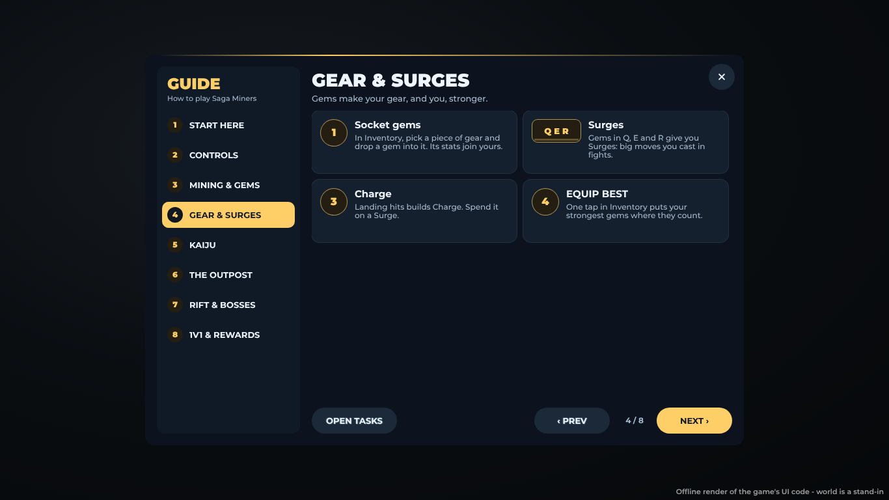
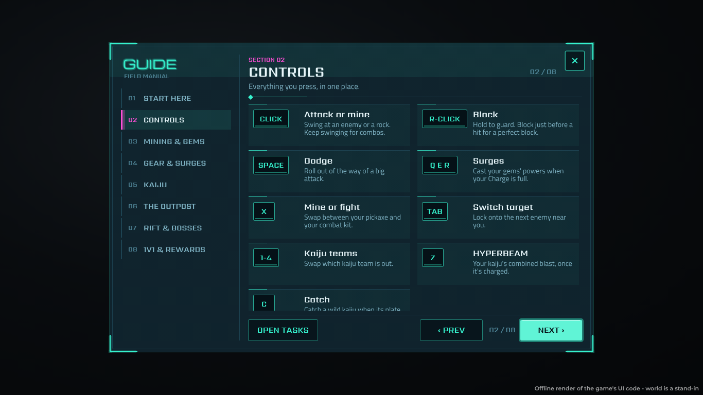
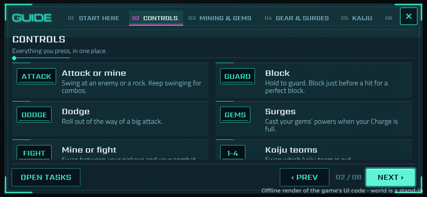

# The GUIDE and the Tasks path

*2026-10-29.* The menu's RANKS tile is now **GUIDE**: a how-to-play window,
on a computer and on a phone. The Tasks window is a step-by-step learning
path. Every step says what to do, how, and has a button that takes you there.
(The Hall of Fame stays on its board in the Shelter.)

## GUIDE (`Modules/GuideUI`, words in `Shared/GameGuide`)

*2026-10-30, restyled:* the GUIDE is the Tasks window's Rift terminal now,
as a field manual, so the two read as one game's: dark cyan glass, a double
hairline frame and corner brackets, GUIDE in Michroma over FIELD MANUAL,
Sarpanch for names, numbers and keys, Titillium for the words. The pages
are numbered 01 to 08, the open one lit magenta; the page has SECTION 04
over its name and 04 / 08, a rule with a lit end; the tips are manual
entries (a hairline with a lit end over each, no rounded cards or number
circles), each key on a terminal key cap with a lit lip, the words starting
in line on a page, every entry as tall as the page's longest words; OPEN
TASKS and PREV are cyan-rimmed, NEXT lit cyan like Tasks' GO. It used to be
gold pills, round number badges and rounded cards, which looked like any
other game's.

- Opens from the **GUIDE** tile (an open-book icon). On a phone it's in the
  dock too, which now has eight tiles: PLAY, INVENTORY, SKINS, TASKS, MARKET,
  GUIDE, SOCIAL, INVITE. With eight tiles the gap between them is 4 points
  instead of 6, so each tile is still 44 points wide on a 667-point phone
  (`MobileLayout.dock`).
- Eight pages, in the order a new player needs them:

  | Page | What it covers |
  | --- | --- |
  | START HERE | The game in five lines; "not sure what's next? open TASKS" |
  | CONTROLS | Every key, on a key cap: CLICK, R-CLICK, SPACE, Q E R, X, TAB, 1-4, Z, C |
  | MINING & GEMS | Rocks, rarities, elements, richer rocks further out, spare gems |
  | GEAR & SURGES | Sockets, Q/E/R Surges, Charge, EQUIP BEST |
  | KAIJU | The team, catching, HYPERBEAM, healing, four teams, the Kaiju Arena |
  | THE OUTPOST | The Shelter, critters, falling, mechs |
  | RIFT & BOSSES | Rift Veins, bosses, parties, loot |
  | 1V1 & REWARDS | Practice, Ranked, daily challenges, Tasks |

- **On a computer**: the pages down a rail on the left, the tips two to a
  row. **On a phone**: the pages as a row of tabs along the top, the tips one
  or two to a row (two once the list is 520 points wide). Phone cards show the on-screen button's name (ATTACK, GUARD, DODGE,
  GEMS, FIGHT, BEAM, CATCH) instead of the key, and tips that only apply to a
  keyboard (TAB) are left out.
- At the bottom: ‹ PREV, the page count, NEXT › (DONE on the last page), and
  **OPEN TASKS**.
- Pages and tips for switched-off features (`Config.Features`, e.g. Kaiju or
  Mechs) are left out (`GameGuide.closeFor`).

## Tasks: a learning path (`Shared/TrainingRewards`, `TrainingRewards.client`)

The steps are grouped into chapters, in the order a new player meets them.
Each step pays coins once. The IDs and coins of the old tasks are unchanged,
so steps already paid stay paid.

| Chapter | Steps |
| --- | --- |
| BASICS | Break your first rock · Find a gem · Keep digging |
| GEAR | Socket a gem · Ready a Surge · Build your loadout |
| FIGHT | Land a hit · Block a hit · Cast a Surge · Perfect block · Beat a Rival |
| KAIJU | Catch a kaiju · Fire a HYPERBEAM · Kaiju Arena *(new)* |
| EXPLORE | Pilot a mech · Beat a Rift boss *(new)* |
| 1V1 | Enter the arena · First challenger defeated |
| DUNGEONS | (while dungeons are open) |
| MARKET | Find your upgrade · Open for business |
| DISCOVERIES | A rare discovery · Struck legendary |

The new steps are counted on the server with `PlayerData.training`:

| Step | Counted in |
| --- | --- |
| KaijuCatch | `KaijuWilds`: a wild kaiju caught |
| Hyperbeam | `KaijuBeamServer`: a HYPERBEAM fired |
| KaijuBattle | `KaijuBattles`: a Kaiju Arena battle finished |
| Mech | `OutpostVehicles`: climbing into a mech |
| RiftBoss | `RiftServer`: a Rift boss beaten (every member of the party) |

Steps that wait on a switched-off feature (`Needs`) are left out of the list
and of the count.

The look (*2026-10-29*): the Rift terminal, a field log on dark glass.
Cyan light on a double frame with corner brackets, TASKS in Michroma, names
and numbers in Sarpanch, words in Titillium Web. The path's progress is a row
of segments in the header. The open chapter is lit magenta. The NEXT OBJECTIVE
sits on magenta glass with brackets, its count as glowing segments, the coins
in gold and a cyan GO. Steps are ruled log lines, ticked in cyan when paid.
It's all frames, gradients and strokes (no uploaded images).

The window:
- **TODAY** (the daily challenges and the bonus, with the time until new
  ones) and the chapters: a rail on a computer, chips on a phone. Each
  chapter shows its progress ("2/3") or a tick when it's done.
- A gold **NEXT STEP** card at the top: the first step not done in this
  chapter, its how-to line, its progress bar and coins, and a button:
  - **MINE**: a toast: "Find a rock nearby and swing at it.";
  - **GO**: Inventory, the PLAY menu or the Market;
  - **HOW?**: the GUIDE page that explains it (kaiju, the Outpost, the Rift).
- The chapter's steps under it, numbered, ticked when paid.
- It opens on the first chapter with something left to do.

## Tests

| Suite | What it covers |
| --- | --- |
| `tests/run_training_rewards.py` | Chapter order; every step has a button target and words; every chapter a blurb; the new events pay once; steps waiting on a switched-off feature are left out of the list and `nextTask` |
| `tests/run_mobile_layout.py` | Eight tiles in the phone dock, each at least 44 points, at every phone size |
| `tests/run_lang.py` | Every step, chapter line and GUIDE tip has its Spanish |
| `tests/run_kaiju.py` and the other server suites | The new `PlayerData.training` hooks |
