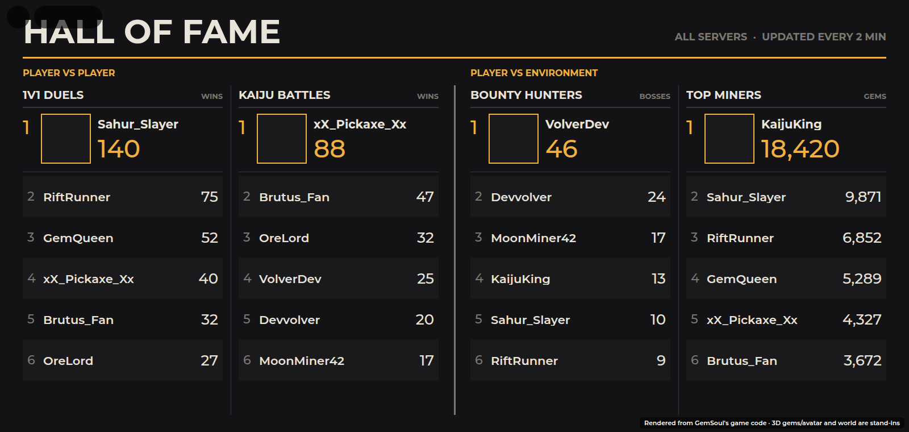
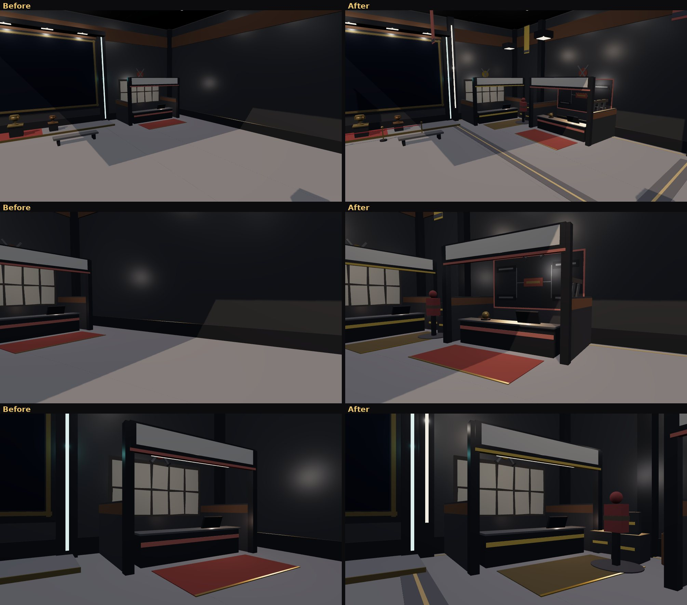

# The Hall of Fame, Brutus's bounties, and no more PROBE-7

*2026-10-22.* The Shelter's east wall, rebuilt: a **Hall of Fame** in place
of the old leaderboard, and a **bounty booth** for Brutus beside it. PROBE-7
is gone for good: Garrick sells the swing refills.

The pictures are offline renders of the game's own code (the board and the
windows drawn from their Luau, the hall from `OutpostWorld`'s parts). They
are stand-ins, not Roblox screenshots.

## The Hall of Fame

*2026-10-26:* redrawn as a plain results board, like a stadium's: dark,
one amber accent, square photos, tabular figures and thin rules between
the columns. Gone: the five rainbow column colours, the rounded neon
cards, the CHAMPION badges and the gold title rules. The halves are
**PLAYER VS PLAYER** and **PLAYER VS ENVIRONMENT**, and the wall round it
is plain steel with two caged work lamps (no red and teal neon pylons).
The wall picture below is from before this change.

*2026-10-27:* the **1V1 + KAIJU** column is gone, with the mode itself
(`Config.Features.KaijuDuel` is off: see
[kaiju-arena.md](kaiju-arena.md#1v1--kaiju)). The board has four columns
now, two a side, each a little wider:

One board, two halves (the table is how it was; 1V1 + KAIJU comes back
only if that switch is turned on):

| Half | Column | Counts |
| --- | --- | --- |
| **PLAYER VS PLAYER** | 1V1 DUELS | ranked 1v1 wins (`Duel.Solo`) |
| | 1V1 + KAIJU | wins in the Kaiju Arena's 1V1 + KAIJU mode (`Stats.MixedWins`; [kaiju-arena.md](kaiju-arena.md#1v1--kaiju)) |
| | KAIJU BATTLES | Kaiju Arena wins (`Stats.KaijuWins`, counted from this round on) |
| **PLAYER VS ENVIRONMENT** | BOUNTY HUNTERS | Rift bosses slain, every ladder (`RiftBosses`) |
| | TOP MINERS | gems mined in the Outpost (`Stats.GemsMined`, from this round on) |

Each column has its **champion** on top (headshot, name, the number large),
then places 2 to 6, with gold, silver and bronze badges for the first three.
An empty place reads UNCLAIMED. The subtitle says whether it's the global
board (every server, refreshed every two minutes) or this server's (when
data stores aren't there, as in Studio).

- `Shared.HallOfFame`: the board's columns, its layout and `draw(gui,
  boards, global)`. Pure UI on a SurfaceGui, so the test draws it for real.
- `Server.TopPlayers`: five new boards (Duel, Mixed, Kaiju, Bosses, Mined),
  rows carry `UserId` for the headshots.
- `Server.OutpostServer`: draws it on the wall's `BoardFace`, and only
  redraws when a row changed (`Drawn` attribute).
- `PlayerData.count(player, name, n?)`: a tally in `profile.Stats`, for the
  columns that had none.

The wall around it: a gold-trimmed frame under five spot lamps, a red neon
pylon on the PvP side and a teal one on the PvE side, a dais with gold,
silver and bronze trophies, and two benches facing it.

## Brutus's bounty booth

Brutus is the bounty rep now. His booth stands beside the Hall of Fame: a
lightbox saying **BOUNTIES**, a counter with a terminal, and a wall of
**WANTED** posters, one per Rift boss (its name, element, threat, and
"BRING A PARTY" for the group bosses). Talk to him or walk up to the
counter (prompt: **Bounty Board**) to open the bounty board.

The bounty board puts **every Rift Gate's bosses in one place**. It is the
same window as a gate's lobby (party, invites, ENTER), with a tab for each
biome on top. Pick a biome and then a boss, and you and your party go
through from the counter, just as through that biome's gate. Each boss still
opens once you've beaten the one before it on its ladder.

Each boss has a **GET READY** box: its element, its weakness, what to
bring, and **ADJUST ARMOR** to set your armor against it. An invite from
the board says which boss, and taking it gets you ready to go in with the
party from anywhere. See [rift.md](rift.md#adjust-armor).

- `Shared.Bounties`: the biomes' ladders in the Loop's order (`list()`),
  which ladder a boss is on (`elementOf`), and the WANTED poster.
- `Server.RiftServer`: `RiftEnter(player, "Bounty", bossId, together)` and
  `RiftPeek(player, "Bounty")` (all the ladders as `Ladders`). You have to
  stand within `Bounties.Reach` of the counter (`RiftServer.bountyAt`, set
  by Main from `OutpostServer.bountyCounter`).
- `Client.RiftClient.openGate("Bounty")`: the BOUNTY BOARD title and the
  biome tabs.
- Brutus's lines (`Shared.Vendors.ArenaMaster`): **Show me the bounties**,
  **Find me a duel**, how bounties work, what a win streak pays.

## Brutus's duel booth, the bounty office, the hall dressed

*2026-10-23.* Brutus has a booth of his own now, and the bounties an
office of their own with a clerk.

- **Brutus's duel booth** stands on the south wall by the corner, a
  lightbox saying **DUELS** over it: the partitions and counter as the
  bounty office has them, the duel terminal on the counter (prompt:
  **Find a duel**, which opens the duel queue: ranked, casual and 1V1 +
  KAIJU) and a bell beside it, a bracket board under crossed swords on the
  wall behind him, a rack of blades on one partition, a red rug, and a
  sparring dummy out beside the booth. Brutus stands behind his counter.
  His lines (`Shared.Vendors.ArenaMaster`): **Find me a duel** first, how
  duels work, what a win streak pays, where the bounties are.
- **The bounty office** is the booth beside the Hall of Fame, in amber
  now, with **Marlo, bounty clerk** (`Shared.Vendors.BountyClerk`) behind
  its counter: **Show me the bounties** first, how bounties work, which to
  take first. Its counter's prompt is **Bounty Board** (BOUNTY OFFICE).
  The Rift's messages say "the bounty counter" where they said Brutus's.
- **The hall, dressed** (`OutpostWorld`'s `hallDressing`): dark inlay
  bands across the floor with an amber seam down each and a gold line
  along the walls' feet, pilasters up the walls with a slit of light in
  each, pennants hung from the roof in the stations' colours, pendant
  lamps over both booths' rugs, stanchions and a rope in front of the Hall
  of Fame's dais, and a supply corner of crates and barrels between the
  booths.

## The area

| Before | After |
| --- | --- |
|  |  |

## PROBE-7, removed

PROBE-7 no longer exists anywhere in the game: no crew robot, no station, no
lines. Its Exchange is **SWING REFILLS**, opened from Garrick (**Buy swing
refills**) or the REFILLS button on the HUD. Every message that sent you to
PROBE-7 now sends you to Garrick, and INFO-9's answers and tips say so.

## Tests

- `tests/outpost_cases.luau`: no PROBE-7, the Bounty prompt and posters,
  the Duels prompt on Brutus's counter (clear of the bounty office), the
  Hall of Fame's texts and headshots, no redraw when nothing changed,
  Garrick's refills, Brutus at his duel counter and Marlo at the bounty
  counter, seven crew.
- `tests/kaiju_server_cases.luau`: a bounty from across the Outpost is
  refused; the board lists every biome's ladder; no target, an unknown boss
  and a locked boss are refused; another biome's first boss goes through as
  that biome's trip. A Kaiju Arena win lands on the winner's tally.
- `tests/shelter_life_cases.luau`, `tests/signage_cases.luau`: Brutus at his
  duel booth and Marlo at the bounty office; BOUNTIES and DUELS are
  allowed sign words.
- Spanish for every new line (`tests/run_lang.py`).
