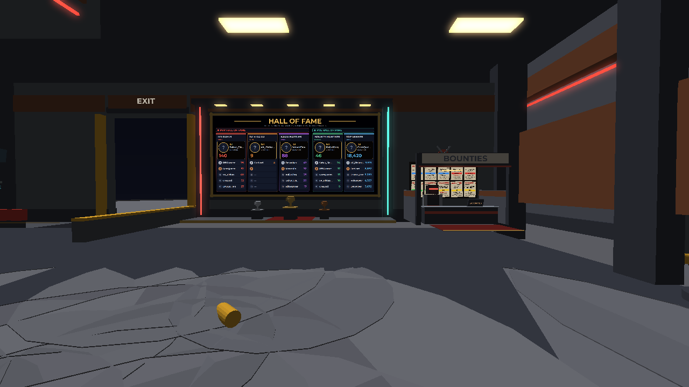
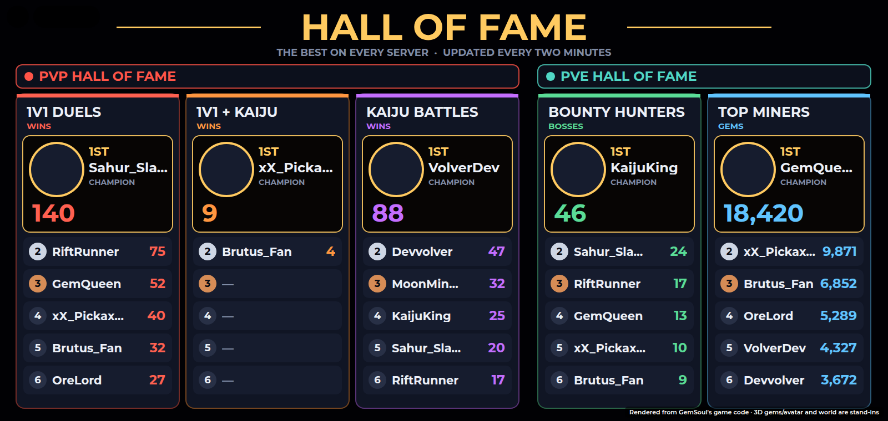
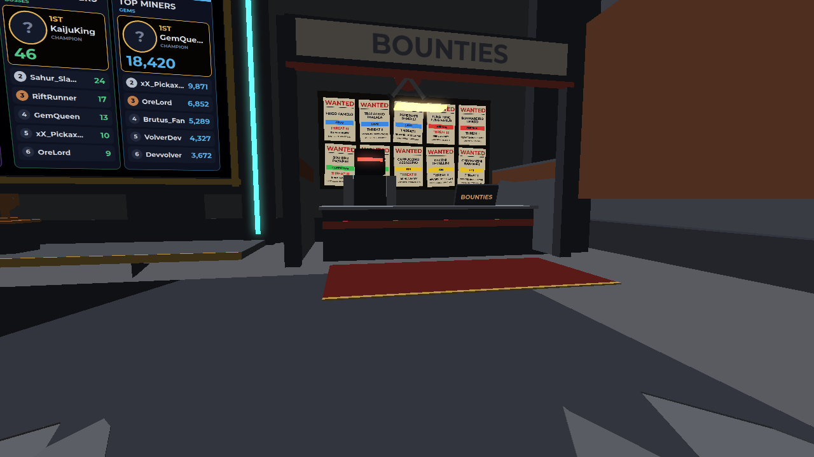
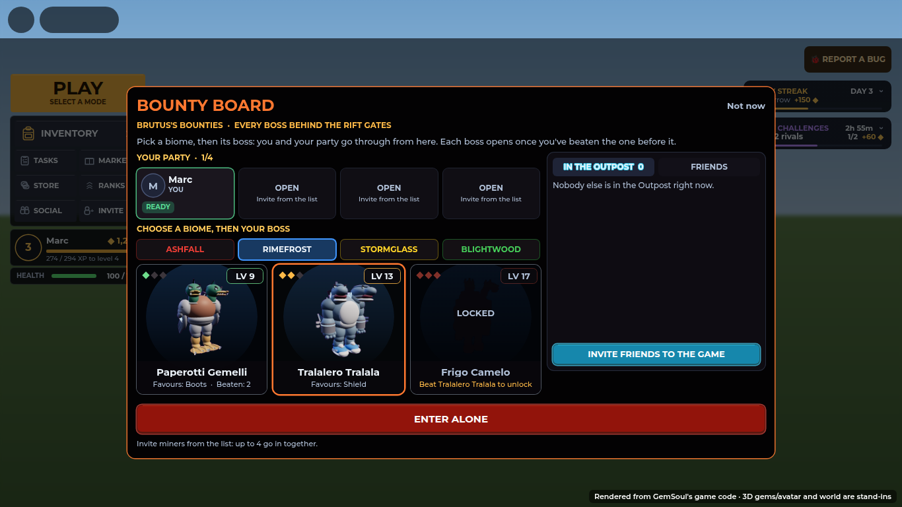
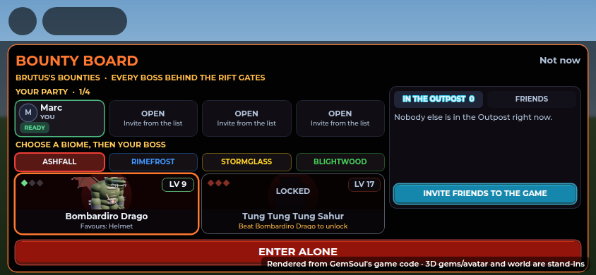
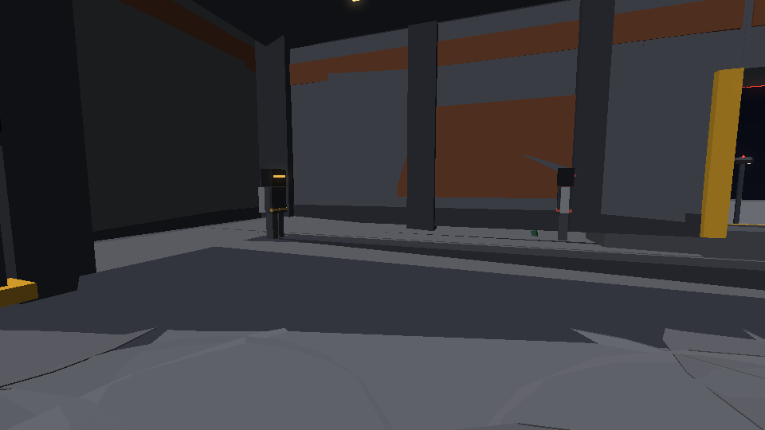
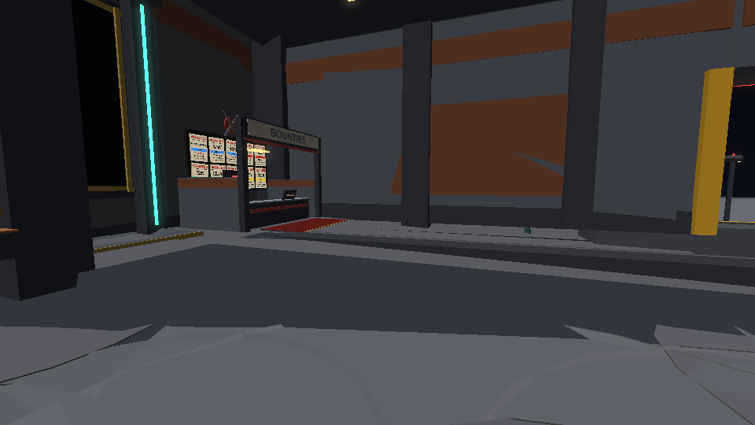

# The Hall of Fame, Brutus's bounties, and no more PROBE-7

*2026-10-22.* The Shelter's east wall, rebuilt: a **Hall of Fame** in place
of the old leaderboard, and a **bounty booth** for Brutus beside it. PROBE-7
is gone for good: Garrick sells the swing refills.

The pictures are offline renders of the game's own code (the board and the
windows drawn from their Luau, the hall from `OutpostWorld`'s parts). They
are stand-ins, not Roblox screenshots.

## The Hall of Fame

One board, two halves, five columns:

| Half | Column | Counts |
| --- | --- | --- |
| **PVP HALL OF FAME** (red) | 1V1 DUELS | ranked 1v1 wins (`Duel.Solo`) |
| | 1V1 + KAIJU | wins in the Kaiju Arena's 1V1 + KAIJU mode (`Stats.MixedWins`; [kaiju-arena.md](kaiju-arena.md#1v1--kaiju)) |
| | KAIJU BATTLES | Kaiju Arena wins (`Stats.KaijuWins`, counted from this round on) |
| **PVE HALL OF FAME** (teal) | BOUNTY HUNTERS | Rift bosses slain, every ladder (`RiftBosses`) |
| | TOP MINERS | gems mined in the Outpost (`Stats.GemsMined`, from this round on) |

Each column has its **champion** on top (headshot, name, the number large),
then places 2 to 6, with gold, silver and bronze badges for the first three.
An empty place reads UNCLAIMED. The subtitle says whether it's the global
board (every server, refreshed every two minutes) or this server's (when
data stores aren't there, as in Studio).

- `Shared.HallOfFame`: the board's columns, its layout and `draw(gui,
  boards, global)`. Pure UI on a SurfaceGui, so the test draws it for real.
- `Server.TopPlayers`: five new boards (Duel, Mixed, Kaiju, Bosses, Mined),
  rows carry `UserId` for the headshots.
- `Server.OutpostServer`: draws it on the wall's `BoardFace`, and only
  redraws when a row changed (`Drawn` attribute).
- `PlayerData.count(player, name, n?)`: a tally in `profile.Stats`, for the
  columns that had none.

The wall around it: a gold-trimmed frame under five spot lamps, a red neon
pylon on the PvP side and a teal one on the PvE side, a dais with gold,
silver and bronze trophies, and two benches facing it.

## Brutus's bounty booth

Brutus is the bounty rep now. His booth stands beside the Hall of Fame: a
lightbox saying **BOUNTIES**, a counter with a terminal, and a wall of
**WANTED** posters, one per Rift boss (its name, element, threat, and
"BRING A PARTY" for the group bosses). Talk to him or walk up to the
counter (prompt: **Bounty Board**) to open the bounty board.

The bounty board puts **every Rift Gate's bosses in one place**. It is the
same window as a gate's lobby (party, invites, ENTER), with a tab for each
biome on top. Pick a biome and then a boss, and you and your party go
through from the counter, just as through that biome's gate. Each boss still
opens once you've beaten the one before it on its ladder.

- `Shared.Bounties`: the biomes' ladders in the Loop's order (`list()`),
  which ladder a boss is on (`elementOf`), and the WANTED poster.
- `Server.RiftServer`: `RiftEnter(player, "Bounty", bossId, together)` and
  `RiftPeek(player, "Bounty")` (all the ladders as `Ladders`). You have to
  stand within `Bounties.Reach` of the counter (`RiftServer.bountyAt`, set
  by Main from `OutpostServer.bountyCounter`).
- `Client.RiftClient.openGate("Bounty")`: the BOUNTY BOARD title and the
  biome tabs.
- Brutus's lines (`Shared.Vendors.ArenaMaster`): **Show me the bounties**,
  **Find me a duel**, how bounties work, what a win streak pays.

## The area

| Before | After |
| --- | --- |
|  |  |

## PROBE-7, removed

PROBE-7 no longer exists anywhere in the game: no crew robot, no station, no
lines. Its Exchange is **SWING REFILLS**, opened from Garrick (**Buy swing
refills**) or the REFILLS button on the HUD. Every message that sent you to
PROBE-7 now sends you to Garrick, and INFO-9's answers and tips say so.

## Tests

- `tests/outpost_cases.luau`: no PROBE-7, the Bounty prompt and posters,
  the Hall of Fame's texts and headshots, no redraw when nothing changed,
  Garrick's refills and Brutus at his counter.
- `tests/kaiju_server_cases.luau`: a bounty from across the Outpost is
  refused; the board lists every biome's ladder; no target, an unknown boss
  and a locked boss are refused; another biome's first boss goes through as
  that biome's trip. A Kaiju Arena win lands on the winner's tally.
- `tests/shelter_life_cases.luau`, `tests/signage_cases.luau`: Brutus at his
  booth, BOUNTIES is an allowed sign word.
- Spanish for every new line (`tests/run_lang.py`).
