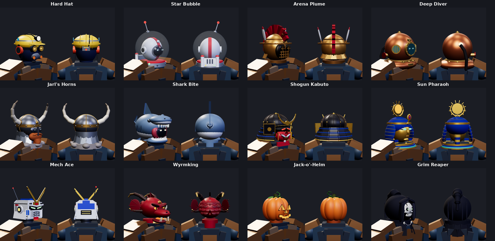
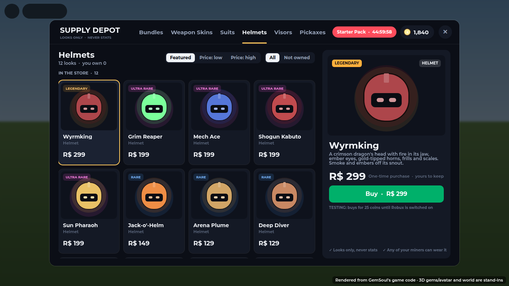
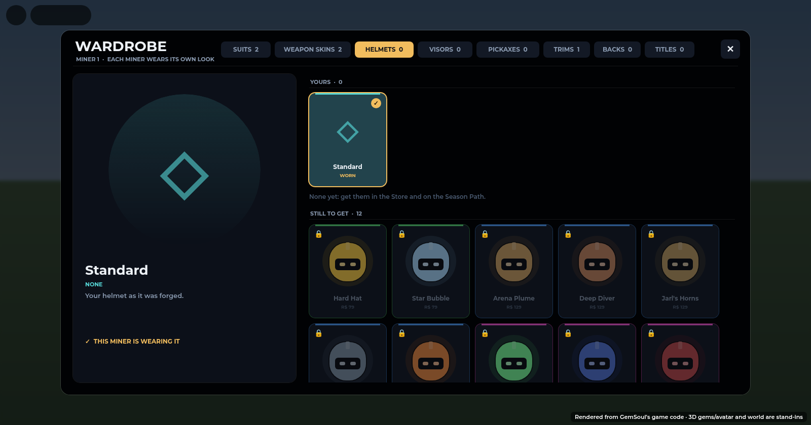
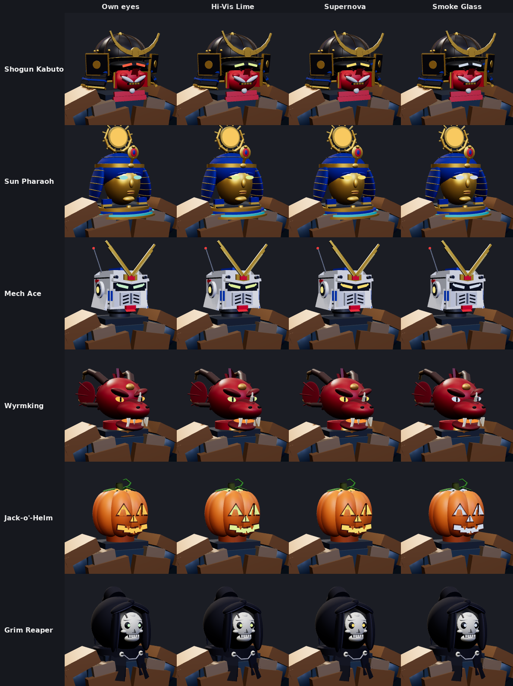
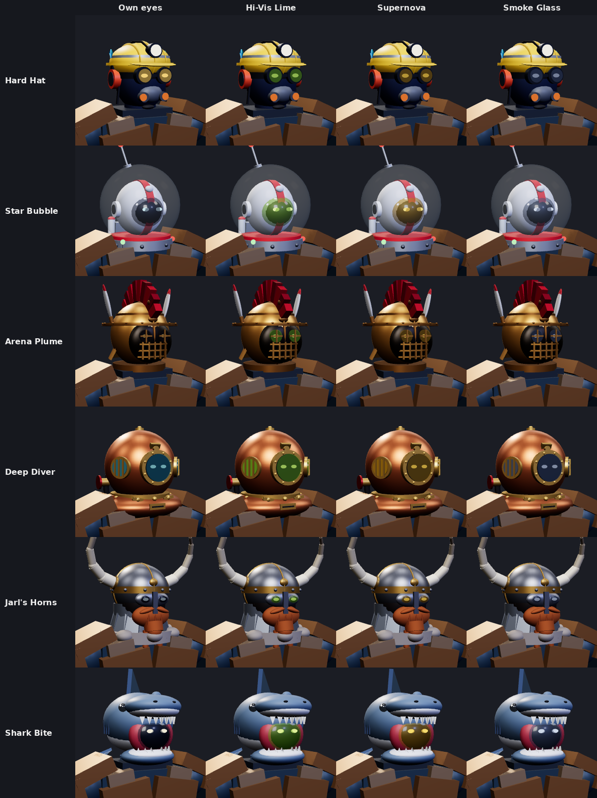

# Helmet skins

Twelve helmet skins. Each one is a whole new head in place of the helmet
you wear. The helmet keeps its stats, rolls and gem; only its look changes.
Each skin has its own silhouette, built from parts welded to the head and
sized to it, so it fits any avatar. Two of them are for Halloween.

| Skin | The look |
| --- | --- |
| Hard Hat | A ribbed yellow site helmet with reflective tape, a gem sticker and a headlamp corded to a battery pack (red tail light). Amber goggles, ear defenders, a dust mask. |
| Star Bubble | A 1950s fishbowl space helmet: a white comms cap with a racing stripe, a smoked shield with eyes behind it, a blinking antenna, and a life-support pack with air tanks on the collar. |
| Arena Plume | A bronze gladiator's helmet with a riveted wide brim, a face of bronze bars over dark mesh with two eye grilles, a griffin's head leading a red horsehair crest, white feathers and a flared neck guard. |
| Deep Diver | A copper diving bonnet: a riveted brass faceplate with glowing eyes behind the port, grilled side ports, wing nuts, a nameplate, an air valve and hose, and bubbles. |
| Jarl's Horns | An iron spangenhelm with spectacle guard and nasal, mail flaring over the shoulders, a braided ginger beard, a fur collar and great ivory horns. |
| Shark Bite | Your head in a shark's jaws, eyes glowing in the dark of its mouth, with a dorsal fin and a tail fin. |
| Shogun Kabuto | A black-lacquered kabuto with gold rivets: a gold crescent crest, gold-edged side wings, a three-tier neck guard laced in blue cord, a red war mask with cheekbones, scowl lines, gold teeth and a flowing white moustache, and a burning red stare. |
| Sun Pharaoh | A gold death mask with sculpted lips and chin, in a lapis-and-gold headcloth, the cobra rearing on its brow, and a burning, rayed sun disc between golden horns. |
| Mech Ace | A mobile-suit head of angled white plates under a blue crest: a tall gold V-fin over a red forehead camera, slanted green eyes under a scowling brow, a vented faceplate with a red chin, swept cheek guards, head vulcans, lit ear sensors and an antenna. |
| Wyrmking | A crimson dragon's head: a long snout with fangs and fire in its jaw, ember eyes, gold-tipped horns, frills, a scaled back and smoke from the nostrils. |
| Jack-o'-Helm *(Halloween)* | A pumpkin with a carved, flickering face (every cut edged dark, fangs left in the grin), lit from inside, its lid cut glowing round the stem, two leaves, embers rising off the top. |
| Grim Reaper *(Halloween)* | A peaked hood with a pointed, grey-worn opening and a long, drooping tail, round a bone skull with green fire licking up out of its eyes; skull clasps and a chain on a tattered mantle, green mist. |

## Getting one

The Store has a **Helmets** tab, between Suits and Visors:

| Skin | Id | Rarity | Robux |
| --- | --- | --- | --- |
| Hard Hat | `HelmetHardHat` | Uncommon | 79 |
| Star Bubble | `HelmetStarBubble` | Uncommon | 79 |
| Arena Plume | `HelmetArenaPlume` | Rare | 129 |
| Deep Diver | `HelmetDeepDiver` | Rare | 129 |
| Jarl's Horns | `HelmetJarlHorns` | Rare | 129 |
| Shark Bite | `HelmetSharkBite` | Rare | 129 |
| Jack-o'-Helm | `HelmetJackOLantern` | Rare | 149 |
| Shogun Kabuto | `HelmetShogun` | Ultra Rare | 199 |
| Sun Pharaoh | `HelmetPharaoh` | Ultra Rare | 199 |
| Mech Ace | `HelmetMechAce` | Ultra Rare | 199 |
| Grim Reaper | `HelmetGrimReaper` | Ultra Rare | 199 |
| Wyrmking | `HelmetWyrmking` | Legendary | 299 |

The Vault holds all twelve.

Like a suit, a visor or a pickaxe, each miner wears its own helmet skin
(`Cosmetics.MinerKinds`). You put one on from the Wardrobe's **HELMETS** tab.
Its "Standard" is the helmet as it was forged.

A skin goes on whatever helmet the miner wears and stays on through helmet
swaps. Take the helmet off and the skin comes off with it.

## Visors on helmet skins

Every helmet skin has eyes that glow, and the eyes always take the selected
visor's colour and movement. A dark glass visor such as Smoke is brightened
until it glows, so the eyes never go dark. Each skin keeps its own eye shapes:
nothing is cut into bands or framed. A visor's particles, sparks and light come
off both eyes alike.

- **Character helmets** (Shogun, Pharaoh, Mech Ace, Wyrmking, Jack-o'-Helm,
  Grim Reaper): their own eyes light in the visor's colour.
  Their glows change colour too: the light inside the pumpkin and its lid
  cut, and the lamps by the eyes. With a visor that holds still, a skin's
  own flicker or pulse carries on in the visor's colour.
- **Glass-faced helmets** (Hard Hat, Star Bubble, Arena Plume, Deep Diver,
  Jarl's Horns, Shark Bite): the glass takes the visor's tint, and the eyes
  glow behind it in the visor's colour.

Without a visor, each skin shows its own eye colour.

Standard helmets take visors exactly as before (bands, rims, a dark lens
behind).

## How it's built

`src/server/Systems/HelmetLooks.luau`:

| Function | What it does |
| --- | --- |
| `HelmetLooks.build(component, character, look)` | Builds skin `look` into the helmet's model, round the character's head. |
| `HelmetLooks.restore(component)` | Puts the skin's own colours back after the gem, rarity and suit passes. Run it before the visor is applied. |
| `HelmetLooks.has(look)` | Whether `look` is a known skin. |
| `HelmetLooks.Looks` | The designs. |

Each part can carry these attributes:

- `VisorFace` marks an eye or lens.
- `VisorFit` is `"Eye"` (a glowing eye) or `"Lens"` (glass in front of the eyes).
- `VisorTint` marks a part lit by the same light as the eyes, such as the
  pumpkin's lid cut.
- `VisorLight` is set on a light that the eyes give off.
- `StoneSeat` marks where the helmet's gem sits.

`Equipment.applyVisor` fits the visor to any helmet whose lens parts carry
`VisorFit`. It does this in `fitVisor`. Helmets without `VisorFit` (the
standard ones) are unchanged.

What `Equipment.dress` does when the miner wears a helmet skin:

1. **Builds the skin instead of the helmet.** The skin is built
   (`HelmetLooks.build`) in place of `ArmorKits.build`, and the head and its
   face are hidden under it (`hideHead`). The old transparency is kept in a
   `SkinHid` attribute on the head and restored when the skin comes off
   (`showHead`).
2. **Seats the gem.** The helmet's gem sits on the skin's `StoneSeat`, just
   in front of it (`seatStone`), instead of the helmet's usual stone spots.
3. **Keeps the suit off it.** The suit pass skips the skin: a suit repaints
   your armour, not the head you bought.
4. **Resets the colours.** `HelmetLooks.restore` runs after the gem, rarity
   and Prismatic passes, then the visor goes on.

The other pieces of code involved:

- **Catalog.** The skins are `Kind = "Helmet"` entries in
  `src/shared/Cosmetics.luau`. Each entry's `Look` is a design in
  `HelmetLooks`.
- **Store.** `Store.TabKinds.Helmets` is the Store tab, and The Vault's loop
  includes Helmet.
- **Wardrobe.** The HELMETS tab is in `Wardrobe.luau`.
- **Previews.**
  - Store tile art is `helmetArt` in `ShopArt.luau`.
  - The 3D preview is `Equipment.cosmeticPreview`, framed on the head
    (`CosmeticView`).
  - The Inventory's preview key now includes the helmet skin and the visor,
    so a change shows straight away.

## Before selling for Robux

Every helmet's Developer Product id in `Store.RobuxProducts` is still `0`.
Until it's set, the Buy button says "Coming soon". While testing, it buys for
coins instead (`Config.TestCosmeticPrice`). Create the twelve products at
the prices above, then paste in their ids (see `docs/store.md`, "To switch
Robux on").

## Tests

- **`tests/gear_look_cases.luau`** wears every skin with gems and a suit on,
  and checks:
  - The skin keeps its own colours under the suit.
  - It has no seams and at least one glowing eye.
  - The gem sits on the skin's stone seat.
  - The head is hidden under the skin and comes back exactly as before once
    the skin is off. This is checked on a plain-look helmet whose head would
    otherwise show.
  - With three visors (a lit one, Smoke and Supernova), the eyes and tints
    glow in the visor's colour, the glass takes its tint, and no bands are
    cut.
  - A one-helmet preview builds the skin.
  - The Store's preview of each skin keeps every rounded part the worn
    skin has. The preview once dropped their meshes, so in the Store
    every dome, egg and tube showed as a box.
- **`tests/skins_store_cases.luau`** checks the catalog:
  - Every skin is a real design and is sold once, with a price.
  - The Store has a Helmets tab.
  - Each miner wears its own.

## Status

The skins are in the game: Store, Wardrobe, previews, the gem and visors.
The images are rendered from the game's own building code with a stand-in
renderer, and haven't been checked in Roblox Studio yet. Each skin uses
37 (Star Bubble) to 129 (Shogun Kabuto, mostly its laced neck guard) parts.
