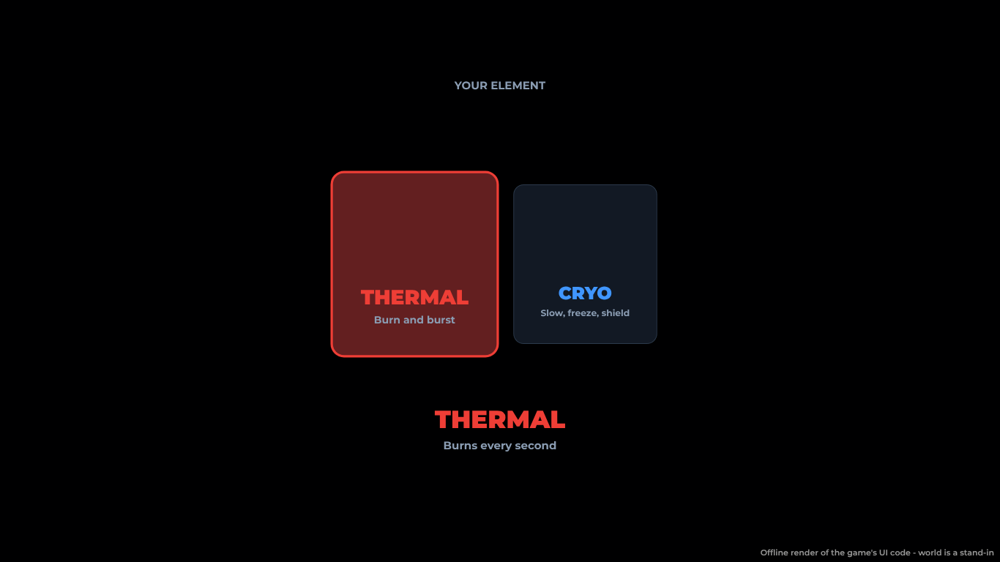

# The intro (a new player's first minute)

*2026-10-30.* The intro teaches the two main things, gems and fighting,
and nothing else. No picker, no kaiju:

1. **Their element, rolled for them.** A quick reel of the two starter
   elements, **Thermal** and **Cryo**, flicks between them and lands on
   the one the server rolled (`FastStart.rollElement`, Systems/Intro:
   whatever the client sends, a new kit gets a random one of the two, in
   the default Skirmisher style). YOUR ELEMENT, its name and what its hits
   do, then on by itself after a beat. A roll that fails says so and
   offers RETRY.
2. **The surge roll** (unchanged): Q, E and R's gems spin and crack open,
   each giving up its Surge, then NEXT · YOUR FIRST FIGHT and on by itself
   (or on a click).
3. **The first fight.** Straight behind the loading screen, which stays up
   till the fight starts (`LoadingFlow.hold`'s `Until`; the player
   attribute `IntroCover`, set by the intro, cleared by `Lobby.client`
   once the fight's on or when there's none to wait for): no inventory,
   lobby or SEARCHING card in between. On a quiet server (fewer than
   `AutoQueue.Intro.Populated`, 6, players) it's the **sparring bot at
   once**; on a busy one the intro queue pairs two new miners, then calls
   a lobby player after 4 s, then the bot at 10 s.

**Kaiju come later, from Wren** at the Kennel ("Roll my free kaiju":
`docs/kaiju-kennel.md`), pointed to by a word on arriving in the Outpost
and by Tasks' **Meet Wren** step (+150 coins).

The old picker (a fighting style, then any of the four elements) is still
there behind `FastStart.Pick` (off): its screens are `style-picker.png` and
`element-picker.png` here.

## Code

| Where | What |
| --- | --- |
| `Shared.FastStart` | `Pick` (off), `StarterElements` (Fire, Frost), `DefaultStyle`, `rollElement` |
| `Systems/Intro` | `prepareLottery`: with `Pick` off, rolls the style and element itself |
| `Client/Intro.client` | the element reel (`ElementRoll`), then `revealMoves`, then `finish`; `close` holds the loading screen with `Until` |
| `Client/Modules/LoadingFlow` | `hold(..., { Until })`: not ready till it says so (a full-screen view of its own still takes over; `Max` still ends it) |
| `Client/Lobby.client` | `firstDuel`: no toast or search card behind the cover; `uncover` |
| `Shared.AutoQueue`, `Systems/Duels` | `Intro.Populated`, `introSearches`: the bot at once on a quiet server |
| `Client/KaijuHud`, `Systems/KaijuServer` | no starter roll by itself any more; a word about Wren |
| `Shared.Vendors`, `Client/Dialogue` | Wren's "Roll my free kaiju" (`Only`) and her greeting for a new player |

## Tests

| Runner | What |
| --- | --- |
| `run_lottery_ui` | the picker (Pick on) and the fast start as it is: no picker, Thermal or Cryo on the reel, RETRY, on by itself to the surge roll and the fight, no kaiju, the loading screen held till the fight (Cryo, Thermal after a failed roll, a saved kit) |
| `run_fast_start` | only Thermal or Cryo, both turning up; the server rolls it; no kaiju roll in the intro |
| `run_duels` | the bot at once on a quiet server; the search on a busy one |
| `run_kaiju` | an owed roll waits for Wren, never handed out by itself |
| `run_outpost` | Wren's options fit the dialogue's five rows either way |
| `run_training_rewards` | Meet Wren pays |

