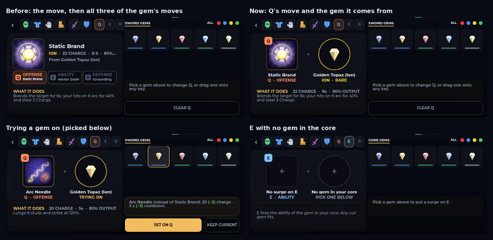
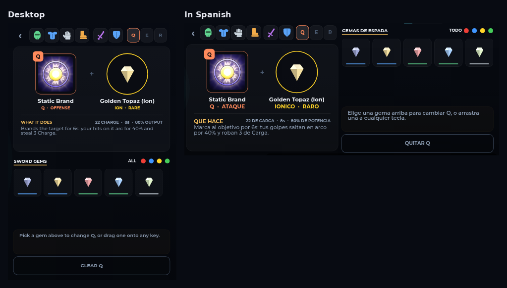

# The Q / E / R view

Open Q, E or R in the Inventory and the card shows that key's move and the
gem it comes from, laid out like a piece and its gem.

## Before

The card showed the move's icon and words, then a strip with all three of
the gem's moves (Q, E and R). The key you had opened was one of three alike
chips, so it read as three moves on one key.

## Now

- **The square: the move.** Its icon, with the key on the corner in the
  key's colour (Q orange, E blue, R green). Under it: the move's name, then
  the key and its job ("Q · OFFENSE"). A ★ marks a signature move (it rolls
  at half the odds).
- **The circle: the gem it comes from.** Its art, name, element and rarity.
  In the triad Q reads the sword's gem, E the core gem and R the shield's.
- **WHAT IT DOES:** the move's description. Its cost, cooldown and output
  are on the right of that line. A Legendary gem's flourish is a gold ✦
  line under the description. On a phone the longest of these step down a
  size, so they stay inside the card.
- **Tap either one** to open the gem window on that gem. All three of its
  moves are there.
- **Trying a gem on** (picking one below): both edges turn gold and the
  gem's line reads TRYING ON. The box under the grid says what changes
  against the move on the key now.
- **No gem:** both are empty. The name says there's no surge on the key,
  the gem's line says which socket is empty, and the text says what the key
  reads.

On a phone, the row of slots and keys over the card is 10 points tighter.
Before, R ran past the card into the gem grid's column.

## Code

`drawDetail` in `src/client/Modules/InventoryV2.luau`. The key view uses the
piece view's two wells:
- `PieceWell` shows the move (`MoveGlyph`, painted by `SurgeIcons`), with
  the key on `KeyBadge`;
- `GemWell` shows the gem;
- `PerkStats` holds the cost, cooldown and output.

The old `TraitStrip` and the separate surge layout are gone.
