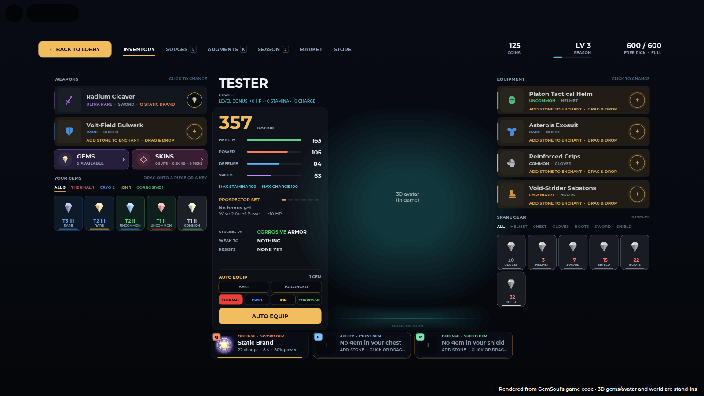
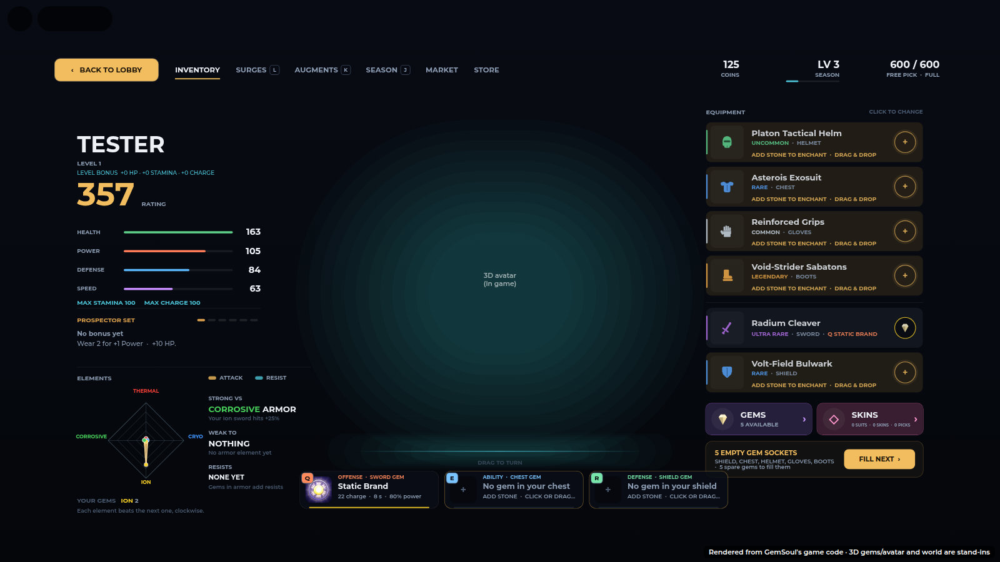
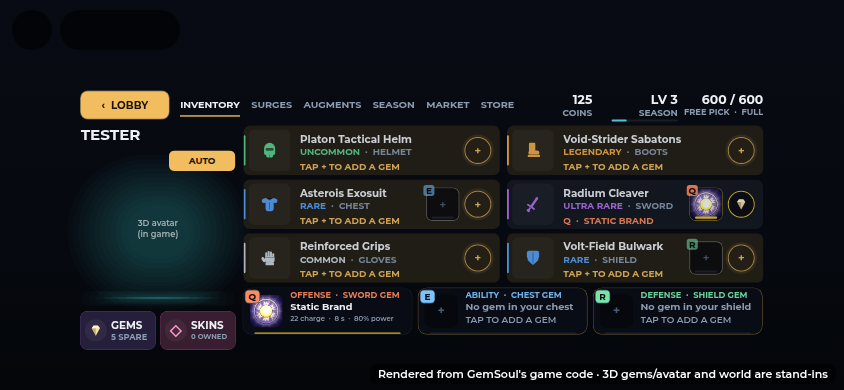
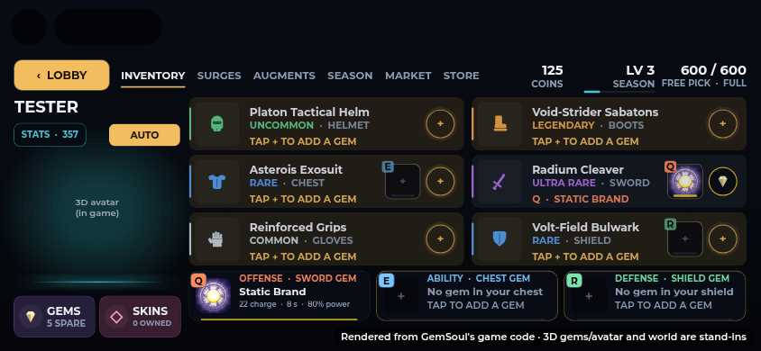
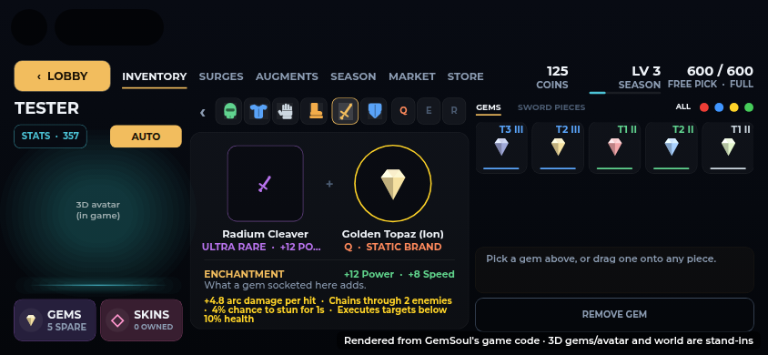
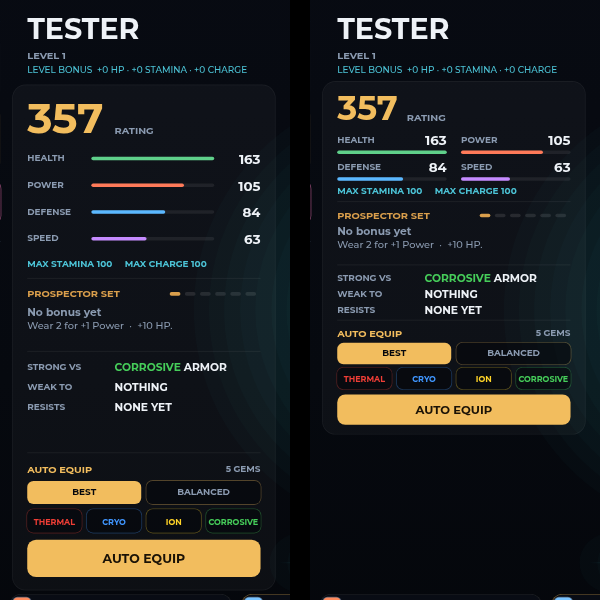
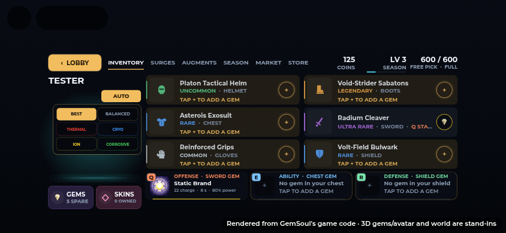
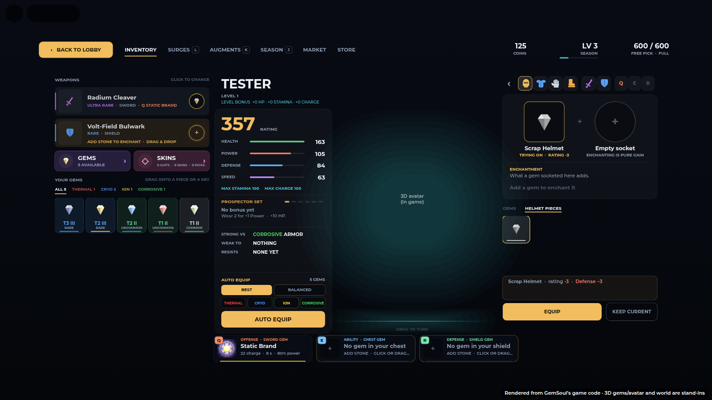
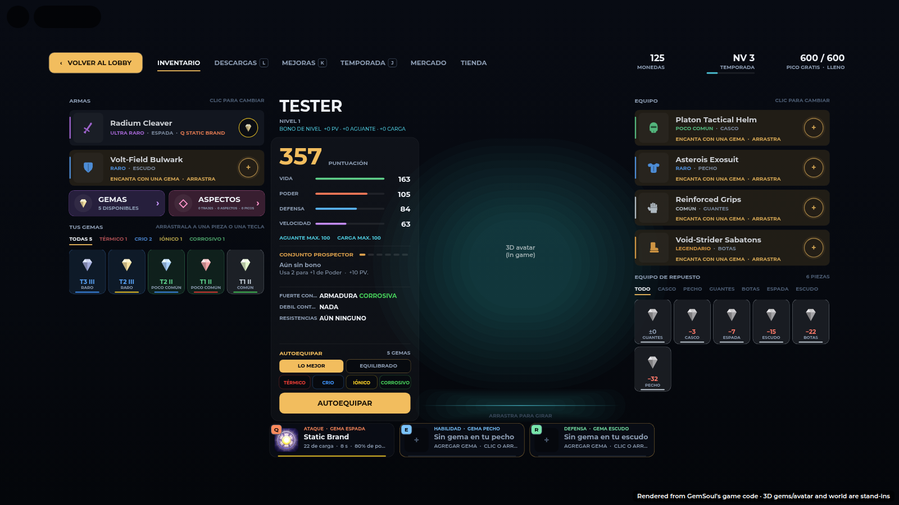

# The Inventory: your gems, your gear, AUTO EQUIP

The Inventory (Modules/InventoryV2) on a computer, laid out as the sketch asked:
weapons and gems on the left, who you are and AUTO EQUIP left of the miner,
armor and spare gear on the right, Q / E / R along the bottom.

| Before | Now |
| --- | --- |
|  |  |

## Left: weapons, then your gems

- **WEAPONS**: your sword and your shield, each a row with its gem socket.
  Click one and the right column turns into that piece, as an armor row
  does.
- **The surge in the row**: the sword's, chest's and shield's rows show the
  surge their gem gives Q, E or R, left of the socket: its icon (the same
  art as the Q / E / R cards), its key, a line in the gem's colour, and its
  name on a line of its own under the piece's rarity (`Q · STATIC BRAND`).
  With no gem, the tile is empty but for its key.

- **GEMS** (the gem window) and **SKINS** (the Wardrobe), side by side.
- **YOUR GEMS**: every loose gem you have, rarest first. A tab per element
  (`ALL 5 · THERMAL 1 · CRYO 2 · ION 1 · CORROSIVE 1`, each in its colour).
  Each gem shows:
  - its **tier level**, `T3 III`: the tier of the surge it carries
    (1 Novice to 4 Master) and its rank (I to III), from
    `GemRoller.levelLabel`, in its rarity's colour;
  - its rarity under that (UNCUT for one that can't be socketed yet);
  - a line in its element's colour.

  Drag one onto any row or Q / E / R card to socket it; click one for the
  gem window on it.

The gem window's list and the gems under an open piece show the tier level
too (top right of each gem).

## Middle: you, your stats, AUTO EQUIP

Left of the miner (who now stands between this card and your armor): your
name and level, then a card with your rating, the four stats, your armor
set, what you're strong against, weak to and resist, and **AUTO EQUIP**.

The card is packed close and is only as tall as what's in it (`buildLeft`
sets its height after `buildAuto`). It's about 155 px shorter than it was,
roughly a third, and nothing was taken out:

- The rating is a size down (38).
- The four stats sit two by two: name and value over a thin bar.
- The set and matchup lines have less space between them.
- AUTO EQUIP comes straight after the matchups instead of being pinned to
  the foot of the column, and its chips and button are a little slimmer.

On a phone the card is a sheet over the screen: **STATS · 212** over the
miner (your rating on it) opens it, with everything the desktop card has,
scrolling if it runs long; a tap outside or × closes it
(`buildStatsSheet`). The piece card lists every stat on the piece beside
its perk's name on both layouts, so a phone, with no hover card, still
shows them all (`allStats` in `drawDetail`).

### AUTO EQUIP

Pick a build and press **AUTO EQUIP**: the server puts on the gear you own
that fits it best and fills the gem sockets (Forge's `"AutoEquip"`,
`Shared.AutoEquip`). Above the button, what it would change
(`+56 RATING · 4 GEAR · 2 GEMS`, or NOTHING TO CHANGE).

| Mode | Gear | Gems |
| --- | --- | --- |
| **BEST** | the most total rating | empty sockets get your most valuable gem; the helmet, gloves and boots swap theirs for a more valuable one |
| **BALANCED** | the most even stats: the product of the four, each against what you have now, so a fair lift to all beats a big lift to one | as BEST, but a new element beats a repeat |
| **THERMAL / CRYO / ION / CORROSIVE** | armor whose affinity affixes are that element first, then the most rating | every socket that isn't that element takes its most valuable gem of it, while there are some |

- The sword's, chest's and shield's gems are Q, E and R: BEST and BALANCED
  only fill those when they're empty, so your moves don't change under you.
  An element build swaps them for that element's (that's the build).
- Only gear you own, of your class, not another miner's; no shield under a
  two-handed weapon (the weapon goes on first).
- Not mid-match (the same rule as changing gear by hand), and the gems only
  where you can socket by hand (Vey's rule: anywhere in the beta, it's
  menu-only).
- A slot's gem stays in the slot when its piece changes (below), so a swap
  never drops one.

On a phone, **AUTO** sits over the miner; tap it for the six builds, tap
one to put it on.

## Right: armor, then your spare gear

- **EQUIPMENT**: helmet, chest, gloves, boots, each with its socket.
- **SPARE GEAR**: every piece you own and don't wear, a tab per slot
  (`ALL · HELMET · CHEST · GLOVES · BOOTS · SWORD · SHIELD`), the best swap
  first. Each shows the rating it would add (`+12` green, `−4` red, `±0`).
  Click one: the column turns into its slot with it tried on, and EQUIP
  puts it on.

## A slot's gem stays in the slot

Swap a piece and the gem in that slot now enchants the new piece
(`PlayerData.equipGear`); before, it stayed with the old piece in your bag.
An empty slot takes the new piece's own gem, if it kept one from before
this; a piece that kept one, going into a slot that has one, sends its own
back to your pouch. The Inventory's compare line says so ("The slot's gem
moves onto it.") and tries the piece on with the slot's gem.

## In Spanish

## In the code

| Where | What |
| --- | --- |
| `Shared.AutoEquip` | `Modes`, `valid`, `label`, `rating`, `plan(profile, mode)`: the gear (a few passes over the slots, so a set bonus counts) and the gems |
| `Systems/Forge` | `"AutoEquip"`: checks the mode and `Combat.canChangeBuild`, equips the plan's gear, then its gems (`Enchanting.canEnchant`) |
| `Systems/PlayerData` | `equipGear`: the slot's gem moves onto the new piece |
| `Shared.GemRoller` | `levelLabel(gem)`: `"T3 II"` |
| `Modules/InventoryV2` | `buildRow` (each row; the sword's, chest's and shield's `SurgeTile`, drawn in `drawRows`), `buildWeapons` (left), `buildLeft` + `buildAuto` (the card; compact: `buildStatsSheet`, the card in a sheet STATS opens), `buildBag` (spare gear), `drawPouch`, `drawBag`, `drawAuto`, `allStats` (every stat of a piece, on its card) |
| `tests/inventory_stats_cases.luau` | the stats sheet and STATS button are built compact, the rating is on the button, the piece card lists every stat, the Spanish is there |
| `tests/auto_equip_cases.luau` | every mode, two hands, other miners, gems, a plan applied leaves nothing to do, and the server request |
