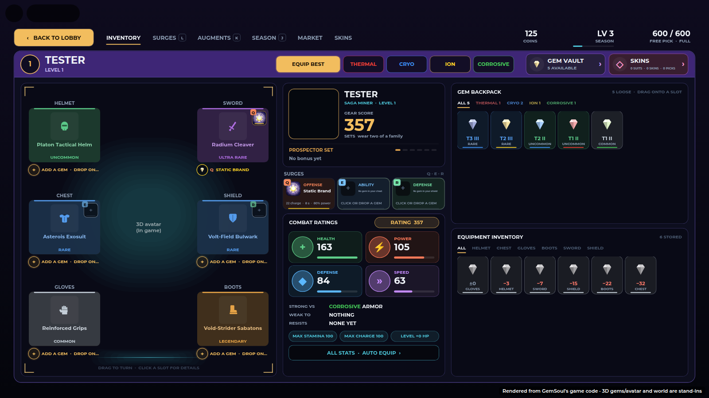
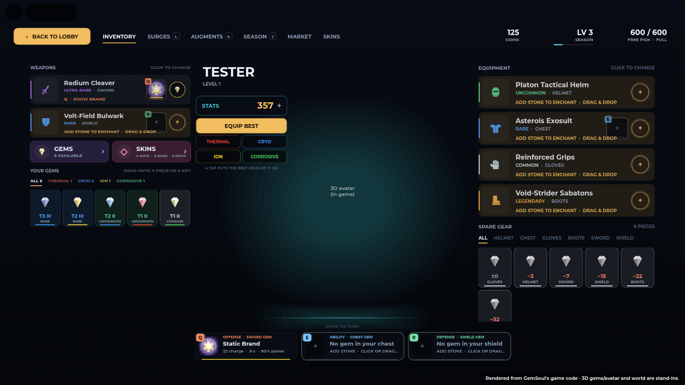
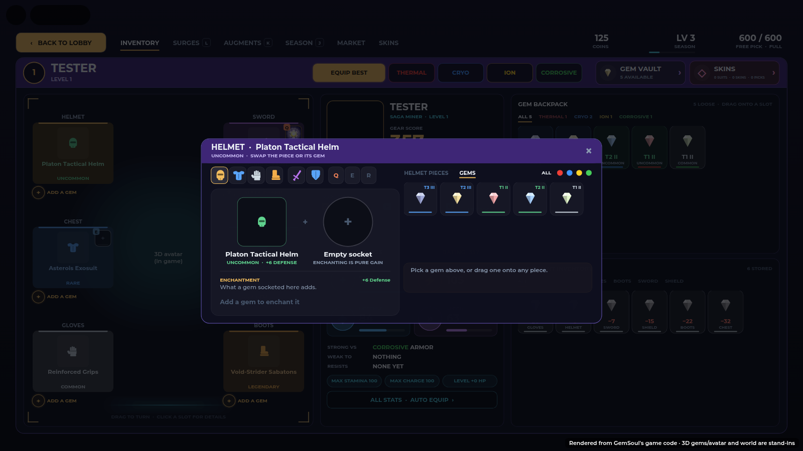
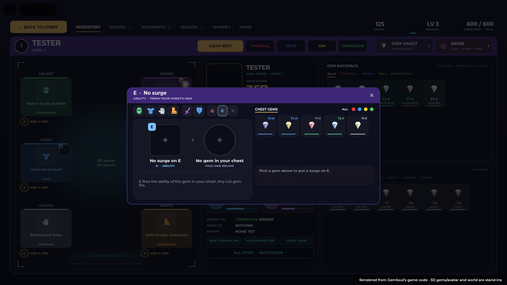
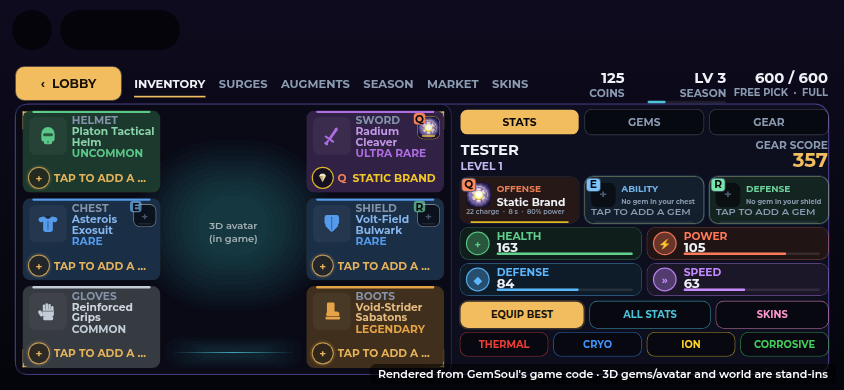
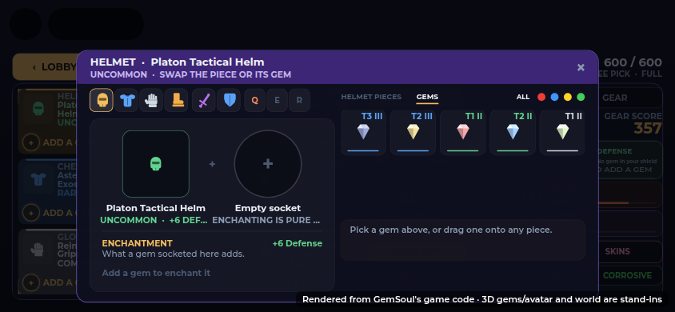
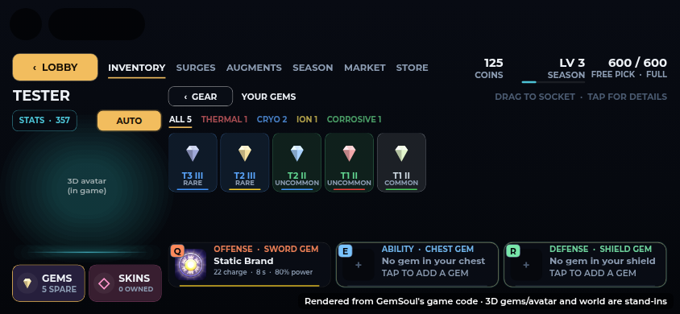
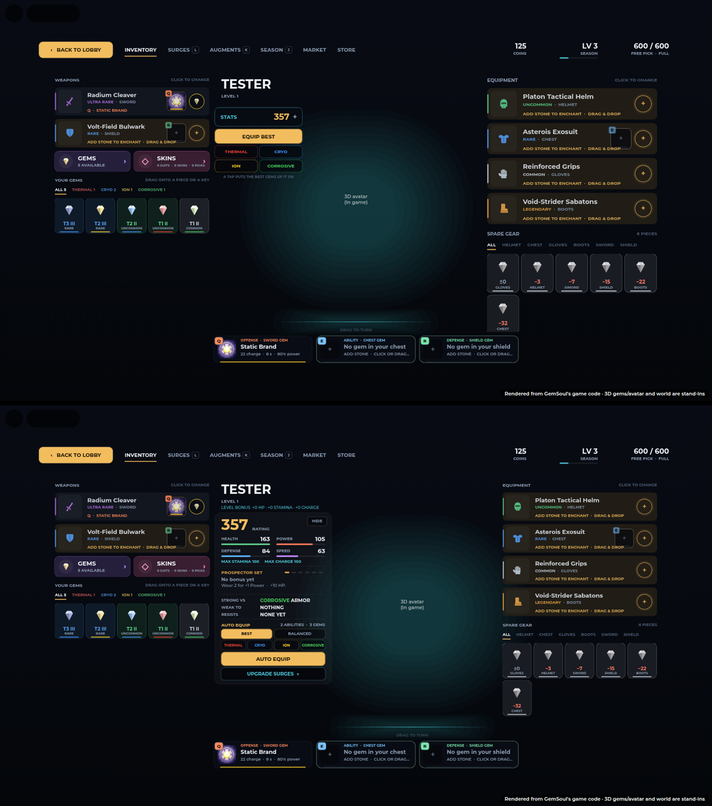

# The Inventory: your gems, your gear, AUTO EQUIP

## The paper doll (current layout)

The Inventory is now laid out like the old CharacterUI panel, updated for
today's game: your miner in the middle of a paper doll, the six slots around
it, a summary column, and the two backpacks on the right.

| Before | Now |
| --- | --- |
|  |  |

- **Header**: level badge, name and sets; EQUIP BEST and the four element
  buttons (AUTO EQUIP); GEM VAULT and SKINS.
- **Paper doll**: Helmet, Chest and Gloves on the left; Sword, Shield and
  Boots on the right; the miner in the middle (drag to turn). Each slot is a
  card tinted by the piece's rarity, with its gem socket underneath ("ADD A
  GEM" when the socket is empty, otherwise the gem and the Q/E/R move it
  gives). The Sword, Chest and Shield cards show their Q / E / R surge tile.
- **Summary**: portrait, GEAR SCORE, the set bonus, the Q / E / R SURGES
  cards, COMBAT RATINGS (health, power, defense, speed, strong vs / weak to
  / resists), and ALL STATS · AUTO EQUIP, which opens the full stats sheet.
- **GEM BACKPACK**: every loose gem by element. Drag one onto a slot, card
  or socket, or onto a Q / E / R card, to enchant it.
- **EQUIPMENT INVENTORY**: spare pieces by slot, with the gear-score change
  if you wear each one.

### Click anything for its window

Clicking a slot card, its socket, or a Q / E / R card opens a **detail
window** over the screen. It has the piece and its gem side by side, the
enchantment it gives, and a list on the right: **PIECES** (spares for that
slot) or **GEMS** (gems that fit it, filtered by element). Clicking the
socketed gem opens it in the Gem Vault. Tabs across the top jump to any other
slot or key. Close it with ×, Escape, or a click outside. Dragging a gem
still works with the window open: it closes and the doll takes the drop.

| A piece | A key (E) |
| --- | --- |
|  |  |

### On a phone

The doll fills the left side. The right side has three tabs: **STATS**
(score, surges, ratings, EQUIP BEST, ALL STATS, SKINS, elements), **GEMS**
(the backpack) and **GEAR** (spare pieces). Tapping a slot opens the same
window.

| Phone | Phone, a slot's window |
| --- | --- |
|  |  |

## Earlier layout (kept for reference)

The Inventory (Modules/InventoryV2) on a computer, laid out as the sketch asked:
weapons and gems on the left, who you are and AUTO EQUIP left of the miner,
armor and spare gear on the right, Q / E / R along the bottom.

| Before | Now |
| --- | --- |
|  |  |

## Left: weapons, then your gems

- **WEAPONS**: your sword and your shield, each a row with its gem socket.
  Click one and the right column turns into that piece, as an armor row
  does.
- **The surge in the row**: the sword's, chest's and shield's rows show the
  surge their gem gives Q, E or R, left of the socket: its icon (the same
  art as the Q / E / R cards), its key, a line in the gem's colour, and its
  name on a line of its own under the piece's rarity (`Q · STATIC BRAND`).
  With no gem, the tile is empty but for its key.

- **GEMS** (the gem window) and **SKINS** (the Wardrobe), side by side.
- **YOUR GEMS**: every loose gem you have, rarest first. A tab per element
  (`ALL 5 · THERMAL 1 · CRYO 2 · ION 1 · CORROSIVE 1`, each in its colour).
  Each gem shows:
  - its **tier level**, `T3 III`: the tier of the surge it carries
    (1 Novice to 4 Master) and its rank (I to III), from
    `GemRoller.levelLabel`, in its rarity's colour;
  - its rarity under that (UNCUT for one that can't be socketed yet);
  - a line in its element's colour.

  Drag one onto any row or Q / E / R card to socket it; click one for the
  gem window on it.

The gem window's list and the gems under an open piece show the tier level
too (top right of each gem).

**On a phone** there's no gems column, so **GEMS** (bottom left) opens
YOUR GEMS in place of the gear list on the right: the element tabs, then
your loose gems as tiles. **‹ GEAR** brings the gear list back, and so does
starting to drag a gem. Drag a gem onto a piece's row or a Q / E / R card to
socket it; tap one for the gem window. GEMS is lit gold while the tab is
open. (On a computer, GEMS still opens the gem window, as YOUR GEMS is
always on the left there.)

## Middle: you, your stats, AUTO EQUIP

Left of the miner (who now stands between this card and your armor): your
name and level, then a card with your rating, the four stats, your armor
set, what you're strong against, weak to and resist, and **AUTO EQUIP**.

The card is packed close and is only as tall as what's in it (`buildLeft`
sets its height after `buildAuto`). It's about 155 px shorter than it was,
roughly a third, and nothing was taken out:

- The rating is a size down (38).
- The four stats sit two by two: name and value over a thin bar.
- The set and matchup lines have less space between them.
- AUTO EQUIP comes straight after the matchups instead of being pinned to
  the foot of the column, and its chips and button are a little slimmer.

**Folded by default (desktop).** The card starts folded: in its place a
**STATS** button with your rating on it, **EQUIP BEST** under it, and an
element each (THERMAL, CRYO, ION, CORROSIVE). A tap on an element puts that
build on at once: the best gems of that element (the same as picking it in
AUTO EQUIP and pressing the button). Folded, the miner moves to the middle
of the screen and the armor column grows by a tenth (its spare gear a
little shorter to fit). **STATS** opens the full card, with a **HIDE**
button at its top right, and the folded buttons hide while it's open: the
card's AUTO EQUIP does their job (`buildStatsMini`, `setStatsOpen`).

On a phone the card is a sheet over the screen: **STATS · 212** over the
miner (your rating on it) opens it, with everything the desktop card has,
scrolling if it runs long; a tap outside or × closes it
(`buildStatsSheet`). The piece card lists every stat on the piece beside
its perk's name on both layouts, so a phone, with no hover card, still
shows them all (`allStats` in `drawDetail`).

### AUTO EQUIP

Pick a build and press **AUTO EQUIP**: the server puts on the gear you own
that fits it best and fills the gem sockets (Forge's `"AutoEquip"`,
`Shared.AutoEquip`). Above the button, what it would change
(`+56 RATING · 4 GEAR · 3 ABILITIES · 2 GEMS`, or NOTHING TO CHANGE):
ABILITIES are new gems on Q, E and R, GEMS the rest.

| Mode | Gear | Gems |
| --- | --- | --- |
| **BEST** | the most total rating | Q, E and R get your strongest moves, whatever their element; the helmet, gloves and boots swap theirs for a more valuable gem |
| **BALANCED** | the most even stats: the product of the four, each against what you have now, so a fair lift to all beats a big lift to one | your Q, E and R stay (an empty one is filled); the rest as BEST, but a new element beats a repeat |
| **THERMAL / CRYO / ION / CORROSIVE** | armor whose affinity affixes are that element first, then the most rating | Q, E and R get that element's strongest moves; the helmet, gloves and boots its most valuable gems; any gem of another element goes |

- The sword's, chest's and shield's gems are Q, E and R. A gem's moves are
  as strong as its rarity first (the "% power" they show: Common 60% up to
  Legendary 100%, with its Flourish), then its Size, Clarity and Cut
  (`AutoEquip.power`). BEST puts the strongest of your loose gems on Q,
  the next on E, then R, each only when it's stronger than what's there,
  whatever its element. An element build does the same with that element's
  gems only, so it upgrades a weaker gem of its own element too. The gem
  that comes out goes back in your pouch and can fill another socket.
  *2026-10-27*: BEST used to leave Q, E and R alone once they were full.
- Only gear you own, of your class, not another miner's; no shield under a
  two-handed weapon (the weapon goes on first).
- Not mid-match (the same rule as changing gear by hand), and the gems only
  where you can socket by hand (Vey's rule: anywhere in the beta, it's
  menu-only).
- A slot's gem stays in the slot when its piece changes (below), so a swap
  never drops one.
- Every build also puts on your best looks: for each kind (suit, weapon
  and shield skin, helmet, visor, pickaxe, trim, back piece) the rarest
  one you own, when it's rarer than what you wear; one as rare as yours
  stays on (`AutoEquip.looks`, applied by Forge with `setCosmetic`).

On a phone, **AUTO** sits over the miner; tap it for the six builds, tap
one to put it on.

### Upgrade cues

After any profile update (including dungeon rewards, mining and trades),
the lobby's **INVENTORY** tile pulses gold and shows an up arrow if the
owned stash has an available upgrade. Inside, **BEST** and its **AUTO EQUIP**
button pulse for that build. Selecting another mode keeps the cue on BEST,
so it doesn't imply that the other build will apply the recommendation.

**UPGRADE SURGES**, below AUTO EQUIP (inside AUTO on phones), pulses cyan
along with the affected Q/E/R cards. This separate action fills empty
surge sockets or replaces a gem with one of the same element and the same
move for that key, with no lower rarity, Size, Clarity or Cut and at least
one improvement. If Q and R share the weapon, both moves must be preserved.
Different moves remain manual choices. Already-socketed gems and other
miners' gems are excluded. The server rechecks the recommendation and
enchanting/combat rules when pressed; nothing equips just from receiving loot.

The cues recalculate and clear as the recommendations are applied, removed,
or no longer available. They use a slow border pulse rather than flashing
the whole panel. `Shared.UpgradeRecommendations` owns the comparison;
`Modules.UpgradeHints` caches it once per coalesced profile update.

## Right: armor, then your spare gear

- **EQUIPMENT**: helmet, chest, gloves, boots, each with its socket.
- **SPARE GEAR**: every piece you own and don't wear, a tab per slot
  (`ALL · HELMET · CHEST · GLOVES · BOOTS · SWORD · SHIELD`), the best swap
  first. Each shows the rating it would add (`+12` green, `−4` red, `±0`).
  Click one: the column turns into its slot with it tried on, and EQUIP
  puts it on.

## A slot's gem stays in the slot

Swap a piece and the gem in that slot now enchants the new piece
(`PlayerData.equipGear`); before, it stayed with the old piece in your bag.
An empty slot takes the new piece's own gem, if it kept one from before
this; a piece that kept one, going into a slot that has one, sends its own
back to your pouch. The Inventory's compare line says so ("The slot's gem
moves onto it.") and tries the piece on with the slot's gem.

## In Spanish

## In the code

| Where | What |
| --- | --- |
| `Shared.AutoEquip` | `Modes`, `valid`, `label`, `rating`, `plan(profile, mode)`: the gear (a few passes over the slots, so a set bonus counts) and the gems |
| `Systems/Forge` | `"AutoEquip"`: checks the mode and `Combat.canChangeBuild`, equips the plan's gear, then its gems (`Enchanting.canEnchant`) |
| `Systems/PlayerData` | `equipGear`: the slot's gem moves onto the new piece |
| `Shared.GemRoller` | `levelLabel(gem)`: `"T3 II"` |
| `Modules/InventoryV2` | `buildRow` (each row; the sword's, chest's and shield's `SurgeTile`, drawn in `drawRows`), `buildWeapons` (left), `buildLeft` + `buildAuto` (the card; compact: `buildStatsSheet`, the card in a sheet STATS opens), `buildBag` (spare gear), `drawPouch`, `drawBag`, `drawAuto`, `allStats` (every stat of a piece, on its card) |
| `tests/inventory_stats_cases.luau` | the stats sheet and STATS button are built compact, the rating is on the button, the piece card lists every stat, the Spanish is there |
| `tests/auto_equip_cases.luau` | every mode, two hands, other miners, gems, a plan applied leaves nothing to do, and the server request |
