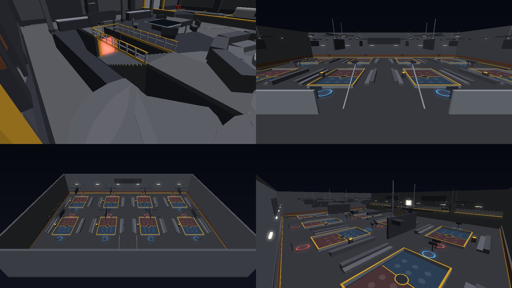
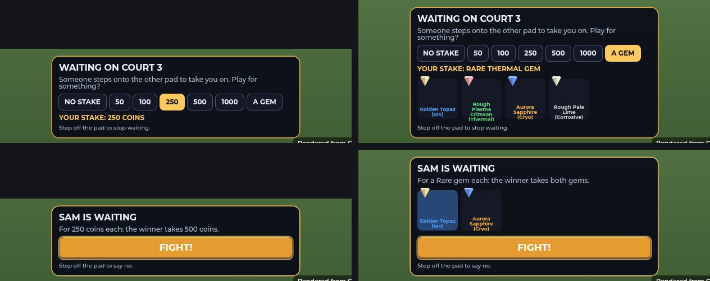
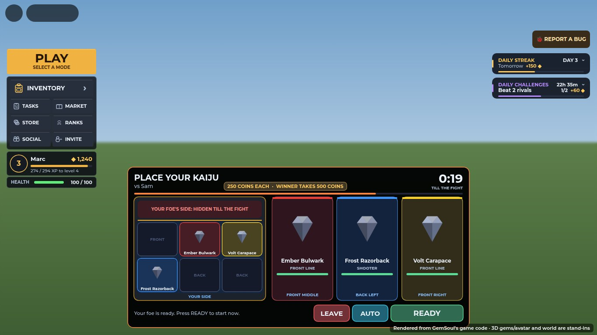
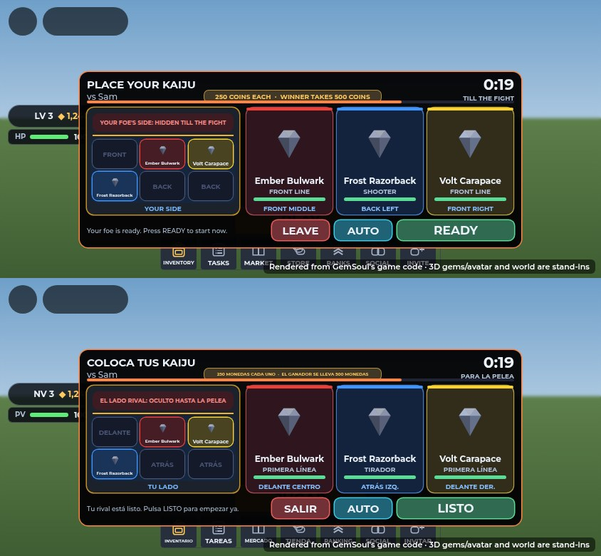
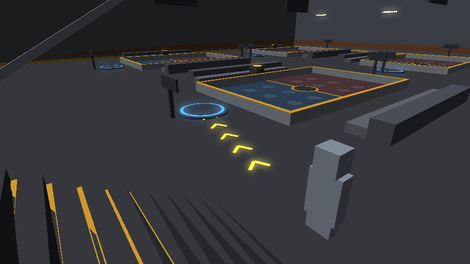

# The Kaiju Arena: downstairs, rows of courts, stakes and arrows on the ground

Kaiju battles now have a home of their own. Take the stairs down from the
Shelter and you're on the balcony of the **Kaiju Arena**: a hall with eight
courts in two rows, like ping-pong tables. Each court has a pad at either
end:

1. Stand on a pad and you're waiting for a challenger.
2. Someone steps onto the other pad and says FIGHT.
3. You both get 25 seconds to drag your kaiju into place.
4. Your kaiju fight it out on that court while everyone else watches from
   the aisles and the balcony.

The winner's kaiju are healed, and you can play for coins or a gem, shown
on the court's board and pedestal for everyone to see.

Subtle yellow arrows on the floor lead you where to go: to the stairs when
someone's waiting downstairs, to a free pad once you're there, and through
the Rift's caves.

The 3D pictures are offline renders of the parts the server builds
(`Server/World/KaijuPitWorld`, `Server/World/OutpostWorld`), drawn by the
trailer renderer. They are **not Roblox screenshots**: lighting, glass and
neon are only roughly matched, and the boards' and signs' text (SurfaceGuis)
isn't drawn. The screen shots are the real client code rendered by the UI
harness. A kaiju's portrait there is a stand-in gem, because the harness
can't draw a ViewportFrame's 3D model. In the game it's the kaiju's own
model.

## The way down

- **In the Shelter.** A stairwell is cut into the hall's floor on the west
  side, by the old arena stage. The stage's sign now reads **DOWNSTAIRS:
  TAKE THE WEST STAIRS**.
  - 13 steps go down to a landing and a lit doorway.
  - Over the doorway: **KAIJU ARENA / DOWNSTAIRS: KAIJU BATTLES**.
  - A rail runs round the other three sides of the well, with hazard
    paint round its lip.
- **Going down.** Walk onto the landing. A moment's cover (**KAIJU ARENA**)
  and you're on the hall's balcony, facing the courts.
  - Your kaiju come with you.
  - You can't take a mech down: "Hop out of the mech first: it won't fit
    down the stairs."
- **Coming back up.** The lit doorway behind the balcony (**UP TO THE
  SHELTER**) takes you back to the top of the stairs.
  - Walking up mid-battle forfeits it.
- **Where it is.** The hall is 150 studs under the Shelter, inside the Core.
  The frontier (critters, rifts, raids) leaves it alone, and so does the
  Outpost's "stranded" check.

## The hall

- **Size.** 216 × 160 studs and 36 high.
- **The balcony.** A deck along the north wall, 12 up, with a glass rail.
  A 20-step stair runs down off it to the floor.
- **The courts.** Eight of them, in two rows of four, with wide aisles
  between. Each court has:
  - bleachers along both sides;
  - floodlights over it;
  - a board over it;
  - a pedestal by its side.
- **Signs.**
  - **KAIJU ARENA** on the north and south walls.
  - **STAND ON A PAD · WAIT FOR A CHALLENGER · 25 S TO PLACE YOUR KAIJU**
    facing you as you arrive.
  - **HOW IT WORKS** on the balcony's face beside the stairs, off the floor
    and out of the way.

## A court

- **The mat.** 34 × 22 studs, half blue and half red, with each side's six
  places painted on it and the court's number in the middle. Rails, and
  invisible walls on them, keep the kaiju in.
- **The pads.** A ring at each end: blue (A) to the north, red (B) to the
  south. A pad lights up while someone's on it.
- **The board** shows, on both faces:
  - **COURT n**;
  - what's happening: **OPEN**, **WAITING FOR A CHALLENGER**, **CHALLENGER
    STEPPED UP**, **PLACING** with its clock, **FIGHTING** with its clock,
    then **X WINS** or **A DRAW**;
  - both players' names, or "STEP ON THE BLUE PAD" for an empty one;
  - while they fight, each side's health left as a bar;
  - the stake: **250 COINS EACH · WINNER TAKES 500 COINS**.
- **The pedestal** shows the stake for everyone: a stack of coins, or the
  gem itself turning in its element's colour, with a **STAKE** billboard
  over it.

## Waiting, challenging, and stakes

**On a pad, waiting.** Your card reads **WAITING ON COURT n**. Choose
what to play for:

- **NO STAKE**.
- **50, 100, 250, 500 or 1000 coins**: only amounts you have.
- **A GEM**: opens your loose gems. Pick one to stake.

What you chose is spelled out (**YOUR STAKE: RARE THERMAL GEM**) and shown on
the board and pedestal. Only whoever got there first sets the stake. Step
off for a moment and your wait is over.

**On the other pad, challenging.** Your card reads **SAM IS WAITING** and
says what for: "For 250 coins each: the winner takes 500 coins."

- **FIGHT!** puts both stakes in and starts the battle on that court.
- **For a gem stake,** your gems that can match it are shown, weakest
  first, and you pick one. A match is the same rarity or better.
- **If you can't match it,** the card says why: "You need 1000 coins to
  match the stake." or "You need an Uncommon gem or better to match the
  stake." FIGHT stays dark.
- **Saying no:** step off the pad.

The waiting player is told "Sam stepped up. Place your kaiju!"

**The stakes are safe.**

- Both stakes are taken in at FIGHT: coins off both, gems out of both
  pouches.
- Each is checked again just before. If one can no longer be covered, the
  other is given straight back.
- The winner takes both. A draw gives each their own back.
- If the server closes mid-battle, both stakes are returned.

## Placing your kaiju (25 seconds)

**PLACE YOUR KAIJU**, against whom, the stake, and a big countdown with a
bar draining toward the fight.

- **Your half of the court**, drawn as you see it: three places in the
  front row, three behind, each showing the kaiju in it with its portrait.
  **Your foe's side stays hidden till the fight.**
- **Your three kaiju as cards:**
  - its portrait, name, level and role (FRONT LINE or SHOOTER);
  - its health;
  - where it stands now.
- **Moving them.** There are two ways:
  - **Drag** a card, or a kaiju already on the court, onto a place. A
    ghost follows your finger or mouse and the place under it lights up.
    Drop it onto another kaiju and the two swap.
  - **Tap** a kaiju, then a place.
- **AUTO** puts them back in the default (the sturdy ones in front, a
  Razorback behind).
- **READY** from both of you starts the fight at once. When your foe is
  ready first, the hint says so.
- **LEAVE** forfeits.

## The battle

- **On the court.** Every kaiju starts at its place, facing the other side,
  and fights by itself as before (`KaijuFighter`).
- **Kept in.** A kaiju that strays past the court's edge walks back in. One
  more than 3 studs out is put straight back.
- **The bar at the top:**
  - a face and health gauge for each of the six kaiju, yours on the left;
  - the clock;
  - what you're playing for (**FOR 500 COINS**).
  - It's sized to clear the lobby's side panels on a desktop and to fit a
    phone.
- **Watching.** Anyone downstairs can watch from the aisles, the bleachers
  or the balcony. The board shows both sides' health.

**Who wins** is decided as before: the side with kaiju still standing, or
the one with more health left when time runs out. Walking off the field,
going back upstairs, leaving the Outpost or the game, or LEAVE all hand the
other side the win.

**After it.** VICTORY, DEFEAT or DRAW and the EXP, as before, plus:

- **YOUR KAIJU ARE HEALED** for the winner. Every one of the winner's kaiju
  is back to full, even one that was knocked out.
- **What happened to the stake:** **YOU WON 500 COINS**, **YOUR STAKE IS
  THEIRS** or **STAKES RETURNED**. The winner is also told "You won 1000
  coins!" or "You won Sam's Rough Plasma Crimson (Thermal)!", and the loser
  "Sam took your …".

To go again, step off your pad and back on.

## Asking from a player card

**KAIJU** on another miner's card still works. Once they accept, you're
both brought down to a free court and onto its pads, and the battle runs
there like any other. If every court is taken: "Every court in the Kaiju
Arena is taken. Try again in a moment."

## Yellow arrows on the ground

A short trail of yellow chevrons on the floor (`Client/GroundGuide`):

- They start a few studs ahead of you and drift the way to go.
- They fade in and out at each end, and they're see-through, so they're
  easy to ignore.
- They follow the floor, take the way round walls (PathfindingService, or
  straight there when there's no path), and go away when you arrive.

Where they lead, the first of these that wants you somewhere:

| Where you are | They lead to |
| --- | --- |
| Downstairs | The free pad across from someone waiting. Just after you arrive (18 seconds), the nearest open court's pad. Nothing while you're on a pad or in a battle. |
| In the Rift | Through a wall of fire that's just gone out (15 seconds), and to the way home once the boss is down. |
| In the Shelter | The stairs down, for 25 seconds after someone starts waiting for a challenger downstairs. A toast says "Sam is waiting for a kaiju battle downstairs. Follow the arrows!", at most once a minute. |

## Files

| File | What |
| --- | --- |
| `src/shared/KaijuPit.luau` (new) | The rules: the hall, the courts and where they are, pads, where you arrive and leave, in a court or the hall, keeping a kaiju in, stakes (what you can stake, why a challenger can't match it, their gems that can, what's said), the pot |
| `src/server/World/KaijuPitWorld.luau` (new) | Builds the hall under the Shelter: walls, roof, balcony and stairs, the way up, signs, lights, and each court (mat, places, rails and keep walls, pads, board, pedestal, bleachers, floodlights) |
| `src/server/Systems/KaijuPitServer.luau` (new) | The stairs both ways, the pads, waiting and challenging, stakes in and paid out, the boards' attributes, bringing a card's battle down to a court, refunds on shutdown |
| `src/server/Systems/KaijuBattles.luau` | Battles on a court (its field, `Bounds`), `findCourt`, `onOver` (the payout), `inPit`, the winner's kaiju healed (`KaijuServer.restoreAll`), the stake in what the client is sent |
| `src/server/Systems/KaijuServer.luau` | A battling kaiju kept inside its court |
| `src/shared/KaijuBattle.luau` | 25 seconds to place |
| `src/server/World/OutpostWorld.luau` | The Shelter's stairwell (the floor, hall and keel built around it), its steps, rails, signs and door; the stage's sign |
| `src/server/Systems/OutpostServer.luau` | Downstairs isn't stranded |
| `src/client/Modules/KaijuBattleUI.luau` (rebuilt) | The placement board (drag and drop, portraits, cards, AUTO, READY, the clock), the battle bar, the result card |
| `src/client/Modules/KaijuPitClient.luau` (new) | The courts' boards, lit pads, the stake on the pedestal, your pad's card, the crossing cover, the toast upstairs |
| `src/client/Modules/GroundGuide.luau` (new) | The arrows on the ground |
| `src/shared/Vendors.luau` | INFO-9's tips: where battles are now, 25 seconds, the winner's heal and stakes |

A player downstairs carries `KaijuPit` (and keeps `Outpost`). Each
court's model carries what its board shows (`State`, `AName`, `BName`,
`AId`, `BId`, `Stake`, `StakeKind`, `StakeCoins`, `StakeTier`,
`StakeElement`, `StakeGem`, `Pot`, `Phase`, `EndsAt`, `AShare`, `BShare`,
`Winner`). The client is told about its pad and the stairs on the Social
remote (`KaijuPitPad`, `KaijuPitCross`), and asks with `KaijuPitStake` and
`KaijuPitFight`.

## Spanish

Everything above is in `Shared.LangEs`: the placement board, the battle bar
and result, the pad cards, the stakes (each rarity's wording), the
server's messages, the toast and the courts' boards. The boards are in the
world, not on screen, so the client translates them itself. The hall's
signs stay in English, like the Shelter's. Gem names stay in English: they're
names.

## Tests

| Suite | What it checks |
| --- | --- |
| `run_kaiju_battle` (`kaiju_battle_cases`) | The arena's rules: eight courts in two rows, inside the hall and the Core, clear of each other and of the stairs, every place inside its court; the pads; arriving on the balcony facing the courts; a stray kaiju clamped back in; the nearest pad; what can be staked; matching coins and gems (same rarity or better, weakest first); what's said ("an Uncommon gem each"). The arrows: spaced along the way from just ahead of you, facing along it, never past its end, round a corner, flat on a slope; each chevron points the way it leads; subtle |
| `run_kaiju` (`kaiju_server_cases`) | The arena on the server: down the stairs and back up; pads, the stake and the board; a challenger who can't cover it, then FIGHT; 25 seconds to place, every kaiju placed inside its court, a stray one put back; the fight on the court; the winner healed; the coins paid out (1250 and 350); the notes; the board's winner; the court freed; stepping off and back on; a gem stake (a Common refused against a Rare, a Legendary taken); walking upstairs forfeits; the winner gets both gems; a card's battle brought down to a court |
| `run_moon_quarry_scene`, `run_shelter_life` | The Shelter with its stairwell: spawn, stations, the stage and its hologram, the part budget |
| `run_lang` | Every new Spanish entry follows the rules |
