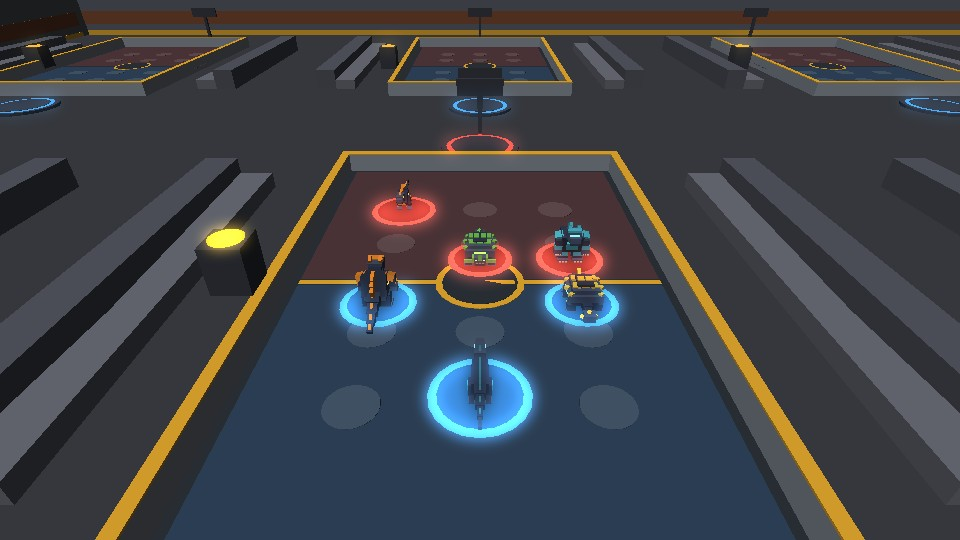
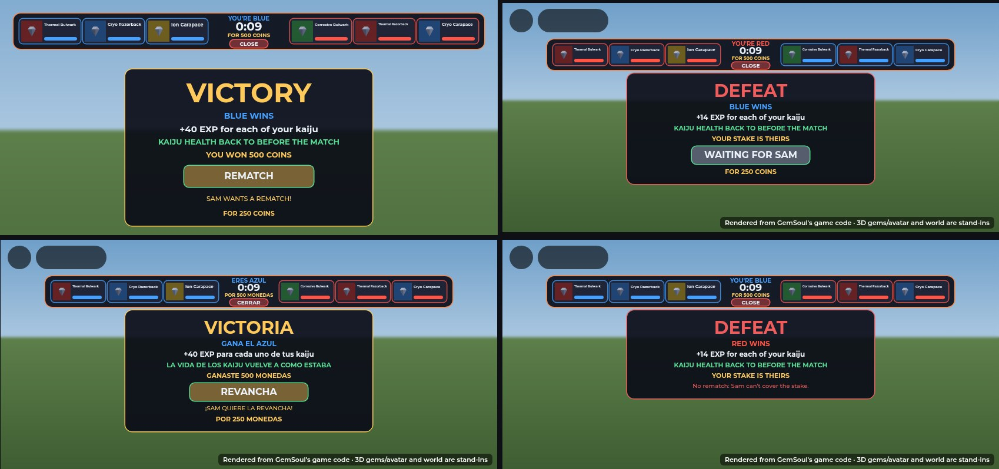

# The Kaiju Arena: downstairs, rows of courts, stakes and arrows on the ground

*Since then (2026-10-22): plain one-word signs, and the Shelter's floor cleared (no PROBE-7 station, duel gate, stands or survey table; PROBE-7 and Brutus are crew; the Gem Gallery is next to the Market). See [plain-signs.md](plain-signs.md).*

Kaiju battles now have a home of their own. Take the stairs down from the
Shelter and you're on the balcony of the **Kaiju Arena**: a hall with eight
courts in two rows, like ping-pong tables. Each court has a pad at either
end:

1. Stand on a pad and you're waiting for a challenger.
2. Someone steps onto the other pad and says FIGHT.
3. You both get 25 seconds to drag your kaiju into place.
4. Your kaiju fight it out on that court while everyone else watches from
   the aisles and the balcony.

You can play for coins or a gem, shown on the court's board and pedestal
for everyone to see. And in every battle:

- **Full health, then back.** Every kaiju fights at full health, even one
  that was knocked out. When it's over, each goes back to the health it had
  before, win or lose.
- **The overview camera.** Once the fight starts, the camera rises over
  your end of the court like a spectator's. Drag to look round it, scroll
  or pinch to zoom.
- **BLUE against RED.** The pads, the court's halves, a ring under every
  kaiju, the placing board, the battle bar and the result all use the two
  sides' colours.
- **REMATCH.** Both press it within 12 seconds of the result and you go
  again, on the same court, for the same stake.
- **COACH-4.** A guide robot on the balcony explains battles, placing,
  the kinds of kaiju, elements and stakes, and gives a battle tip whenever
  you ask.

Subtle yellow arrows on the floor lead you where to go: to the stairs when
someone's waiting downstairs, to a free pad once you're there, and through
the Rift's caves.

The 3D pictures are offline renders of the parts the server builds
(`Server/World/KaijuPitWorld`, `Server/World/OutpostWorld`), drawn by the
trailer renderer. They are **not Roblox screenshots**: lighting, glass and
neon are only roughly matched, and the boards' and signs' text (SurfaceGuis)
isn't drawn. The screen shots are the real client code rendered by the UI
harness. A kaiju's portrait there is a stand-in gem, because the harness
can't draw a ViewportFrame's 3D model. In the game it's the kaiju's own
model.

## The way down

- **In the Shelter.** A stairwell is cut into the hall's floor on the west
  side, by the old arena stage, a steel plate over it saying **ARENA**.
  - 13 steps go down to a landing and a lit doorway.
  - A rail runs round the other three sides of the well, with hazard
    paint round its lip.
- **Going down.** Walk onto the landing. A moment's cover (**KAIJU ARENA**)
  and you're on the hall's balcony, facing the courts.
  - Your kaiju come with you.
  - You can't take a mech down: "Hop out of the mech first: it won't fit
    down the stairs."
- **Coming back up.** The lit doorway behind the balcony (**EXIT** painted
  over it) takes you back to the top of the stairs.
  - Walking up mid-battle forfeits it.
- **Where it is.** The hall is 150 studs under the Shelter, inside the Core.
  The frontier (critters, rifts, raids) leaves it alone, and so does the
  Outpost's "stranded" check.

## The hall

- **Size.** 216 × 160 studs and 36 high.
- **The balcony.** A deck along the north wall, 12 up, with a glass rail.
  A 20-step stair runs down off it to the floor. **COACH-4**, the arena's
  guide, stands on it by its kiosk (**INFO** on its screen), just to the
  right of where you arrive, facing you.
- **The courts.** Eight of them, in two rows of four, with wide aisles
  between. Each court has:
  - bleachers along both sides;
  - floodlights over it;
  - a board over it;
  - a pedestal by its side.
- **Signs.** Only **EXIT** and **INFO** (since 2026-10-22,
  [plain-signs.md](plain-signs.md)). The rules are COACH-4's to tell, and
  each court's board shows the court.

## A court

- **The mat.** 34 × 22 studs, half blue and half red, with each side's six
  places painted on it and the court's number in the middle. Rails, and
  invisible walls on them, keep the kaiju in.
- **The pads.** A ring at each end: blue (A) to the north, red (B) to the
  south. A pad lights up while someone's on it.
- **The board** shows, on both faces:
  - **COURT n**;
  - what's happening: **OPEN**, **WAITING FOR A CHALLENGER**, **CHALLENGER
    STEPPED UP**, **PLACING** with its clock, **FIGHTING** with its clock,
    then **X WINS** or **A DRAW**;
  - both players' names, or "STEP ON THE BLUE PAD" for an empty one;
  - while they fight, each side's health left as a bar;
  - the stake: **250 COINS EACH · WINNER TAKES 500 COINS**.
- **The pedestal** shows the stake for everyone: a stack of coins, or the
  gem itself turning in its element's colour, with a **STAKE** billboard
  over it.

## Waiting, challenging, and stakes

**On a pad, waiting.** Your card reads **WAITING ON COURT n**. Choose
what to play for:

- **NO STAKE**.
- **50, 100, 250, 500 or 1000 coins**: only amounts you have.
- **A GEM**: opens your loose gems. Pick one to stake.

What you chose is spelled out (**YOUR STAKE: RARE THERMAL GEM**) and shown on
the board and pedestal. Only whoever got there first sets the stake. Step
off for a moment and your wait is over.

**On the other pad, challenging.** Your card reads **SAM IS WAITING** and
says what for: "For 250 coins each: the winner takes 500 coins."

- **FIGHT!** puts both stakes in and starts the battle on that court.
- **For a gem stake,** your gems that can match it are shown, weakest
  first, and you pick one. A match is the same rarity or better.
- **If you can't match it,** the card says why: "You need 1000 coins to
  match the stake." or "You need an Uncommon gem or better to match the
  stake." FIGHT stays dark.
- **Saying no:** step off the pad.

The waiting player is told "Sam stepped up. Place your kaiju!"

**The stakes are safe.**

- Both stakes are taken in at FIGHT: coins off both, gems out of both
  pouches.
- Each is checked again just before. If one can no longer be covered, the
  other is given straight back.
- The winner takes both. A draw gives each their own back.
- If the server closes mid-battle, both stakes are returned.

## Placing your kaiju (25 seconds)

**PLACE YOUR KAIJU**, against whom, the stake, and a big countdown with a
bar draining toward the fight.

- **Your half of the court**, drawn as you see it: three places in the
  front row, three behind, each showing the kaiju in it with its portrait.
  **Your foe's side stays hidden till the fight.**
- **Your three kaiju as cards:**
  - its portrait, name, level and role (FRONT LINE or SHOOTER);
  - its health;
  - where it stands now.
- **Moving them.** There are two ways:
  - **Drag** a card, or a kaiju already on the court, onto a place. A
    ghost follows your finger or mouse and the place under it lights up.
    Drop it onto another kaiju and the two swap.
  - **Tap** a kaiju, then a place.
- **Your side.** A pill by the clock says **YOU'RE BLUE** or **YOU'RE RED**.
  Your half of the court is drawn in your colour (**YOUR SIDE: BLUE**), your
  foe's in theirs, and the places on the ground too.
- **Full health.** Every kaiju on your team is here, at full health, even
  one that was knocked out before.
- **AUTO** puts them back in the default (the sturdy ones in front, a
  Razorback behind).
- **READY** from both of you starts the fight at once. When your foe is
  ready first, the hint says so.
- **LEAVE** forfeits.

## Roles: an auto battler

Every kind has a role, and on the court it fights by it, like a piece in an
auto battler (`Shared/KaijuRoles`, `Server/KaijuBattleBrain`):

| Role | Kind | On the court |
| --- | --- | --- |
| **TANK** | Carapace | Holds the front and takes the hits (it shrugs off a quarter of each). Its roar makes the foes round it attack it. |
| **WARRIOR** | Bulwark | Closes in and hits hardest up close. |
| **RANGED** | Razorback | Stays at the back and shoots spines from up to 15 studs. It backs off from a foe that gets within 6, at most every 2.5 s, and otherwise stands and shoots. It never walks into the front line. |
| **ASSASSIN** | Scythe | Leaps over the front line the moment the battle starts, onto their ranged kaiju first, else their weakest, and cuts fast. It has the least health of any kaiju. |

(An offline render of the game's kaiju models, not a Roblox screenshot.)

**Who it fights.** Every think (0.15 s) it looks again:

- One foe down, it goes straight for the next. A blow it was winding up at
  the one that fell is dropped, and a move's wait is given back.
- A melee kaiju takes the nearest foe, and keeps the one it's on unless
  another is 5 studs nearer. Two or three on one foe spread round it.
- A ranged one picks off the weakest foe in range, else the nearest.
- An assassin sees its mark through.
- A taunted kaiju goes for the tank that roared, for as long as the roar
  lasts.
- 2 on 1, 3 on 1: everyone left goes for the last foe.

**Where it stands.** A melee kaiju closes to its reach. A ranged one holds
its ground while its foe is in range, and closes only to range when it
isn't. Every spot it walks to is inside the court's rails. That's why
nothing gets stuck against the rails any more: before, a Razorback's hop
back and a kaiju circling to its flank kept aiming past the edge and got
pulled back in every step. One that's somehow well out (a shove) is put
back in.

**Positions matter.** They start at their places. The front row meets
first, the back row shoots over it, and an assassin goes for whoever's at
your back. Put tanks and warriors in front and ranged ones behind. A
Scythe starts in the back row too (that's where the default places put it)
and leaps from there.

**Moves.** Each role has its own three moves, copied from the gem surges and
renamed (`KaijuRoles.Moves`, and they're the kaiju's moves everywhere, not
just in the arena):

| Role | E (when its mana is full) | Q (level 5, every 8 s) | R (level 10, when its moment comes) |
| --- | --- | --- | --- |
| Tank | **Taunting Roar** (from Resonance Echo): the foes round it attack it for 3.5 s, and it takes 35% less meanwhile | **Shell Slam** (from Hydraulic Slam): 110% to the foes round it, stunning | **Fortress** (from Cryo Shield), at half health: a shell soaking 35% of its health for 5 s, then a burst that slows |
| Warrior | **Cleave** (from Circuit Cleave): a wide sweep through its foe and those beside it, 160% | **War Cry** (from Overload): 5 s of 30% harder, 35% faster blows, and 8% health back | **Earthshaker** (from Tremor Slam), hard pressed or with two foes on it: the ground breaks under its foe, 150%, stunning |
| Ranged | **Spine Volley** (from Railstorm): five spines rain on its foe and those near, 130% in all, with its element's effect | **Piercing Spine** (from Armor Piercer): one spine through a line of them, 140%, leaving them Vulnerable | **Vault** (from Stim Dodge), a foe too close: it vaults back and leaves a patch that slows and hurts |
| Assassin | **Shadow Leap** (from Thruster Leap): behind its mark, 200%, leaving it Vulnerable | **Rend** (from Servo Flurry): three quick rakes, 140% in all | **Vanish** (from Null Prism), low on health: untouchable for 1.5 s, then behind their weakest |

**Its gem surge.** Beside its role's three, every kaiju casts its gem
surge, its Gemsoul's E (of its element: [kaiju.md](kaiju.md#a-kaijus-moves-its-own-and-its-gem-surge)):
6 seconds into the battle, then every 14, on a foe up to 30 studs off (a
ring round itself only with its foe inside it). Its damage is the Gemsoul's
(2.6 of its blows times the Gemsoul's output) times its role's Power, as its
blows are, so it adds the same share for every role.

**Mana** fills as a kaiju hits (10 a blow for a tank, 14 for a warrior, 12
for ranged, 16 for an assassin) and as it's hit. A tank fills fastest from
the hits it takes, so the harder it's pushed, the sooner it roars. Its E
goes off at 100. "Its element's effect" is Thermal's burn, Cryo's slow,
Ion's stun or Corrosive's poison.

**Balance.** A kaiju's blow in a battle is its Damage times its role's
Power (`KaijuRoles.power`), which shifts as it levels, because a tank's
and a warrior's Q and R carry more of their fight than the others' do:

| Role | Level 1 | Level 5 | Level 10 and up |
| --- | --- | --- | --- |
| Tank | 0.84 | 0.7 | 0.65 |
| Warrior | 1.05 | 0.95 | 0.85 |
| Ranged | 1.4 | 1.6 | 1.9 |
| Assassin | 0.88 | 1.0 | 1.1 |

(In between, it moves from one to the next.) With these, and the
Razorback's health up from 160 to 190, every team of three (repeats
allowed: 20 teams, 380 battles a level) fought every other in its default
places. The share of battles won by teams with each kind:

| Level | Bulwark | Razorback | Carapace | Scythe |
| --- | --- | --- | --- | --- |
| 1 | 54% | 50% | 48% | 48% |
| 5 | 52% | 49% | 49% | 51% |
| 10 | 52% | 50% | 49% | 49% |

(With every kaiju's gem surge in: see below. The surge at first tipped level
1 to the tank (Carapace 60%) over the assassin (Scythe 39%): a tank lives to
cast more of them, and they water down an assassin's opening burst. So the
tank's level-1 power went from 0.9 to 0.84 and the assassin's from 0.8 to
0.88; levels 5 and 10 are as they were.)

Before (a blow was its Damage alone), the Razorback's teams won 21% to 24%
and the Carapace's up to 70%, and three Razorbacks never won. Now the
strongest teams are a tank in front of two that deal the damage (a
Carapace with two Razorbacks, two Scythes, or one of each: 71% to 82%),
and three Carapaces or three Razorbacks win only about a quarter of their
battles at level 10. A tank alone can't kill fast enough, and shooters
alone have no one to hide behind.

## The battle

(An offline render of the hall's parts and the game's own kaiju models, seen
from where `KaijuBattleCam.view` puts the camera, with the rings at their
code's size and colours. It isn't a Roblox screenshot.)

- **The camera.** When the fight starts, the camera rises over your end of
  the court, 25 studs back and 17 up, and looks down on the whole court:
  your kaiju nearest, your foe's beyond. It eases in, leans a little after
  the fight as it moves, and stays inside the hall whichever court you're
  on (`Client/KaijuBattleCam`).
  - **Drag** (the right mouse button, or a finger off the thumbstick) to
    swing round the court, up to 60° either way.
  - **Scroll or pinch** to come in or back a little.
  - It stays on through the result, and gives you your own camera back
    when the battle's gone, or as soon as you're well away from the court
    (up the stairs, say).
- **The lobby HUD steps aside.** While you're in a battle, the lobby's
  buttons hide, so the court and the battle's own bar and result have the
  screen.
- **On the court.** Every kaiju starts at its place, facing the other side,
  and fights by itself by its role (above).
- **Rings.** Each kaiju in a battle stands on a ring in its side's colour:
  a bright rim round a darker fill, a little wider than the kaiju
  (`Client/KaijuTeamRings`). Everyone sees them, players and onlookers
  alike.
- **Kept in.** Every spot a kaiju walks to is inside the rails. One more
  than 3 studs out (a shove) is put straight back.
- **The bar at the top:**
  - a face and health gauge for each of the six kaiju, yours on the left,
    each outlined and filled in its side's colour;
  - **YOU'RE BLUE** or **YOU'RE RED** over the clock, in your colour;
  - the clock;
  - what you're playing for (**FOR 500 COINS**).
  - It's sized to clear the lobby's side panels on a desktop and to fit a
    phone.
- **Watching.** Anyone downstairs can watch from the aisles, the bleachers
  or the balcony. The board shows both sides' health.

**Who wins** is decided as before: the side with kaiju still standing, or
the one with more health left when time runs out. Walking off the field,
going back upstairs, leaving the Outpost or the game, or LEAVE all hand the
other side the win.

**After it.**

- **VICTORY, DEFEAT or DRAW**, then **BLUE WINS** or **RED WINS** in the
  winner's colour (**NEITHER SIDE WINS** for a draw), and the EXP.
- **KAIJU HEALTH BACK TO BEFORE THE MATCH**, for both of you.
- **What happened to the stake:** **YOU WON 500 COINS**, **YOUR STAKE IS
  THEIRS** or **STAKES RETURNED**. The winner is also told "You won 1000
  coins!" or "You won Sam's Rough Plasma Crimson (Thermal)!", and the loser
  "Sam took your …".
- **REMATCH.** The result stays up for 12 seconds (the bar's clock counts
  them down), with a **REMATCH** button and what it would take: **FOR 250
  COINS**, or the gem of yours that would go in.
  - Press it and it reads **WAITING FOR SAM**. Sam is told "Marc wants a
    rematch!" and sees **MARC WANTS A REMATCH!**, the button lit gold.
  - Both pressed: the stakes are taken again and you're straight back to
    placing, on the same court, on the same sides, every kaiju full again.
  - A gem stake is matched again with a gem each as rare as the first: your
    weakest loose one that is.
  - **No rematch** when one of you closes the result or leaves ("No
    rematch: Sam left."), or can't cover the stake ("No rematch: Sam can't
    cover the stake."). Whoever pressed first gets their stake back.

**CLOSE** puts the result away. To go again with someone new, step off your
pad and back on.

## Full health, and back

A battle never costs your kaiju health.

- **When it starts** (`KaijuServer.battleStart`), each kaiju on both teams
  has its health kept on its record (`BattleKeep`, saved with your kaiju).
  Then all of them are brought to full, and one that was knocked out comes
  back out for the battle.
- **A kaiju knocked out in the battle** is out of it quietly. There's no
  "knocked out" notice and no critter raid for a team all down, and no
  revive timer starts.
- **When it's over** (`KaijuServer.battleEnd`, as the result appears), each
  goes back to exactly the health it had before, win or lose. One that was
  knocked out before is down again, with the same wait as before.
- **If something cuts it short**, the kept health is put back anyway. That
  covers leaving the game mid-battle or a server shutting down. Your saved
  kaiju still carry what they had, and the next time the server looks at
  your team, out of a battle, they're put back.
- **A revive bought during a battle** applies to the kaiju as it was before.
- **What you need to battle** is your kaiju out (not put away). Knocked-out
  ones count, since the battle brings them back for itself.

## COACH-4, the arena's guide

Talk to it (E) on the balcony (`Shared/Vendors.ArenaGuide`). Like INFO-9
upstairs, its answers keep to the game's rules.

- **Give me a battle tip:** the next of 15 tips, from a random start.
  - **Elements:** Thermal beats Cryo, Cryo beats Ion, Ion beats Corrosive,
    Corrosive beats Thermal.
  - **Damage:** 125% from the element that beats a kaiju's own, 75% from its
    own.
  - **Kinds:** Carapaces shrug off a quarter of each blow and Bulwarks a
    tenth; a Razorback shoots from the back row.
  - **Time and READY:** out of time, more health left wins; press READY
    to start at once.
  - **Other tips:** REMATCH, the camera controls, EXP for each result, Q
    at level 5 and R at level 10, hidden places, and watching.
- **How battles work:**
  - starting one;
  - what happens in one (25 seconds to place, up to 90 to fight, who wins);
  - full health and back;
  - the rematch.
- **Placing and elements:**
  - front row or back row;
  - how to place;
  - which kaiju is which;
  - which element beats which, and by how much.
- **Sides, stakes and rewards:**
  - which side you are, and the camera;
  - what you can play for;
  - who gets the stake (only loose gems, never your gear's);
  - EXP: 40 for a win, 24 for a draw, 14 for a loss.

## Asking from a player card

**KAIJU** on another miner's card still works. Once they accept, you're
both brought down to a free court and onto its pads, and the battle runs
there like any other. If every court is taken: "Every court in the Kaiju
Arena is taken. Try again in a moment."

## Yellow arrows on the ground

A short trail of yellow chevrons on the floor (`Client/GroundGuide`):

- They start a few studs ahead of you and drift the way to go.
- They fade in and out at each end, and they're see-through, so they're
  easy to ignore.
- They follow the floor, take the way round walls (PathfindingService, or
  straight there when there's no path), and go away when you arrive.

Where they lead, the first of these that wants you somewhere:

| Where you are | They lead to |
| --- | --- |
| Downstairs | The free pad across from someone waiting. Just after you arrive (18 seconds), the nearest open court's pad. Nothing while you're on a pad or in a battle. |
| In the Rift | Through a wall of fire that's just gone out (15 seconds), a little way into the next cave (`GroundGuide.through`), and nothing once you're through it. To the way home once the boss is down. |
| In the Shelter | The stairs down, for 25 seconds after someone starts waiting for a challenger downstairs. A toast says "Sam is waiting for a kaiju battle downstairs. Follow the arrows!", at most once a minute. |

## Files

| File | What |
| --- | --- |
| `src/shared/KaijuPit.luau` (new) | The rules: the hall, the courts and where they are, pads, where you arrive and leave, in a court or the hall, keeping a kaiju in, stakes (what you can stake, why a challenger can't match it, their gems that can, what's said), the pot |
| `src/server/World/KaijuPitWorld.luau` (new) | Builds the hall under the Shelter: walls, roof, balcony and stairs, the way up, signs, lights, COACH-4's kiosk and spot (`Guide`), and each court (mat, places, rails and keep walls, pads, board, pedestal, bleachers, floodlights) |
| `src/server/Systems/KaijuPitServer.luau` (new) | The stairs both ways, the pads, waiting and challenging, stakes in and paid out, the boards' attributes, bringing a card's battle down to a court, refunds on shutdown; a rematch's stakes taken again; COACH-4 built on the balcony |
| `src/server/Systems/KaijuBattles.luau` | Battles on a court (its field, `Bounds`), `findCourt`, `onOver` (the payout), `inPit`, full health and back for both sides (`KaijuServer.battleStart` / `battleEnd`), each kaiju marked with its side (`KaijuTeam`), the rematch (`KaijuBattleRematch`, `KaijuBattles.again`, `rematchOn` / `rematchCost`), the stake in what the client is sent |
| `src/server/Systems/KaijuServer.luau` | A battling kaiju run by `KaijuBattleBrain` and kept inside its court (one put back in stops walking too, so a wind-up started outside doesn't walk it back out); every kaiju's moves are its role's (`Kaiju.kitMoves`); the caster's taunt, war cry, leap, vault and pick; `battleStart`, `battleEnd` and `battleable`; the kept health (`BattleKeep`) put back after a rejoin; quiet knockouts in a battle |
| `src/shared/KaijuBattle.luau` | 25 seconds to place, 12 for the result (and a rematch), the sides' names and colours (`Sides`) |
| `src/shared/KaijuRoles.luau` (new) | The roles (tank, warrior, ranged, assassin) and each kind's, the roles' own moves (`Kits`, `Moves`: copied from the gem surges and renamed), mana, a blow's share of its Damage by level (`power`), who a kaiju fights (`target`), where it stands (`spot`, inside the court: `clamp`), when its R goes off (`wantsR`) |
| `src/shared/Kaiju.luau`, `KaijuModels.luau`, `KaijuFight.luau`, `CreatureMotion.luau` | The Scythe: its stats (and the Razorback's health up to 190), its model, its blows and its poses |
| `src/server/Systems/KaijuBattleBrain.luau` (new) | A kaiju in a battle, fighting by its role: picking its foe every think, walking to its spot, blows and spines, its E on full mana, its Q and R, its gem surge every 14 s (at its role's power), a wind-up dropped when its foe falls, an assassin's opening leap |
| `src/server/Systems/KaijuAbilities.luau` | The roles' new shapes: a taunt, a war cry, a leap, a vault, rakes and a vanish |
| `src/client/Modules/KaijuBattleCam.luau` (new) | The overview camera: where it looks from (`view`), easing in, leaning after the fight, dragging and zooming, handing your camera back |
| `src/client/Modules/KaijuTeamRings.luau` (new) | The ring under each kaiju in a battle, in its side's colour |
| `src/client/Lobby.client.luau` | Starts the rings; the lobby HUD hides during a kaiju battle |
| `src/client/Dialogue.client.luau` | COACH-4's tips (`ArenaTip`) |
| `src/server/World/OutpostWorld.luau` | The Shelter's stairwell (the floor, hall and keel built around it), its steps, rails, signs and door; the stage's sign |
| `src/server/Systems/OutpostServer.luau` | Downstairs isn't stranded |
| `src/client/Modules/KaijuBattleUI.luau` (rebuilt) | The placement board (drag and drop, portraits, cards, AUTO, READY, the clock, your side), the battle bar (by side), the result card (who won, health back, REMATCH) |
| `src/client/Modules/KaijuPitClient.luau` (new) | The courts' boards, lit pads, the stake on the pedestal, your pad's card, the crossing cover, the toast upstairs |
| `src/client/Modules/GroundGuide.luau` (new) | The arrows on the ground |
| `src/shared/Vendors.luau` | INFO-9's tips: where battles are now, 25 seconds, full health and back, stakes. COACH-4 (`ArenaGuide`) and its tips (`ArenaTips`) |

A player downstairs carries `KaijuPit` (and keeps `Outpost`). Each
court's model carries what its board shows (`State`, `AName`, `BName`,
`AId`, `BId`, `Stake`, `StakeKind`, `StakeCoins`, `StakeTier`,
`StakeElement`, `StakeGem`, `Pot`, `Phase`, `EndsAt`, `AShare`, `BShare`,
`Winner`). The client is told about its pad and the stairs on the Social
remote (`KaijuPitPad`, `KaijuPitCross`), and asks with `KaijuPitStake` and
`KaijuPitFight`. In a battle, each kaiju's model carries its side
(`KaijuTeam`: `A` or `B`), the battle's state carries `Restored` and
`Rematch` (`{ A, B, Off, Cost }`), and the client asks for a rematch with
`KaijuBattleRematch`.

## Spanish

Everything above is in `Shared.LangEs`: the placement board, the battle bar
and result (the sides, the rematch and why there isn't one), the pad cards,
the stakes (each rarity's wording), the server's messages, the toast, the
courts' boards, and everything COACH-4 says. The boards are in the
world, not on screen, so the client translates them itself. The hall's
signs (and COACH-4's kiosk) stay in English, like the Shelter's. Gem names stay in English: they're
names.

## Tests

| Suite | What it checks |
| --- | --- |
| `run_kaiju_battle` (`kaiju_battle_cases`) | The arena's rules: eight courts in two rows, inside the hall and the Core, clear of each other and of the stairs, every place inside its court; the pads; arriving on the balcony facing the courts; a stray kaiju clamped back in; the nearest pad; what can be staked; matching coins and gems (same rarity or better, weakest first); what's said ("an Uncommon gem each"). The arrows: spaced along the way from just ahead of you, facing along it, never past its end, round a corner, flat on a slope; each chevron points the way it leads; subtle. The sides: BLUE and RED, a ring a little wider than its kaiju. The camera: for every court and side, swung either way and zoomed in or out, it stays inside the hall, over your end, past the floodlights and looking down, with all twelve places in view on a 16:10 screen below the battle bar |
| `run_kaiju` (`kaiju_server_cases`) | The arena on the server: down the stairs and back up; COACH-4 on the balcony, off the stairs, facing you; pads, the stake and the board; a challenger who can't cover it, then FIGHT; every kaiju of both teams at full health (one knocked out brought back), each marked with its side; 25 seconds to place, every kaiju placed inside its court, a stray one put back; the fight on the court; afterwards every kaiju back as it was (the hurt one hurt, the one down before down again with the same wait), no raid for a team knocked out in it, both told; the coins paid out (1250 and 350); the board's winner; a rematch (asked, told, both, the same court and sides, the stakes taken again, everyone full again), forfeited, then refused when one can't cover the stake (the asker's coins back) and ended when one closes; the court freed and the sides unmarked; stepping off and back on; a gem stake; walking upstairs forfeits; the winner gets both gems; a kept health put back by itself out of a battle; a card's battle brought down to a court. The older open-field battle: the losers' kaiju back as they were |
| `run_kaiju_roles` (`kaiju_roles_cases`, new) | The roles and their moves (each kind's role, each move its role's and key's, waking at 1, 5 and 10, castable, with an icon and what it's from); who a kaiju picks (the nearest; an assassin their shooter; a shooter the weakest in range; onto the next after a kill; not swapping for one barely nearer; its taunter while taunted) and where it stands (to its reach; a shooter holding in range, closing only to range, backing off one too close, slipping along the rails when cornered; never out of the court). Then whole battles with the real brain and moves on stand-in bodies: 3 on 3 (it ends; nobody stands about over 1.5 s with a foe up; the shooter shoots, from range, and isn't ahead of its front line), 3 on 1 (everyone on the last foe within a beat of each kill), the tank's roar turning a foe, an assassin (a Scythe) on their shooter at once, a shooter against an assassin, and every role's move cast at level 10. No kaiju ever leaves the court. The balance: every team of three against every other at levels 1, 5 and 10, each kind's teams winning between 40% and 60% |
| `run_outpost` (`outpost_cases`) | COACH-4's dialogue fits the dialogue's rows, its tip action exists, and all of its lines and tips are in Spanish |
| `run_moon_quarry_scene`, `run_shelter_life` | The Shelter with its stairwell: spawn, stations, the stage and its hologram, the part budget |
| `run_lang` | Every new Spanish entry follows the rules |

None of this has been played in Roblox Studio. Before publishing, play a
battle on a court with two players, on a desktop and a phone, and check:

- the camera takes over when the fight starts, drags and zooms, and hands
  back cleanly after the result, after CLOSE and after walking upstairs;
- the rings follow the kaiju on the court's floor;
- the roles: the Razorback stays back and shoots, a kaiju moves straight on
  to the next foe after a kill, the tank's roar pulls foes onto it, and
  nobody sticks to the rails;
- the Scythe: its walk and blade swings look right at its size, its opening
  leap lands behind their shooter, and its roar plays (a built-in stand-in
  until `roar_scythe.mp3` is uploaded);
- the health comes back right after a win, a loss, a forfeit and a rejoin;
- a coin rematch and a gem rematch.
