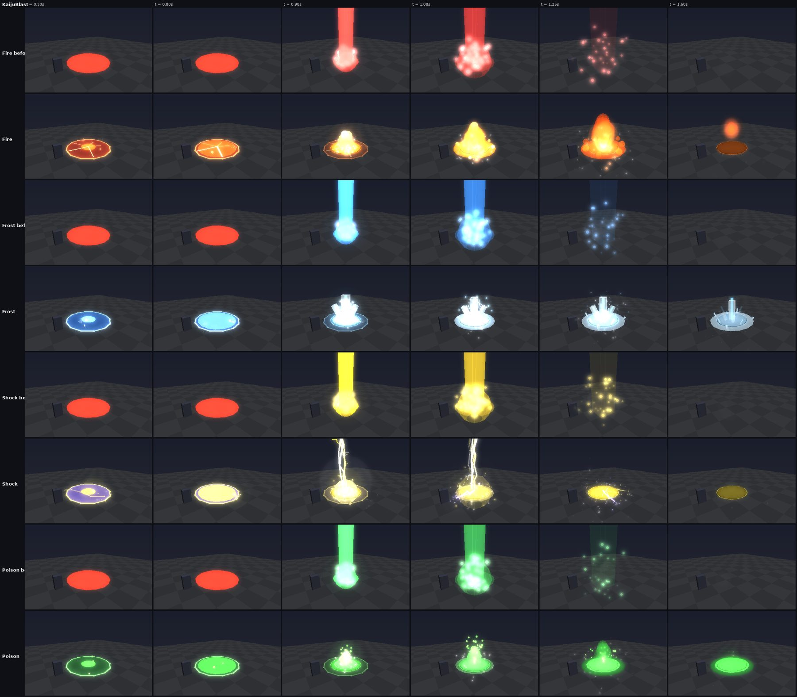
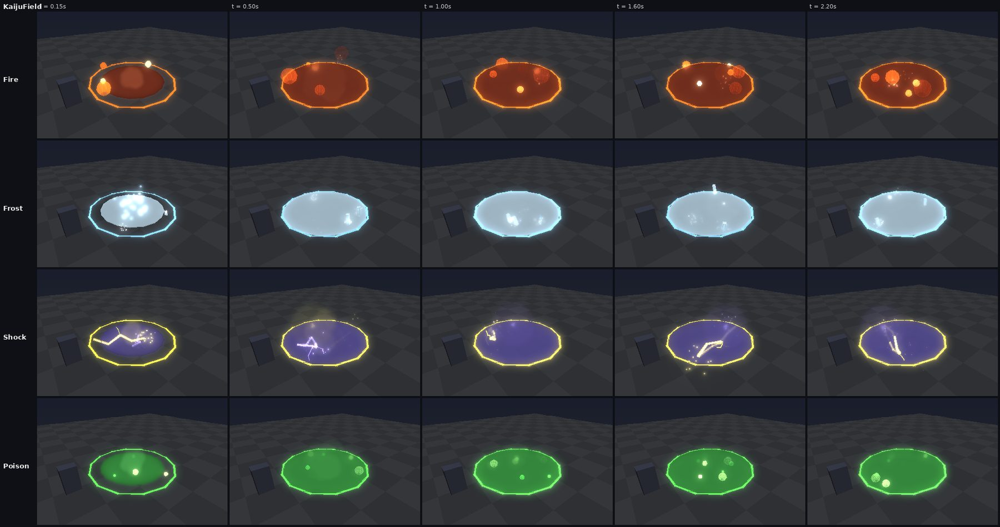
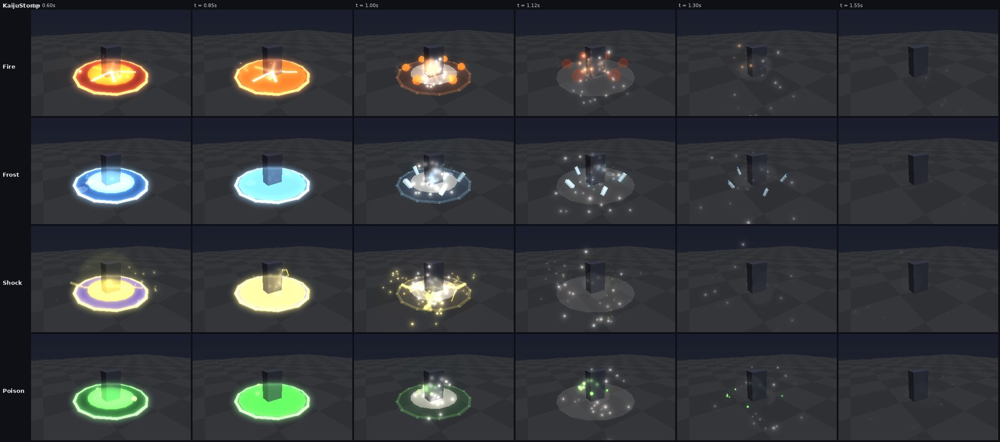
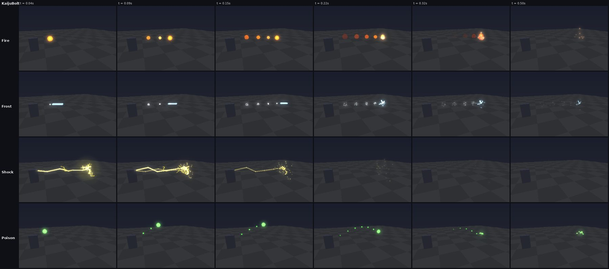
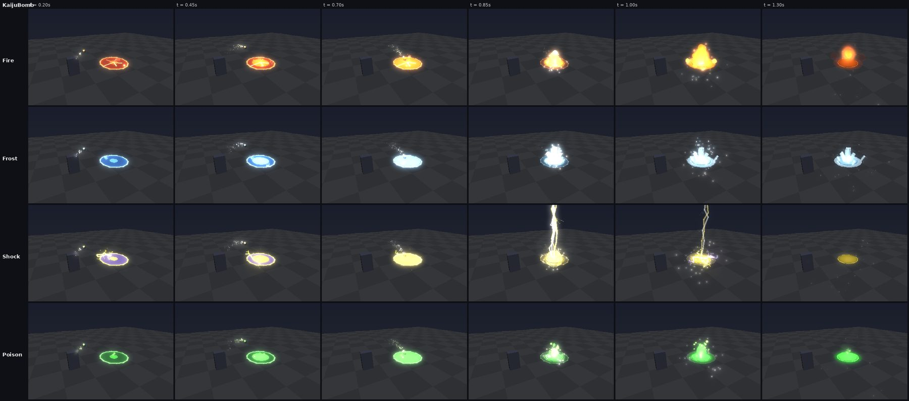
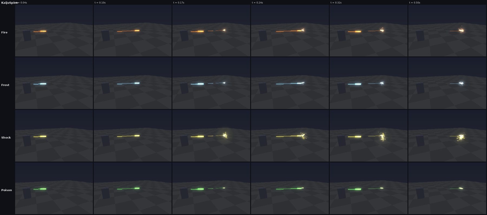
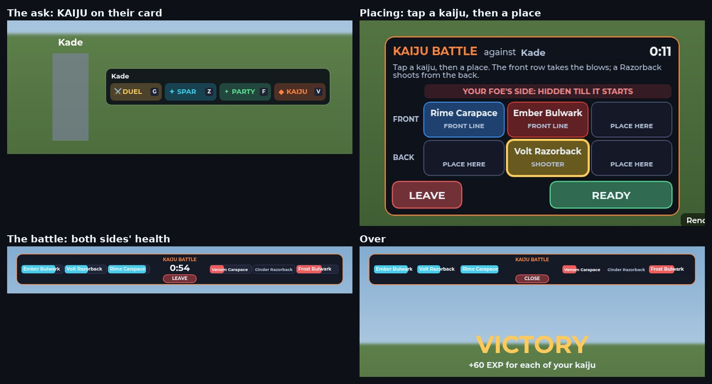
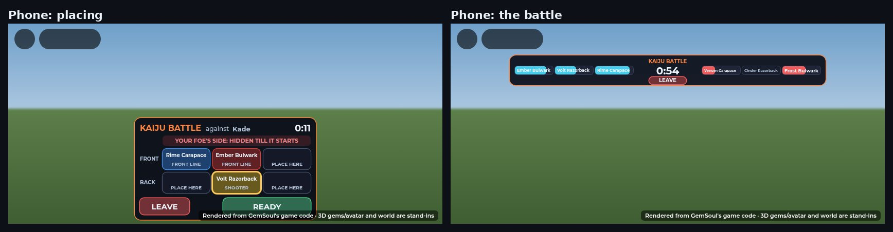

# Elements on the ground, the Razorback, kaiju battles, weak revives

This round covers four changes:

- **The elements on the ground.** The tall coloured column of light is gone.
  Every blast, lingering area, heavy blow, bolt and bomb now looks like its
  element: flame, ice, lightning or acid (`Client.ElementFx`).
- **The Razorback is a shooter.** It bites up close, hops back, and looses
  volleys of spines from range.
- **Kaiju battles.** Two players set their teams against each other, place
  them in a formation, and the kaiju fight it out by themselves.
- **Revives and auto heal.**
  - A kaiju that comes back after its wait is weak (15% health) and needs
    healing with gems.
  - AUTO HEAL uses your spare Commons first, then your spare Uncommons.

The images are offline renders, not Roblox screenshots:

- The effects come from the game's own effect code, run in Lune by
  `tools/vfx_sim.luau` and drawn by `tools/vfx_render.py`.
- The screens come from the game's own UI code, laid out and drawn in a
  browser.

Neither renderer is Roblox's. The effect renderer draws particles as soft
dots and has no bloom. Check the look in a Studio playtest.

## The elements on the ground

### Blasts

Before, every delayed blast was drawn the same way:

- a flat red ring, red whatever the element;
- then a column of light 40 studs tall in the element's colour, a dome and
  sparks.

That column was the "spotlight". Now a blast is warned of, then goes off out
of the ground (`ElementFx.telegraph`, then `ElementFx.erupt`).

**The warning** (the first two frames of each row):

- the area darkened, with a bright edge;
- a fill sweeping out from the middle that reaches the edge as the blast
  lands, so you can see when to move;
- the element stirring inside:

| Element | Inside the warning |
| --- | --- |
| Fire | glowing cracks and embers |
| Frost | frost creeping over the ground |
| Shock | sparks crawling in from the edge |
| Poison | bubbles |

A player's blast still marks its core (stun) and middle (stagger) as inner
rings. A creature's has no zones, so it shows none.

**The blast:**

| Element | What goes off |
| --- | --- |
| Fire | a geyser of flame roaring up, a fireball at its foot, a ring of fire racing out with flames licking up round it, embers, black smoke |
| Frost | a spire of ice stabbing up with four more angled out, frost sheeting the ground, a ring of spikes at its edge, glitter and cold mist; it all breaks off and crumbles |
| Shock | lightning striking down out of the sky twice, arcs crawling out along the ground to the edge, a dome of charge flickering out, sparks, a white flash |
| Poison | a geyser of acid spouting up and raining back down in droplets, a pool spreading with a sheen, fumes |

Every blast also sends out:

- a dust shockwave along the ground;
- a scorch mark that cools;
- debris and a flash;
- a shake that's harder the closer you are.

All of it is drawn at the size of whoever made it (`FxSize`).

### Lingering areas

A move that leaves the ground dangerous (`ElementFx.field`, the `Zone`
effect) used to be a flat disc with smoke. Now:

| Element | The ground |
| --- | --- |
| Fire | burning, flames licking up all over it, embers drifting |
| Frost | a sheet of ice, frost mist, spikes popping up |
| Shock | crackling, arcs leaping between points on it |
| Poison | a bubbling pool of acid, fumes curling up |

Its edge pulses the whole time.

### Heavy blows

A kaiju's heavy blow used to ring its feet in orange, whatever its element.
Then the warning went off as a full blast, with a column, and the stomp
landed on top of it.

Now there's one warning and one landing:

1. **The warning** is in its element's look (the new `Telegraph` effect,
   sent by `KaijuFighter`). It's only a warning: nothing goes off when it
   ends.
2. **The blow lands** with a stomp (`ElementFx.stomp`):
   - a ring of dust and debris;
   - the element's flourish: flames round the feet, ice spikes, arcs, or
     droplets of acid.

A critter's burst warns the same way, then leaves its element on the ground
(the lingering area above). A critter's slam warns, then goes off as a blast.

### Bolts, bombs and spines

| A creature's... | Now |
| --- | --- |
| bolt (`ElementFx.bolt`) | Fire: a fireball trailing flame. Frost: a lance of ice glittering in its wake. Shock: a lightning bolt. Poison: a glob of acid lobbed in an arc and dripping. Each bursts in its element where it lands. |
| bomb (a Crocodilo's, `ElementFx.lob`) | a dark metal bomb with its element's glow, its fuse fizzing, arcing over in exactly its flight time; it lands as a blast |
| spine (a Razorback's, `ElementFx.spine`) | a pale quill in a glow of its element with a streak behind it, sticking where it hits with a splash of the element |

A player's own shots look as they did.

### Limits

- **Effect parts.** When over 320 effect parts are already alive (a big
  fight), the optional extras are skipped: frost patches, bubbles, spikes
  popping up, flames licking.
- **Placement.** Every effect is anchored, doesn't collide and can't be
  clicked, so a click still lands on what's behind it.
- **Shake.** The shake reaches the blast's radius plus 14 studs at the
  creature's size.

## The Razorback: a shooter

The Razorback is the lightest of the three kinds, so it now fights best from
range (`KaijuFight`'s Razorback `Ranged`):

1. **Up close**, it fights as before: bites, a tail lash, guards and hops.
2. **Its combo done.** Once it has landed two blows, it hops back out of
   reach: about 12 of a duellist's studs at its size, untouchable as it
   hops.
3. **At range**, it looses **Spine Volleys**:
   - three spines, 0.15 seconds apart;
   - each spine does half its Damage;
   - each volley winds up for half a second as a Bolt, named on its cast
     bar;
   - it shoots from 11 to 26 studs off, circling in a band 11 to 17 off
     between volleys (a duellist's studs, scaled to its size like all its
     distances);
   - the next volley comes about 1.4 seconds after the last.
4. **Pressed closer than 11**, it hops back again (at most every 2.5
   seconds). If its hop isn't ready yet and its foe is in reach, it bites.
5. **After three volleys** it closes in for the next combo.

Fighting it:

- A stagger, a hop aside, a guard against a blow coming, or its E still
  break off its shooting.
- Its foe sees it shooting: another kaiju closes in on it behind a raised
  guard, as the Arena's rival does against a gun.
- A volley winding up reads as a cast, so a foe can hop clear.

Its spines only land on a foe still within its reach, and a hop aside
dodges them.

## Kaiju battles

**Asking.**

- Another miner's player card has a fourth button, **KAIJU** (key V,
  gamepad LB).
- They get a card to accept within 20 seconds. Asking back when they've
  asked you is a yes.

You can ask when:

- both of you have a kaiju out and up;
- you're within 40 studs of each other;
- neither of you is in a fight, a match, a spar, a hunt or another battle.

**Placing** (15 seconds, `KaijuBattle.FormationSeconds`).

- **The field.** It lies between the two of you:
  - its middle is halfway between you;
  - each side has six places, three across the front row and three across
    the back;
  - it's sized for pet kaiju: the two back rows are 19 studs apart.
- **The default places.** Your kaiju start in theirs: a Bulwark and a
  Carapace in front, where the blows land; a Razorback behind, where it
  shoots from.
- **Moving them.** Tap a kaiju, then a place. Onto another kaiju, the two
  swap.
- **The ground.** Both sides' places are marked on the ground, yours lit
  where a kaiju stands.
- **Your foe's places stay hidden** till it starts.
- **Starting early.** READY from both of you starts it now.

**The battle** (up to 90 seconds, auto battle).

- **At the start**, every kaiju is put at its place, facing the other side.
- **They fight by themselves**, as they fight anything (`KaijuFighter`):
  - each side's kaiju are shared out over the other's (`Shared.Squad`);
  - where two share one foe, they come at it from either side;
  - their blows and moves land on the other side's kaiju.
- **The bar at the top** shows every kaiju's health, yours on the left, and
  the clock.
- **Your team stays put.** You can't recall it or change it mid-battle.

**Who wins.**

- The side with kaiju still up when the other's are all down.
- Out of time: the side with more of its health left. Within 2% of each
  other is a draw.
- Leaving loses: walking off past 70 studs from the field, leaving the
  Outpost or the game, or LEAVE all hand the other side the win.

**After it.**

- **VICTORY, DEFEAT or DRAW** shows for a few seconds.
- **EXP for every kaiju of yours still out:** 60 for a win, 35 for a draw,
  20 for a loss.

**It's real.** What your kaiju lose stays lost, and one knocked out waits
out its revive. Heal them after. No auto heal or HEAL works during a battle,
since the fighting counts as danger.

## Weak revives, and auto heal with Uncommons

**A kaiju back by itself.** Once its wait is up, a knocked-out kaiju comes
back **weak, at 15% of its health** (`Kaiju.Revive.Health`). Heal it with
gems, or let AUTO HEAL, before it fights again.

- The kaiju panel says so while it's down: "It comes back weak, at 15%
  health: heal it with gems."
- So does the message when it's back: "... is back on its feet, but weak:
  heal with gems before the next fight."

**Brought back now**, it comes back at **half health**
(`Kaiju.Revive.Bought`), as before. That's REVIVE (Robux) or a Revive
coupon.

**AUTO HEAL** uses your spare **Commons first, then your spare Uncommons**
(`Kaiju.AutoHeal.Tiers`, `Kaiju.autoHealPick`):

- It takes an Uncommon only once every spare Common is used up. While one
  Common is left, even one too strong to fit, it waits rather than spend an
  Uncommon.
- It never wastes a gem, and never takes a Rare or rarer gem, one a saved
  loadout names, or a Gemsoul.
- On the strip, AUTO HEAL shows the gem it takes next and the count of both
  tiers.
- When both tiers are gone it says so once: "Auto heal is out of spare
  Commons and Uncommons".

## Spanish

Every new line is in Spanish:

- the ask card and the board;
- the bar, the results and the messages;
- the revive and auto-heal lines;
- "Spine Volley" (Ráfaga de púas).

## Tests

| Suite | What it covers |
| --- | --- |
| `tests/run_kaiju_battle.py` (new) | The field halfway between the two players, its axis from the asker to the other. Each side's places on its own half: front and back rows, left and right as that side sees them, clear of each other, the front rows apart. The default formation (sturdy kinds in front, a Razorback behind, every kaiju placed, never two on one place). A formation checked (every kaiju placed, a place each, only yours, only places on the field). Who wins (one side down, both down, out of time, nearly even). Why one can't ask. |
| `tests/run_kaiju.py` | **The rules:** a revive back by itself is weak; one bought back is stronger. Auto heal's pick: Commons first, an Uncommon only once the Commons are gone, none wasted, none for one that's down. A Razorback's moves at range: hop back, bite, volley, close in, keep its band. It reads as ranged to its foe, and a volley reads as a cast. The other kinds never shoot. **The server:** a heavy's warning is a Telegraph in its element's colour and never goes off as a blast. A Razorback's combo ends in a hop back. Its volley is named on the cast bar and winds up as a Bolt. Its spines are Shot "Spine" and land. After its last volley it goes back in; pressed, it hops back again; calm, its next fight opens up close. A weak revive. Auto heal moving on to an Uncommon once the Commons are gone. **A whole kaiju battle:** the ask and its card; accepted; the default places; the foe's places hidden; no recall mid-battle; bad formations refused; a good one taken; both ready starts it; every kaiju at its place facing the other side, each with a foe. It's fought out to the end by knockouts, not the clock: the right side wins, both are told, the losers' kaiju are really knocked out, the winners gain EXP. It closes a moment later. Walking off forfeits. |
| `tests/run_outpost.py` | Four social prompts on a miner (KAIJU added), each with its own key and gamepad button. |
| `tests/run_lang.py` | The new lines in Spanish. |

The full suite passes except `run_client_boot` (an untracked test, not part
of this work) and `run_fighter_rig`. Both failed the same way before this
round.

`tools/vfx_sim.luau` gained these scenarios: KaijuBlast (with a "before"
replay of the old column), KaijuField, KaijuStomp, KaijuBolt, KaijuBomb and
KaijuSpine.

Lune's `CFrame.lookAt` points the wrong way, and gives NaN straight up. The
harness now gives the effect modules Roblox's. `ElementFx` aims its spikes
and lances with its own `aim`, which also works straight up, where `lookAt`
has no up to go by.
