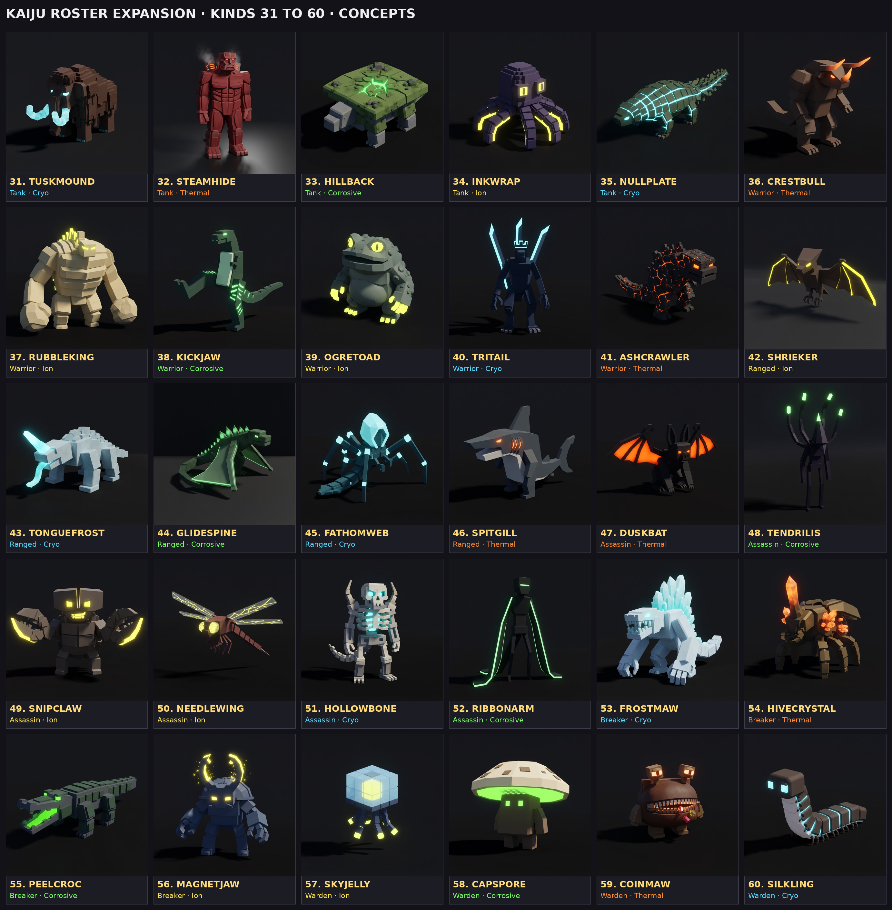
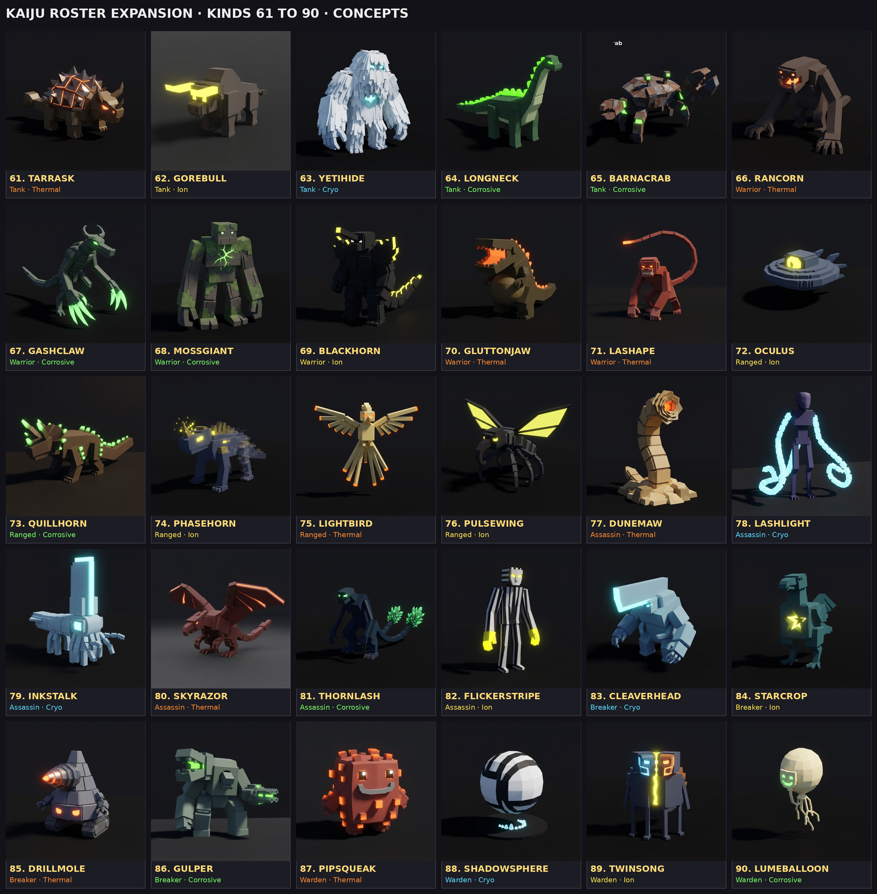

# Kaiju roster expansion: 90 new kinds

> **In the game (Oct 22):** 28 of the first thirty below (all but Prisma and
> Clawtide), with the Breaker and Warden roles, their own kits and models.
> What shipped, and where it differs from this proposal, is in
> [kaiju-roster.md](kaiju-roster.md). Kinds 31 to 90 are still a proposal.

A proposal (Oct 21, draft, not signed off). The game has four kinds of mini
kaiju, each in four elements (`Shared.Kaiju.Species`, `Shared.KaijuRoles`;
see [kaiju.md](kaiju.md)). This adds **90 more kinds** (in three sets of thirty), drawn from the
kaiju canon (Toho, Gamera, Pacific Rim, Ultraman, Evangelion) but renamed and
reshaped so they are ours: blocky, knee-high, one glow zone, readable at a
glance. Every kind still comes in Thermal, Cryo, Ion and Corrosive, so this
is 360 new kaiju in all. Ship them in waves (below), not at once.

## What a kind is

A kind is a silhouette, a role, a stat line and a fight pattern. Today all
four kinds share their role's three moves (`KaijuRoles.Kits`). This proposal
keeps the roles (and adds two), but gives **each kind its own three moves**
(E from the start, Q at level 5, R at level 10), each still copied from a gem
surge shape (`Plan`) so it needs no new combat code, only a new entry in
`KaijuRoles.Moves`. The stat lines below are level 1 at a Common Gemsoul and
sit inside the existing bands (Health 165 to 340, Damage 10 to 22, Speed 8 to
22, Guard 0 to 0.30). They are drafts for the balance sim, which must keep
every kind's teams under about 55% wins at any level.

### Roles

| Role | Today | Plays |
| --- | --- | --- |
| Tank | Carapace | Front, draws foes, shrugs off the most |
| Warrior | Bulwark | Front, hits hardest up close |
| Ranged | Razorback | Back row, shoots, backs off when pressed |
| Assassin | Scythe | Opens by leaping onto their back row |
| **Breaker** (new) | | Mid-line. Goes for the foe with the highest Guard or a raised shell and strips it. Its blows ignore 50% of Guard. Gains mana for every guard it breaks. |
| **Warden** (new) | | Back row with the shooters. Its E goes on allies, not foes. Gains mana as allies lose health. Weak blows. |

If the two new roles are too much for v1, every Breaker below maps to
Warrior and every Warden to Ranged, and the kits still work.

## The roster

(AI concept renders in the style of `kaiju/species.png`, one element each; every kind comes in all four. Individual renders in `kaiju-concepts/kaiju-<name>.png`; the first wave alone is `kaiju-concepts/wave1-lineup.png`.)

Stats: **HP / Damage / Rate (s per blow) / Speed / Guard**. Fight: the quick
blow combo, the heavy (its multiplier and sweep), and the guard pose with the
share of a blow it still takes. Moves: E (surge) / Q (strike) / R (defense).

### Tanks (5)

**1. Ironhide** (after Anguirus). A low, spiked back-roller on four legs, horned snout, a nail-studded tail.
320 / 12 / 1.4 / 11 / 0.30. Combo: Horn Butt x2. Heavy: Spine Roll 1.8x (rolls through the line, 360° sweep). Guard: curls into its spikes, takes 10%.
- E **Thorn Hide**: for 5s every foe that strikes it takes 20% of the blow back.
- Q **Roll Out**: a rolling charge that knocks everything in its path back 4 studs.
- R **Spiked Curl**: a shell of 35% of its health; blows on the shell are reflected at 30%.

**2. Shellfire** (after Gamera). A turtle with jet vents in its leg holes, tusked jaw, a shell that glows at the seams.
290 / 14 / 1.3 / 12 / 0.25. Combo: Shell Bash x2. Heavy: Spin Dive 1.9x (leaps and spins down, 150°). Guard: into the shell, takes 15%.
- E **Spin Jet**: spins through the enemy line, hitting everyone in a 12-stud path.
- Q **Plasma Bite**: a bite that applies its element's status (Burn / Slow / Stun / Poison).
- R **Soul Shell**: a shell of 30% health; while it stands, allies in 10 studs gain mana 50% faster.

**3. Mossback** (after Biollante). A walking thicket: a bark-plated body, vines for arms, a rose-mouth that opens on a maw.
340 / 10 / 1.5 / 8 / 0.20. Combo: Vine Lash x2 (reach 7, the longest of any tank). Heavy: Root Burst 1.7x (roots erupt from the ground in a 150° arc). Guard: bark closes over it, takes 15%.
- E **Grasping Vines**: roots every foe in reach for 1.5s.
- Q **Sap Drain**: a lash that heals it for 40% of the damage dealt.
- R **Overgrowth**: a ward (-30% damage taken for 4s) that spreads its element's status to foes that touch it.

**4. Bastion** (after King Caesar). A lion-dog guardian statue come to life, mane of stone fins, mirrored eyes.
280 / 15 / 1.2 / 13 / 0.25. Combo: Paw Strike x2. Heavy: Guardian Slam 1.8x. Guard: braces on its forepaws, takes 10%, and shots that hit the guard bounce off.
- E **Mirror Guard**: for 2s the next ranged shot or cast aimed at any ally in 8 studs is reflected back at its caster.
- Q **Pounce Slam**: leaps to the nearest foe and slams it, staggering it 0.5s.
- R **Sentinel's Roar**: taunts foes in 15 studs for 3s; its whole team takes 25% less damage while they are taunted.

**5. Hulkshell** (after Leatherback, Pacific Rim). A gorilla kaiju: huge forearms, a hunched back plated like a turtle, knuckle-walks.
310 / 16 / 1.5 / 10 / 0.20. Combo: Fist Slam x2. Heavy: Ground Pound 2.0x (150°). Guard: forearms up, takes 15%.
- E **Nullpulse**: a burst in 10 studs that silences every foe's casts for 2s and empties 20 mana from each.
- Q **Haymaker**: a single blow that knocks its foe back 6 studs into its own back row.
- R **Brace**: a shell of 30% health that cannot be knocked back.

### Warriors (6)

**6. Emberjaw** (after the classic upright reptile king). Dorsal fins down the back, a thick tail, stands tall.
250 / 21 / 1.6 / 12 / 0.10. Combo: Claw x2. Heavy: Tail Sweep 2.0x (220°). Guard: arms up, takes 30%.
- E **Soul Breath**: a beam down a 14-stud line in its element, hitting everything in it.
- Q **Tail Sweep**: a 220° sweep that knocks back.
- R **Dorsal Glow**: heals 25% of its health over 4s; its fins light up while it mends.

**7. Dreadmaw** (after the Skullcrawler). A two-legged jaw on a long body, no eyes, a whip tail.
220 / 22 / 1.4 / 16 / 0.05. Combo: Snap x3. Heavy: Lunge Bite 1.8x (closes 6 studs first). Guard: a flinch, takes 45%.
- E **Devour**: a bite that heals it for half the damage dealt; on a kill it heals fully.
- Q **Whip Tail**: a 180° lash behind it, for foes that flank.
- R **Frenzy**: under 50% health it attacks 40% faster for 4s.

**8. Hornblade** (after Baragon). A stocky digger with a nose horn, big ears, digging claws.
260 / 19 / 1.5 / 13 / 0.10. Combo: Horn Gore x2. Heavy: Burrow Strike 1.9x (goes under, erupts beneath its foe). Guard: head down, horn out, takes 30%.
- E **Burrow**: untargetable for 1.5s, then erupts under its target, staggering it.
- Q **Horn Charge**: a 10-stud charge; the first foe hit is carried 3 studs.
- R **Tremor Guard**: a ward (-25% for 4s); every blow it blocks shakes the ground in 5 studs for 20% of a blow.

**9. Titanfin** (after Titanosaurus). A long-necked sea reptile with a fan tail and fins on its forearms.
255 / 18 / 1.5 / 12 / 0.10. Combo: Fin Slash x2. Heavy: Tail Gale 1.7x (180°, pushes every foe back 5 studs). Guard: fins crossed, takes 30%.
- E **Tail Gale**: a cone of wind that pushes foes back and slows them 30% for 2s.
- Q **Fin Cleave**: a two-handed cut, 30% harder on a foe that is slowed.
- R **Riptide Stance**: a ward (-30% for 3s); foes that strike it are pulled 2 studs in.

**10. Drillhorn** (after Megalon). A beetle on two legs, drill-bit arms, a single horn, wing cases.
245 / 20 / 1.6 / 12 / 0.15. Combo: Drill Jab x2. Heavy: Drill Dive 2.0x (leaps, lands point first, 150°). Guard: drills crossed, takes 25%.
- E **Drill Dive**: a leap onto its target, hitting everything in 5 studs where it lands.
- Q **Soul Bomb**: lobs a bomb of its element 10 studs, bursting in 4.
- R **Chitin Lock**: a shell of 30% health; its wing cases snap shut.

**11. Grandape** (after the great ape). A broad-chested ape, knuckle-walks, beats its chest before a heavy.
265 / 20 / 1.5 / 14 / 0.10. Combo: Fist x3. Heavy: Chest-Beat Slam 1.8x. Guard: forearms up, takes 30%.
- E **Alpha Roar**: its team hits 15% harder for 4s.
- Q **Boulder Throw**: hurls a rock 14 studs at a foe it cannot reach, a melee kind's only shot.
- R **Thump Guard**: a ward (-30% for 3s); the first blow it takes is answered with a free Fist.

### Ranged (5)

**12. Stormwing** (after Rodan). A pterosaur kaiju with a spiked crest, fights from the air.
180 / 12 / 0.8 / 22 / 0.00. Combo: Dive Peck x2, then wheels away. Heavy: Sonic Dive 1.7x. Guard: banks away, takes 45%.
- E **Sonic Boom**: a 12-stud cone that slows foes 40% for 2s and knocks shots out of the air.
- Q **Dive Strike**: a strafing dive down a 10-stud line.
- R **Updraft**: a vault; it flies out of reach for 2s and lands behind its own front line.

**13. Thornlob** (after Kumonga). A fat spider, eight stubby legs, a lamp-eyed face.
185 / 11 / 0.9 / 17 / 0.05. Combo: Fang x2. Heavy: Web Shot 1.5x (roots the target 1.5s). Guard: legs tucked, takes 40%.
- E **Web Shot**: a shot that roots its target 1.5s; a rooted foe takes 25% more from its team.
- Q **Venom Fang**: a shot that applies its element's status twice over.
- R **Silk Wall**: a 6-stud wall in front of it for 3s that stops shots and casts (not kaiju).

**14. Starspine** (after SpaceGodzilla). A crystal-shouldered reptile with two great shards rising from its back.
190 / 13 / 1.0 / 14 / 0.10. Combo: Crystal Shard x2. Heavy: Crystal Spire 1.8x (a pillar grows under its foe). Guard: shoulders forward, takes 35%.
- E **Corona Beam**: a bending beam that curves to its target, 16 studs, cannot be dodged by a hop.
- Q **Crystal Spire**: a pillar under its foe that stuns 0.6s and blocks the path for 3s.
- R **Crystal Shell**: a shell of 30% health; it gains 10% of the shell back for every ally cast while it stands.

**15. Nulltalon** (after Zetton, Ultraman). An armoured insect-knight, no face, a glowing slit, blade talons.
180 / 14 / 1.1 / 15 / 0.05. Combo: Fire Orb x1. Heavy: Barrier Shot 1.6x. Guard: a shimmering plane, takes 35%.
- E **Absorb Barrier**: for 2s it swallows the next enemy cast and fires it back at the caster.
- Q **Trillion Orbs**: three orbs in a fan, each 0.6 of a blow.
- R **Phase Step**: blinks 8 studs away from the foe nearest it and clears status.

**16. Sporeback** (after Hedorah). A heap of smog and sludge with lamp eyes, half liquid.
200 / 10 / 1.0 / 11 / 0.15. Combo: Sludge Fling x2. Heavy: Smog Wave 1.7x (a rolling wave down a 10-stud line). Guard: goes slack, takes 35%.
- E **Smog Cloud**: a 6-stud cloud for 3s; foes inside are blinded (miss 30%) and take its element's status.
- Q **Acid Spit**: a lob that leaves a puddle for 3s.
- R **Dissolve**: becomes smog for 2s, untouchable, and drifts 6 studs away.

### Assassins (5)

**17. Sickleclaw** (after Gigan). Hooks for hands, a buzzsaw down its belly, one red visor eye.
175 / 16 / 0.9 / 18 / 0.05. Combo: Hook x3. Heavy: Buzzsaw Rush 1.9x (a dash through its foe). Guard: hooks crossed, takes 45%.
- E **Buzzsaw Rush**: a 10-stud dash that hits everything in its path.
- Q **Hook Slash**: a cut that bleeds for 3 more blows' worth over 3s.
- R **Rocket Hop**: a vanish; it fires its heels and lands behind their back row.

**18. Nightwing** (after Battra). A black moth-dragon, jagged wings, a horned brow, three glowing eyes.
165 / 17 / 0.9 / 20 / 0.05. Combo: Prism Dive x2. Heavy: Horn Impale 1.9x. Guard: wings wrap it, takes 45%.
- E **Prism Beams**: beams from its eyes at its target from above, 3 hits of 0.9.
- Q **Dive Bomb**: a dive that stuns 0.5s.
- R **Shadow Veil**: untargetable 1.5s; its next blow is a critical (1.5x).

**19. Longcoil** (after Manda). A serpent-dragon, whiskered, no legs, a long coiling body.
180 / 14 / 0.8 / 19 / 0.05. Combo: Bite x3. Heavy: Constrict 1.8x (wraps its foe, rooting it 1s). Guard: coils up, takes 40%.
- E **Coil**: wraps its target for 2s: rooted, and bitten for a blow every 0.5s.
- Q **Serpent Strike**: a lunge from 7 studs, 30% harder on a rooted foe.
- R **Slither**: slides 10 studs through the line, untouchable, leaving its element on the ground.

**20. Glassjaw** (after Zilla). A lean iguana on long legs, built to sprint and dig.
175 / 15 / 0.8 / 21 / 0.00. Combo: Bite x3. Heavy: Burrow Ambush 1.7x. Guard: a sidestep, takes 45%.
- E **Burrow Ambush**: digs in and surfaces behind their back row 1s later, its first bite 1.5x.
- Q **Tail Whip**: a 180° lash that knocks shots aside.
- R **Scatter**: +50% speed for 3s and it drops aggro; foes pick a new target.

**21. Razorclaw** (after Otachi, Pacific Rim). Winged, a pincer tail, a glowing acid sac in its throat.
170 / 16 / 0.9 / 19 / 0.05. Combo: Claw x2. Heavy: Tail Pincer 1.8x. Guard: wings forward, takes 45%.
- E **Acid Spew**: an 8-stud cone of its element that lingers 2s.
- Q **Tail Pincer**: grabs its target and throws it 6 studs toward its own team.
- R **Wing Snatch**: lifts off out of reach for 1.5s, carrying its target with it and dropping it (0.8 of a blow).

### Breakers (3) — new role

**22. Triskull** (after Ghidorah). Three heads on three necks, two tails, great wings folded. The flagship.
230 / 17 / 1.2 / 14 / 0.10. Combo: Triple Snap x3 (one per head). Heavy: Gravity Bolt 1.9x (three bolts down three lines). Guard: wings fold over, takes 35%.
- E **Gravity Storm**: three bolts at three different foes, 0.9 each; each bolt breaks a raised guard.
- Q **Triple Bite**: three bites at once, 0.6 each, on up to three foes in reach.
- R **Regrow**: heals 25% over 3s; if a head was "lost" (it fell under 30% health), it is restored to 40%.

**23. Brightsteel** (after the robot kaiju: MechaGodzilla, Jet Jaguar). A chrome machine kaiju, piston limbs, a visor, vents that glow.
240 / 16 / 1.3 / 13 / 0.20. Combo: Piston Punch x2. Heavy: Finger Missiles 1.6x (five small shots). Guard: plating locks, takes 25%.
- E **Overclock**: its team attacks 20% faster for 4s.
- Q **Missile Salvo**: six shots over 1.5s at the foe with the highest Guard, each ignoring Guard fully.
- R **Reboot**: a shell of 25% health; once a battle, if it would be knocked out it instead stands at 10% health.

**24. Dreadcrown** (after Destoroyah). A crab-demon with a horn crown, pincers, a jagged chest cavity that glows.
235 / 18 / 1.3 / 13 / 0.15. Combo: Pincer x2. Heavy: Oxygen Crush 1.9x. Guard: pincers up, takes 30%.
- E **Micro-Oxygen**: a 10-stud cone that sets every foe's Guard to 0 for 3s and bursts any shell.
- Q **Horn Katana**: its horn blazes and cuts a 7-stud line; a foe with no Guard takes 1.5x.
- R **Split**: splits into three crablings for 3s (untargetable; each crabling bites for 0.3), then re-forms.

### Wardens (2) — new role

**25. Moonmoth** (after Mothra). A great moth, patterned wings, feathered antennae, the gentlest kind.
170 / 10 / 0.9 / 20 / 0.00. Combo: Wing Buffet x2. Heavy: Scale Storm 1.6x. Guard: wings folded, takes 40%.
- E **Scale Storm**: reflective scales over its team for 3s: shots and casts on them lose 50%.
- Q **Antenna Beam**: a 14-stud line shot.
- R **Silk Cocoon**: a shell of 30% on its lowest ally that heals that ally 5% a second while it stands.

**26. Prisma** (after Ramiel, Evangelion). A floating crystal octahedron with a single core light, no face, no limbs. The strangest thing in the roster.
200 / 12 / 1.2 / 9 / 0.20. Combo: Lance Beam x1. Heavy: Drill Beam 2.0x (a long wind-up, a 16-stud line). Guard: it turns a facet, takes 25%.
- E **Field**: a barrier on every ally for 3s: the next two blows on each are halved.
- Q **Drill Beam**: a 16-stud beam that pierces every foe in it.
- R **Shift Shape**: a shell of 35%; a foe striking the shell is pushed back 4 studs.

### Four more (27 to 30)

**27. Clawtide** (after Ebirah). Tank. A giant lobster: one oversized crusher claw, one cutter, a fanned tail, antennae.
300 / 13 / 1.4 / 10 / 0.25. Combo: Cutter Snip x2. Heavy: Crusher Clamp 1.9x (holds its foe 0.8s). Guard: claws crossed, takes 15%.
- E **Clamp**: seizes its target for 1.5s (rooted, cannot cast) and squeezes for a blow every 0.5s.
- Q **Tail Fan**: a 180° sweep behind it that pushes foes back 4 studs.
- R **Shell Harden**: a shell of 35% health; while it stands, it cannot be rooted or knocked back.

**28. Bladebrow** (after Knifehead, Pacific Rim). Warrior. A hunched brute with a flat blade of a head that juts forward and four arms.
255 / 21 / 1.6 / 12 / 0.10. Combo: Twin Fist x2 (both big arms). Heavy: Head Spear 2.0x (a lunge, the blade first). Guard: all four arms up, takes 25%.
- E **Head Spear**: a 7-stud lunge that pierces a shell outright.
- Q **Four-Arm Flurry**: four quick blows of 0.45 each over 1s.
- R **Hunker**: a ward (-35% for 3s); it cannot be staggered while it holds.

**29. Lankshade** (after Clover). Assassin. A tall gangly stalker on long thin limbs, a hunched spine, a wide mouth.
170 / 16 / 0.9 / 20 / 0.00. Combo: Rake x3. Heavy: Stomp Down 1.8x (from above, 150°). Guard: folds its limbs, takes 45%.
- E **Loom**: rises to its full height and drops onto their back row from 8 studs, staggering 0.5s.
- Q **Rake Flurry**: three rakes of 0.6 that each apply its element's status.
- R **Scuttle**: untouchable 1.5s, moving 10 studs; it drops a parasite (a critter of 0.3 of a blow per bite, 4s) where it stood.

**30. Voltfin** (after Eleking, Ultraman). Ranged. An eel kaiju on two short legs, a ridged dorsal fin its whole length, a dragging tail.
185 / 12 / 0.9 / 16 / 0.05. Combo: Arc Spit x2. Heavy: Tail Discharge 1.6x (a ring in 5 studs). Guard: fin flattens, takes 40%.
- E **Discharge Ring**: a ring round it for 2 blows that applies its element's status to all in 6 studs.
- Q **Arc Lash**: a shot that jumps to one more foe within 5 studs for half.
- R **Grounding**: a shell of 25% health; while it stands, its team is immune to Stun and Slow.

Build order addition: Clawtide and Voltfin join wave 2 (the Rift's caves), Bladebrow wave 3, Lankshade wave 4.

## The second thirty (31 to 60)

Same rules as the first thirty: a silhouette, a role, a level-1 stat line
(**HP / Damage / Rate / Speed / Guard**), a fight pattern and three moves of
its own. Stat lines sit in the same bands and are sim inputs, not final.

### Tanks (5)

**31. Tuskmound** (after Behemoth). A woolly mammoth kaiju: curved tusks, a humped back, pillar legs.
330 / 12 / 1.5 / 9 / 0.25. Combo: Tusk Swing x2. Heavy: Trample 1.8x (walks through, 150°). Guard: lowers its head, takes 15%.
- E **Stampede**: a 10-stud charge that carries every foe in its path along and drops them.
- Q **Tusk Toss**: flings its foe 5 studs into the air (stunned on landing, 0.5s).
- R **Thick Hide**: a ward (-35% for 4s); it cannot be slowed while it holds.

**32. Steamhide** (after the Colossal Titan). A skinless giant, all muscle blocks, steam venting from its back and shoulders.
310 / 14 / 1.5 / 9 / 0.20. Combo: Palm Slam x2. Heavy: Body Drop 2.0x (falls forward, 150°). Guard: arms crossed, takes 15%.
- E **Steam Vent**: a 6-stud cloud for 3s; foes inside take its element's status and lose 30% damage.
- Q **Palm Sweep**: a 180° sweep that pushes foes back 4 studs.
- R **Pressure Shell**: a shell of 30%; when it breaks, it scalds everyone in 6 studs for a blow.

**33. Hillback** (after Methuselah). A kaiju that looks like a walking hillside: a mossy slab back, a short snout, four thick legs.
340 / 11 / 1.6 / 8 / 0.25. Combo: Snout Butt x2. Heavy: Landslide 1.7x (shakes its back, debris in 150°). Guard: lies flat, takes 10%.
- E **Settle**: for 3s it cannot move and takes 50% less; foes attacking it are slowed 30%.
- Q **Rockfall**: boulders roll off its back down a 10-stud line.
- R **Bedrock**: a shell of 40%, the biggest in the roster, but it cannot move while it stands.

**34. Inkwrap** (after Oodako). A boxy octopus kaiju: a dome head, eight thick tentacles, big lamp eyes.
290 / 13 / 1.3 / 10 / 0.20. Combo: Tentacle Slap x3. Heavy: Wrap 1.8x (holds its foe 0.8s). Guard: tentacles bunch in front, takes 15%.
- E **Ink Cloud**: an 8-stud cloud for 3s; foes inside miss 40% of their blows.
- Q **Eight-Arm Grab**: pulls every foe in 6 studs 3 studs toward it.
- R **Jet Away**: a shell of 25% and it slides 5 studs back behind its line.

**35. Nullplate** (after the Zillo Beast). A long, low, armoured lizard: overlapping plates, a spiked tail, six legs.
300 / 14 / 1.4 / 11 / 0.30. Combo: Claw x2. Heavy: Tail Hammer 1.8x (220°). Guard: plates lock, takes 10%.
- E **Impervious**: for 2.5s it ignores all status and casts (blows still land).
- Q **Plate Rake**: a 7-stud claw lunge.
- R **Shed Plate**: a shell of 30%; when it breaks, the plate flies off and hits the breaker for a blow.

### Warriors (6)

**36. Crestbull** (after Gomora). A horned dinosaur kaiju: two long brow horns, a nose horn, a thick tail, a bull's shoulders.
260 / 20 / 1.5 / 13 / 0.10. Combo: Horn Hook x2. Heavy: Tail Spike 1.9x. Guard: horns down, takes 30%.
- E **Horn Rush**: an 8-stud charge; the foe hit is stunned 0.6s.
- Q **Tail Whip**: a 220° sweep behind.
- R **Dig In**: a ward (-30% for 3s); it heals 10% when it ends if it took a blow.

**37. Rubbleking** (after Red King). A hulking brute: a tiny head on a huge ridged body, long arms, boulder fists.
270 / 22 / 1.7 / 11 / 0.10. Combo: Boulder Fist x2. Heavy: Double Hammer 2.1x (the biggest heavy). Guard: fists up, takes 30%.
- E **Rock Toss**: tears a rock from the ground and throws it 12 studs; 1.5 of a blow.
- Q **Ground Rip**: a 6-stud line of cracked ground that staggers.
- R **Bellow**: foes in 8 studs lose 20 mana; it gains it.

**38. Kickjaw** (after Gorosaurus). A lean upright dinosaur with huge legs; it fights with kangaroo kicks.
250 / 19 / 1.4 / 15 / 0.05. Combo: Bite x2. Heavy: Drop Kick 2.0x (leaps, both feet, knocks back 6). Guard: a hop back, takes 40%.
- E **Drop Kick**: a leap and kick that sends its foe 6 studs into its own back row.
- Q **Tail Balance Kick**: a 180° kick that hits twice (0.7 each).
- R **Spring Back**: a vault 6 studs away and its next blow is 1.5x.

**39. Ogretoad** (after Gabara). A squat ogre kaiju with a toad's face, warty hide, clawed hands that spark.
255 / 18 / 1.5 / 12 / 0.15. Combo: Claw x2. Heavy: Belly Slam 1.8x. Guard: hunches, takes 30%.
- E **Shock Grip**: grabs its foe for 1.5s and applies its element's status every 0.5s.
- Q **Cackle**: foes in 6 studs are blinded (miss 30%) for 2s.
- R **Warty Hide**: a ward (-30% for 3s); foes striking it take its status.

**40. Tritail** (after Slattern, Pacific Rim). A tall, slim giant with three long bladed tails, a crowned head, a hunched gait. A flagship.
240 / 21 / 1.4 / 15 / 0.10. Combo: Tail Lash x3 (one per tail). Heavy: Triple Impale 2.0x (three lines). Guard: tails fan in front, takes 30%.
- E **Three Tails**: three lashes at three foes in 8 studs, 0.9 each.
- Q **Crown Shriek**: a cone that empties 25 mana from foes in it.
- R **Tail Shield**: a shell of 30%; blows on it answer with a tail lash (0.4).

**41. Ashcrawler** (after the fourth form). A hunched, cracked, half-molten reptile; a tail longer than its body; small arms.
265 / 20 / 1.6 / 10 / 0.15. Combo: Tail Drag x2 (the tail does the fighting). Heavy: Tail Beam 1.9x (down a 12-stud line). Guard: hunches, takes 30%.
- E **Back Rays**: beams from its spine at every foe in 8 studs, 0.6 each.
- Q **Tail Beam**: a 12-stud line.
- R **Harden**: a shell of 30%; while it stands it is slowed 50% but takes no status.

### Ranged (5)

**42. Shrieker** (after Gyaos). A bat-bird kaiju: a flat triangular head, leathery wings, hooked feet, hovering.
175 / 12 / 0.8 / 21 / 0.00. Combo: Peck x2. Heavy: Sonic Scalpel 1.7x (a thin cutting beam). Guard: wheels away, takes 45%.
- E **Sonic Scalpel**: a 14-stud line so thin it hits one foe, 1.6 of a blow, ignoring Guard.
- Q **Screech**: foes in 6 studs are stunned 0.4s.
- R **Night Flight**: untouchable 1.5s, repositions behind its line.

**43. Tonguefrost** (after Barugon). A low lizard with a long horn and a tongue it shoots like a whip.
190 / 12 / 1.0 / 13 / 0.10. Combo: Tongue Whip x2 (reach 8). Heavy: Tongue Pull 1.6x (pulls its foe 4 studs). Guard: tongue coiled, takes 35%.
- E **Tongue Pull**: yanks a back-row foe into its own front line.
- Q **Horn Spray**: a 7-stud cone of its element.
- R **Rainbow Hide**: a ward (-30% for 3s) that reflects beams.

**44. Glidespine** (after Varan). A spined lizard with skin flaps between its limbs; it glides.
180 / 12 / 0.9 / 19 / 0.05. Combo: Spine Flick x2. Heavy: Glide Slam 1.7x. Guard: flaps spread, takes 40%.
- E **Glide Strike**: glides 10 studs over the line and drops on a back-row foe.
- Q **Spine Fan**: five spines in a fan, 0.4 each.
- R **Updraft**: untouchable 1.5s, lands behind its own line.

**45. Fathomweb** (after Scylla). A spider-squid: six legs, a hooded crystal head, a dragging abdomen.
185 / 13 / 1.0 / 15 / 0.05. Combo: Leg Jab x2. Heavy: Web Burst 1.6x (roots in 4 studs). Guard: legs fold, takes 40%.
- E **Freezing Web**: a 6-stud patch for 3s; foes inside are slowed 50% and cannot hop.
- Q **Hood Beam**: a 12-stud line.
- R **Burrow**: untouchable 2s, surfaces behind its line.

**46. Spitgill** (after Zigra). A shark kaiju on two legs: a fin on its back, gills, a long snout.
185 / 13 / 1.0 / 16 / 0.05. Combo: Snap x2. Heavy: Water Jet 1.6x (line). Guard: turns side-on, takes 40%.
- E **Pressure Jet**: a 12-stud line that pushes foes back 4 studs.
- Q **Gill Spray**: a 7-stud cone.
- R **Slick**: a 5-stud slick for 3s under it; foes crossing slip (stunned 0.4s).

### Assassins (6)

**47. Duskbat** (after Camazotz). A bat kaiju: wide wings, a snub face, long ears, hooked thumbs.
170 / 16 / 0.9 / 21 / 0.00. Combo: Claw x3. Heavy: Dive Bite 1.8x. Guard: wings wrap, takes 45%.
- E **Blackout**: a 6-stud cloud for 2s; foes inside cannot see to cast.
- Q **Dive Bite**: a dive onto a back-row foe.
- R **Vanish Wing**: untouchable 1.5s; its next blow is 1.5x.

**48. Tendrilis** (after Iris). A tall, thin kaiju with four tentacles from its back and a spear-like head.
165 / 17 / 0.9 / 19 / 0.05. Combo: Tendril Stab x3. Heavy: Spear Lunge 1.9x. Guard: tendrils cross, takes 45%.
- E **Four Tendrils**: four stabs over 1s at up to four foes in 8 studs, 0.5 each, healing it 20% of the damage.
- Q **Spear Lunge**: a 7-stud lunge.
- R **Absorb**: a shell of 25%; damage on the shell heals it 50%.

**49. Snipclaw** (after Baltan). A crab-faced alien: two huge scissor claws, a split head, a cackling mouth.
170 / 16 / 0.9 / 19 / 0.05. Combo: Snip x3. Heavy: Double Snip 1.8x. Guard: claws cross, takes 45%.
- E **Split**: makes a decoy for 3s that foes target first; the real one leaps onto the back row.
- Q **Scissor Cut**: a cut that bleeds for 2 blows over 3s.
- R **Phase Out**: untouchable 1.5s, repositions.

**50. Needlewing** (after Megaguirus). A dragonfly kaiju: four long wings, a needle tail, grasping legs.
160 / 18 / 0.8 / 22 / 0.00. Combo: Needle Jab x3. Heavy: Tail Drill 1.9x. Guard: darts aside, takes 45%.
- E **Siphon**: its tail drains 20 mana from its target and gives it to itself.
- Q **Hypersonic Pass**: a 10-stud dash through the line.
- R **Afterimage**: untouchable 1.5s; foes targeting it are confused (hit the nearest ally) once.

**51. Hollowbone** (after Monster X). A skeletal, upright kaiju: a bone-plated frame, two shoulder horns, glowing eye sockets.
175 / 17 / 0.9 / 18 / 0.05. Combo: Bone Claw x2. Heavy: Shoulder Beam 1.8x (two lines). Guard: arms cross, takes 40%.
- E **Gravity Beams**: two beams at two foes, 0.9 each, that pull them 2 studs.
- Q **Bone Spur**: a 7-stud lunge that staggers.
- R **Hollow Form**: untouchable 1.5s; it leaves a bone decoy that explodes (0.6) when struck.

**52. Ribbonarm** (after Zeruel). A tall faceless kaiju with two long, flat ribbon arms that unroll into blades.
170 / 18 / 1.0 / 16 / 0.10. Combo: Ribbon Cut x2 (reach 9, the longest in the roster). Heavy: Ribbon Scissor 1.9x. Guard: ribbons wrap it, takes 35%.
- E **Unfurl**: both ribbons sweep 10 studs across the whole enemy line, 0.8 each.
- Q **Ribbon Pierce**: a 10-stud line through one foe.
- R **Cocoon Fold**: a shell of 30%; it cannot be rooted while it stands.

### Breakers (4)

**53. Frostmaw** (after Shimo). A hunched, pale ice titan: a sail of ice on its back, a wide fanged jaw, long forearms.
245 / 17 / 1.3 / 12 / 0.15. Combo: Claw x2. Heavy: Ice Breath 1.9x (cone). Guard: hunches into its sail, takes 30%.
- E **Deep Freeze**: a cone that shatters every shell and ward in it and slows 50% for 2s.
- Q **Rime Claw**: a blow that does 1.5x to a frozen or slowed foe.
- R **Glacier Back**: a shell of 30%; foes striking it are slowed 30%.

**54. Hivecrystal** (after Legion). An insect kaiju with a crystal horn and shoulder crystals; it carries a swarm.
235 / 16 / 1.3 / 13 / 0.15. Combo: Mandible x2. Heavy: Horn Beam 1.8x (line). Guard: shoulder crystals forward, takes 30%.
- E **Swarm**: releases six soldier crystals (0.2 of a blow each per bite, 4s) onto the foe with the highest Guard.
- Q **Horn Beam**: a 12-stud line that ignores Guard.
- R **Crystal Seed**: plants a crystal that absorbs the next cast aimed at its team.

**55. Peelcroc** (after Raiju, Pacific Rim). An armoured crocodile kaiju whose head opens in three jaws.
240 / 18 / 1.4 / 14 / 0.15. Combo: Bite x2. Heavy: Triple Jaw 1.9x. Guard: jaws shut, takes 30%.
- E **Peel**: a bite that strips 50% of its target's Guard for 4s and bursts any shell.
- Q **Death Roll**: grabs and rolls 4 studs with its foe, 1.4 of a blow.
- R **Armour Lock**: a shell of 30%.

**56. Magnetjaw** (after Antlar). A stag-beetle kaiju with great pincer horns that pull.
250 / 16 / 1.4 / 11 / 0.20. Combo: Pincer x2. Heavy: Magnet Pull 1.7x (pulls all in 6 studs). Guard: horns forward, takes 25%.
- E **Magnet Field**: pulls every foe in 8 studs 4 studs toward it and drops their Guard to 0 for 2s.
- Q **Pincer Crush**: a blow that does 1.5x to a foe with no Guard.
- R **Polarize**: a ward (-30% for 3s); shots at its team curve to it.

### Wardens (4)

**57. Skyjelly** (after Dogora). A floating jellyfish kaiju: a dome, trailing boxy tentacles, no face.
185 / 10 / 1.2 / 10 / 0.15. Combo: Tentacle Brush x1. Heavy: Drain Pulse 1.6x (ring). Guard: it rises out of reach, takes 30%.
- E **Lift**: lifts its lowest ally out of reach for 2s and heals it 10%.
- Q **Drain Pulse**: a 6-stud ring that heals it 50% of the damage.
- R **Dome**: a shell of 30% on its whole team's front line.

**58. Capspore** (after Matango). A walking mushroom kaiju: a wide cap, a stumpy body, spore vents under the cap.
200 / 10 / 1.3 / 9 / 0.20. Combo: Cap Butt x1. Heavy: Spore Puff 1.5x (cloud). Guard: cap tilts, takes 30%.
- E **Healing Spores**: a 6-stud cloud for 3s that heals allies 4% a second.
- Q **Spore Puff**: a cloud that applies its status.
- R **Root**: a shell of 30%; while it stands, allies in 6 studs cannot be knocked back.

**59. Coinmaw** (after Kanegon). A coin-purse kaiju with a zipper mouth, bulging eyes on stalks, stubby legs. It eats gems. The Outpost's mascot.
190 / 9 / 1.2 / 12 / 0.15. Combo: Chomp x1. Heavy: Coin Spit 1.6x (lob). Guard: zips shut, takes 25%.
- E **Share the Hoard**: gives every ally 20 mana.
- Q **Coin Spit**: a lob that bursts in 4 studs.
- R **Zip Up**: a shell of 35%; while it stands, allies' Q cooldowns run 50% faster.

**60. Silkling** (after the larva). A great caterpillar kaiju: a segmented body, a blunt head, blue eyes; it spits silk.
210 / 9 / 1.2 / 9 / 0.20. Combo: Headbutt x1. Heavy: Silk Spray 1.5x (roots). Guard: curls, takes 25%.
- E **Silk Wrap**: a shell of 30% on its lowest ally; the ally heals 5% a second while it stands.
- Q **Silk Spray**: a 7-stud cone that roots for 1s.
- R **Cocoon**: a shell of 40% on itself; it cannot move; when it ends it heals its team 10%.

### Where the second thirty roam

| Wave | Kinds |
| --- | --- |
| 6 | Crestbull, Shrieker, Tuskmound, Duskbat, Capspore, Peelcroc |
| 7 | Kickjaw, Tonguefrost, Steamhide, Snipclaw, Skyjelly, Frostmaw |
| 8 | Rubbleking, Glidespine, Inkwrap, Needlewing, Coinmaw, Magnetjaw |
| 9 | Ogretoad, Fathomweb, Hillback, Hollowbone, Silkling, Hivecrystal |
| 10 | Ashcrawler, Spitgill, Nullplate, Tendrilis, Ribbonarm, Tritail (boss-adjacent flagship, like Triskull) |

Coinmaw should be an event or quest kaiju (it eats gems: a catch that costs you a Common to lure), not a wild roll.

## The third thirty (61 to 90)

Same rules again: **HP / Damage / Rate / Speed / Guard** at level 1, a fight
pattern, three moves of its own. Sim inputs, not final.

### Tanks (5)

**61. Tarrask** (after the Tarrasque). A squat reptile under a dome of reflective spiked plates, a horned skull, a heavy tail.
330 / 13 / 1.5 / 9 / 0.30. Combo: Horn Butt x2. Heavy: Plate Slam 1.8x. Guard: plates lock, takes 10%.
- E **Reflective Carapace**: for 3s every cast aimed at it is thrown back at its caster.
- Q **Gore**: a 6-stud charge that staggers.
- R **Regenerate**: heals 20% over 4s; it cannot be stopped by status.

**62. Gorebull** (after Scunner, Pacific Rim). A bull kaiju: two forward horns, a hump, four thick legs, a short face.
310 / 15 / 1.4 / 12 / 0.20. Combo: Horn Hook x2. Heavy: Bull Rush 1.9x (10 studs, carries its foe). Guard: head down, takes 15%.
- E **Bull Rush**: a charge that carries the first foe hit 6 studs and drops it stunned 0.5s.
- Q **Hoof Stamp**: a 5-stud ring.
- R **Stubborn**: a ward (-35% for 3s); it cannot be moved by any push or pull.

**63. Yetihide** (after Woo). A shaggy snow yeti kaiju: long white fur blocks, a hidden face, huge hands.
300 / 14 / 1.4 / 10 / 0.25. Combo: Swat x2. Heavy: Bear Hug 1.8x (holds 0.8s). Guard: arms wrap, takes 15%.
- E **Blizzard Coat**: foes striking it are slowed 40% for 2s, for 4s.
- Q **Bear Hug**: holds its foe 1.5s and squeezes for a blow every 0.5s.
- R **Snowdrift**: a shell of 30%; when it breaks, everything in 6 studs is slowed 50%.

**64. Longneck** (after Mokele-Mbembe). A sauropod kaiju: a long neck and tail, a small head, four pillar legs, a ridged back.
340 / 11 / 1.6 / 8 / 0.20. Combo: Neck Swing x2 (reach 8). Heavy: Tail Whip 1.7x (220°). Guard: legs braced, takes 15%.
- E **Rear Up**: stands on its hind legs and comes down, hitting everything in 6 studs and staggering.
- Q **Neck Sweep**: a 220° sweep at long reach.
- R **Living Wall**: a shell of 35%; while it stands, allies behind it cannot be shot.

**65. Barnacrab** (after Onibaba, Pacific Rim). A crab kaiju with a rusted shanty-like carapace, two mismatched claws, stalk eyes.
290 / 14 / 1.3 / 11 / 0.25. Combo: Claw Snap x2. Heavy: Shell Drop 1.8x. Guard: claws cover its face, takes 15%.
- E **Barnacle Burst**: barnacles on its shell fire in 5 studs, 0.3 each at everything near.
- Q **Pin**: its big claw holds its foe 1s; the small one strikes twice (0.6 each).
- R **Hull Down**: a shell of 30%; blows on it answer with Barnacle Burst at half.

### Warriors (6)

**66. Rancorn** (after the Rancor). A hunched brute with a huge head, long arms, small eyes, a wide tusked mouth.
270 / 22 / 1.7 / 11 / 0.10. Combo: Grab x2. Heavy: Jaw Slam 2.0x (lifts its foe and bites). Guard: forearms up, takes 30%.
- E **Grab and Bite**: lifts its foe for 1s and bites for 2 blows.
- Q **Arm Sweep**: a 180° sweep that knocks back 4.
- R **Thick Skull**: a ward (-30% for 3s); it cannot be stunned.

**67. Gashclaw** (after the Deathclaw). A lean, horned reptile on two legs with long bladed fingers.
245 / 21 / 1.3 / 16 / 0.05. Combo: Claw x3. Heavy: Disembowel 1.9x. Guard: a crouch, takes 40%.
- E **Pounce**: an 8-stud leap; the foe is staggered and bleeds for 2 blows over 3s.
- Q **Rake**: three cuts of 0.5.
- R **Hunter's Hide**: a ward (-25% for 3s) and +20% speed.

**68. Mossgiant** (after the Gargantuas). A shaggy green giant, humanoid, moss and bark over a huge frame.
275 / 20 / 1.6 / 11 / 0.10. Combo: Fist x2. Heavy: Boulder Hurl 1.8x (12-stud lob). Guard: forearms up, takes 30%.
- E **Rip Up**: tears a slab from the ground and throws it 12 studs, 1.5 of a blow.
- Q **Haymaker**: knocks back 6.
- R **Regrowth**: heals 25% over 4s.

**69. Blackhorn** (after Black King). A black armoured brute with a single forward horn and jagged shoulder plates.
265 / 21 / 1.6 / 12 / 0.15. Combo: Horn Gore x2. Heavy: Horn Lance 2.0x (lunge). Guard: horn forward, takes 25%.
- E **Horn Lance**: a 7-stud lunge that pierces a shell.
- Q **Shoulder Check**: knocks back 5 and staggers.
- R **Black Armour**: a shell of 30%.

**70. Gluttonjaw** (after Deviljho). A hunched brute reptile, all jaw and belly, a spined back, short arms.
260 / 22 / 1.5 / 13 / 0.05. Combo: Bite x2. Heavy: Pin and Chew 2.0x. Guard: a flinch, takes 45%.
- E **Ravenous**: a bite that heals it 60% of the damage; it hits 20% harder under 50% health.
- Q **Dragon Breath**: a 7-stud cone that applies its status.
- R **Gorge**: heals 15% at once and gains 30 mana.

**71. Lashape** (after the whip-wielding ape king). A lean, hunched ape with a long whip-tail and a mean grin.
250 / 19 / 1.3 / 15 / 0.10. Combo: Whip x3 (reach 8). Heavy: Whip Crack 1.8x (line). Guard: whip coiled, takes 35%.
- E **Whip Crack**: a 10-stud line that pulls the first foe hit 4 studs.
- Q **Tail Trip**: a 180° sweep that staggers.
- R **Cruel Command**: its team hits 15% harder for 4s.

### Ranged (5)

**72. Oculus** (after Sahaquiel). A floating, flat, saucer-like kaiju with a single huge eye and three small wings.
175 / 13 / 1.0 / 12 / 0.05. Combo: Eye Beam x1. Heavy: Drop Weight 1.8x (lands on its foe from above). Guard: closes its eye, takes 35%.
- E **Descent**: drops onto a back-row foe from above, hitting everything in 5 studs.
- Q **Eye Beam**: a 14-stud line.
- R **Rise**: untouchable 2s, drifts behind its line.

**73. Quillhorn** (after Jiger). A low four-legged lizard with four horns and spines along its flanks.
190 / 12 / 0.9 / 15 / 0.10. Combo: Quill Shot x2. Heavy: Horn Burst 1.6x (cone). Guard: flank spines up, takes 35%.
- E **Quill Storm**: five quills at the nearest foe, 0.4 each, applying its status.
- Q **Horn Burst**: a 7-stud cone.
- R **Spined Flank**: a ward (-30% for 3s); foes striking it take 0.3.

**74. Phasehorn** (after Neronga). A four-legged horned lizard that flickers in and out of sight.
185 / 13 / 1.0 / 16 / 0.05. Combo: Horn Bolt x2. Heavy: Lightning Horn 1.6x (line). Guard: it fades, takes 40%.
- E **Phase**: invisible 2s (foes lose target); its next shot is 1.5x.
- Q **Horn Bolt**: a 12-stud line.
- R **Flicker**: untouchable 1.5s, repositions.

**75. Lightbird** (after Arael). A bird of light: a blocky bird shape with long trailing wing-feathers, hovering high.
170 / 12 / 1.0 / 18 / 0.00. Combo: Feather Dart x2. Heavy: Lance of Light 1.7x (line from above). Guard: wings fold, takes 45%.
- E **Mind Beam**: a line from above on one foe, 1.4 of a blow; the foe loses 20 mana.
- Q **Feather Fan**: five darts.
- R **Ascend**: untouchable 2s.

**76. Pulsewing** (after the winged MUTO). An eight-limbed insect with wide wings, a hooked head, hooked legs.
180 / 12 / 0.9 / 19 / 0.05. Combo: Hook x2. Heavy: EMP Shriek 1.6x (ring). Guard: wings fold, takes 40%.
- E **EMP Shriek**: a 6-stud ring that empties 25 mana from foes and silences casts 1.5s.
- Q **Hook Dive**: a dive on a back-row foe.
- R **Updraft**: untouchable 1.5s.

### Assassins (6)

**77. Dunemaw** (after the sandworm). A great worm, segmented, a round maw of plates, no eyes; it travels underground.
180 / 17 / 1.0 / 17 / 0.10. Combo: Maw Bite x2. Heavy: Eruption 1.9x (bursts up under its foe). Guard: sinks in, takes 35%.
- E **Burrow Ambush**: goes under and erupts beneath a back-row foe 1s later, 1.5 of a blow.
- Q **Swallow**: holds its foe 1s and does 1.3 of a blow.
- R **Sink**: untouchable 2s, moving 10 studs.

**78. Lashlight** (after Shamshel). A tall, slim kaiju with a blank mask head and two glowing whip arms.
165 / 18 / 0.9 / 19 / 0.05. Combo: Whip x3 (reach 9). Heavy: Twin Lash 1.9x. Guard: whips cross, takes 45%.
- E **Twin Lash**: two whips at two foes, 0.9 each, that root 1s.
- Q **Whip Pierce**: a 10-stud line.
- R **Fold**: untouchable 1.5s.

**79. Inkstalk** (after Gezora). A cuttlefish kaiju on tentacle legs: a long head fin, big eyes, grasping arms.
175 / 16 / 0.9 / 18 / 0.05. Combo: Tentacle Lash x3. Heavy: Cold Grip 1.8x (holds 0.8s). Guard: tentacles bunch, takes 40%.
- E **Cold Grip**: grabs a back-row foe for 1.5s and slows it 50% for 3s after.
- Q **Ink Jet**: a 6-stud cloud; foes inside miss 40%.
- R **Slip Away**: untouchable 1.5s, 8 studs.

**80. Skyrazor** (after the Hellhawk). A bat-winged predator with a hooked beak, long tail, four legs.
170 / 17 / 0.9 / 21 / 0.00. Combo: Talon x3. Heavy: Dive Rake 1.8x. Guard: banks away, takes 45%.
- E **Dive Rake**: a dive onto a back-row foe that bleeds for 2 blows over 3s.
- Q **Beak Snap**: staggers.
- R **Wheel Off**: untouchable 1.5s.

**81. Thornlash** (after Shrikethorn, Pacific Rim). A hunched kaiju whose twin tails end in spine clusters.
170 / 17 / 0.9 / 18 / 0.05. Combo: Claw x2. Heavy: Spine Volley 1.7x (tails fire spines). Guard: tails cross, takes 45%.
- E **Spine Volley**: both tails fire six spines at the nearest two foes, 0.3 each, applying its status.
- Q **Tail Impale**: a 7-stud lunge.
- R **Spined Guard**: a ward (-30% for 3s) that fires a spine at each striker.

**82. Flickerstripe** (after Dada). A tall thin humanoid kaiju covered in black and white stripes, three faces that rotate.
165 / 16 / 0.9 / 20 / 0.05. Combo: Chop x3. Heavy: Shrink Ray 1.7x (line). Guard: a face turns, takes 45%.
- E **Shrink Ray**: a 12-stud line; the foe hit does 30% less damage for 3s.
- Q **Teleport Strike**: blinks behind a back-row foe and strikes 1.2.
- R **Flicker**: untouchable 1.5s.

### Breakers (4)

**83. Cleaverhead** (after Mutavore, Pacific Rim). A hunched kaiju with a huge axe-blade head and four arms.
245 / 18 / 1.4 / 13 / 0.15. Combo: Fist x2. Heavy: Head Cleave 2.0x. Guard: four arms up, takes 25%.
- E **Head Cleave**: a 7-stud lunge that destroys any shell or wall outright.
- Q **Four-Fist**: four blows of 0.45.
- R **Hunker**: a ward (-35% for 3s).

**84. Starcrop** (after Bemstar). A bird-bodied kaiju with a star-shaped mouth on its belly that eats energy.
240 / 16 / 1.3 / 13 / 0.15. Combo: Beak x2. Heavy: Belly Gulp 1.7x. Guard: wings fold over the belly, takes 30%.
- E **Devour Energy**: for 3s every cast aimed at its team is swallowed; it gains 20 mana per cast eaten.
- Q **Belly Beam**: fires what it ate down a 12-stud line.
- R **Star Shell**: a shell of 30%.

**85. Drillmole** (after Moguera). A robot mole kaiju: a drill nose, a cone body, tread feet, lamp eyes.
235 / 17 / 1.3 / 12 / 0.20. Combo: Drill Jab x2. Heavy: Burrow Drill 1.9x (from below). Guard: plating locks, takes 25%.
- E **Burrow Drill**: goes under and drills up under the foe with the highest Guard, bursting its shell.
- Q **Eye Beams**: two lines.
- R **Spinning Shield**: a shell of 30%; blows on it are deflected (0.3 back).

**86. Gulper** (after Orga). A hulking hunched alien kaiju with a huge shoulder-mounted mouth and a cannon arm.
265 / 18 / 1.5 / 11 / 0.15. Combo: Maul x2. Heavy: Swallow 1.8x (holds 0.8s). Guard: hunches, takes 30%.
- E **Absorb**: a bite that steals 20% of its target's Damage stat for 4s and adds it to its own.
- Q **Shoulder Cannon**: a 12-stud line.
- R **Regenerate**: heals 25% over 4s.

### Wardens (4)

**87. Pipsqueak** (after Pigmon). A small friendly kaiju: a round red-brown body covered in blocky warts, a wide mouth, bright eyes. The second mascot.
180 / 8 / 1.2 / 14 / 0.15. Combo: Bonk x1. Heavy: Trip 1.4x. Guard: ducks, takes 35%.
- E **Cheer**: its team gains 25 mana and heals 5%.
- Q **Pebble Toss**: a lob.
- R **Brave Stand**: a shell of 30% on its lowest ally and it taunts that ally's attacker 2s.

**88. Shadowsphere** (after Leliel). A floating striped black-and-white sphere; its shadow on the ground is where it really is.
190 / 10 / 1.3 / 10 / 0.20. Combo: Shadow Snap x1 (from the ground). Heavy: Swallow 1.6x. Guard: the sphere vanishes, takes 30%.
- E **Dirac Shade**: hides its lowest ally in its shadow for 2s (untargetable), healing it 10%.
- Q **Shadow Snap**: a bite from the ground under a foe.
- R **Sea of Shadow**: a 6-stud patch for 3s; allies on it take 30% less.

**89. Twinsong** (after Israfel). Two slim kaiju that are one: mirror twins joined by a glowing seam, each with a half-mask face.
200 / 10 / 1.2 / 12 / 0.15. Combo: Twin Chop x2 (both at once). Heavy: Harmony Beam 1.6x (line). Guard: they step together, takes 30%.
- E **Split**: divides into two for 4s; each half has half its health and both attack (its moves cast from both at half).
- Q **Harmony Beam**: a 12-stud line.
- R **Rejoin**: snaps back together, healing 20% and clearing status.

**90. Lumeballoon** (after Nova). A floating balloon kaiju: a round body, a thin neck, a smiling mask, trailing limbs.
185 / 9 / 1.3 / 11 / 0.15. Combo: Slap x1. Heavy: Red Mist 1.5x (cloud). Guard: it drifts up, takes 30%.
- E **Lift Allies**: every ally gains +25% speed for 3s.
- Q **Red Mist**: a 6-stud cloud; foes inside hit the nearest thing, friend or foe, once.
- R **Deflate**: a shell of 30%; when it ends it pops, pushing foes in 6 studs back 4.

### Where the third thirty roam

| Wave | Kinds |
| --- | --- |
| 11 | Gorebull, Gashclaw, Quillhorn, Skyrazor, Pipsqueak, Drillmole |
| 12 | Yetihide, Mossgiant, Phasehorn, Inkstalk, Lumeballoon, Cleaverhead |
| 13 | Barnacrab, Blackhorn, Pulsewing, Thornlash, Shadowsphere, Starcrop |
| 14 | Longneck, Lashape, Lightbird, Flickerstripe, Twinsong, Gulper |
| 15 | Tarrask, Rancorn, Gluttonjaw, Oculus, Dunemaw, Lashlight (deep Frontier and boss-adjacent) |

Pipsqueak is a quest reward (the Outpost's friendly kaiju), not a wild roll, like Coinmaw.

## Balance notes for the sim

- **Stat budget.** Health x (Damage / Rate) sits between 2,600 and 3,000 at level 1 for the four current kinds. Every line above was drafted to land in that band, with Tanks trading damage for Guard and Assassins trading Guard for Speed. Treat Breakers like Warriors (higher damage, lower Guard) and Wardens like Ranged (low damage, high utility).
- **Counters to design for.** Breakers should beat Tank-heavy teams and lose to Assassins (they stand mid-line with their backs open). Wardens should make Ranged teams stronger and die fast to Assassins. If Breakers or Wardens win more than 55% of mirror-less matchups, cut their E's duration first, not their stats.
- **Mana.** Breakers gain 15 mana per guard broken on top of attack mana; Wardens gain 1.5 mana per 1% of health an ally loses (the Tank's Hurt gain is 1.2 for itself).
- **No new combat verbs.** Every move above is a Taunt, Shell, Ward, Mend, Ring, Line, Cone, Lob, Dash, Vault or Root, all shapes `Server.KaijuAbilities` already casts for the gem surges. The three new ideas (reflect, silence, revive-once) are flags on those shapes.

## Build order

Ship in waves of five or six so each wave can be balanced and so the Season has new kaiju to put in its track and the Frontier has new ones to catch:

| Wave | Kinds | Where they roam |
| --- | --- | --- |
| 1 | Emberjaw, Stormwing, Ironhide, Sickleclaw, Moonmoth | Fringe and Edge of the Outpost (the first five fill out the four roles plus the first Warden) |
| 2 | Hornblade, Thornlob, Shellfire, Longcoil, Brightsteel, Dreadmaw | The Rift's caves |
| 3 | Titanfin, Starspine, Mossback, Nightwing, Grandape | Deep veins and the dungeons' approaches |
| 4 | Drillhorn, Nulltalon, Bastion, Glassjaw, Razorclaw | Season 2 track and event spawns |
| 5 | Hulkshell, Sporeback, Prisma, Dreadcrown, Triskull | Boss-adjacent: Triskull only near the rift titans, a Legendary-Gemsoul unicorn like Voidmaw was for pets |

## Implementation notes

- `Shared.Kaiju.Species`: one entry per kind (Id, Name, Role, Blurb, Health, Damage, Rate, Speed, Reach, Guard), and `Kaiju.Order` extended.
- `Shared.KaijuRoles.Species`: map each kind to its role; add `Breaker` and `Warden` to `Roles` and `Order` (Front = false for both; Breaker targets the highest-Guard foe in `target`, Warden picks the lowest-health ally for its E).
- `Shared.KaijuRoles.Kits`: key by species first, fall back to the role kit, so the four current kinds are unchanged. `KaijuRoles.kit(species)` reads `Kits[species] or Kits[role]`.
- `Shared.KaijuRoles.Moves`: 270 new entries (3 per kind), each with `From` (the gem surge it copies), `IconSource` and a `Plan`.
- `Shared.KaijuModels`: 90 new blocky models, each with one glow zone that takes the element colour; fight poses for quick, heavy and guard; the Frontier's wild-size (0.9) and pet-size (0.55) scales as now.
- `Server.KaijuBattleBrain`: two new role behaviours; the fight pattern tables (combo count, heavy multiplier and arc, guard share) extend `KaijuFight`.
- The starter roll (`Kaiju.RollVersion`) should keep rolling only the four original kinds for new players, so the first team is readable; new kinds come from catching, the Season track and events.
