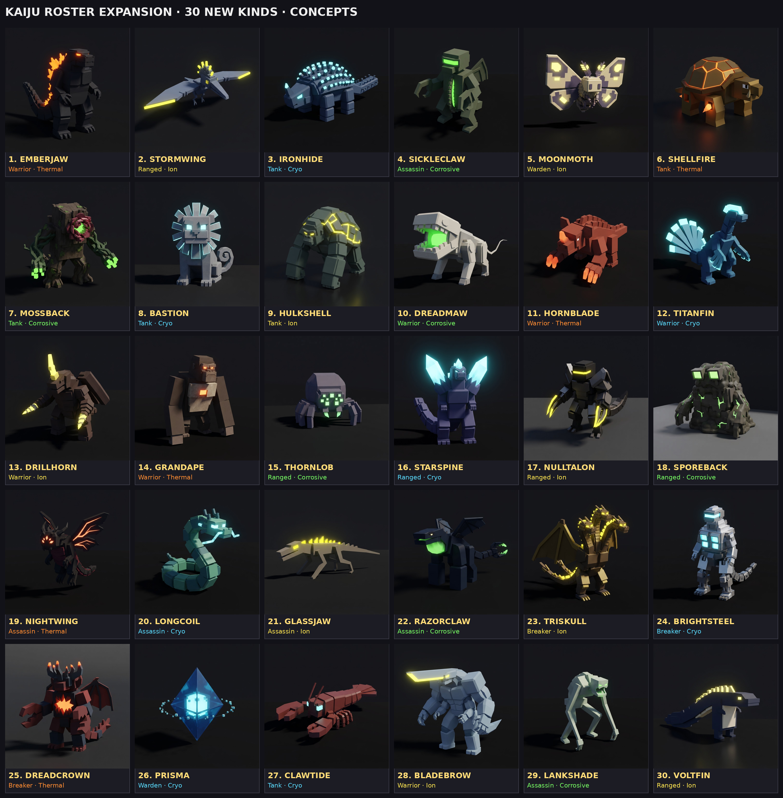

# Kaiju roster expansion: 30 new kinds

A proposal (Oct 21, draft, not signed off). The game has four kinds of mini
kaiju, each in four elements (`Shared.Kaiju.Species`, `Shared.KaijuRoles`;
see [kaiju.md](kaiju.md)). This adds **30 more kinds**, drawn from the
kaiju canon (Toho, Gamera, Pacific Rim, Ultraman, Evangelion) but renamed and
reshaped so they are ours: blocky, knee-high, one glow zone, readable at a
glance. Every kind still comes in Thermal, Cryo, Ion and Corrosive, so this
is 120 new kaiju in all. Ship them in waves (below), not at once.

## What a kind is

A kind is a silhouette, a role, a stat line and a fight pattern. Today all
four kinds share their role's three moves (`KaijuRoles.Kits`). This proposal
keeps the roles (and adds two), but gives **each kind its own three moves**
(E from the start, Q at level 5, R at level 10), each still copied from a gem
surge shape (`Plan`) so it needs no new combat code, only a new entry in
`KaijuRoles.Moves`. The stat lines below are level 1 at a Common Gemsoul and
sit inside the existing bands (Health 165 to 340, Damage 10 to 22, Speed 8 to
22, Guard 0 to 0.30). They are drafts for the balance sim, which must keep
every kind's teams under about 55% wins at any level.

### Roles

| Role | Today | Plays |
| --- | --- | --- |
| Tank | Carapace | Front, draws foes, shrugs off the most |
| Warrior | Bulwark | Front, hits hardest up close |
| Ranged | Razorback | Back row, shoots, backs off when pressed |
| Assassin | Scythe | Opens by leaping onto their back row |
| **Breaker** (new) | | Mid-line. Goes for the foe with the highest Guard or a raised shell and strips it. Its blows ignore 50% of Guard. Gains mana for every guard it breaks. |
| **Warden** (new) | | Back row with the shooters. Its E goes on allies, not foes. Gains mana as allies lose health. Weak blows. |

If the two new roles are too much for v1, every Breaker below maps to
Warrior and every Warden to Ranged, and the kits still work.

## The roster

(AI concept renders in the style of `kaiju/species.png`, one element each; every kind comes in all four. Individual renders in `kaiju-concepts/kaiju-<name>.png`; the first wave alone is `kaiju-concepts/wave1-lineup.png`.)

Stats: **HP / Damage / Rate (s per blow) / Speed / Guard**. Fight: the quick
blow combo, the heavy (its multiplier and sweep), and the guard pose with the
share of a blow it still takes. Moves: E (surge) / Q (strike) / R (defense).

### Tanks (5)

**1. Ironhide** (after Anguirus). A low, spiked back-roller on four legs, horned snout, a nail-studded tail.
320 / 12 / 1.4 / 11 / 0.30. Combo: Horn Butt x2. Heavy: Spine Roll 1.8x (rolls through the line, 360° sweep). Guard: curls into its spikes, takes 10%.
- E **Thorn Hide**: for 5s every foe that strikes it takes 20% of the blow back.
- Q **Roll Out**: a rolling charge that knocks everything in its path back 4 studs.
- R **Spiked Curl**: a shell of 35% of its health; blows on the shell are reflected at 30%.

**2. Shellfire** (after Gamera). A turtle with jet vents in its leg holes, tusked jaw, a shell that glows at the seams.
290 / 14 / 1.3 / 12 / 0.25. Combo: Shell Bash x2. Heavy: Spin Dive 1.9x (leaps and spins down, 150°). Guard: into the shell, takes 15%.
- E **Spin Jet**: spins through the enemy line, hitting everyone in a 12-stud path.
- Q **Plasma Bite**: a bite that applies its element's status (Burn / Slow / Stun / Poison).
- R **Soul Shell**: a shell of 30% health; while it stands, allies in 10 studs gain mana 50% faster.

**3. Mossback** (after Biollante). A walking thicket: a bark-plated body, vines for arms, a rose-mouth that opens on a maw.
340 / 10 / 1.5 / 8 / 0.20. Combo: Vine Lash x2 (reach 7, the longest of any tank). Heavy: Root Burst 1.7x (roots erupt from the ground in a 150° arc). Guard: bark closes over it, takes 15%.
- E **Grasping Vines**: roots every foe in reach for 1.5s.
- Q **Sap Drain**: a lash that heals it for 40% of the damage dealt.
- R **Overgrowth**: a ward (-30% damage taken for 4s) that spreads its element's status to foes that touch it.

**4. Bastion** (after King Caesar). A lion-dog guardian statue come to life, mane of stone fins, mirrored eyes.
280 / 15 / 1.2 / 13 / 0.25. Combo: Paw Strike x2. Heavy: Guardian Slam 1.8x. Guard: braces on its forepaws, takes 10%, and shots that hit the guard bounce off.
- E **Mirror Guard**: for 2s the next ranged shot or cast aimed at any ally in 8 studs is reflected back at its caster.
- Q **Pounce Slam**: leaps to the nearest foe and slams it, staggering it 0.5s.
- R **Sentinel's Roar**: taunts foes in 15 studs for 3s; its whole team takes 25% less damage while they are taunted.

**5. Hulkshell** (after Leatherback, Pacific Rim). A gorilla kaiju: huge forearms, a hunched back plated like a turtle, knuckle-walks.
310 / 16 / 1.5 / 10 / 0.20. Combo: Fist Slam x2. Heavy: Ground Pound 2.0x (150°). Guard: forearms up, takes 15%.
- E **Nullpulse**: a burst in 10 studs that silences every foe's casts for 2s and empties 20 mana from each.
- Q **Haymaker**: a single blow that knocks its foe back 6 studs into its own back row.
- R **Brace**: a shell of 30% health that cannot be knocked back.

### Warriors (6)

**6. Emberjaw** (after the classic upright reptile king). Dorsal fins down the back, a thick tail, stands tall.
250 / 21 / 1.6 / 12 / 0.10. Combo: Claw x2. Heavy: Tail Sweep 2.0x (220°). Guard: arms up, takes 30%.
- E **Soul Breath**: a beam down a 14-stud line in its element, hitting everything in it.
- Q **Tail Sweep**: a 220° sweep that knocks back.
- R **Dorsal Glow**: heals 25% of its health over 4s; its fins light up while it mends.

**7. Dreadmaw** (after the Skullcrawler). A two-legged jaw on a long body, no eyes, a whip tail.
220 / 22 / 1.4 / 16 / 0.05. Combo: Snap x3. Heavy: Lunge Bite 1.8x (closes 6 studs first). Guard: a flinch, takes 45%.
- E **Devour**: a bite that heals it for half the damage dealt; on a kill it heals fully.
- Q **Whip Tail**: a 180° lash behind it, for foes that flank.
- R **Frenzy**: under 50% health it attacks 40% faster for 4s.

**8. Hornblade** (after Baragon). A stocky digger with a nose horn, big ears, digging claws.
260 / 19 / 1.5 / 13 / 0.10. Combo: Horn Gore x2. Heavy: Burrow Strike 1.9x (goes under, erupts beneath its foe). Guard: head down, horn out, takes 30%.
- E **Burrow**: untargetable for 1.5s, then erupts under its target, staggering it.
- Q **Horn Charge**: a 10-stud charge; the first foe hit is carried 3 studs.
- R **Tremor Guard**: a ward (-25% for 4s); every blow it blocks shakes the ground in 5 studs for 20% of a blow.

**9. Titanfin** (after Titanosaurus). A long-necked sea reptile with a fan tail and fins on its forearms.
255 / 18 / 1.5 / 12 / 0.10. Combo: Fin Slash x2. Heavy: Tail Gale 1.7x (180°, pushes every foe back 5 studs). Guard: fins crossed, takes 30%.
- E **Tail Gale**: a cone of wind that pushes foes back and slows them 30% for 2s.
- Q **Fin Cleave**: a two-handed cut, 30% harder on a foe that is slowed.
- R **Riptide Stance**: a ward (-30% for 3s); foes that strike it are pulled 2 studs in.

**10. Drillhorn** (after Megalon). A beetle on two legs, drill-bit arms, a single horn, wing cases.
245 / 20 / 1.6 / 12 / 0.15. Combo: Drill Jab x2. Heavy: Drill Dive 2.0x (leaps, lands point first, 150°). Guard: drills crossed, takes 25%.
- E **Drill Dive**: a leap onto its target, hitting everything in 5 studs where it lands.
- Q **Soul Bomb**: lobs a bomb of its element 10 studs, bursting in 4.
- R **Chitin Lock**: a shell of 30% health; its wing cases snap shut.

**11. Grandape** (after the great ape). A broad-chested ape, knuckle-walks, beats its chest before a heavy.
265 / 20 / 1.5 / 14 / 0.10. Combo: Fist x3. Heavy: Chest-Beat Slam 1.8x. Guard: forearms up, takes 30%.
- E **Alpha Roar**: its team hits 15% harder for 4s.
- Q **Boulder Throw**: hurls a rock 14 studs at a foe it cannot reach, a melee kind's only shot.
- R **Thump Guard**: a ward (-30% for 3s); the first blow it takes is answered with a free Fist.

### Ranged (5)

**12. Stormwing** (after Rodan). A pterosaur kaiju with a spiked crest, fights from the air.
180 / 12 / 0.8 / 22 / 0.00. Combo: Dive Peck x2, then wheels away. Heavy: Sonic Dive 1.7x. Guard: banks away, takes 45%.
- E **Sonic Boom**: a 12-stud cone that slows foes 40% for 2s and knocks shots out of the air.
- Q **Dive Strike**: a strafing dive down a 10-stud line.
- R **Updraft**: a vault; it flies out of reach for 2s and lands behind its own front line.

**13. Thornlob** (after Kumonga). A fat spider, eight stubby legs, a lamp-eyed face.
185 / 11 / 0.9 / 17 / 0.05. Combo: Fang x2. Heavy: Web Shot 1.5x (roots the target 1.5s). Guard: legs tucked, takes 40%.
- E **Web Shot**: a shot that roots its target 1.5s; a rooted foe takes 25% more from its team.
- Q **Venom Fang**: a shot that applies its element's status twice over.
- R **Silk Wall**: a 6-stud wall in front of it for 3s that stops shots and casts (not kaiju).

**14. Starspine** (after SpaceGodzilla). A crystal-shouldered reptile with two great shards rising from its back.
190 / 13 / 1.0 / 14 / 0.10. Combo: Crystal Shard x2. Heavy: Crystal Spire 1.8x (a pillar grows under its foe). Guard: shoulders forward, takes 35%.
- E **Corona Beam**: a bending beam that curves to its target, 16 studs, cannot be dodged by a hop.
- Q **Crystal Spire**: a pillar under its foe that stuns 0.6s and blocks the path for 3s.
- R **Crystal Shell**: a shell of 30% health; it gains 10% of the shell back for every ally cast while it stands.

**15. Nulltalon** (after Zetton, Ultraman). An armoured insect-knight, no face, a glowing slit, blade talons.
180 / 14 / 1.1 / 15 / 0.05. Combo: Fire Orb x1. Heavy: Barrier Shot 1.6x. Guard: a shimmering plane, takes 35%.
- E **Absorb Barrier**: for 2s it swallows the next enemy cast and fires it back at the caster.
- Q **Trillion Orbs**: three orbs in a fan, each 0.6 of a blow.
- R **Phase Step**: blinks 8 studs away from the foe nearest it and clears status.

**16. Sporeback** (after Hedorah). A heap of smog and sludge with lamp eyes, half liquid.
200 / 10 / 1.0 / 11 / 0.15. Combo: Sludge Fling x2. Heavy: Smog Wave 1.7x (a rolling wave down a 10-stud line). Guard: goes slack, takes 35%.
- E **Smog Cloud**: a 6-stud cloud for 3s; foes inside are blinded (miss 30%) and take its element's status.
- Q **Acid Spit**: a lob that leaves a puddle for 3s.
- R **Dissolve**: becomes smog for 2s, untouchable, and drifts 6 studs away.

### Assassins (5)

**17. Sickleclaw** (after Gigan). Hooks for hands, a buzzsaw down its belly, one red visor eye.
175 / 16 / 0.9 / 18 / 0.05. Combo: Hook x3. Heavy: Buzzsaw Rush 1.9x (a dash through its foe). Guard: hooks crossed, takes 45%.
- E **Buzzsaw Rush**: a 10-stud dash that hits everything in its path.
- Q **Hook Slash**: a cut that bleeds for 3 more blows' worth over 3s.
- R **Rocket Hop**: a vanish; it fires its heels and lands behind their back row.

**18. Nightwing** (after Battra). A black moth-dragon, jagged wings, a horned brow, three glowing eyes.
165 / 17 / 0.9 / 20 / 0.05. Combo: Prism Dive x2. Heavy: Horn Impale 1.9x. Guard: wings wrap it, takes 45%.
- E **Prism Beams**: beams from its eyes at its target from above, 3 hits of 0.9.
- Q **Dive Bomb**: a dive that stuns 0.5s.
- R **Shadow Veil**: untargetable 1.5s; its next blow is a critical (1.5x).

**19. Longcoil** (after Manda). A serpent-dragon, whiskered, no legs, a long coiling body.
180 / 14 / 0.8 / 19 / 0.05. Combo: Bite x3. Heavy: Constrict 1.8x (wraps its foe, rooting it 1s). Guard: coils up, takes 40%.
- E **Coil**: wraps its target for 2s: rooted, and bitten for a blow every 0.5s.
- Q **Serpent Strike**: a lunge from 7 studs, 30% harder on a rooted foe.
- R **Slither**: slides 10 studs through the line, untouchable, leaving its element on the ground.

**20. Glassjaw** (after Zilla). A lean iguana on long legs, built to sprint and dig.
175 / 15 / 0.8 / 21 / 0.00. Combo: Bite x3. Heavy: Burrow Ambush 1.7x. Guard: a sidestep, takes 45%.
- E **Burrow Ambush**: digs in and surfaces behind their back row 1s later, its first bite 1.5x.
- Q **Tail Whip**: a 180° lash that knocks shots aside.
- R **Scatter**: +50% speed for 3s and it drops aggro; foes pick a new target.

**21. Razorclaw** (after Otachi, Pacific Rim). Winged, a pincer tail, a glowing acid sac in its throat.
170 / 16 / 0.9 / 19 / 0.05. Combo: Claw x2. Heavy: Tail Pincer 1.8x. Guard: wings forward, takes 45%.
- E **Acid Spew**: an 8-stud cone of its element that lingers 2s.
- Q **Tail Pincer**: grabs its target and throws it 6 studs toward its own team.
- R **Wing Snatch**: lifts off out of reach for 1.5s, carrying its target with it and dropping it (0.8 of a blow).

### Breakers (3) — new role

**22. Triskull** (after Ghidorah). Three heads on three necks, two tails, great wings folded. The flagship.
230 / 17 / 1.2 / 14 / 0.10. Combo: Triple Snap x3 (one per head). Heavy: Gravity Bolt 1.9x (three bolts down three lines). Guard: wings fold over, takes 35%.
- E **Gravity Storm**: three bolts at three different foes, 0.9 each; each bolt breaks a raised guard.
- Q **Triple Bite**: three bites at once, 0.6 each, on up to three foes in reach.
- R **Regrow**: heals 25% over 3s; if a head was "lost" (it fell under 30% health), it is restored to 40%.

**23. Brightsteel** (after the robot kaiju: MechaGodzilla, Jet Jaguar). A chrome machine kaiju, piston limbs, a visor, vents that glow.
240 / 16 / 1.3 / 13 / 0.20. Combo: Piston Punch x2. Heavy: Finger Missiles 1.6x (five small shots). Guard: plating locks, takes 25%.
- E **Overclock**: its team attacks 20% faster for 4s.
- Q **Missile Salvo**: six shots over 1.5s at the foe with the highest Guard, each ignoring Guard fully.
- R **Reboot**: a shell of 25% health; once a battle, if it would be knocked out it instead stands at 10% health.

**24. Dreadcrown** (after Destoroyah). A crab-demon with a horn crown, pincers, a jagged chest cavity that glows.
235 / 18 / 1.3 / 13 / 0.15. Combo: Pincer x2. Heavy: Oxygen Crush 1.9x. Guard: pincers up, takes 30%.
- E **Micro-Oxygen**: a 10-stud cone that sets every foe's Guard to 0 for 3s and bursts any shell.
- Q **Horn Katana**: its horn blazes and cuts a 7-stud line; a foe with no Guard takes 1.5x.
- R **Split**: splits into three crablings for 3s (untargetable; each crabling bites for 0.3), then re-forms.

### Wardens (2) — new role

**25. Moonmoth** (after Mothra). A great moth, patterned wings, feathered antennae, the gentlest kind.
170 / 10 / 0.9 / 20 / 0.00. Combo: Wing Buffet x2. Heavy: Scale Storm 1.6x. Guard: wings folded, takes 40%.
- E **Scale Storm**: reflective scales over its team for 3s: shots and casts on them lose 50%.
- Q **Antenna Beam**: a 14-stud line shot.
- R **Silk Cocoon**: a shell of 30% on its lowest ally that heals that ally 5% a second while it stands.

**26. Prisma** (after Ramiel, Evangelion). A floating crystal octahedron with a single core light, no face, no limbs. The strangest thing in the roster.
200 / 12 / 1.2 / 9 / 0.20. Combo: Lance Beam x1. Heavy: Drill Beam 2.0x (a long wind-up, a 16-stud line). Guard: it turns a facet, takes 25%.
- E **Field**: a barrier on every ally for 3s: the next two blows on each are halved.
- Q **Drill Beam**: a 16-stud beam that pierces every foe in it.
- R **Shift Shape**: a shell of 35%; a foe striking the shell is pushed back 4 studs.

### Four more (27 to 30)

**27. Clawtide** (after Ebirah). Tank. A giant lobster: one oversized crusher claw, one cutter, a fanned tail, antennae.
300 / 13 / 1.4 / 10 / 0.25. Combo: Cutter Snip x2. Heavy: Crusher Clamp 1.9x (holds its foe 0.8s). Guard: claws crossed, takes 15%.
- E **Clamp**: seizes its target for 1.5s (rooted, cannot cast) and squeezes for a blow every 0.5s.
- Q **Tail Fan**: a 180° sweep behind it that pushes foes back 4 studs.
- R **Shell Harden**: a shell of 35% health; while it stands, it cannot be rooted or knocked back.

**28. Bladebrow** (after Knifehead, Pacific Rim). Warrior. A hunched brute with a flat blade of a head that juts forward and four arms.
255 / 21 / 1.6 / 12 / 0.10. Combo: Twin Fist x2 (both big arms). Heavy: Head Spear 2.0x (a lunge, the blade first). Guard: all four arms up, takes 25%.
- E **Head Spear**: a 7-stud lunge that pierces a shell outright.
- Q **Four-Arm Flurry**: four quick blows of 0.45 each over 1s.
- R **Hunker**: a ward (-35% for 3s); it cannot be staggered while it holds.

**29. Lankshade** (after Clover). Assassin. A tall gangly stalker on long thin limbs, a hunched spine, a wide mouth.
170 / 16 / 0.9 / 20 / 0.00. Combo: Rake x3. Heavy: Stomp Down 1.8x (from above, 150°). Guard: folds its limbs, takes 45%.
- E **Loom**: rises to its full height and drops onto their back row from 8 studs, staggering 0.5s.
- Q **Rake Flurry**: three rakes of 0.6 that each apply its element's status.
- R **Scuttle**: untouchable 1.5s, moving 10 studs; it drops a parasite (a critter of 0.3 of a blow per bite, 4s) where it stood.

**30. Voltfin** (after Eleking, Ultraman). Ranged. An eel kaiju on two short legs, a ridged dorsal fin its whole length, a dragging tail.
185 / 12 / 0.9 / 16 / 0.05. Combo: Arc Spit x2. Heavy: Tail Discharge 1.6x (a ring in 5 studs). Guard: fin flattens, takes 40%.
- E **Discharge Ring**: a ring round it for 2 blows that applies its element's status to all in 6 studs.
- Q **Arc Lash**: a shot that jumps to one more foe within 5 studs for half.
- R **Grounding**: a shell of 25% health; while it stands, its team is immune to Stun and Slow.

Build order addition: Clawtide and Voltfin join wave 2 (the Rift's caves), Bladebrow wave 3, Lankshade wave 4.

## Balance notes for the sim

- **Stat budget.** Health x (Damage / Rate) sits between 2,600 and 3,000 at level 1 for the four current kinds. Every line above was drafted to land in that band, with Tanks trading damage for Guard and Assassins trading Guard for Speed. Treat Breakers like Warriors (higher damage, lower Guard) and Wardens like Ranged (low damage, high utility).
- **Counters to design for.** Breakers should beat Tank-heavy teams and lose to Assassins (they stand mid-line with their backs open). Wardens should make Ranged teams stronger and die fast to Assassins. If Breakers or Wardens win more than 55% of mirror-less matchups, cut their E's duration first, not their stats.
- **Mana.** Breakers gain 15 mana per guard broken on top of attack mana; Wardens gain 1.5 mana per 1% of health an ally loses (the Tank's Hurt gain is 1.2 for itself).
- **No new combat verbs.** Every move above is a Taunt, Shell, Ward, Mend, Ring, Line, Cone, Lob, Dash, Vault or Root, all shapes `Server.KaijuAbilities` already casts for the gem surges. The three new ideas (reflect, silence, revive-once) are flags on those shapes.

## Build order

Ship in waves of five or six so each wave can be balanced and so the Season has new kaiju to put in its track and the Frontier has new ones to catch:

| Wave | Kinds | Where they roam |
| --- | --- | --- |
| 1 | Emberjaw, Stormwing, Ironhide, Sickleclaw, Moonmoth | Fringe and Edge of the Outpost (the first five fill out the four roles plus the first Warden) |
| 2 | Hornblade, Thornlob, Shellfire, Longcoil, Brightsteel, Dreadmaw | The Rift's caves |
| 3 | Titanfin, Starspine, Mossback, Nightwing, Grandape | Deep veins and the dungeons' approaches |
| 4 | Drillhorn, Nulltalon, Bastion, Glassjaw, Razorclaw | Season 2 track and event spawns |
| 5 | Hulkshell, Sporeback, Prisma, Dreadcrown, Triskull | Boss-adjacent: Triskull only near the rift titans, a Legendary-Gemsoul unicorn like Voidmaw was for pets |

## Implementation notes

- `Shared.Kaiju.Species`: one entry per kind (Id, Name, Role, Blurb, Health, Damage, Rate, Speed, Reach, Guard), and `Kaiju.Order` extended.
- `Shared.KaijuRoles.Species`: map each kind to its role; add `Breaker` and `Warden` to `Roles` and `Order` (Front = false for both; Breaker targets the highest-Guard foe in `target`, Warden picks the lowest-health ally for its E).
- `Shared.KaijuRoles.Kits`: key by species first, fall back to the role kit, so the four current kinds are unchanged. `KaijuRoles.kit(species)` reads `Kits[species] or Kits[role]`.
- `Shared.KaijuRoles.Moves`: 90 new entries (3 per kind), each with `From` (the gem surge it copies), `IconSource` and a `Plan`.
- `Shared.KaijuModels`: 30 new blocky models, each with one glow zone that takes the element colour; fight poses for quick, heavy and guard; the Frontier's wild-size (0.9) and pet-size (0.55) scales as now.
- `Server.KaijuBattleBrain`: two new role behaviours; the fight pattern tables (combo count, heavy multiplier and arc, guard share) extend `KaijuFight`.
- The starter roll (`Kaiju.RollVersion`) should keep rolling only the four original kinds for new players, so the first team is readable; new kinds come from catching, the Season track and events.
