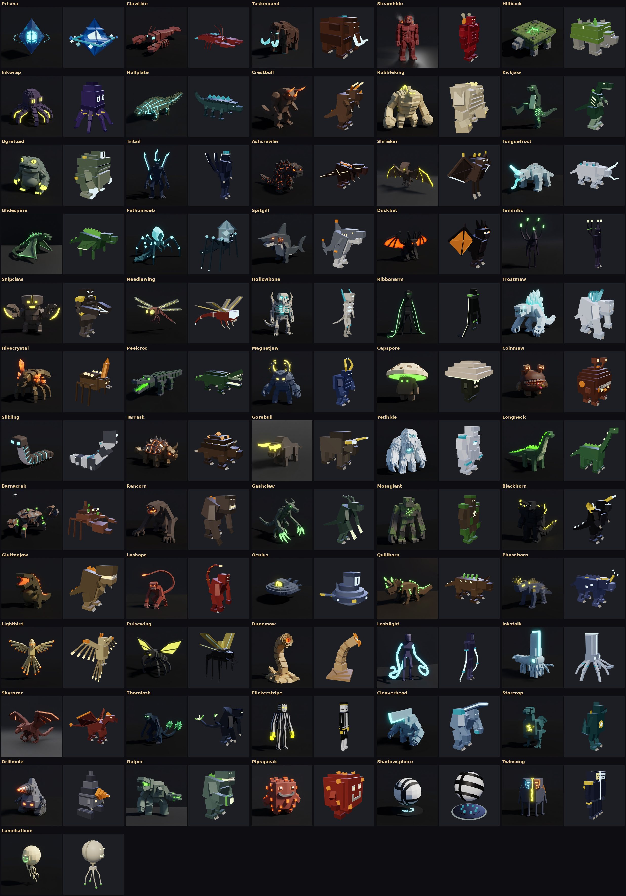

# The rest of the roster: 61 more kaiju

*2026-10-28.* Every kind on the three concept sheets is now in the game.
That's the 61 left: Prisma and Clawtide from the first sheet, and kinds 31
to 90 from the second and third (Skyjelly, 57, was already in as everyone's
starter support). With the 33 before them (the first four, the first
sheet's 28 and Skyjelly) the game has **94 kinds**, each in all four
elements: 376 kaiju.

*(An offline three.js render of the real model builders, each in the
element its concept shows. Not a Roblox screenshot.)*

## Where every kind stands

| Kinds | Data, kit and Spanish | Model | Fight poses | Caught in the wild |
| --- | --- | --- | --- | --- |
| The first four (Bulwark, Razorback, Carapace, Scythe) | Yes | Yes | Yes | No: the starter roll deals them |
| The first sheet's 28 ([kaiju-roster.md](kaiju-roster.md)) | Yes | Yes, 11 rebuilt after their concepts on Oct 22 | Yes | 11 of them (below) |
| Skyjelly | Yes | Yes | Yes | No: everyone's starter support |
| The 61 on this page | Yes | Yes, new, after their concepts | Yes | All 61 |

On Oct 24 the wild was cut down to a hand-picked list (`Kaiju.WildRoster`):
Emberjaw, Stormwing, Sickleclaw, Mossback, Hulkshell, Drillhorn, Triskull,
Brightsteel, Dreadcrown, Bladebrow and Starspine. That list is unchanged.
So 17 of the first sheet's kinds are in the game but can't be caught:
Ironhide, Moonmoth, Shellfire, Bastion, Dreadmaw, Hornblade, Titanfin,
Grandape, Thornlob, Nulltalon, Sporeback, Nightwing, Longcoil, Glassjaw,
Razorclaw, Lankshade and Voltfin. To open one, add it to `Kaiju.WildRoster`.

Each of the 61 has:

- a model of its own, built after its concept render, in a hide of its
  own colours, with plates in its element's colour and glows in its
  element's light;
- one of the six roles, with its own stats, fight style, blow names,
  shots (the Ranged and the Wardens) and roar;
- three moves of its own: E from level 1, Q at level 5 and R at level 10
  (183 moves in all), beside its gem surge as every kaiju has;
- fight poses of its own;
- a place where it roams wild.

## How you get them

All 61 roam the frontier and are caught as the others are. Where each
roams is its Habitat, as for the first sheet:

| Roams | Kinds |
| --- | --- |
| Fringe and Edge (anywhere past the core) | Tuskmound, Crestbull, Shrieker, Duskbat, Peelcroc, Capspore, Coinmaw, Gorebull, Gashclaw, Quillhorn, Skyrazor, Drillmole, Pipsqueak |
| The Edge only | the 41 others not listed here |
| The Rift Vein's guardian only | Prisma, Tritail, Tarrask, Gluttonjaw, Oculus, Dunemaw, Starcrop |

Coinmaw and Pipsqueak, the two mascots, were proposed as quest rewards.
There are no quests for them yet, so they roam the Fringe for now.

The eight new Wardens (Prisma, Capspore, Coinmaw, Silkling, Pipsqueak,
Shadowsphere, Twinsong, Lumeballoon) go in the support slot when caught,
as Moonmoth and Skyjelly do.

## The kinds

| Kind | Role | Roams | HP / Dmg / Rate / Speed / Guard | E (level 1) | Q (level 5) | R (level 10) |
| --- | --- | --- | --- | --- | --- | --- |
| Prisma | Warden | Vein guardian | 200 / 12 / 1.2 / 9 / 0.20 | Barrier Field | Drill Beam | Shift Shape |
| Clawtide | Tank | the Edge | 300 / 13 / 1.4 / 10 / 0.25 | Clamp | Tail Fan | Shell Harden |
| Tuskmound | Tank | Fringe and Edge | 330 / 12 / 1.5 / 9 / 0.25 | Stamp | Tusk Toss | Thick Hide |
| Steamhide | Tank | the Edge | 325 / 14 / 1.5 / 9 / 0.20 | Steam Vent | Palm Sweep | Pressure Shell |
| Hillback | Tank | the Edge | 340 / 11 / 1.6 / 8 / 0.25 | Settle | Rockfall | Bedrock |
| Inkwrap | Tank | the Edge | 290 / 13 / 1.3 / 10 / 0.20 | Ink Cloud | Eight-Arm Grab | Jet Away |
| Nullplate | Tank | the Edge | 300 / 14 / 1.4 / 11 / 0.30 | Impervious | Plate Rake | Shed Plate |
| Crestbull | Warrior | Fringe and Edge | 260 / 20 / 1.5 / 13 / 0.10 | Horn Rush | Tail Whip | Dig In |
| Rubbleking | Warrior | the Edge | 270 / 22 / 1.7 / 11 / 0.10 | Rock Toss | Ground Rip | Bellow |
| Kickjaw | Warrior | the Edge | 250 / 20 / 1.4 / 15 / 0.05 | Drop Kick | Tail Balance Kick | Spring Back |
| Ogretoad | Warrior | the Edge | 278 / 21 / 1.5 / 12 / 0.15 | Shock Grip | Cackle | Warty Hide |
| Tritail | Warrior | Vein guardian | 240 / 21 / 1.4 / 15 / 0.10 | Three Tails | Crown Shriek | Tail Shield |
| Ashcrawler | Warrior | the Edge | 265 / 20 / 1.6 / 10 / 0.15 | Back Rays | Tail Beam | Harden |
| Shrieker | Ranged | Fringe and Edge | 175 / 12 / 0.8 / 21 / 0.00 | Sonic Scalpel | Screech | Night Flight |
| Tonguefrost | Ranged | the Edge | 190 / 12 / 1.0 / 13 / 0.10 | Tongue Pull | Horn Spray | Rainbow Hide |
| Glidespine | Ranged | the Edge | 180 / 12 / 0.9 / 19 / 0.05 | Glide Strike | Spine Fan | Updraft |
| Fathomweb | Ranged | the Edge | 185 / 13 / 1.0 / 15 / 0.05 | Freezing Web | Hood Beam | Burrow Back |
| Spitgill | Ranged | the Edge | 185 / 12 / 1.0 / 16 / 0.05 | Pressure Jet | Gill Spray | Slick |
| Duskbat | Assassin | Fringe and Edge | 170 / 16 / 0.9 / 21 / 0.00 | Dive Bite | Blackout | Vanish Wing |
| Tendrilis | Assassin | the Edge | 165 / 17 / 0.9 / 19 / 0.05 | Spear Lunge | Four Tendrils | Absorb |
| Snipclaw | Assassin | the Edge | 170 / 15 / 0.9 / 19 / 0.05 | Split | Scissor Cut | Phase Out |
| Needlewing | Assassin | the Edge | 160 / 17 / 0.8 / 22 / 0.00 | Hypersonic Pass | Siphon | Afterimage |
| Hollowbone | Assassin | the Edge | 175 / 15 / 0.9 / 18 / 0.05 | Bone Spur | Gravity Beams | Hollow Form |
| Ribbonarm | Assassin | the Edge | 170 / 16 / 1.0 / 17 / 0.10 | Ribbon Pierce | Unfurl | Cocoon Fold |
| Frostmaw | Breaker | the Edge | 245 / 17 / 1.3 / 12 / 0.15 | Deep Freeze | Rime Claw | Glacier Back |
| Hivecrystal | Breaker | the Edge | 260 / 18 / 1.3 / 13 / 0.15 | Swarm | Horn Beam | Crystal Seed |
| Peelcroc | Breaker | Fringe and Edge | 255 / 18 / 1.4 / 14 / 0.15 | Peel | Death Roll | Armour Lock |
| Magnetjaw | Breaker | the Edge | 275 / 18 / 1.4 / 11 / 0.20 | Magnet Field | Pincer Crush | Polarize |
| Capspore | Warden | Fringe and Edge | 200 / 10 / 1.3 / 9 / 0.20 | Healing Spores | Spore Puff | Root Guard |
| Coinmaw | Warden | Fringe and Edge | 190 / 9 / 1.2 / 12 / 0.15 | Share the Hoard | Coin Spit | Zip Up |
| Silkling | Warden | the Edge | 210 / 9 / 1.2 / 9 / 0.20 | Silk Wrap | Silk Spray | Cocoon |
| Tarrask | Tank | Vein guardian | 330 / 13 / 1.5 / 9 / 0.30 | Reflective Carapace | Gore | Regenerate |
| Gorebull | Tank | Fringe and Edge | 310 / 15 / 1.4 / 12 / 0.20 | Hoof Stamp | Bull Rush | Stubborn |
| Yetihide | Tank | the Edge | 300 / 14 / 1.4 / 10 / 0.25 | Blizzard Coat | Bear Hug | Snowdrift |
| Longneck | Tank | the Edge | 345 / 11 / 1.6 / 8 / 0.20 | Rear Up | Neck Sweep | Living Wall |
| Barnacrab | Tank | the Edge | 305 / 14 / 1.3 / 11 / 0.25 | Barnacle Burst | Pin | Hull Down |
| Rancorn | Warrior | the Edge | 275 / 22 / 1.7 / 11 / 0.10 | Grab and Bite | Arm Sweep | Thick Skull |
| Gashclaw | Warrior | Fringe and Edge | 245 / 21 / 1.3 / 16 / 0.05 | Pounce | Rake | Hunter's Hide |
| Mossgiant | Warrior | the Edge | 275 / 20 / 1.6 / 11 / 0.10 | Rip Up | Haymaker | Regrowth |
| Blackhorn | Warrior | the Edge | 265 / 21 / 1.6 / 12 / 0.15 | Horn Lance | Shoulder Check | Black Armour |
| Gluttonjaw | Warrior | Vein guardian | 265 / 19 / 1.5 / 13 / 0.05 | Ravenous | Dragon Breath | Gorge |
| Lashape | Warrior | the Edge | 250 / 19 / 1.3 / 15 / 0.10 | Whip Crack | Tail Trip | Cruel Command |
| Oculus | Ranged | Vein guardian | 175 / 13 / 1.0 / 12 / 0.05 | Descent | Eye Beam | Rise |
| Quillhorn | Ranged | Fringe and Edge | 190 / 12 / 0.9 / 15 / 0.10 | Quill Storm | Horn Burst | Spined Flank |
| Phasehorn | Ranged | the Edge | 185 / 13 / 1.0 / 17 / 0.05 | Horn Arc | Lightning Horn | Flicker |
| Lightbird | Ranged | the Edge | 195 / 14 / 1.0 / 18 / 0.00 | Mind Beam | Feather Fan | Ascend |
| Pulsewing | Ranged | the Edge | 180 / 13 / 0.9 / 19 / 0.05 | EMP Shriek | Hook Dive | Pulse Lift |
| Dunemaw | Assassin | Vein guardian | 165 / 14 / 1.0 / 17 / 0.10 | Burrow Ambush | Swallow | Sink |
| Lashlight | Assassin | the Edge | 165 / 15 / 0.9 / 19 / 0.05 | Twin Lash | Whip Pierce | Fold |
| Inkstalk | Assassin | the Edge | 185 / 15 / 0.9 / 18 / 0.05 | Cold Grip | Ink Jet | Slip Away |
| Skyrazor | Assassin | Fringe and Edge | 170 / 16 / 0.9 / 20 / 0.00 | Dive Rake | Beak Snap | Wheel Off |
| Thornlash | Assassin | the Edge | 170 / 17 / 0.9 / 18 / 0.05 | Tail Impale | Spine Volley | Spined Guard |
| Flickerstripe | Assassin | the Edge | 165 / 16 / 0.9 / 20 / 0.05 | Teleport Strike | Shrink Ray | Face Turn |
| Cleaverhead | Breaker | the Edge | 245 / 18 / 1.4 / 13 / 0.15 | Head Cleave | Four-Fist | Brace Arms |
| Starcrop | Breaker | Vein guardian | 240 / 16 / 1.3 / 13 / 0.15 | Belly Beam | Devour Energy | Star Shell |
| Drillmole | Breaker | Fringe and Edge | 235 / 17 / 1.3 / 12 / 0.20 | Burrow Drill | Eye Beams | Spinning Shield |
| Gulper | Breaker | the Edge | 265 / 18 / 1.5 / 11 / 0.15 | Absorb | Shoulder Cannon | Regenerate |
| Pipsqueak | Warden | Fringe and Edge | 180 / 8 / 1.2 / 14 / 0.15 | Cheer | Pebble Toss | Brave Stand |
| Shadowsphere | Warden | the Edge | 190 / 10 / 1.3 / 10 / 0.20 | Dirac Shade | Shadow Snap | Sea of Shadow |
| Twinsong | Warden | the Edge | 200 / 10 / 1.2 / 12 / 0.15 | Duet Ward | Harmony Beam | Rejoin |
| Lumeballoon | Warden | the Edge | 185 / 9 / 1.3 / 11 / 0.15 | Lift Allies | Red Mist | Deflate |

| Kind | Key | Move | What it does |
| --- | --- | --- | --- |
| Prisma | E | Barrier Field | A crystal barrier over its team: it and every ally near it take 35% less for 3s. |
| Prisma | Q | Drill Beam | A drilling beam through everyone in a line: 140% damage, leaving them Vulnerable. |
| Prisma | R | Shift Shape | At half health: it folds into a new shape, a shell of 35% of its health for 5s. |
| Clawtide | E | Clamp | Snaps its claws all round: foes near it take 60% damage, are held fast (stunned) and turn on it for 3s, while it takes 30% less. |
| Clawtide | Q | Tail Fan | Fans its tail round it: 100% damage to the foes near it, slowing them. |
| Clawtide | R | Shell Harden | At half health: its shell hardens, a shell of 35% of its health for 5s. |
| Tuskmound | E | Stamp | Trumpets and stamps the ground: foes near it take 50% damage, are stunned and turn on it for 4s, while it takes 30% less. |
| Tuskmound | Q | Tusk Toss | Tosses its foe on its tusks: 140% damage, stunning it. |
| Tuskmound | R | Thick Hide | At half health: its thick hide shrugs off blows, 35% less for 4s. |
| Steamhide | E | Steam Vent | Vents a cloud of steam: foes near it take 50% damage with its element's effect and turn on it for 3s, while it takes 30% less. |
| Steamhide | Q | Palm Sweep | Sweeps its palms round it: 110% damage to the foes near it, slowing them. |
| Steamhide | R | Pressure Shell | At half health: a shell of 30% of its health for 5s that bursts in scalding steam when it breaks. |
| Hillback | E | Settle | Settles in like a hill: foes near it take 30% damage, are slowed and turn on it for 3s, while it takes 50% less. |
| Hillback | Q | Rockfall | Boulders roll off its back down a line: 120% damage to everyone in it, stunning them. |
| Hillback | R | Bedrock | At half health: it turns to bedrock, a shell of 40% of its health for 5s. |
| Inkwrap | E | Ink Cloud | Squirts a cloud of ink: foes near it take 40% damage, are blinded and turn on it for 3s, while it takes 30% less. |
| Inkwrap | Q | Eight-Arm Grab | Grabs with all eight arms: 100% damage to the foes near it, holding them (stunned). |
| Inkwrap | R | Jet Away | At half health: it jets back in a cloud of ink, a shell of 25% of its health for 4s. |
| Nullplate | E | Impervious | Locks its plates: foes near it take 40% damage and turn on it for 3s, while it takes 40% less. |
| Nullplate | Q | Plate Rake | Two raking swipes of its plated claws: 130% damage in all, leaving its foe Vulnerable. |
| Nullplate | R | Shed Plate | At half health: a shell of 30% of its health for 5s; when it breaks the plate flies off at the foes round it. |
| Crestbull | E | Horn Rush | Charges horns first down a line: 140% damage to everyone in its path, stunning them. |
| Crestbull | Q | Tail Whip | Whips its tail round it: 110% damage to the foes near it. |
| Crestbull | R | Dig In | Hard pressed or crowded: it digs in, taking 30% less for 3s, and heals 10% of its health. |
| Rubbleking | E | Rock Toss | Tears a rock from the ground and hurls it at its foe: 150% damage, stunning it. |
| Rubbleking | Q | Ground Rip | Rips the ground open down a line: 120% damage to everyone in it, stunning them. |
| Rubbleking | R | Bellow | Hard pressed or crowded: it bellows, and for 4s it hits 20% harder and 15% faster. |
| Kickjaw | E | Drop Kick | Leaps onto its foe feet first: 170% damage, stunning it. |
| Kickjaw | Q | Tail Balance Kick | Balances on its tail and kicks round it: 140% damage to the foes near it. |
| Kickjaw | R | Spring Back | Hard pressed or crowded: it springs about, and for 4s it hits 30% harder and 10% faster. |
| Ogretoad | E | Shock Grip | Grips its foe and squeezes three times: 150% damage in all, the last with its element's effect. |
| Ogretoad | Q | Cackle | A cackle that rings round it: 60% damage to the foes near it, blinding them. |
| Ogretoad | R | Warty Hide | Hard pressed or crowded: it takes 30% less for 3s and its element spreads to foes close to it. |
| Tritail | E | Three Tails | Lashes all three tails round it: 140% damage to the foes near it, with its element's effect. |
| Tritail | Q | Crown Shriek | A shriek down a wide cone: 80% damage to everyone in it, slowing them. |
| Tritail | R | Tail Shield | Hard pressed or crowded: its tails fan into a shell of 30% of its health for 5s that lashes every foe close to it each second. |
| Ashcrawler | E | Back Rays | Beams burst from its spine at everything round it: 130% damage to the foes near it, with its element's effect. |
| Ashcrawler | Q | Tail Beam | A beam down its tail through everyone in a line: 140% damage, with its element's effect. |
| Ashcrawler | R | Harden | Hard pressed or crowded: its molten hide hardens, a shell of 30% of its health for 5s that clears its effects. |
| Shrieker | E | Sonic Scalpel | A sonic beam so thin it cuts through everyone in a line: 160% damage, leaving them Vulnerable. |
| Shrieker | Q | Screech | A screech round it: 60% damage to the foes near it, stunning them. |
| Shrieker | R | Night Flight | A foe too close: it wheels away into the night, leaving a gust that slows whoever followed. |
| Tonguefrost | E | Tongue Pull | Lashes its tongue round its foe and yanks: 140% damage, stunning it. |
| Tonguefrost | Q | Horn Spray | Sprays its element from its horn down a wide cone: 130% damage to everyone in it, with its element's effect. |
| Tonguefrost | R | Rainbow Hide | A foe too close: its hide shimmers, and it takes 30% less for 3s. |
| Glidespine | E | Glide Strike | Glides over the line and drops on its foe after a beat: 140% damage round where it lands, stunning. |
| Glidespine | Q | Spine Fan | Fans five spines at its foe and those near it: 120% damage in all, the last with its element's effect. |
| Glidespine | R | Updraft | A foe too close: it catches an updraft back, leaving a gust that slows whoever followed. |
| Fathomweb | E | Freezing Web | Lays a freezing web on its foe for 3s: 120% damage in all to those inside, slowing them. |
| Fathomweb | Q | Hood Beam | A beam from its hood through everyone in a line: 130% damage, with its element's effect. |
| Fathomweb | R | Burrow Back | A foe too close: it burrows and surfaces back, leaving webbing that stuns whoever followed. |
| Spitgill | E | Pressure Jet | A jet of water at high pressure through everyone in a line: 140% damage, slowing them. |
| Spitgill | Q | Gill Spray | Sprays from its gills down a wide cone: 120% damage to everyone in it, with its element's effect. |
| Spitgill | R | Slick | A foe too close: it slides back, leaving a slick that trips (stuns) whoever followed. |
| Duskbat | E | Dive Bite | Dives onto their weakest out of the dark: 180% damage, with its element's effect. |
| Duskbat | Q | Blackout | A cloud of darkness on its foe for 2s: 80% damage in all to those inside, blinding them. |
| Duskbat | R | Vanish Wing | Low on health: it wraps itself in its wings, can't be hurt for 1.5s, and strikes their weakest. |
| Tendrilis | E | Spear Lunge | Leaps in head first and spears its foe: 180% damage, leaving it Vulnerable. |
| Tendrilis | Q | Four Tendrils | Four quick stabs of its tendrils: 160% damage in all, the last with its element's effect, and it heals 5% of its health. |
| Tendrilis | R | Absorb | Low on health: a shell of 25% of its health for 4s, and it heals 10% of its health. |
| Snipclaw | E | Split | Leaves a decoy in its place (it can't be hurt for a moment) and appears behind their weakest: 160% damage, stunning it. |
| Snipclaw | Q | Scissor Cut | Two snips of its scissor claws: 140% damage in all, leaving its foe Vulnerable. |
| Snipclaw | R | Phase Out | Low on health: it phases out, can't be hurt for 1.5s, and reappears with a snip. |
| Needlewing | E | Hypersonic Pass | Flashes through the line onto their weakest: 170% damage, with its element's effect. |
| Needlewing | Q | Siphon | Stings its foe with its tail and drinks: 130% damage, slowing it, and it heals 8% of its health. |
| Needlewing | R | Afterimage | Low on health: it leaves an afterimage, can't be hurt for 1.5s, and strikes their weakest. |
| Hollowbone | E | Bone Spur | Leaps onto its foe spur first: 170% damage, stunning it. |
| Hollowbone | Q | Gravity Beams | Beams from its shoulders at its foe and one more: 140% damage in all, slowing them. |
| Hollowbone | R | Hollow Form | Low on health: it goes hollow, can't be hurt for 1.5s, and strikes as it comes back. |
| Ribbonarm | E | Ribbon Pierce | Darts in behind a ribbon's point: 160% damage, leaving its foe Vulnerable. |
| Ribbonarm | Q | Unfurl | Unrolls both ribbons in a sweep round it: 130% damage to the foes near it, with its element's effect. |
| Ribbonarm | R | Cocoon Fold | Low on health: its ribbons wrap round it, a shell of 30% of its health for 4s. |
| Frostmaw | E | Deep Freeze | Breathes freezing cold down a wide cone: 140% damage to everyone in it, slowing them. |
| Frostmaw | Q | Rime Claw | Two rime-crusted swipes: 150% damage in all, leaving its foe Vulnerable. |
| Frostmaw | R | Glacier Back | Hard pressed or crowded: its sail freezes over, a shell of 30% of its health for 5s that chills and slows foes close to it. |
| Hivecrystal | E | Swarm | Looses its swarm on its foe and those near it: six bites for 150% damage in all, the last with its element's effect. |
| Hivecrystal | Q | Horn Beam | A beam from its crystal horn through everyone in a line: 140% damage, leaving them Vulnerable. |
| Hivecrystal | R | Crystal Seed | Hard pressed or crowded: it plants a crystal; it and every ally near it take 30% less for 4s. |
| Peelcroc | E | Peel | All three jaws on its foe at once: 160% damage, peeling its guard (Vulnerable). |
| Peelcroc | Q | Death Roll | Grabs its foe and rolls: three wrenching bites for 140% damage in all, stunning it. |
| Peelcroc | R | Armour Lock | Hard pressed or crowded: its plates lock, a shell of 30% of its health for 5s. |
| Magnetjaw | E | Magnet Field | A magnetic pulse round it: 100% damage to the foes near it, stripping their guard (Vulnerable). |
| Magnetjaw | Q | Pincer Crush | Clamps its horns on its foe: 150% damage, stunning it. |
| Magnetjaw | R | Polarize | Hard pressed or crowded: it polarizes; it and every ally near it take 30% less for 3s. |
| Capspore | E | Healing Spores | A cloud of healing spores: it, you and every ally near it heal 12% of their health over 3s. |
| Capspore | Q | Spore Puff | A choking puff of spores on its foe for 3s: 100% damage in all to those inside, poisoning them. |
| Capspore | R | Root Guard | At half health: it roots its team in place; it and every ally near it take 30% less for 4s. |
| Coinmaw | E | Share the Hoard | Spills its hoard over its team: it, you and every ally near it heal 10% of their health over 2s. |
| Coinmaw | Q | Coin Spit | Spits a fistful of coins at its foe; they burst after a beat: 120% damage round where they land, stunning. |
| Coinmaw | R | Zip Up | At half health: it zips shut, a shell of 35% of its health for 5s. |
| Silkling | E | Silk Wrap | Wraps its team in silk: it and every ally near it take 30% less for 4s. |
| Silkling | Q | Silk Spray | Sprays sticky silk down a line: 100% damage to everyone in it, pinning them (stunned). |
| Silkling | R | Cocoon | At half health: it spins a cocoon, healing it, you and every ally near it 20% of their health over 4s. |
| Tarrask | E | Reflective Carapace | Its mirror plates flare: foes near it take 40% damage and turn on it for 3s, while it takes 45% less. |
| Tarrask | Q | Gore | Charges horns first down a line: 120% damage to everyone in its path, stunning them. |
| Tarrask | R | Regenerate | At half health: its wounds close, healing it 20% of its health over 4s and clearing its effects. |
| Gorebull | E | Hoof Stamp | Stamps and snorts: foes near it take 50% damage, are stunned and turn on it for 3s, while it takes 30% less. |
| Gorebull | Q | Bull Rush | Rushes horns down through the line: 130% damage to everyone in its path, stunning them. |
| Gorebull | R | Stubborn | At half health: it plants its hooves and won't budge, taking 35% less for 3s. |
| Yetihide | E | Blizzard Coat | Shakes out its coat in a blizzard: foes near it take 40% damage, are slowed and turn on it for 4s, while it takes 30% less. |
| Yetihide | Q | Bear Hug | Hugs its foe and squeezes three times: 140% damage in all, stunning it. |
| Yetihide | R | Snowdrift | At half health: a shell of 30% of its health for 5s that bursts in a snowdrift when it breaks, slowing everything round it. |
| Longneck | E | Rear Up | Rears up and crashes down: foes near it take 60% damage, are stunned and turn on it for 3s, while it takes 30% less. |
| Longneck | Q | Neck Sweep | Sweeps its long neck round it: 100% damage to the foes near it. |
| Longneck | R | Living Wall | At half health: it braces like a wall, a shell of 35% of its health for 5s. |
| Barnacrab | E | Barnacle Burst | Its barnacles burst: foes near it take 50% damage with its element's effect and turn on it for 3s, while it takes 30% less. |
| Barnacrab | Q | Pin | Pins its foe with its big claw and snips with the small one: 150% damage in all, stunning it. |
| Barnacrab | R | Hull Down | At half health: a shell of 30% of its health for 5s; its barnacles hurt every foe close to it each second. |
| Rancorn | E | Grab and Bite | Lifts its foe and bites it twice: 180% damage in all, stunning it. |
| Rancorn | Q | Arm Sweep | Sweeps its long arms round it: 110% damage to the foes near it, slowing them. |
| Rancorn | R | Thick Skull | Hard pressed or crowded: it takes 30% less for 3s and shakes off its effects. |
| Gashclaw | E | Pounce | Pounces on its foe, claws first: 160% damage, leaving it Vulnerable. |
| Gashclaw | Q | Rake | Three raking cuts: 140% damage in all, the last with its element's effect. |
| Gashclaw | R | Hunter's Hide | Hard pressed or crowded: for 3s it strikes 30% faster and 15% harder. |
| Mossgiant | E | Rip Up | Tears a slab from the ground and hurls it at its foe: 150% damage, stunning it. |
| Mossgiant | Q | Haymaker | One huge swing: 150% damage, stunning its foe. |
| Mossgiant | R | Regrowth | Hard pressed or crowded: moss grows over its wounds, healing it 25% of its health over 4s. |
| Blackhorn | E | Horn Lance | Lunges horn first down a line: 160% damage to everyone in it, leaving them Vulnerable. |
| Blackhorn | Q | Shoulder Check | Slams its shoulder into its foe: 130% damage, stunning it. |
| Blackhorn | R | Black Armour | Hard pressed or crowded: its black plates lock, a shell of 30% of its health for 5s. |
| Gluttonjaw | E | Ravenous | One ravenous bite: 180% damage, and it heals 12% of its health. |
| Gluttonjaw | Q | Dragon Breath | Breathes its element down a wide cone: 130% damage to everyone in it, with its element's effect. |
| Gluttonjaw | R | Gorge | Hard pressed or crowded: it gorges, healing 15% of its health, and for 4s it hits 20% harder and 10% faster. |
| Lashape | E | Whip Crack | Cracks its whip down a line: 150% damage to everyone in it, stunning them. |
| Lashape | Q | Tail Trip | Sweeps its tail low round it: 100% damage to the foes near it, stunning them. |
| Lashape | R | Cruel Command | Hard pressed or crowded: it roars itself into a fury, and for 4s it hits 25% harder and 15% faster. |
| Oculus | E | Descent | Drops onto its foe from above after a beat: 150% damage round where it lands, stunning. |
| Oculus | Q | Eye Beam | A beam from its great eye through everyone in a line: 140% damage, with its element's effect. |
| Oculus | R | Rise | A foe too close: it rises and drifts back, leaving a downdraft that slows whoever followed. |
| Quillhorn | E | Quill Storm | Looses five quills at its foe and those near it: 140% damage in all, the last with its element's effect. |
| Quillhorn | Q | Horn Burst | Bursts from its horns down a wide cone: 120% damage to everyone in it, stunning them. |
| Quillhorn | R | Spined Flank | A foe too close: its spines rise; it takes 30% less for 3s and its spines hurt foes close to it. |
| Phasehorn | E | Horn Arc | An arc from its horn that leaps from its foe to two more: 130% damage in all, with its element's effect. |
| Phasehorn | Q | Lightning Horn | Lightning down a line from its horn: 140% damage to everyone in it, stunning them. |
| Phasehorn | R | Flicker | A foe too close: it flickers out and back further off, leaving a flash that blinds whoever followed. |
| Lightbird | E | Mind Beam | A beam of light from above onto its foe: 140% damage, blinding it. |
| Lightbird | Q | Feather Fan | Fans five feather darts at its foe and those near it: 130% damage in all, the last with its element's effect. |
| Lightbird | R | Ascend | A foe too close: it ascends and glides back, leaving a gust that slows whoever followed. |
| Pulsewing | E | EMP Shriek | A shrieking pulse round it: 80% damage to the foes near it, stunning them. |
| Pulsewing | Q | Hook Dive | Dives hooks first through a line: 140% damage to everyone in it, leaving them Vulnerable. |
| Pulsewing | R | Pulse Lift | A foe too close: it lifts off and wheels back, leaving a pulse that slows whoever followed. |
| Dunemaw | E | Burrow Ambush | Goes under (it can't be hurt for a moment) and erupts beneath their weakest: 160% damage, stunning it. |
| Dunemaw | Q | Swallow | Swallows its foe whole for a moment: 140% damage, stunning it. |
| Dunemaw | R | Sink | Low on health: it sinks into the ground, can't be hurt for 2s, and surfaces with a bite. |
| Lashlight | E | Twin Lash | Swings in on its whips onto their weakest: 160% damage, rooting it (stunned). |
| Lashlight | Q | Whip Pierce | Drives a whip straight through a line: 130% damage to everyone in it, with its element's effect. |
| Lashlight | R | Fold | Low on health: it folds into its light, can't be hurt for 1.5s, and lashes as it unfolds. |
| Inkstalk | E | Cold Grip | Jets onto their weakest and grips it with cold arms: 150% damage, slowing it. |
| Inkstalk | Q | Ink Jet | A cloud of ink on its foe for 3s: 90% damage in all to those inside, blinding them. |
| Inkstalk | R | Slip Away | Low on health: it slips away in ink, can't be hurt for 1.5s, and strikes as it comes back. |
| Skyrazor | E | Dive Rake | Dives onto their weakest, talons first: 180% damage, poisoning it. |
| Skyrazor | Q | Beak Snap | A snap of its hooked beak: 130% damage, stunning its foe. |
| Skyrazor | R | Wheel Off | Low on health: it wheels off into the sky, can't be hurt for 1.5s, and dives on their weakest. |
| Thornlash | E | Tail Impale | Leaps in and drives both tails into its foe: 170% damage, leaving it Vulnerable. |
| Thornlash | Q | Spine Volley | Both tails fire six spines at its foe and those near it: 130% damage in all, the last with its element's effect. |
| Thornlash | R | Spined Guard | Low on health: its tails curl over it; it takes 30% less for 3s and its spines hurt foes close to it. |
| Flickerstripe | E | Teleport Strike | Blinks out (it can't be hurt for a moment) and strikes from behind their weakest: 150% damage, leaving it Vulnerable. |
| Flickerstripe | Q | Shrink Ray | A shrinking ray through everyone in a line: 120% damage, blinding them. |
| Flickerstripe | R | Face Turn | Low on health: a face turns and it flickers away, can't be hurt for 1.5s, and chops as it returns. |
| Cleaverhead | E | Head Cleave | Brings its axe of a head down on its foe: 190% damage, leaving it Vulnerable. |
| Cleaverhead | Q | Four-Fist | Four quick blows of its four fists: 160% damage in all. |
| Cleaverhead | R | Brace Arms | Hard pressed or crowded: all four arms up, it takes 35% less for 3s. |
| Starcrop | E | Belly Beam | Fires the energy it ate from its belly through a line: 150% damage to everyone in it, with its element's effect. |
| Starcrop | Q | Devour Energy | Its belly mouth gulps at the foes round it: 80% damage to each, and it heals 10% of its health. |
| Starcrop | R | Star Shell | Hard pressed or crowded: its wings fold over its belly, a shell of 30% of its health for 5s. |
| Drillmole | E | Burrow Drill | Goes under (it can't be hurt for a moment) and drills up under its foe: 160% damage, leaving it Vulnerable. |
| Drillmole | Q | Eye Beams | Beams from its lamp eyes through everyone in a line: 130% damage, with its element's effect. |
| Drillmole | R | Spinning Shield | Hard pressed or crowded: its drill spins up into a shell of 30% of its health for 5s that grinds foes close to it each second. |
| Gulper | E | Absorb | Its shoulder mouth bites down on its foe: 160% damage, leaving it Vulnerable, and it heals 10% of its health. |
| Gulper | Q | Shoulder Cannon | Fires its cannon arm through a line: 140% damage to everyone in it, with its element's effect. |
| Gulper | R | Regenerate | Hard pressed or crowded: its alien flesh knits, healing it 25% of its health over 4s. |
| Pipsqueak | E | Cheer | Cheers its team on: it, you and every ally near it heal 12% of their health over 3s. |
| Pipsqueak | Q | Pebble Toss | Tosses a pebble at its foe: 100% damage, stunning it. |
| Pipsqueak | R | Brave Stand | At half health: it stands up bravely for its team; it and every ally near it take 30% less for 4s. |
| Shadowsphere | E | Dirac Shade | Hides its team in its shadow: it and every ally near it take 40% less for 2s. |
| Shadowsphere | Q | Shadow Snap | Its shadow bites up from the ground under its foe after a beat: 120% damage round it, slowing. |
| Shadowsphere | R | Sea of Shadow | At half health: its shadow spreads under its team, healing it, you and every ally near it 20% of their health over 4s. |
| Twinsong | E | Duet Ward | The twins split to shield their team: it and every ally near it take 30% less for 4s. |
| Twinsong | Q | Harmony Beam | A beam in two voices through everyone in a line: 120% damage, with its element's effect. |
| Twinsong | R | Rejoin | At half health: the twins snap back together in a chord, healing it, you and every ally near it 25% of their health over 3s and clearing their effects. |
| Lumeballoon | E | Lift Allies | Lifts its team's spirits: it and every ally near it take 25% less for 3s. |
| Lumeballoon | Q | Red Mist | A cloud of red mist on its foe for 3s: 90% damage in all to those inside, blinding them. |
| Lumeballoon | R | Deflate | At half health: a shell of 30% of its health for 4s that pops when it breaks, slowing everything round it. |

Stats are level 1 at a Common Gemsoul. Rate is seconds per blow, and Guard
is the share of every blow it shrugs off.

Where a proposed move broke a role's rule it was changed: every tank's E
draws foes (a Taunt), every assassin's E gets it in (a Leap or a Vanish),
and every R has its moment (half health, low health, a foe too close, or
crowded). Every move is a shape `Server.KaijuAbilities` already casts, so
no combat code changed.

## Models

- **Where they are.** `Shared.KaijuShapesMore` has the hides, the hovers
  and the helpers, and `KaijuShapes` merges them in. The builders are in
  two halves: `KaijuShapesMoreA` (Prisma to Silkling) and
  `KaijuShapesMoreB` (Tarrask to Lumeballoon).
- **How they're built.** In the concept-led style of
  `KaijuConceptShapes`, from blocks, wedges, corner wedges, balls and
  discs. Legs bend at a knee down to a foot and toes. Membranes are
  triangles of wedges. Prisma's crystal is a pyramid of corner wedges.
- **Size.** 2.7 to 5.8 studs tall at scale 1, and 18 to 58 parts each,
  under the budget of 90.
- **A second look.** After rendering all 61 beside their concepts (below),
  the six furthest from theirs were rebuilt: Rubbleking (a hunched golem,
  its head sunk between its shoulders, boulder fists by the ground),
  Ogretoad (a squat stepped pear of a toad with one great eye on top),
  Coinmaw (a rounded purse with the zipper right across it), Twinsong (a
  wide body, the two heads side by side), Steamhide (bulked up, steam in
  puffs) and Pipsqueak (a round body bristling with nubs).
- **Floaters.** Prisma floats 0.7 studs up, Shrieker 0.9, and Needlewing,
  Oculus and Lightbird 1.0 (`KaijuHover`).
- **No legs.** Prisma (a crystal), Oculus (a saucer), Shadowsphere (a
  sphere over its shadow) and Dunemaw (a worm out of its mound) have no
  legs, as Longcoil has none.
- **Joints with new jobs:**
  - Prisma's orbiting ring is two Wing joints, and the band round its
    middle is its Jaw.
  - Oculus's eyelid is its Jaw.
  - Shadowsphere's sphere is its Body, and the maw in its shadow is its
    Jaw. The shadow stays on the ground while the sphere moves.
  - Drillmole's drill and Tuskmound's trunk are their Jaws, so they lift
    when it roars.
  - Inkwrap's eight tentacles and Inkstalk's six are Stride legs.
  - Twinsong has two Head joints, one for each twin.
  - Longneck's and Dunemaw's necks sway on Tail joints. Silkling,
    Flickerstripe, Longneck and Dunemaw have a Head joint.

## Fight poses

Every kind has its own in `Shared.CreatureMotion.Fight`, after its blows'
names. As for the first sheet, each starts from the first-four kind its
body is nearest to. Some new shared blows:

- **Drop**: up, then its whole weight down (Steamhide's Body Drop,
  Ogretoad's Belly Slam).
- **Breath**: reared back, jaws wide, held on the beam (Frostmaw's Ice
  Breath, Hivecrystal's Horn Beam).
- **Gore**: head down, then tossed up (Hillback, Blackhorn, Capspore).
- **Snip**: both claws snapped shut together (Snipclaw, Ribbonarm).
- **Float**: drifting up, then sinking onto it (Prisma, Oculus,
  Shadowsphere, Lumeballoon).
- **Wing beam**: a beam fired from the wing (Shrieker, Lightbird).

Others are their own. Tritail drives all three tails down, Lashape cracks
its whip of a tail over its head, Kickjaw drop-kicks, Dunemaw dives under
and bursts up, and Gulper's cannon arm recoils.

## Balance

`tests/run_kaiju_roles.py` now plays all 84 fighting kinds (the Wardens
take no fighting slot): each leads 24 seeded three-on-three battles at
levels 1, 5 and 10. No kind's teams may win under 28% or over 72%.

After tuning, every kind is between 32% and 67%. The changes from the
proposal's numbers:

| Kind | Change | Why |
| --- | --- | --- |
| Dunemaw | Damage 17 to 14, health 180 to 165 | Won 75% to 80% |
| Lashlight, Hollowbone | Damage 18 to 15, 17 to 15 | Won 68% to 76% |
| Snipclaw | Damage 16 to 15 | Won 73% at level 10 (and its stats matched Razorclaw's) |
| Ribbonarm | Damage 18 to 16, speed 16 to 17 | Won 69% at level 10, and an assassin must outrun every warrior |
| Needlewing, Skyrazor | Damage 18 to 17; 17 to 16 and speed 21 to 20 | Near the top at levels 5 and 10 |
| Spitgill | Damage 13 to 12 | Won 72% at level 10 |
| Gluttonjaw | Damage 22 to 19, health 260 to 265 | Won 64% to 67% |
| Lightbird | Health 170 to 195, damage 12 to 14 | Won 25% at level 1 |
| Ogretoad | Health 255 to 278, damage 18 to 21 | Won 27% to 30%; under every tank's health (280) |
| Magnetjaw, Hivecrystal | Health +25, damage 16 to 18 | Won 26% to 28% at level 10 |
| Kickjaw | Damage 19 to 20 | Faded at level 10 |
| Steamhide, Barnacrab, Peelcroc | Health +15 | Near the bottom |
| Longneck, Rancorn, Phasehorn, Pulsewing, Inkstalk | A point or a few of health, speed or damage | Each stat line must be a kind's own |

The role rules from the first sheet still hold over all 94 kinds: every
tank outlasts every warrior, every warrior every assassin, and every
assassin outruns every tank and warrior.

## Spanish

Every blurb, move name and description, blow name and volley name of the
61 is in `Shared.LangEs`: 610 entries. An entry with numbers in it is
keyed with `{1}`, `{2}`, as `Shared.Lang` reads them.

## Files

| File | What changed |
| --- | --- |
| `src/shared/KaijuRosterMore.luau` (new) | The 61 kinds: stats, habitats, kits, fight styles, voices, and their 183 moves |
| `src/shared/KaijuRoster.luau` | Merges them in after its own |
| `src/shared/KaijuShapesMore.luau` (new) | Their hides and hovers, and the helpers both halves use |
| `src/shared/KaijuShapesMoreA.luau`, `KaijuShapesMoreB.luau` (new) | Their models |
| `src/shared/KaijuShapes.luau` | Merges them in |
| `src/shared/CreatureMotion.luau` | Their fight poses |
| `src/shared/Kaiju.luau` | All 61 in `Kaiju.WildRoster` |
| `src/shared/LangEs.luau` | Spanish |
| `tests/kaiju_cases.luau`, `kaiju_models_cases.luau`, `kaiju_roles_cases.luau` | 94 kinds, 270 moves; the legless kinds |
| `tests/run_lang.py`, `run_kaiju_taming.py` | Bundle `KaijuRosterMore` |

## Tests

| Suite | What it covers |
| --- | --- |
| `run_kaiju.py` (`kaiju_models_cases`) | All 94 kinds in all four elements. For each model: its feet on the ground (or hovering), its joints seated, its part budget, its element's plates and its own hide. Every kind's fight poses stay in bounds. |
| `run_kaiju.py` (`kaiju_cases`) | 94 kinds, each with a stat line of its own; the role rules; the habitats and the wild list. |
| `run_kaiju.py` (`kaiju_server_cases`) | All 270 moves cast, each hitting its foe and leaving its status. |
| `run_kaiju_roles.py` | Each kind's kit keeps its role's rules. The balance. |
| `run_lang.py` | The Spanish. |

## Not tested here

The models, poses and roars run in Roblox only. They need a playtest:

- Do the floaters hover cleanly, and does Prisma's ring read as it tilts?
- Does Shadowsphere's sphere bob over a shadow that stays on the ground?
- With 72 kinds out in the wild, are packs still worth hunting for one
  kind? Do the ten Vein kinds (the seven here, and Hulkshell, Triskull and
  Dreadcrown) make good guardians, and is a Warden (Prisma) a fair one?
- Do the long-tailed kinds (Tritail, Lashape, Needlewing) clip the camera
  or the court's walls?

*(Each concept on the left, the game's model on the right, rendered offline
from the builders in the element the concept shows. Not Roblox
screenshots.)*
