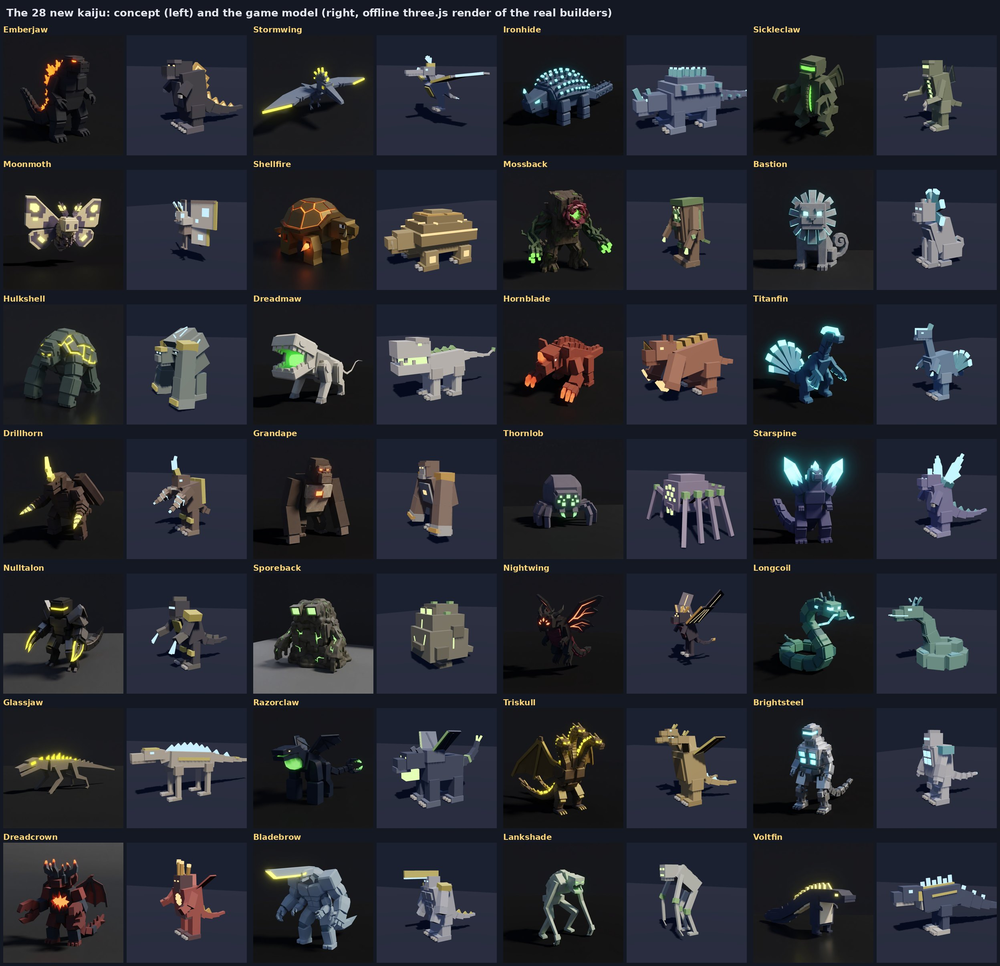

# The 28 new kaiju

Twenty-eight of the thirty kinds on the roster's first concept sheet
([kaiju-roster-expansion.md](kaiju-roster-expansion.md)) are now in the
game; Prisma and Clawtide were left out. With the first four, that makes 32
kinds, each in all four elements (128 kaiju).

*(An offline three.js render of the real model builders, each in the
element its concept shows. Not a Roblox screenshot.)*

Each new kind has:

- a blocky model of its own, built after its concept render, in a hide of
  its own colour with plates in its element's colour and glows in its
  element's light;
- a role, and two of the roles are new: the **Breaker** and the **Warden**;
- its own stats, fight style, blow names and roar;
- three moves of its own: E from level 1, Q at level 5 and R at level 10
  (84 moves in all), and beside them its gem surge, its Gemsoul's E, as
  every kaiju has ([kaiju.md](kaiju.md#a-kaijus-moves-its-own-and-its-gem-surge));
- a place where it roams wild.

## How you get them

The starter roll still deals only the first four (Bulwark, Razorback,
Carapace, Scythe). The new kinds are caught out in the frontier, by where
they roam:

| Roams | Kinds |
| --- | --- |
| Fringe and Edge (anywhere past the core) | Emberjaw, Stormwing, Ironhide, Sickleclaw, Moonmoth |
| The Edge only | the 19 others not listed here |
| The Rift Vein's guardian only | Hulkshell, Sporeback, Triskull, Dreadcrown |

A pack of wild kaiju is one kind that roams that far out, and a different
kind from the other packs where it can be. The vein guardian is always one of
the four Vein kinds.

## The two new roles

| Role | Where it stands | What it does |
| --- | --- | --- |
| **Breaker** (ROMPEDOR) | The front row | It goes for the foe with the toughest guard (the highest Guard; the nearest, if that's a tie), and stays on it. Its R comes when it's crowded, as a warrior's does. |
| **Warden**, shown as **SUPPORT** (APOYO) | The back row, with the shooters; out of a battle, the support slot | It shoots from range. Its moves look after its team: Moonmoth's Scale Storm wards it and every ally within 20 studs (35% less damage for 4 s), and its Silk Cocoon heals them all 20% of their health over 4 s. Since Oct 25 a Warden kind goes only in the support slot, the fourth kaiju out, and Skyjelly is everyone's starter support: see [kaiju.md](kaiju.md#your-support-the-fourth-kaiju). |

The proposal said a Breaker's blows would ignore half of a guard. That
isn't in: a Breaker picks the toughest guard instead.

Two new move flags make the kits work without new combat code:

- **Heal**: the move heals its caster that share of its health as it
  lands. Dreadmaw's Devour heals 10% and Mossback's Sap Drain 8%.
- **Team**: a ward or a mend goes on every ally near the caster too.

## The kinds

| Kind | Role | Roams | HP / Dmg / Rate / Speed / Guard | E (level 1) | Q (level 5) | R (level 10) |
| --- | --- | --- | --- | --- | --- | --- |
| Emberjaw | Warrior | Fringe and Edge | 250 / 21 / 1.6 / 12 / 0.10 | Soul Breath | Tail Sweep | Dorsal Glow |
| Stormwing | Ranged | Fringe and Edge | 180 / 12 / 0.8 / 22 / 0.00 | Sonic Boom | Dive Strike | Updraft |
| Ironhide | Tank | Fringe and Edge | 320 / 12 / 1.4 / 11 / 0.30 | Thorn Hide | Roll Out | Spiked Curl |
| Sickleclaw | Assassin | Fringe and Edge | 175 / 16 / 0.9 / 18 / 0.05 | Buzzsaw Rush | Hook Slash | Rocket Hop |
| Moonmoth | Warden | Fringe and Edge | 210 / 12 / 0.9 / 20 / 0.00 | Scale Storm | Antenna Beam | Silk Cocoon |
| Shellfire | Tank | the Edge | 290 / 14 / 1.3 / 12 / 0.25 | Spin Jet | Plasma Bite | Soul Shell |
| Mossback | Tank | the Edge | 340 / 10 / 1.5 / 8 / 0.20 | Grasping Vines | Sap Drain | Overgrowth |
| Bastion | Tank | the Edge | 280 / 15 / 1.2 / 13 / 0.25 | Mirror Guard | Pounce Slam | Sentinel's Roar |
| Hulkshell | Tank | Vein guardian | 310 / 16 / 1.5 / 10 / 0.20 | Nullpulse | Haymaker | Brace |
| Dreadmaw | Warrior | the Edge | 235 / 22 / 1.4 / 16 / 0.05 | Devour | Whip Tail | Frenzy |
| Hornblade | Warrior | the Edge | 260 / 19 / 1.5 / 13 / 0.10 | Burrow | Horn Charge | Tremor Guard |
| Titanfin | Warrior | the Edge | 255 / 20 / 1.4 / 12 / 0.10 | Tail Gale | Fin Cleave | Riptide Stance |
| Drillhorn | Warrior | the Edge | 245 / 22 / 1.6 / 12 / 0.15 | Drill Dive | Soul Bomb | Chitin Lock |
| Grandape | Warrior | the Edge | 265 / 20 / 1.5 / 14 / 0.10 | Chest-Beat Slam | Boulder Throw | Alpha Roar |
| Thornlob | Ranged | the Edge | 185 / 11 / 0.9 / 17 / 0.05 | Web Shot | Venom Fang | Silk Wall |
| Starspine | Ranged | the Edge | 175 / 11 / 1.0 / 14 / 0.10 | Corona Beam | Crystal Spire | Crystal Shell |
| Nulltalon | Ranged | the Edge | 180 / 14 / 1.1 / 15 / 0.05 | Trillion Orbs | Barrier Shot | Phase Step |
| Sporeback | Ranged | Vein guardian | 200 / 10 / 1.0 / 11 / 0.15 | Smog Cloud | Acid Spit | Dissolve |
| Nightwing | Assassin | the Edge | 165 / 15 / 0.9 / 20 / 0.05 | Dive Bomb | Prism Beams | Shadow Veil |
| Longcoil | Assassin | the Edge | 180 / 13 / 0.8 / 19 / 0.05 | Coil | Serpent Strike | Slither |
| Glassjaw | Assassin | the Edge | 175 / 14 / 0.8 / 21 / 0.00 | Burrow Ambush | Tail Whip | Scatter |
| Razorclaw | Assassin | the Edge | 170 / 16 / 0.9 / 19 / 0.05 | Wing Snatch | Acid Spew | Take Wing |
| Triskull | Breaker | Vein guardian | 255 / 18 / 1.2 / 14 / 0.10 | Gravity Storm | Triple Bite | Regrow |
| Brightsteel | Breaker | the Edge | 250 / 17 / 1.3 / 13 / 0.20 | Missile Salvo | Overclock | Reboot |
| Dreadcrown | Breaker | Vein guardian | 235 / 18 / 1.3 / 13 / 0.15 | Micro-Oxygen | Horn Katana | Split |
| Bladebrow | Warrior | the Edge | 265 / 21 / 1.5 / 12 / 0.10 | Head Spear | Four-Arm Flurry | Hunker |
| Lankshade | Assassin | the Edge | 170 / 15 / 0.9 / 20 / 0.00 | Loom | Rake Flurry | Scuttle |
| Voltfin | Ranged | the Edge | 185 / 11 / 0.9 / 16 / 0.05 | Arc Lash | Discharge Ring | Grounding |

Stats are level 1 at a Common Gemsoul. Rate is seconds per blow, and Guard
is the share of every blow it shrugs off.

| Kind | Key | Move | What it does |
| --- | --- | --- | --- |
| Emberjaw | E | Soul Breath | Breathes its element down a line: 160% damage to everyone in it, with its element's effect. |
| Emberjaw | Q | Tail Sweep | Sweeps its tail round it: 110% damage to the foes near it, stunning them. |
| Emberjaw | R | Dorsal Glow | Hard pressed or crowded: its fins light up and it heals 25% of its health over 4s. |
| Stormwing | E | Sonic Boom | A sonic boom down a wide cone: 130% damage to everyone in it, slowing them. |
| Stormwing | Q | Dive Strike | A strafing dive down a line: 140% damage to everyone in it. |
| Stormwing | R | Updraft | A foe too close: it rides an updraft back, leaving a gust that slows whoever followed. |
| Ironhide | E | Thorn Hide | Bristles its spikes: foes round it take 40% damage and turn on it for 4s, while it takes 30% less. |
| Ironhide | Q | Roll Out | Curls up and rolls through its foe's line: 110% damage to everyone in its path, stunning them. |
| Ironhide | R | Spiked Curl | At half health: a shell of 35% of its health for 5s; its spikes hurt every foe close to it each second. |
| Sickleclaw | E | Buzzsaw Rush | Rushes onto its mark (their shooter first, else their weakest), buzzsaw first: 200% damage, leaving it Vulnerable. |
| Sickleclaw | Q | Hook Slash | Three hooked cuts: 140% damage in all, the last with its element's effect. |
| Sickleclaw | R | Rocket Hop | Low on health: it fires its heels, can't be hurt for 1.5s, and lands behind their weakest. |
| Moonmoth | E | Scale Storm | Shimmering scales over its team: it and every ally near it take 35% less for 4s. |
| Moonmoth | Q | Antenna Beam | A beam from its antennae through everyone in a line: 130% damage, with its element's effect. |
| Moonmoth | R | Silk Cocoon | Hurt: it wraps its team in silk, healing it and every ally near it 20% of their health over 4s. |
| Shellfire | E | Spin Jet | Spins on its jets: foes round it take 60% damage with its element's effect and turn on it for 3s, while it takes 30% less. |
| Shellfire | Q | Plasma Bite | A bite charged with its element: 150% damage and its element's effect. |
| Shellfire | R | Soul Shell | At half health: a shell of 30% of its health for 5s that bursts in its element when it breaks. |
| Mossback | E | Grasping Vines | Roots burst round it: foes near it take 40% damage, are held fast (stunned) and turn on it for 3s. |
| Mossback | Q | Sap Drain | Its vines lash round it: 100% damage to the foes near it, and it heals 8% of its health. |
| Mossback | R | Overgrowth | At half health: bark closes over it, taking 30% less for 4s, and its element spreads to foes close to it. |
| Bastion | E | Mirror Guard | Plants its forepaws: foes round it turn on it for 3s while it takes 45% less. |
| Bastion | Q | Pounce Slam | Pounces on its foe and slams it: 120% damage, stunning it. |
| Bastion | R | Sentinel's Roar | At half health: a roar that turns every foe near it on it for 3s while it takes 35% less. |
| Hulkshell | E | Nullpulse | A pulse from its fists: foes round it take 50% damage, are slowed and turn on it for 3s, while it takes 30% less. |
| Hulkshell | Q | Haymaker | One huge blow: 160% damage, stunning its foe. |
| Hulkshell | R | Brace | At half health: a shell of 30% of its health for 5s. |
| Dreadmaw | E | Devour | A huge bite: 200% damage, and it heals 10% of its health. |
| Dreadmaw | Q | Whip Tail | Lashes its tail all round it: 100% damage to the foes near it. |
| Dreadmaw | R | Frenzy | Hard pressed or crowded: for 4s it bites 40% faster and 10% harder. |
| Hornblade | E | Burrow | Goes under for a moment (it can't be hurt) and erupts behind its foe: 160% damage, stunning it. |
| Hornblade | Q | Horn Charge | Charges horn first: 120% damage to everyone in its path, stunning them. |
| Hornblade | R | Tremor Guard | Hard pressed or crowded: it takes 25% less for 4s and the ground shakes round it each second. |
| Titanfin | E | Tail Gale | A gale from its fan of a tail: 140% damage to everyone in a wide cone, slowing them. |
| Titanfin | Q | Fin Cleave | A two-handed cut with its fins: 130% damage to its foe and anyone beside it, leaving them Vulnerable. |
| Titanfin | R | Riptide Stance | Hard pressed or crowded: fins crossed, it takes 30% less for 4s and slows foes close to it. |
| Drillhorn | E | Drill Dive | Leaps onto its foe point first: 180% damage with its element's effect. |
| Drillhorn | Q | Soul Bomb | Lobs a bomb of its element at its foe: 110% damage round where it lands, with its element's effect. |
| Drillhorn | R | Chitin Lock | Hard pressed or crowded: its wing cases snap shut, a shell of 30% of its health for 5s. |
| Grandape | E | Chest-Beat Slam | Beats its chest and slams the ground under its foe after a beat: 150% damage round it, stunning. |
| Grandape | Q | Boulder Throw | Hurls a rock at its foe: 130% damage, stunning it. |
| Grandape | R | Alpha Roar | Hard pressed or crowded: for 5s it hits 30% harder and 25% faster, and it heals 8% of its health. |
| Thornlob | E | Web Shot | A web at its foe and those near it: 130% damage in all, pinning them (stunned). |
| Thornlob | Q | Venom Fang | Spits venom at its foe: 140% damage, poisoning it. |
| Thornlob | R | Silk Wall | A foe too close: it skitters back, leaving a web that slows and hurts whoever followed. |
| Starspine | E | Corona Beam | A beam from its shards through everyone in a line: 140% damage, with its element's effect. |
| Starspine | Q | Crystal Spire | A crystal spire bursts up under its foe after a beat: 130% damage round it, stunning. |
| Starspine | R | Crystal Shell | A foe too close: a shell of crystal, 30% of its health for 4s, that bursts and slows foes near it. |
| Nulltalon | E | Trillion Orbs | Orbs that leap from its foe to two more: 130% damage in all, with its element's effect. |
| Nulltalon | Q | Barrier Shot | A shot that cracks its foe's guard: 140% damage, leaving it Vulnerable. |
| Nulltalon | R | Phase Step | A foe too close: it blinks away, leaving a flicker of its element that hurts whoever followed. |
| Sporeback | E | Smog Cloud | A cloud of smog on its foe for 3s: 140% damage in all to those inside, blinding them. |
| Sporeback | Q | Acid Spit | A glob of acid at its foe: 130% damage round where it lands, poisoning. |
| Sporeback | R | Dissolve | A foe too close: it melts away and re-forms further back, leaving sludge that poisons whoever followed. |
| Nightwing | E | Dive Bomb | Dives out of the dark onto its mark (their shooter first, else their weakest): 200% damage, stunning it. |
| Nightwing | Q | Prism Beams | Beams from its three eyes, jumping between foes: 140% damage in all, blinding the last. |
| Nightwing | R | Shadow Veil | Low on health: it can't be hurt for 1.5s and reappears behind their weakest. |
| Longcoil | E | Coil | Darts onto its mark (their shooter first, else their weakest) and coils round it: 190% damage, holding it fast (stunned). |
| Longcoil | Q | Serpent Strike | Two quick strikes: 140% damage in all, the last with its element's effect. |
| Longcoil | R | Slither | Low on health: it slides through the line, can't be hurt for 1.5s, and comes up behind their weakest. |
| Glassjaw | E | Burrow Ambush | Digs in (it can't be hurt) and surfaces behind its mark (their shooter first, else their weakest): 200% damage, leaving it Vulnerable. |
| Glassjaw | Q | Tail Whip | Whips its tail all round it: 120% damage to the foes near it. |
| Glassjaw | R | Scatter | Low on health: it sprints away, kicking up dust that slows whoever followed. |
| Razorclaw | E | Wing Snatch | Swoops onto its mark (their shooter first, else their weakest): 200% damage with its element's effect. |
| Razorclaw | Q | Acid Spew | Spews acid from its throat sac in a cone: 130% damage to everyone in it, poisoning them. |
| Razorclaw | R | Take Wing | Low on health: it lifts off out of reach for 1.5s and drops behind their weakest. |
| Triskull | E | Gravity Storm | Gravity bolts from all three heads, each at the nearest foe: 160% damage in all, stunning with the last. |
| Triskull | Q | Triple Bite | A bite from each head: 150% damage in all, the last leaving its foe Vulnerable. |
| Triskull | R | Regrow | Hard pressed or crowded: it heals 25% of its health over 3s and shakes off burns, poisons, slows and blinds. |
| Brightsteel | E | Missile Salvo | Six missiles rain on its foe and those near it: 150% damage in all, leaving the last one hit Vulnerable. |
| Brightsteel | Q | Overclock | For 5s its pistons run hot: it hits 20% harder and 40% faster. |
| Brightsteel | R | Reboot | Hard pressed or crowded: plating locks, a shell of 30% of its health for 5s. |
| Dreadcrown | E | Micro-Oxygen | Breathes a cone that strips guards bare: 160% damage to everyone in it, leaving them Vulnerable. |
| Dreadcrown | Q | Horn Katana | Its horn blazes and cuts a short line: 140% damage with its element's effect. |
| Dreadcrown | R | Split | Hard pressed or crowded: it splits into crablings (it can't be hurt for 1.5s) and re-forms behind their weakest. |
| Bladebrow | E | Head Spear | Lunges blade of a head first: 190% damage down a short line, leaving them Vulnerable. |
| Bladebrow | Q | Four-Arm Flurry | Four quick blows: 150% damage in all. |
| Bladebrow | R | Hunker | Hard pressed or crowded: all four arms up, it takes 35% less for 3s. |
| Lankshade | E | Loom | Rises to its full height and drops onto its mark (their shooter first, else their weakest): 210% damage, stunning it. |
| Lankshade | Q | Rake Flurry | Three long rakes: 150% damage in all, the last with its element's effect. |
| Lankshade | R | Scuttle | Low on health: it scuttles away, leaving a patch of its element that hurts whoever followed. |
| Voltfin | E | Arc Lash | An arc that leaps from its foe to three more: 130% damage in all, stunning the last. |
| Voltfin | Q | Discharge Ring | A ring of current round it: 120% damage to the foes near it, with its element's effect. |
| Voltfin | R | Grounding | A foe too close: a shell of 25% of its health for 4s that shakes off burns, poisons, slows and blinds. |

## How they move

- **Models** (`Shared.KaijuShapes` and `Shared.KaijuConceptShapes`): two
  to six studs tall at scale 1, and at most 90 parts each (Triskull is the
  most, at 88, then Mossback at 84). They are built from the same helpers as
  the first four, with the same joints, plus two new kinds of joint:
  - A **Wing** joint for the flyers (Stormwing, Moonmoth, Nightwing) and the
    winged kinds (Razorclaw, Triskull, Dreadcrown). Moonmoth's wings stand
    upright, so they beat forward and back.
  - A **Head** joint for Triskull's three heads and Longcoil's head.
- **Flyers hover.** Stormwing and Moonmoth hover 1.1 studs off the ground
  and Nightwing 0.9, with their legs dangling. This is the `KaijuHover`
  attribute, added to the hip height.
- **Longcoil has no legs.** It sits on its coils, and its neck sways on Tail
  joints.
- **Fight poses** (`Shared.CreatureMotion.Fight`): every kind has its own
  wind-ups and blows, after its blows' names. Each starts from the first-four
  kind its body is nearest to. Examples:
  - Ironhide rolls through on its Spine Roll.
  - Hulkshell and Dreadcrown bring both arms down together.
  - Hornblade and Glassjaw drop low, then burst up from a burrow.
  - Bladebrow drives its brow blade through its foe.
  - The flyers beat their wings on every blow.
  - Triskull's three heads snap in together on a bite.
- **Sweeps.** A heavy's sweep has the kind's own arc. Ironhide's roll goes
  all the way round, Emberjaw's tail sweep covers 220° and Titanfin's tail
  gale 180° (the rest sweep 150°, as a stomp does). The shooters (Ranged, and the Warden) fire volleys, as the
  Razorback does, under their own names.
- **Roars.** Each kind roars in the voice of a first-four kind (its Voice):
  the brutes as a Bulwark, the biters as a Razorback, the shells as a
  Carapace and the insects as a Scythe.
- **Portraits.** The HUD and the kaiju panel lift a dark hide toward the
  portrait light, so Emberjaw, Nulltalon and Nightwing don't come out
  black. A pale hide is left as it is.

## Closer to their concepts

*2026-10-22.* Every kind was rendered beside its concept, and the ones
furthest off were rebuilt in `Shared.KaijuConceptShapes` (which installs
over `KaijuShapes`'s builders):

- **Moonmoth**: a furred thorax, feathered feelers and two pairs of wide
  wings with pale windows and dark blots, held up and back like the moth on
  the sheet. The wings still beat on Wing joints.
- **Shellfire**: a round domed shell of tiered rims and wedge scutes, with
  the dome's seams in neon ember, a beaked head with tusks, and a jet of
  light in each leg.
- **Dreadmaw**: a lean, ribbed body under a big skull with a brow, a crest,
  sunken eyes and a mouth hanging open on a neon throat and tongue.
- **Sporeback**: a heap of a body with lumps and a crown, cracks of neon
  across it, two square lit eyes and spore caps on stalks.
- **Thornlob**: a round spider body with a face plate of eight lit eyes, a
  banded abdomen on Tail joints and eight thick jointed legs.
- **Titanfin**: a fan of seven plated spokes tipped with light on its back,
  a hooked crest, and finned tail.
- **Razorclaw**: a hunched body, horned head with a lit sac, two membrane
  wings of wedge triangles with hooks, talon hands and a lit pincer tail.
- **Longcoil**: two coil rings of scales with a belly, a neck of four
  segments that sway on Tail joints, and an antlered, whiskered head on a
  Head joint.
- **Nightwing**: three lit eyes, plate horns, three-panel membrane wings
  with neon veins and a claw, and a spade tail.
- **Triskull**'s wings are bigger with neon edges; **Stormwing**'s wings
  carry a neon leading edge and lit tips; **Emberjaw**'s dorsal blades have
  neon prongs and flames.

The others (Ironhide, Sickleclaw, Mossback, Bastion, Hulkshell, Hornblade,
Drillhorn, Grandape, Starspine, Nulltalon, Glassjaw, Brightsteel,
Dreadcrown, Bladebrow, Lankshade, Voltfin) already read close to their
concepts and were left as they were. The side-by-side sheet is at the end
of this page.

## Balance

`tests/run_kaiju_roles.py` plays two sets of battles:

- **The first four:** every team of three against every other, at levels
  1, 5 and 10, as before.
- **All 32:** too many teams for that, so each kind leads 24 seeded random
  three-on-three battles against teams drawn from all 32, at levels 1, 5
  and 10.

No kind's teams may win under 28% or over 72%. In a bigger run of 64 each,
every kind averaged between 41% and 57%.

Tuning that came out of it:

- Moonmoth was winning about 20%. It got more health and damage (210 and
  12), the Warden role's power went to 1.3, 1.5 and 1.7, and its two team
  moves were strengthened.
- The Breakers' power went to 1.1, 1.0 and 0.95. Triskull got more health
  and damage, and Brightsteel more damage.
- The assassins ran hot, so Nightwing, Longcoil, Glassjaw and Lankshade each
  lost a little damage. Starspine and Voltfin were trimmed for level 10.
- Titanfin, Drillhorn and Bladebrow were nudged up, because they faded at
  level 10.

Since Oct 22 every kaiju in these battles casts its gem surge too (each
drawn from a fixed seed, so no kind always gets the same one). With them
in, every kind stays between 31% and 66% and averages 42% to 58% over the
three levels, and the first four's round robin is 48% to 54%. The surge in
a battle hits at its role's power, and the tank's and the assassin's level-1
power moved (0.9 to 0.84, 0.8 to 0.88) to keep level 1 even
([kaiju-arena.md](kaiju-arena.md)).

## Spanish

Every new kind's blurb, move names and descriptions, blow names and volley
names are in `Shared.LangEs`, with the two roles (ROMPEDOR, GUARDIÁN).
`tests/run_lang.py` checks that each one comes out in Spanish.

## Files

| File | What changed |
| --- | --- |
| `src/shared/KaijuRoster.luau` (new) | The 28 kinds: stats, habitats, kits, fight styles, voices, and their 84 moves |
| `src/shared/KaijuShapes.luau` (new) | Their models, hides and hovers |
| `src/shared/KaijuConceptShapes.luau` | Concept-led rebuilds of the kinds furthest from the sheet, installed over `KaijuShapes` |
| `src/shared/KaijuModels.luau` | Builds them; hover; portraits lift dark hides |
| `src/shared/Kaiju.luau` | Merges the roster in; `Starters` (the four the roll deals); `wildKinds(band)` |
| `src/shared/KaijuRoles.luau` | Breaker and Warden; each kind's own kit; the Breaker's target |
| `src/shared/KaijuFight.luau` | The roster's fight styles; a kind's own sweep arc |
| `src/shared/KaijuBattle.luau` | Front-row kinds come from the roles |
| `src/shared/CreatureMotion.luau` | Their fight poses; wings beat and heads snap |
| `src/server/Systems/KaijuAbilities.luau` | Team wards and mends; Heal |
| `src/server/Systems/KaijuServer.luau`, `KaijuBattleBrain.luau`, `KaijuFighter.luau` | Allies for team moves; a kind's own shot, guard and arc |
| `src/server/Systems/KaijuWilds.luau` | Packs and the guardian by habitat |
| `src/client/CreatureAnimation.client.luau` | Roars in the kind's voice |
| `src/client/Modules/KaijuRoll.luau` | The roll's reel deals the first four |
| `src/shared/LangEs.luau` | Spanish |

## Tests

| Suite | What it covers |
| --- | --- |
| `run_kaiju.py` (`kaiju_models_cases`) | All 32 kinds in all 4 elements, checking for each model: its feet on the ground (or hovering), its joints seated, its part budget, its element's plates and its own hide. Also each kind's fight poses, the wingbeat and the head snap. |
| `run_kaiju.py` (`kaiju_cases`) | 32 kinds and 4 starters. Each role keeps its shape across all 32: tanks outlast warriors, which outlast assassins; assassins outrun the front line. The habitats. |
| `run_kaiju.py` (`kaiju_fight_cases`) | Every kind's style, blow names and sweep, and which kinds shoot. |
| `run_kaiju.py` (`kaiju_server_cases`) | All 84 moves cast. Team mends and wards reach allies near the caster but not far ones, and Heal heals. The guardian and the packs come by habitat. |
| `run_kaiju_roles.py` | Each kind's own kit (an assassin's E gets it in, a tank's E draws foes), the warden's team moves, and the balance. |
| `run_kaiju_battle.py` | Every kind goes in its role's row. |
| `run_lang.py` | The Spanish. |

## Not tested here

The models, poses and roars run in Roblox only. They need a playtest:

- Do the flyers hover cleanly, and does Moonmoth's upright wingbeat read?
- Does Longcoil's neck sway look right, and do Triskull's heads look about?
- Does a hover's height suit the battle camera and the HUD portraits?
- Are the Edge and Vein kinds rare enough to be worth the trip?

*(Each concept on the left, the game's model on the right, rendered offline
from the builders in the element the concept shows. Not Roblox screenshots.)*
