# Mini kaiju

Small monsters that follow you around the Outpost and fight on their
own, like the heroes in Heroes RNG: you run about and pull enemies in, and
your kaiju do the fighting while you fight beside them. You find new ones in
the wild and catch them, and in the arena two players' kaiju fight one on one,
for keeps.

They replace the critter pets in [pet-system-proposal.md](pet-system-proposal.md).

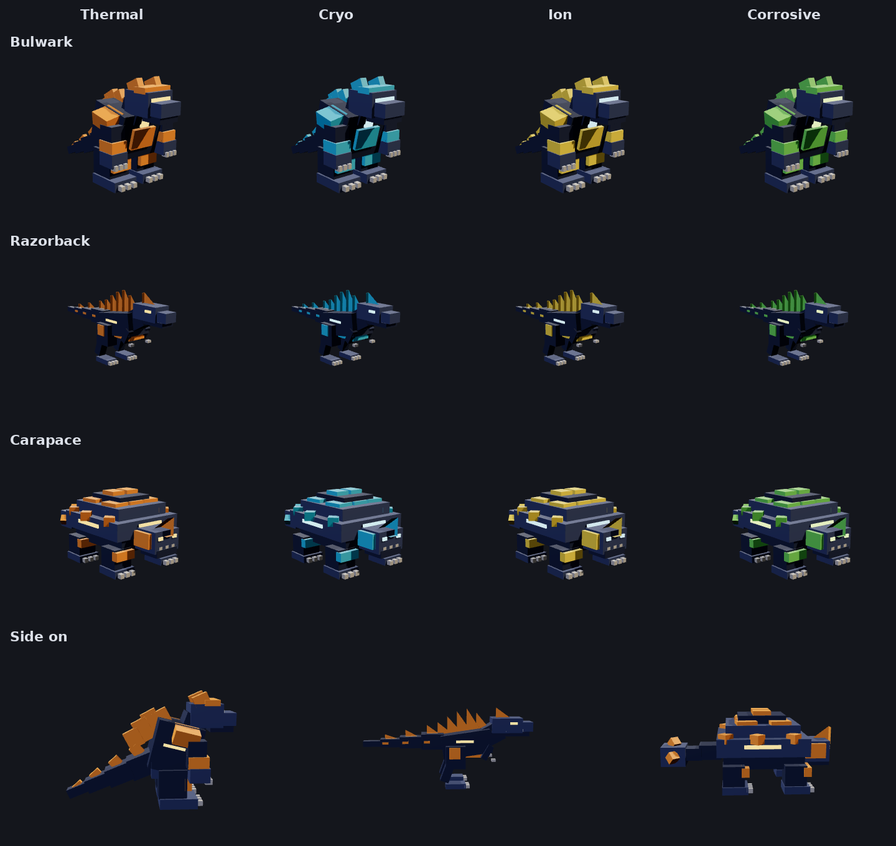

(An offline render of the game's kaiju models, `Shared.KaijuModels`, not a
Roblox screenshot.)

## The four kinds

Each kind comes in Thermal, Cryo, Ion and Corrosive: sixteen in all.

| Kind | Role | Looks | Plays | Health | Damage | Speed |
| --- | --- | --- | --- | --- | --- | --- |
| **Bulwark** | Warrior | Stands upright: plated chest, fins down its back, a long tail | Slow, heavy blows up close, shrugs off 10% | 240 | 20 a blow; attacks about every 1.6 s | 12 |
| **Razorback** | Ranged | Runs low: long toothed snout, spines, long legs | Shoots spines from the back; fragile | 190 | 11 a spine; about every 0.8 s | 20 |
| **Carapace** | Tank | Four stubby legs under a wide shell, a spiked club tail | The hardest to wear down: shrugs off 25%, and draws foes onto itself | 300 | 13 a blow; attacks about every 1.3 s | 10 |
| **Scythe** | Assassin | A mantis on four thin splayed legs: big glowing eyes, feelers, two blade arms held up in front, wing cases over a long abdomen | Leaps over the front line onto their shooter; quick cuts, the least health (shrugs off 5%) | 170 | 15 a cut; about every 0.9 s | 18 |

Those are level 1. Each level adds 8% of them, up to level 30. A finer
Gemsoul (below) adds up to 20% more.

The role decides how it fights in a kaiju battle, and its three moves (see
[kaiju-arena.md](kaiju-arena.md#roles-an-auto-battler), `Shared.KaijuRoles`).
In a battle each role's blows carry their own share of that Damage
(`KaijuRoles.power`), tuned so that no kind's teams win much more than half
their battles at any level.

### 90 more kinds

Every kind on the roster's three concept sheets is in the game too: 94
kinds in all, 376 kaiju. They bring two new roles (Breaker and Warden),
three moves of each kind's own, and models after their concepts. The
starter roll still deals only the four above, and Skyjelly is everyone's
starter support; the others are caught in the frontier, by where they
roam. The first sheet's 28 are in [kaiju-roster.md](kaiju-roster.md), and
the other 61 in [kaiju-roster-more.md](kaiju-roster-more.md).

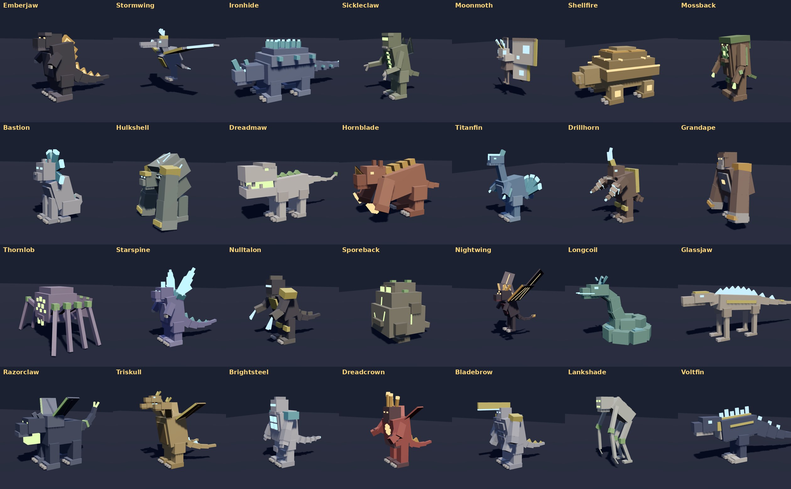

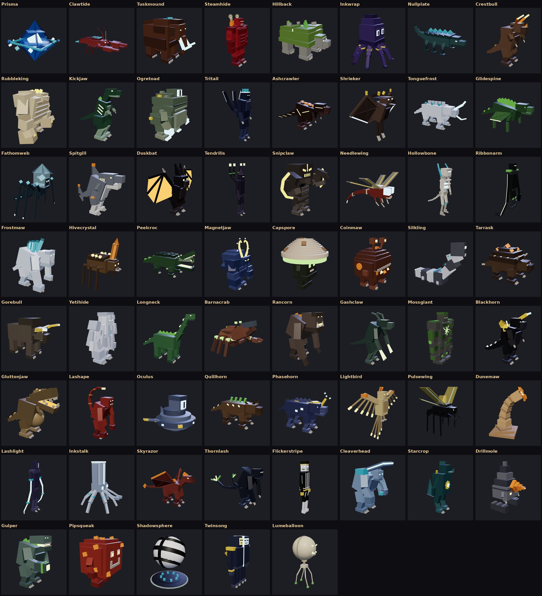

## Traits: no two alike

Two kaiju of one kind at one level are no longer the same. Each is born
with four **traits**, 0 to 20, which never change (`Kaiju.Traits`,
`Kaiju.traits`, `Kaiju.withTraits`):

| Trait | What it moves | Each point over or under 10 |
|---|---|---|
| Might | its damage | ±1.2% |
| Vigor | its health | ±1.2% |
| Guard | the share of each blow it shrugs off (added to its kind's) | ±0.6 points |
| Speed | how fast it runs | ±1% |

A kaiju with all 20s hits and lasts about 12% more than an everyday one
(all 10s), and about 27% more than one with all 0s: enough to matter,
never more than a couple of levels. The four add up to its **Grade**:
S (a total of 66 or more: about 1 kaiju in 60), A (52 or more: 1 in 6), B (36 or more: nearly half) or C.

- **Where they're rolled:** each roll card's kaiju (the server rolls them
  with the roll, so the card shows the kaiju you get), every wild kaiju
  (its Grade is on its plate, so you can tell a fine one before you catch
  it, and it keeps its traits when caught), and anything else that
  adds a kaiju (`Kaiju.new` rolls them when none are given).
- **Old saves:** a kaiju from before traits gets its own, worked out from
  what never changes on it (its id, kind, element and Gemsoul), and keeps
  them from then on (`Kaiju.roster`).
- **Where they count:** `Kaiju.recordStats` (health, damage, speed and
  Guard in every fight, revive and heal), and the blows a kaiju takes
  (`Kaiju.taken` with its own Guard).
- **Where they show:** the kaiju panel (Grade and the four, green when
  good, red when poor), the roll card ("WARRIOR · LV 1 · GRADE A"), the
  Market's kaiju lines ("Grade A") and a wild kaiju's plate.

## A kaiju's moves: its own, and its gem surge

Every kaiju carries an **enchant** (in the code its `Soul`, the gem it
lives in): a gem of its element, rolled like any gem (rarity, Size, Clarity,
Cut). The enchant gives it its element and makes it stronger the finer it
is. A kaiju fights with two sets of moves:

**Its own moves are its kind's** (`Kaiju.kitMoves`; the first four's are
their role's, `KaijuRoles.Kits`, the roster's are their own,
[kaiju-roster.md](kaiju-roster.md)): a tank's Taunting Roar, Shell Slam and
Fortress, a warrior's Cleave, War Cry and Earthshaker, a ranged one's Spine
Volley, Piercing Spine and Vault, an assassin's Shadow Leap, Rend and
Vanish. They wake as it levels (`Kaiju.MoveLevels`): E from the start, Q
at level 5, R at level 10. In a kaiju battle its E goes off when its mana
is full. Out in the Outpost its E comes 3 seconds into a fight and then at
most every 9 seconds, its Q in place of a blow every 7 seconds, and its R
when it's down to 60% health or a heavy blow or a cast is coming (at most
every 14 seconds).

**Its gem surge is its enchant's E** (`Kaiju.gemSurge`), cast beside its
own moves from level 1, everywhere it fights. *2026-10-26:* a support
has no gem surge. Its gem gives it its R instead, cast on you and on
itself ([Your support](#your-support-the-fourth-kaiju)). The rest of
this section is about the fighters:

- **Its own element.** An enchant is rolled in its kaiju's element, and only
  a gem of its own element can enchant it (below), so a Thermal kaiju's gem
  surge is a Thermal move, a Cryo one's a Cryo move. Two kaiju of one kind
  and element can still differ by their enchant.
- **When:** 6 seconds into a fight, then every 14 seconds
  (`Kaiju.GemSurge`), after a wind-up its foe can see on its cast bar. Not
  while it's stunned or silenced, or with a heavy blow coming at it (it
  guards that). A ring round itself (Solar Flare, Acid Spray) only with its
  foe inside it; the rest reach a foe up to 30 studs off.
- **How hard:** 2.6 of its blows, times its enchant's output (a Common's
  0.6 to a Legendary's 1.0) and a little more for a bigger stone, times the
  move's own share (`Kaiju.abilityDamage`). In a kaiju battle, times its
  role's power too, as its blows are, so the surge adds the same share for
  every role. A Legendary enchant's surge hits two thirds harder than a
  Common's.
- **On screen:** a fourth row on its card in the starter roll and in the
  kaiju panel, GEM SURGE (in the enchant's rarity), with the move's icon and
  what it does; and a diamond under the Q, E and R dots on its tile in the
  strip, lit when it's ready (`KaijuGemAt`, its own cast time).

The enchant's E is one of these (`GemTraits.SoulMoves`: the ones you can see
land, never a dash or a "while ready" bonus); its Q and R, the gem's other
two moves, are for whoever sockets it:

| Element | E (the gem surge) | Q (in a sword) | R (in a shield) |
| --- | --- | --- | --- |
| Thermal | Ember Lance, Supernova, Solar Flare, Flame Tornado | Furnace Crescent, Magma Fault, Meteor Leap | Heat Shield, Cauterize, Ring of Fire |
| Cryo | Cryo Lance, Absolute Zero, Hailstorm | Glacier Fan, Permafrost Spire, Frost Chakram | Ice Armor, Glacial Bulwark, Ice Pillar |
| Ion | Ion Spark, Chain Lightning, Thunder Pylon, Storm Call, Ion Cannon | Circuit Cleave, Thunder Dash, Skybreaker | Ion Shield, Capacitor, Tesla Fence |
| Corrosive | Acid Spray, Toxic Cloud, Armor Melt, Toxic Tide, Maneater | Caustic Dart, Vitriol Sweep, Toxic Flask | Rad Shield, Bio Regrowth, Toxic Mantle |

### ENCHANT: its own element only

A kaiju's element never changes (it's its record's `Element`). Its enchant
can: **a gem of its own element from your pouch can enchant it**
(`KaijuSocket`, `KaijuServer.socketSoul`), and the old one goes back to
your pouch as a gem. **Only its own element:** a Cryo kaiju takes Cryo
gems, never Thermal, Ion or Corrosive ones (`Kaiju.canSocket`: "Only a Cryo
gem can enchant a Cryo kaiju.", "Only an Ion gem can enchant an Ion
kaiju.").

- **Rarity makes it stronger** (`Kaiju.SoulBonus`): +0% for a Common, +5%
  Uncommon, +10% Rare, +15% Ultra-Rare, +20% Legendary, on health, damage
  and speed (`Kaiju.recordStats`).
- **Always attuned** (`Kaiju.attuned`: the enchant's element is the
  kaiju's): **+15% damage** (`Kaiju.Attuned.Power`) and its **gem surge**,
  the enchant's E (`Kaiju.recordSurge`; a gem whose E isn't a move a kaiju
  can cast lands its element's first one).
- **An old enchant of another element** (socketed before enchants had to
  match) stays where it is: its rarity's stats, no surge. The panel says so
  in gold and offers its own element's gems, each marked **+ ITS SURGE**.
- **Not mid-fight** (the same `KaijuDanger` as healing), and not the gem
  that's its enchant already. The server checks the gem is yours, loose
  (`GemInventory.available`) and of its element. Health is kept, clamped to
  the new top. It says what happened: "Frosty is enchanted with a Legendary
  Cryo gem. Gem surge: Hailstorm."
- `Kaiju.enchanted(record, gem)` is how it would stand with another gem
  (stats, surge), for the panel's preview.

The ENCHANT tab, beside DETAILS and HEAL:

1. **At the top**, its enchant now: the gem, `COMMON CORROSIVE ENCHANT`,
   `+0% stats · +15% damage · Gem surge: Toxic Cloud` (green; gold with
   what to do for an old one of another element), and its health, damage
   and speed.
2. **The rule**, in its element's colour: "Only Corrosive gems can enchant a
   Corrosive kaiju."
3. **A row for each rarity of its element**, rarest first: the finest of
   yours of that rarity (its gem, `×2`, `+15% stats`, the surge it would
   cast) and how it compares with now: **15% STRONGER**, **5% WEAKER** or
   **SAME AS NOW**. A rarity you have none of is dimmed, *None in your
   pouch*. The best upgrade you have is picked when you open it.
4. **At the foot**, the one picked and what it does to its stats ("Health
   324 to 373 · Damage 16 to 19. Its enchant now goes back to your pouch."),
   and **ENCHANT** (**IN A FIGHT** while you're in one). With none of its
   element at all: where they turn up most (Cryo gems in the snow fields,
   Thermal on the burnt ground, Ion on the salt flats, Corrosive on the mud
   flats: each biome's own element, `Shared.Frontier.Biomes`).

A green dot on the ENCHANT tab, and on a kaiju's row in the list, says you
have a better gem of its element for it.

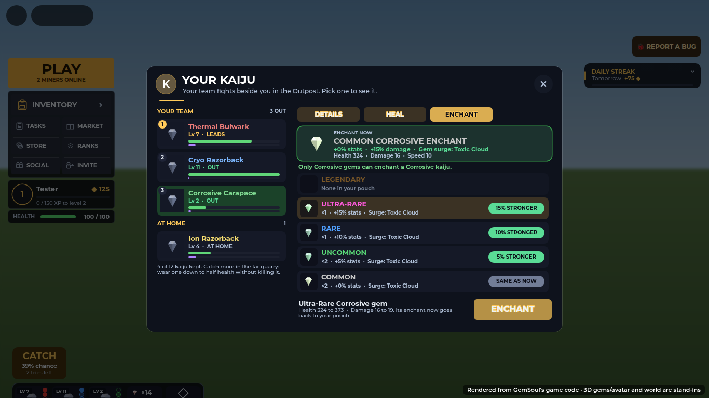

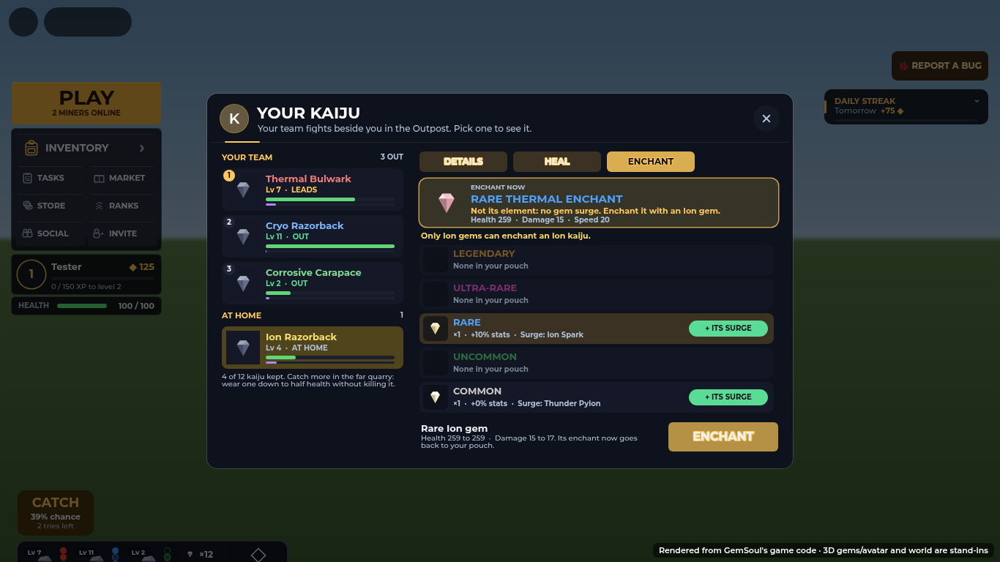

On a phone the rows scroll, and in Spanish the tab is ENCANTAR:

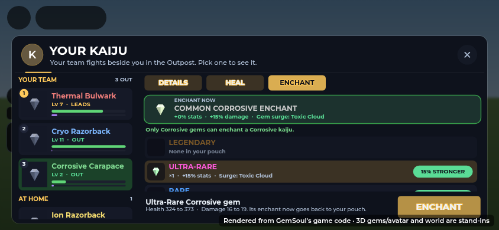

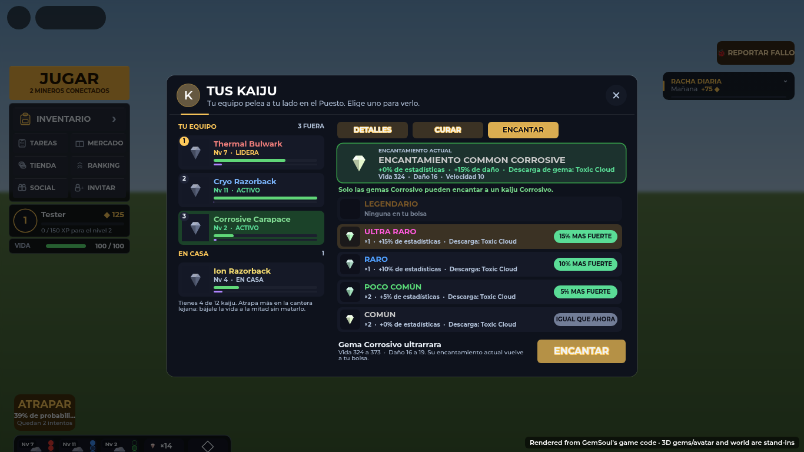

Before, the tab was GEMSOUL and took any gem:
[the old tab](kaiju/gemsoul-tab-before.png).

### Names

**RENAME** beside its name in DETAILS: type a name and **SAVE** (or Enter);
**CANCEL** leaves it. Empty, it's back to its kind's title.

- **The rules** (`Kaiju.cleanName`): up to 16 letters (`Kaiju.NameMax`;
  accented ones too: á, ñ), numbers, spaces, `-`, `'` and `.`, with at
  least one letter. Spaces at the ends go, and runs of them become one.
- **Roblox's filter** (`KaijuServer.filterName`: `TextService`, for
  everyone to see): what comes back must be the name as typed, or it's
  refused ("That name isn't allowed: try another."). If the filter can't be
  reached, it's refused too. One rename every 2 seconds (`Kaiju.NameEvery`).
- **Where it shows** (`Kaiju.nameOf`: its name, or its title): the panel's
  list and DETAILS (its kind then goes on the line under it: `CORROSIVE
  CARAPACE · TANK · LV 2 · OUT`), HEAL, the server's messages (healed,
  knocked out, levelled up, enchanted), its body out (`KaijuName`) and kaiju
  battles.
- **Kept as typed** in Spanish: the panel's name labels are marked
  `NoTranslate`, so a kaiju named "Ready" isn't turned into "Listo".

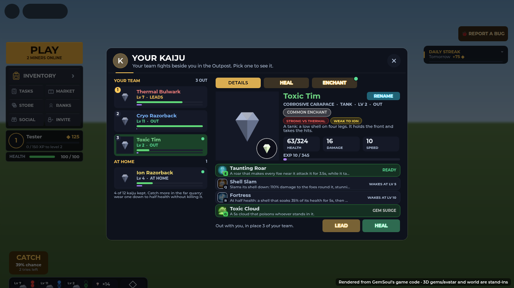

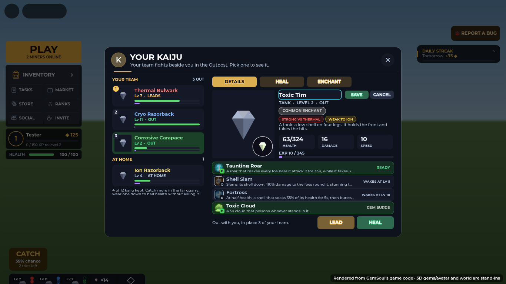

### Strong and weak

DETAILS shows what it's strong and weak against, a pill each in that
element's colour (`Shared.ElementMatchup.Beats`): a Corrosive kaiju is
**STRONG VS THERMAL** and **WEAK TO ION**.

An enchant gem you win (a wild kaiju's, killed) is a gem like any other:
socket it in your gear, enchant a kaiju of its element with it, sell it. In your gear all three of its moves work, like any gem's: its
Q in a sword, its E in a chest, its R in a shield. A Gemsoul saved before
this, its Q and R rolled from the whole lane, gets a kaiju's Q and R seeded
from its id (the same on every server and client); its E is kept.

## How they fight

Kaiju fight exactly as the Arena's rival does, run by the same brain
(`Shared.DuelistBrain`), just shrunk to their size and in their own blows.
They read their foe the way the rival reads you: a swing coming, a charged
heavy, a cast, a raised guard, an opening after a blow, a foe standing idle.

| | Quick blow (combos) | Heavy (breaks a guard) | Guard |
| --- | --- | --- | --- |
| **Bulwark** | Claw Swipe, up to 2 in a row | Ground Stomp: 2× | arms up, takes 30% |
| **Razorback** | Bite, up to 3 in a row | Tail Lash: 1.6× | a low crouch, takes 40% |
| **Carapace** | Shell Snap, up to 2 in a row | Shell Slam: 1.8× | into its shell, takes 15% |
| **Scythe** | Blade Slash, up to 3 in a row | Scissor Strike: 1.8× | blades crossed, takes 45% |

- **Wind-ups.** Every blow winds up first (the brute slowest, the runner
  quickest). A heavy marks the ground at its feet in its element's look
  (embers and cracks, creeping frost, crawling sparks, bubbling acid) and
  names itself on the cast bar: hop out of it. The third blow of a combo
  lands 30% harder. See
  [The elements on the ground](kaiju-elements-battles.md#the-elements-on-the-ground).
- **A Razorback shoots from range.** The lightest of the three fights best
  at a distance: a combo of bites up close, then it hops back out of reach
  and looses volleys of spines (Spine Volley), circling, hopping back again
  when pressed, before it closes in for the next combo. See
  [The Razorback](kaiju-elements-battles.md#the-razorback-a-shooter).
- **Guard and parry.** A guard takes most of a blow. A light blow landing
  just as a guard goes up (within 0.22 s) is parried, and the attacker reels
  for 0.45 s; a guard parries at most every 1.5 s. A heavy smashes through a
  guard, staggers it, and the guard can't go up again for 0.9 s.
- **Hops, pounces, counters.** A kaiju hops aside from a heavy or a cast
  (untouchable for 0.3 s), pounces on a foe that keeps out of reach, counters
  a blow it just blocked or a foe left open after swinging, circles between
  blows and backs off when badly hurt.
- **Hunting a wild kaiju yourself.** Your swings meet its guard as they
  would the rival's: your heavy breaks it, a light swing just as it braces
  is parried (and you reel), and it hops away from your charged heavy.

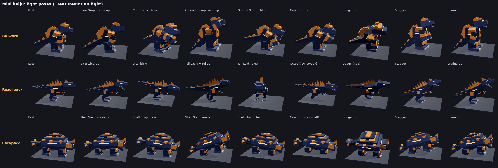

Distances are scaled: the brain thinks in the rival's studs, a kaiju's
reach is its kind's at its size (a kaiju of yours is 0.55 the size of the
model, a wild one 0.9), and its steps, hops and pounces shrink to match.

### Sized to them

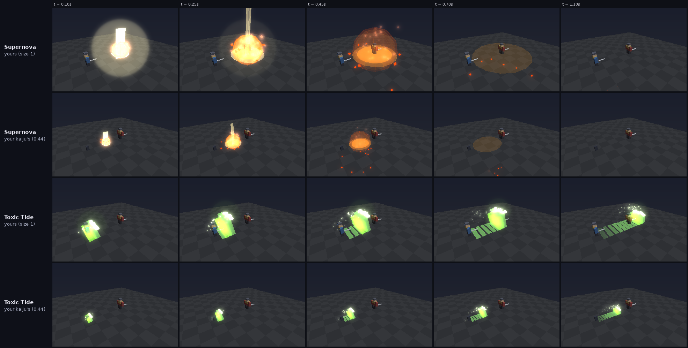

A creature's moves and everything they draw are its size, not yours
(`Kaiju.size`: next to you, at 1, your kaiju stands 0.44, a wild one 0.72,
the vein guardian 0.96, a critter 0.55). A move a kaiju casts lands that
big: its Supernova bursts round it in under half the circle yours does, its
Toxic Tide runs under half as far, and the warning rings round its heavies
match. On your screen the server tags each creature's effect with its size
(`"Sized"`), and the client draws it at that size (`FxSize`): bursts,
flashes, particles, slashes, auras, shields, its death, the sound (quieter,
a touch higher) and the camera shake, which goes with the size squared, so
a knee-high kaiju's slam barely nudges your screen. A creature's shakes
also fade with distance (`CombatFx.shakeNear`): a death or a shield breaking
across the quarry doesn't shake you at all (it used to, anywhere within 140
studs). Your own moves and other players' are unchanged.

## Your team

Three kaiju fight beside you at once, and a fourth, your support, heals
you (see [Your support](#your-support-the-fourth-kaiju)). You can keep 12;
the others wait at home. (The plan is a second slot when one of yours reaches level 10 and a
third at 20; the beta opens all three from the start: `Kaiju.SlotLevels`.)

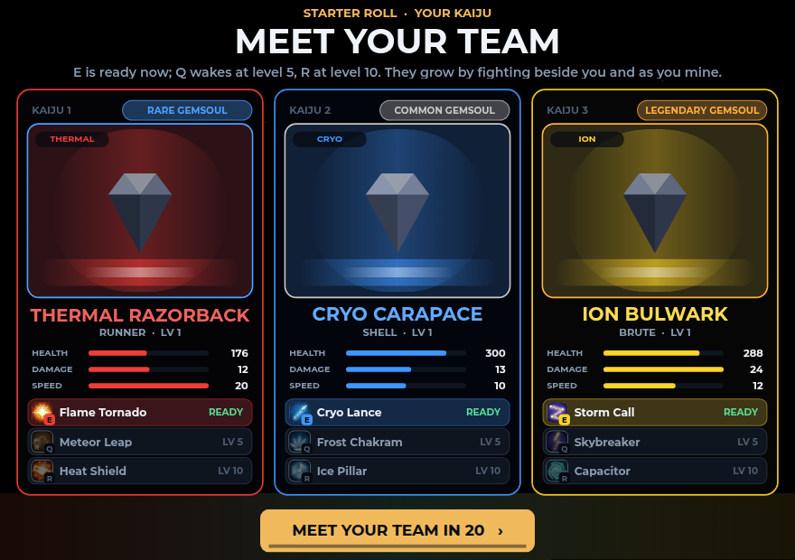

- **A boss roll.** Beating a boss (a Rift boss or a dungeon boss: each
  player who gets its boss cache) also owes you **one kaiju roll**
  (`KaijuBossRolls`, `Kaiju.bossRollsOwed`). Once you're back in the
  Outpost with nothing over the screen, it plays on the starter roll's
  screen with a single card, BOSS REWARD · A NEW KAIJU, its reel running
  through every kind (any kind but a support one, any element, a Gemsoul
  rolled like a mined gem). It reads IT JOINS YOUR KAIJU and moves on by
  itself; the kaiju joins as a reserve (your team stays as it is: swap it
  in from YOUR KAIJU). Several bosses beaten are several rolls, one after
  another. None while your starter roll is still owed, or with no room
  left (`Kaiju.MaxOwned`). A roll made and not yet taken is kept, so
  leaving doesn't reroll it.
- **Rarity by batch.** *2026-10-28.* Past the first four (the starters),
  a kind is as rare as the batch it joined the roster in
  (`Kaiju.Batch`, `Kaiju.batch`, `Kaiju.kindWeight`): the roster's first
  30 kinds (`Shared.KaijuRoster`'s own) the rarest (weight 1), the next 30
  less so (3), the last 30 the most often met (6). The boss roll
  (`bossPick`) and every wild kaiju, den and pack out in the Outpost
  (`pickKind` in `KaijuWilds`) pick by those weights; they used to pick
  every kind evenly. The starter roll is unchanged.
- **The starter roll.** *2026-10-30: not in the intro any more* (it only
  teaches gems and fighting: `docs/intro.md`). It plays by itself when a
  new player reaches the lobby after the intro's first fight, with nothing
  over the screen (`KaijuHud`), and the three rolled deploy round them at
  once. Closed unclaimed, Wren at the Kennel offers it (**Roll my free
  kaiju**). It's never handed out without the roll showing (it used to be
  after 90 s in the Outpost, `RollGrace`, gone). Everyone gets three kaiju,
  rolled on the same reels as the intro's gem roll: three
  cards (each with a numbered keycap) spin a reel of kaiju, every one on
  a glow in its Gemsoul's rarity and named under the window as it passes,
  and land, one after another, on yours (a random kind in a random
  element, never the same pair twice, nor one you have already, each with
  a Gemsoul rolled like a mined gem). Each lands with a flash in its
  rarity's colour and drops onto a stage in its element's colour; its E
  move's badge rises out of the window, and the card fills in: its
  Gemsoul and rarity, its name, health, damage and speed, what it's like,
  and its moves with their icons (E ready now, Q at level 5, R at 10, and
  its gem surge, its Gemsoul's E, marked GEM).
  Until then the card holds blank slots where they go. There's no button:
  once all three are down it reads YOUR KAIJU ARE LOCKED IN and moves on by
  itself 2.5 seconds later (a click while they spin lands them all at once),
  and **the three rolled are your team**. Only a claim that fails puts a
  button up, TRY AGAIN. The server makes the roll once and keeps it till
  it's claimed, so leaving doesn't reroll it; a roll left unclaimed is given
  anyway after 90 seconds in the Outpost. On a phone the cards drop the
  headline and what each kaiju is like, so they come out bigger.
- **Everyone gets the full three, once** (`Kaiju.RollVersion`). The first
  roll only topped a player up to three, so someone with a kaiju already
  (the old first-visit starter) saw two cards; anyone who took that roll is
  owed one full roll of three the next time they're in the Outpost (room
  permitting: 12 kept at most). A beta player can end up with six: the three
  new ones go out, the old ones wait at home.
- **Your team** is the three out, in order: the first leads (the one a
  wild kaiju sees first, and the one some old screens show). Empty places
  fill on their own with your best at home (highest level, then oldest),
  so a knocked-out kaiju's place stays its own and the team is always full.
  Each walks in its own place round you: one to your right, one to your
  left, one behind. One that's down keeps its place (down) until it's
  revived; a place fills from home only when a kaiju leaves the team.
- **They fight on their own, as a team.** They take on any moon bug within
  32 studs of you (28 before 2026-10-28; the support's attack reaches 30
  from it, so now the team takes on whatever it hits), and anything going
  for you or your support from up to 45, and share them out (see
  [Fighting as a team](#fighting-as-a-team)). They only fight a wild kaiju
  once you've started a fight with that one (see [Wild kaiju](#wild-kaiju)).
  They follow you everywhere in the Outpost (put back beside you if one falls
  far behind) and go away in a fight, a match or an expedition.
- **They see a fight through.** Walk off to mine mid-fight and a kaiju
  stays on its foe (and on whatever comes at it there) until the foe is
  down. Only past 150 studs (`Kaiju.Follow.Battle`) does it give up and come
  back to you. Out of a fight, it still runs back past 45 studs and is put
  back beside you past 90.
- **They never chase a foe off, and you come first** (since 2026-10-28,
  `Kaiju.Follow.Chase`, KaijuServer's `teamPlan`). A foe that backs away (a
  Crocodilo bomber keeping its distance) is let go once it's 22 studs from
  where that fight began and more than 44 from you. Before, one could drag
  the whole team after it, 100 to 150 studs off and out of sight, while
  other critters went for you and your support, which can't fight back.
  And the moment a creature goes for you or your support, a fight anywhere
  else is dropped and the team comes for what's on you; a critter on you
  or your support counts before the one on a kaiju itself. (In a
  hundred-second test mining at the Edge with the rifts' critters coming,
  they never got past about 55 studs from you, and a critter on you or your
  support went with none of yours on it for a few seconds at most; before,
  they ran off up to 150 studs, and it was 9 to 65 seconds in two minutes.)
- **EXP** goes to each of them out, for fighting: kills, a Rift's boss,
  kaiju battles. Never for the rocks you mine (those level you:
  [levelling.md](levelling.md)).
- **Recall.** The server can still call all of them back to you for 4
  seconds (`KaijuRecall`), but the strip no longer has a button for it:
  AUTO HEAL took the place of RECALL and HUNT.
- **Teams 1 to 4, on the number keys.** You have four teams of three
  places and a **bench** (the support has its own slot and is in no team).
  Each team is yours to arrange: any team can have kaiju in it whatever the
  others hold, a place can stay empty, and a kaiju can sit on the bench
  (`roster.Teams`; `Kaiju.teams`, `bench`, `place`, `swap`, `benchKaiju`,
  `autoFill`). A new catch takes the first team with an empty place, else
  the bench. Press a team's number (or tap its chip on the kaiju card) and:
  - **the team out's own number** calls it back (they fold into light and
    fly to you), and the same number brings it out again, in a fight or out
    of one;
  - **another team's number** swaps that team in: the team out goes back
    and the other comes out where you are;
  - **an empty team** opens TEAMS with its first place picked, to fill it
    ("Team 3 is empty: put kaiju in it on the TEAMS page."), and a team all
    knocked out says so and stays home.

  This replaced CALL BACK / DEPLOY: there's no button for them now, the
  number does both (`KaijuTeamOut`; `Kaiju.teams`, `teamOf`, `outTeam`). The
  pick or combat kit switch moved from 1 to **Y** to free the numbers (and
  then to **X**: see [friendly-sparring.md](friendly-sparring.md)).

  *2026-10-27:* **every call is instant, in danger too.** There used to be
  a three-second wait between swaps ("One moment.", `Kaiju.SwitchSeconds`)
  and a team called back only came out again once you were clear of the
  fight. Both are gone: the keys, SEND OUT and DEPLOY act at once, in a
  fight or out of one. Changing the team, its lead or the support doesn't
  wait either. So swapping back and forth can't refresh moves, each kaiju
  keeps its moves' waits when it goes back in its Gemsoul (its Q, E, R and
  gem surge, the support's pulses, and the HUD's cooldowns:
  `KaijuServer`'s `waits`). Swap a team out and straight back and it comes
  out as it went in, nothing ready that wasn't. A fresh team swapped in
  fights as fresh. The one thing that still stops a deploy is being down
  ("Not while you're down."): the Rift calls your kaiju back while you're
  down at its boss, and they come out with you when you're up.

  *2026-10-27:* **getting into the game, Team 1 comes out**, whatever was
  out or called back when you left (once a visit, `KaijuServer`'s
  `teamOneOnJoin`; after that your pick holds). And **every kaiju that
  comes out plays its deploy**, a shard from you and it opens out of the
  light, for everyone to see: arriving, a team key, back from a fight or a
  respawn, back on its feet (it used to play only for the keys, and
  arriving they just stood there). Coming in, that's often under the
  loading screen, so once the screen's gone your own team plays it again
  where you can see it (`KaijuOutAt` on the model, `KaijuHud`).
- **The TEAMS page** (the kaiju panel's first, and what it opens on from
  an empty place or an empty team's key; the whole width, no list beside
  it). *2026-10-29, remade:* it used to be the old line cut into threes, so
  Teams 2 to 4 were LOCKED till the one before was full and moving one
  kaiju shifted all the rest. Now:
  - **four team cards side by side**, each with its three places (the first
    LEADS; an empty one says "+ EMPTY"), what it's doing (OUT, CALLED BACK,
    READY, EMPTY) and its button: CALL BACK / BRING OUT / SEND OUT with its
    key, or FILL on an empty team;
  - **the bench** underneath, every fighter in no team, and **the SUPPORT**
    slot at its right (your other supports wait on the bench strip; tap one
    to make it the support);
  - **one way to move anything: tap a kaiju, then tap where it goes.** The
    bar says what's picked ("MOVING THERMAL BULWARK · tap a place, a kaiju
    to swap with, or the bench") and every target says what a tap there
    does: PUT HERE on an empty place, SWAP on a kaiju, SEND TO BENCH on the
    bench. Or tap an empty place first, then the kaiju to put in it. Drag
    and drop does the same. CANCEL (or the one picked again) lets go;
    DETAILS opens the one picked;
  - **AUTO FILL** puts the bench's best into the empty places, Team 1 first.

  Requests: `KaijuPlace` (to a team and place: an empty one takes it, a
  full one swaps), `KaijuSwap` (any two of your fighters, the bench too),
  `KaijuBench`, `KaijuAutoFill`, `KaijuSupport`. Not while that kaiju is in
  a fight; the last kaiju in a team can't be benched ("Keep at least one
  kaiju in a team."). An older save's line becomes its teams, three a team,
  the first time it's read.

  *2026-10-27, fixed:* in the game the tab could show only Team 1's first
  place, the rest missing. Each redraw cleared the rows and destroyed the
  kaiju pictures the tab keeps for next time. Roblox won't let a destroyed
  model be shown again, so the next draw stopped at its first picture. Now
  the pictures are taken out of the rows before they go (`keepModels`), and
  one destroyed anyway is built again (`modelFor`).

  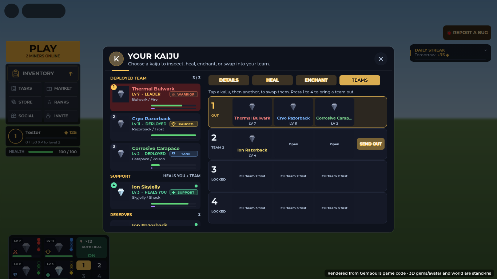

  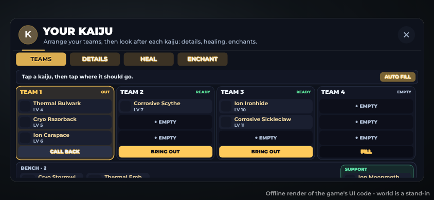

  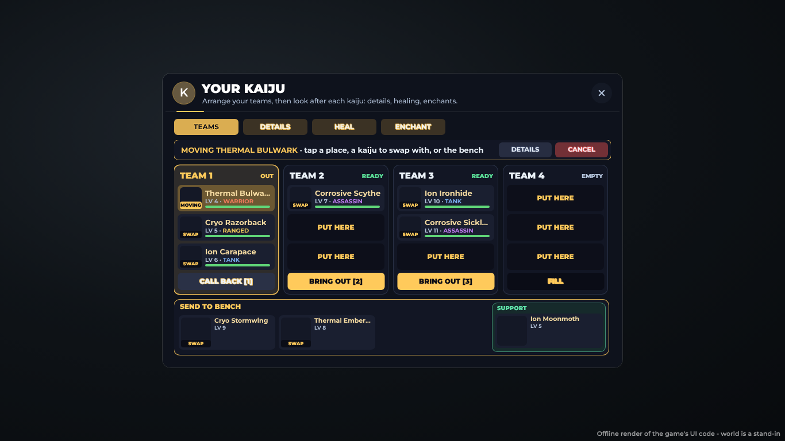
- **They jump with you, follow the leader.** Jump and your team jumps
  after you one by one, down your line: the one nearest you first (0.14 s
  after you), then each one behind it 0.26 s after the one before
  (`Kaiju.Hop`, `Kaiju.hopLine`). Only the kaiju actually following you
  count, so an empty slot or one busy in a fight leaves no gap. Each one
  crouches, springs up nose-first with its legs tucked, tips forward and
  lands with a squash and a puff of dust (`CreatureMotion`'s `Motion.hop`,
  posed from the `KaijuHopAt` take-off time the server puts on its model).
  *2026-10-29:* **heard too, every kaiju**: a springing whoosh as it leaves
  the ground (a "bwip" out of its crouch, air rushing past, a short "hup"),
  a thud, crunch and spatter of grit as it lands, sized to it (a knee-high
  kaiju's higher and lighter, a big one's deeper). Before, only a big
  kaiju's landing made a sound, and a small one jumped in silence
  (`CreatureAnimation`; `KaijuJump` and `KaijuLand` in `CombatSound`, made
  by `tools/make_kaiju_jump_sounds.py`; built-in sounds stand in till
  they're uploaded).
  **Every jump, however fast you jump again**: your own client tells the
  server each time you jump (`KaijuJump.client.luau`, `Remotes.KaijuJump`),
  as well as the server watching you rise, so none is missed; a jump seen
  both ways counts once (`Kaiju.newJump`, none within 0.35 s of the last).
  A kaiju is ready to jump again 0.5 s after it last did (just over its
  time in the air), so holding jump, they keep jumping with you; one still
  waiting its turn when you jump again goes once more right after.
- **Levelling is slower** than it was: `Kaiju.ExpCurve` and less EXP per
  rock and kill (`docs/levelup-lobby.md`).
- **They don't heal on their own.** A kaiju keeps the health it ends a fight
  with, out or at home, across sessions; gems heal it, by hand or by AUTO
  HEAL (see [Healing](#healing)).
- **Knocked out**, it goes back into its Gemsoul and stays down (`Down`)
  until it comes back by itself: 60 seconds and 8 more a level
  (`Kaiju.Revive`, `reviveSeconds`; `DownUntil` on the record, the
  server's clock, so it counts while you're away), **weak, at 15% of its
  health** (`Revive.Health`), to be healed with gems. Gems don't revive
  it. Or revive it now, at half health (`Revive.Bought`):
  **REVIVE** for Robux (the `KaijuRevive` product, R$ 25: every one of
  yours that's down) or a **Revive coupon** from inviting friends
  (`Shared.Coupons`). The others fight on. See [Knocked out](#knocked-out).
- **Changing the team** (the panel): LEAD puts one at the front; SEND OUT
  puts one from home in place of one of the team. Not one that's fought in
  the last 3 seconds, and not twice in a moment.

## Your support: the fourth kaiju

Beside the three that fight, you have a fourth kaiju out: your
**support**. It doesn't fight for creatures. It stays at your shoulder
and keeps you and your team going.

**They lead the way** (since 2026-10-26, `Kaiju.TeamSpots`,
`Kaiju.leadSpot`): your team walks out in front of you, not behind, close
in. The first of the three leads, 11 studs ahead; the other two walk side
by side behind it, 7 ahead and 4 to either side (closer since the second
pass on 2026-10-26: 16, 10 and 5 before). **The support stays at your
shoulder**, 2.5 ahead and 2.5 to your right (it was 12.5 out in front).
**They read where you're going** (`Kaiju.Lead`): on the move the three
face the way you're heading, not the way you look, and walk where you'll
be 0.6 s from now (up to 9 studs further out), so they're already there
when you arrive. The support doesn't run ahead: it keeps to you. Standing
still or turning on the spot, they line up ahead of where you look.

**Where you can see them** (since 2026-10-28, `KaijuView.client.luau`,
`Remotes.KaijuView`, the `view` in `Kaiju.leadSpot`): your client tells
the server which way your camera looks along the ground (only when it's
turned 20° since it last said, at most every 0.3 s). Standing still, the
team lines up in front of you **as your camera sees it**, not the way your
miner faces: facing your camera while you mine, "ahead of you" was behind
the camera, and on a phone the team stood off the bottom of the screen
while the support fought alone at your feet. Walking back toward your
camera (more than half of the way, `Kaiju.Lead.Facing`) they keep to your
far side, following, rather than lead off behind it; walking across or
away from it they lead as before.

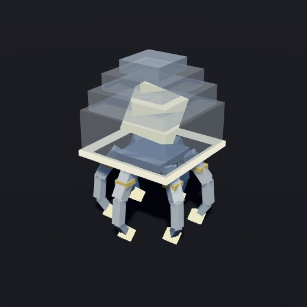

- **The starter support is Skyjelly** (number 57 on the second concept
  sheet, the one Warden left on it): a glass jelly with a core of its
  element's light and six tendrils it drifts on. Everyone gets an Ion
  Skyjelly once (`Kaiju.StarterSupport`, `Kaiju.supportOwed`). A new
  player gets it with the starter roll, and the roll names it under the
  three cards. Anyone from before is given one on their next visit to the
  Outpost, even with a full roster of 12. It never spawns wild.
- **The support slot** (`Kaiju.SupportSlot`, `Kaiju.supportId`) takes a
  support kind only: the Warden role, now shown as **SUPPORT** (Moonmoth
  and Skyjelly). A support kind never takes one of the three fighting
  slots. If you own more than one, the one you set goes out
  (`KaijuSupport`), else your best.
- **Its pulse** (`Kaiju.SupportPulse`), **only in a fight** (in danger,
  `Kaiju.Danger`, as above; since 2026-10-26). Out of one it mends nobody:
  between fights, gems do the healing. In a fight it reads the health of
  you and every one of the team within 24 studs of it, **each and on
  average**, and casts what that calls for, never just because a move is
  ready (`Kaiju.supportChoice`, its moves sorted by what they're for:
  `KaijuRoles.supportMoves`; all its own from level 1):

  | It casts | When |
  |---|---|
  | its **big mend** (Skyjelly: Bloom Surge, 30% over 4 s, effects cleared) | one of you under 35%, or the average under 50% |
  | its **gem R**, on you and itself (below) | with foes about: you under 75%, or the average under 75% |
  | its **mend** (Pulse Mend, 15% over 3 s, heals you too) | one of you under 55%, two or more under 75%, or the average under 75% |
  | its **ward** (Static Veil, 30% less damage for 4 s) | with foes about: one of you under 80%, or the average under 90% (someone's taking the hits) |
  | its **attack** (Static Bolt, 90% damage with its element's effect) | nobody needs it, and a foe within 30 studs (the team's foe first) |

  Each no sooner than its own gap after the last (big mend 18 s, gem R
  14 s, mend 6 s, ward 9 s, attack 2.5 s).
- **It charges off its team** (*2026-10-26*, `Kaiju.SupportCharge`,
  `KaijuServer.chargeSupport`). A support can't fight for its charge, so
  every blow one of your fighting kaiju lands takes **0.5 s** off each of
  its waits: its gem R, its mends and its ward. A team of three hitting
  hard gets its gem R back in a few seconds instead of 14. Its own blows
  don't count, and a blow that's parried, dodged or guarded doesn't
  either. The gem dot on its HUD tile fills faster to match.

  Moonmoth works the same way: Silk Cocoon
  is its mend, Scale Storm its ward, Antenna Beam its attack. In the field
  it is the only thing that heals you away from the Shelter, and only
  mid-fight.
- **Its gem: its R, not a gem surge** (*2026-10-26*, `Kaiju.supportGuard`,
  `Kaiju.gemMove`, `KaijuAbilities.guard`). A support casts no gem surge
  (its enchant's E). Instead its enchant gives it its **R**, from level 1,
  adjusted for a support: it goes **on you and on itself**, not just on
  itself.
  - A shell or a ward: on itself as ever, and on you a shield as strong
    (a shell's share, or a ward's, of your health; up to half) for as long
    (`Enemies.shieldPlayer`, CombatServer's shield).
  - A mend: it heals you both.
  - A ring: it goes off round you, hitting what's on you.

  Ion Skyjelly's R is Ion Shield, Capacitor or Tesla Fence, as its gem
  rolled. On the HUD tile it is the gem dot; the panel names it GEM R.
  An enchant shows "Gem R: …" for a support.
- **In a kaiju battle** it comes as a fourth piece (there are six cells a
  side). It stands at the back with the shooters and mends and wards its
  side, as a Warden does. 1V1 + KAIJU brings it too.

| Skyjelly | |
| --- | --- |
| Role | SUPPORT (Warden) |
| Level 1 | 200 health, 9 damage, speed 18 |
| E · Pulse Mend | It, you and every ally within 24 studs heal 15% over 3 s |
| Q · Static Veil (lv 5) | It and every ally within 24 studs take 30% less for 4 s |
| R · Bloom Surge (lv 10) | Hurt: it, you and every ally within 26 studs heal 30% over 4 s, effects cleared |

### The kaiju menu

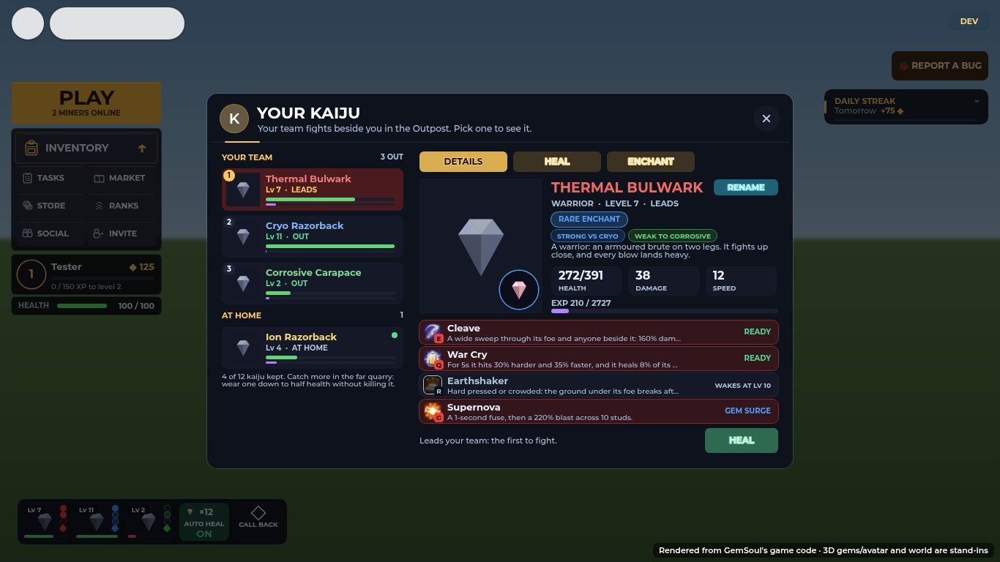

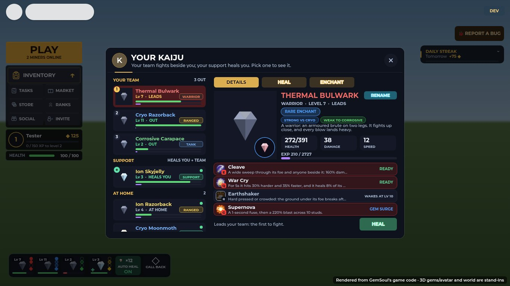

- The list reads **YOUR TEAM**, then **SUPPORT** (marked with a green
  plus, "HEALS YOU"), then **AT HOME**.
- Every row has its role as a coloured tag (TANK, WARRIOR, RANGED,
  ASSASSIN, BREAKER, SUPPORT), so you can see what the team is made of at
  a glance. Each role also has a symbol, in its colour, at the front of
  its tag and on the kaiju's HUD tile (bottom left, above its health):
  a shield (tank), crossed swords (warrior), a crosshair (ranged), a
  dagger (assassin), a hammer (breaker) and a plus (support). They're drawn
  from plain frames (`RoleIcons.luau`), not font glyphs, so they never
  show as boxes.
- The support's page says what it does. A support kind at home has **SET
  AS SUPPORT** instead of SEND OUT.

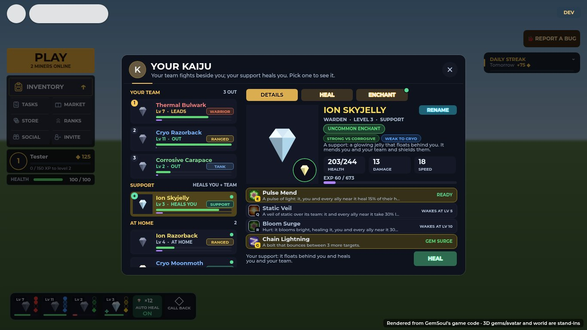

- **The strip** has a fourth tile after a small gap: your support, edged
  in green with a plus. It is 432 px wide on a computer and 340 on a phone.

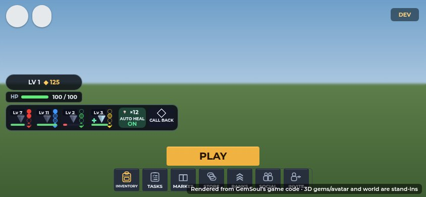

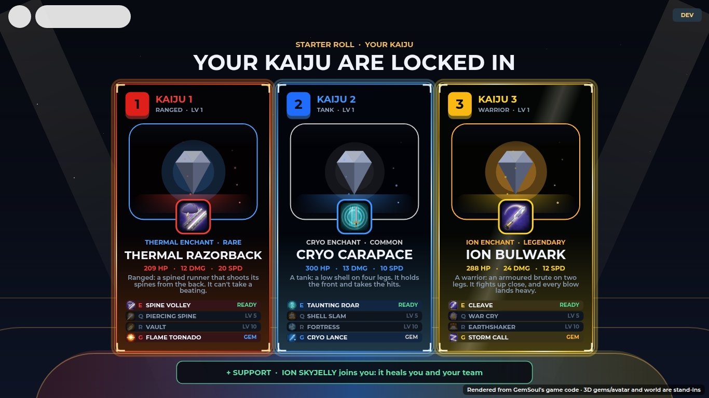

The renders are offline stand-ins drawn from the game's UI code, not
Roblox screenshots; the 3D models show as gems.

## Fighting as a team

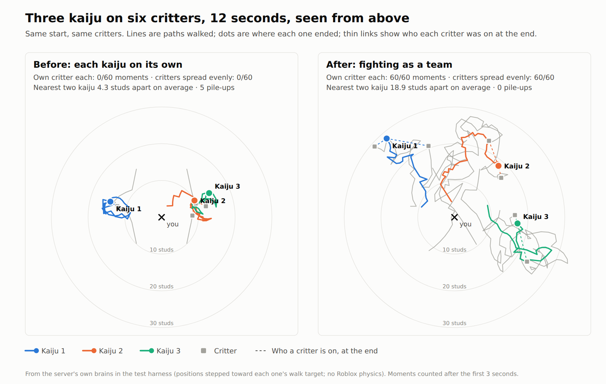

Your team, a pack of wild kaiju and the critters all fight as a side
(`Shared.Squad`), not each on its own:

- **Each its own foe while there are enough to go round.** Three kaiju on
  three critters take one each; two on three fight one each while the third
  waits its turn; two on ten never double up, so each works through its half,
  five each, one at a time. As foes fall, the kaiju collapse onto the ones
  left: with more kaiju than foes they share them out (three on two: two and
  one), and three on one all go in.
- **Who takes whom.** The nearest, but a critter already after a kaiju counts
  6 studs nearer to it, one after you or your support 30 nearer (10 before
  2026-10-28; you come first, ahead of the one on a kaiju itself), and a
  kaiju keeps the foe it's on unless another is 8 studs nearer, so they
  don't swap back and forth (`Kaiju.Squad`, `Squad.Stick`, `Squad.Threat`). It **dives a
  swarm's bomber** (a Crocodilo counts 8 studs nearer) and **finishes off**
  one under a quarter of its health (5 studs nearer).
- **Sweeping heavies.** A kaiju's heavy (a stomp, a slam, a tail lash) hits
  every critter in reach inside its arc, not just its foe: each of the
  others takes 60% of the blow (`KaijuFight.Cleave`; a stomp or slam's arc
  is 150°, a Razorback's tail lash 220°). With three or more foes in reach
  it swings a heavy for a light blow 60% of the time, so a swarm round it
  gets swept.
- **Flanking.** Two or more on one foe spread round it: two on opposite
  sides, three a third of a turn apart. Each works round to its side a step
  at a time (round the foe, not through it), keeping the side it came in on
  where it can.
- **Spacing.** No two of your kaiju stand closer than 5 studs: one crowding
  another is pushed clear.
- **The critters' side too.** Critters near your kaiju share the kaiju out
  evenly: ten on two kaiju, five on each; three on two, two and one. They
  take their own places in a ring round the kaiju they're on, at least 3.5
  studs from each other. A wild pack shares out its foes and flanks one it
  shares the same way.

In the walked-through fight above (three kaiju on six critters, twelve
seconds, the server's own brains), before this two kaiju always shared a
critter, the critters never spread evenly, and the nearest two kaiju stood
about 4 studs apart, on top of each other now and then; now each has its own
critter every moment, the critters are spread two on each, and the nearest
two kaiju fight 6 to 19 studs apart on average (it varies run to run), all
but never on top of each other.

## On screen

How kaiju move and show their casts (the weight of a blow, the walk, the
charge-up at the mouth before a cast, dust at each footfall, a flash when
hit) is covered in [combat-feel.md](combat-feel.md).

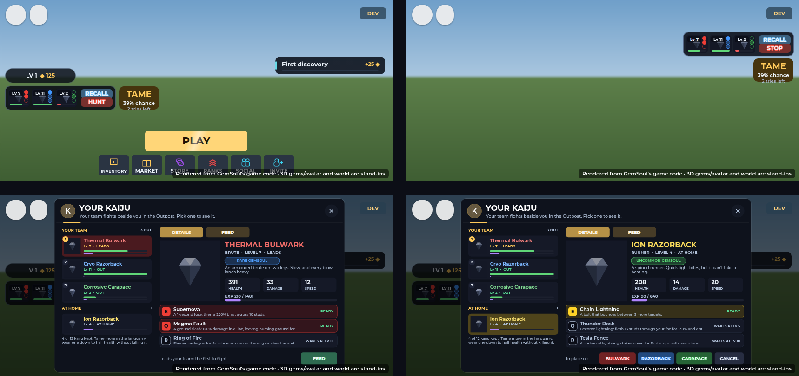

On a computer the strip sits at the bottom left; the CATCH prompt appears
above the combat HUD near the bottom center:
[the lobby on a computer](kaiju/hud-desktop.png).

- **The kaiju card** (`MobileLayout.kaiju`, `kaijuDesk`, `kaijuCells`). On a
  computer, three across and two down:
  - **The kaiju, two by two on the left:** your team's three (the lead
    first, edged in gold, then the second beside it and the third under
    it), and your support beside the third.
  - **On the right** (*2026-10-29*): AUTO HEAL, a tile the size of a
    kaiju's (it used to run down the whole column), over the HYPERBEAM's
    tile with its key, Z. The team keys are tabs along the card's top.

  On a phone, *2026-10-27*, **a small grid at the top left**, in a fight
  too: the team's three and the support a little apart in a row, and AUTO
  HEAL as a slim row across the card under them (the gem and how many,
  AUTO HEAL, ON or OFF). 164 by 67, half the width of the old one-row card
  (351 by 59). No CALL BACK (the number does it), and no HYPERBEAM pill:
  that's a button of its own now (below). The card's own back is
  see-through (`MobileLayout.Kaiju.Back`, 0.55; it was nearly solid), so
  the world shows round the tiles; the tiles and AUTO HEAL keep their
  solid backs.

  **The team keys 1 2 3 4 are off the card**, two by two (*2026-10-28*;
  a row of four before), 34 points square, just above the move stick,
  under your left thumb (`MobileLayout.keys`). On the shortest phones
  (812 by 375) they're 30 and sit a little nearer the stick, to keep clear
  of CATCH under the card. They used to sit at the end of the card's row;
  while you hunted the whole row moved over to the right, across the
  middle of the screen and onto DODGE.

  **The HYPERBEAM is a button of its own**, *2026-10-27*: just right of
  the team keys and as tall as they are (its rim level with their top and
  bottom), 64 wide, over the FIGHT / MINE switch (`MobileLayout.beam`).
  *2026-10-28:* with the keys two by two it moved left beside them; the
  keys and the button take 150 points across, where the row of keys and
  the button took 226. It reads HYPERBEAM over its percent (READY! when
  it's full), with SAVE a strip along its bottom; its meter is its own
  rim, filling from the bottom up in your team's colours. Its title keeps
  well in from the tile's sides (on a phone it ran under the rim, cut off
  as HYPERBEA). It sits clear of the fight's vitals and moves on the
  smallest phone.

  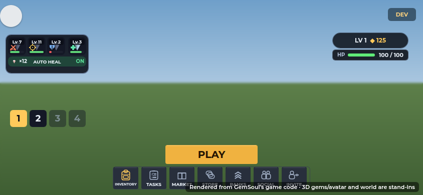

  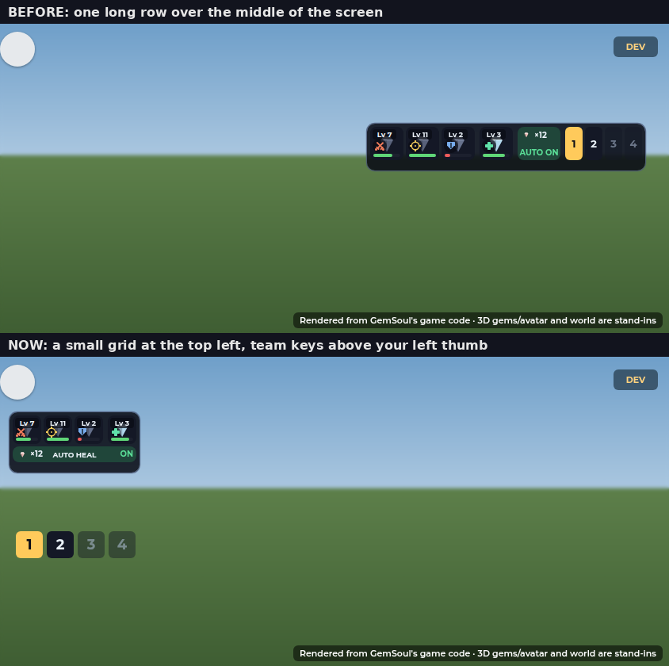

  Around it: **CATCH** under the card, as wide; the **pick card** (when
  you tap the swing bar by a rock) beside it at the top, and in a fight the **foe list** on the
  right, at the top, as many rows as fit above DODGE: two on most phones,
  one on the narrowest (`MobileLayout.foes`, `FoeBars`).

  - **Its outline:** the team's [HYPERBEAM](#hyperbeam) meter, with its
    pill on the card's bottom edge. *2026-10-26:* this replaced the
    full-width bottom row, so the card is shorter (143 px tall on a
    computer, was 186; at most 100 on a phone, was 124).

  Each kaiju tile shows its portrait, level and health. On a computer it
  also has dots down its right edge for Q, E and R: lit when the move is
  ready, faint while it recharges, hollow while it's still asleep. A phone
  leaves the dots off (too small to read there; the kaiju panel has the
  moves), and its role mark is a little smaller, just above its health.
  Knocked out, its tile is
  veiled and says DOWN until you revive it. Tap a tile for the kaiju panel
  on that kaiju (a tile that's DOWN opens HEAL).

  Where it sits:
  - On a computer: the bottom left. The chat feed keeps clear above it.
  - On a phone: the top left, mining or fighting; the pick card shows
    beside it only when opened, the foe list on the right in a fight,
    the team keys above the move stick (see [mobile.md](mobile.md)).
  - **AUTO HEAL**, in the middle row, in place of RECALL and HUNT: the gem
    it takes next (a Common of your lead's element; an Uncommon once the
    Commons are gone), how many spare Commons and Uncommons you have, and
    ON or OFF. Tap it to switch. On, your spare Commons, then your spare
    Uncommons, heal your team by themselves (see [Healing](#healing)).
- **CATCH**, under the kaiju card on a phone, when a wild kaiju near you
  is down to half its
  health: the chance right now and the tries left. It starts the catch
  (see [Catching](#catching)), and hides while it's under way. Tapping the
  gold **CATCH · %** on the wild kaiju's own plate does the same.
- **The kaiju panel:** on the left every kaiju you have: YOUR TEAM (numbered,
  1 leads; health, EXP, and DOWN: REVIVE IT on one knocked out) and AT HOME
  (their health too: it doesn't come back at home either). Pick one for it
  in full on the right: its portrait, with its enchant's gem on the corner
  (edged in its rarity), its name and RENAME, kind, role and level, its
  enchant's rarity, what it's strong and weak against, health, damage and
  speed, its EXP, and its E, Q and R with what each does (READY, or WAKES
  AT LV 5 / 10, each with its icon and key), and under them its gem surge
  (G, GEM SURGE in its enchant's rarity). Under that, what you can
  do: **LEAD** (one of the team to the front), **SEND OUT** (one from home:
  then pick which of the team it goes out in place of) and **HEAL**
  (**REVIVE** on one that's down), which opens its HEAL tab (see
  [Healing](#healing)). On a phone the panel is a window of its own, 860 by
  340, drawn near full size (it used to be the computer's window shrunk to
  about 70%); the one picked scrolls. On a computer the window is 800 by 512.
- **The Gem Vault** shows a Gemsoul's branches as the moves a kaiju casts,
  with KAIJU LV 5 by Q and KAIJU LV 10 by R.

### Health on the body, nothing over heads

Nothing floats over a creature's head but a wild kaiju's: no name and no
health bar over your kaiju, other players' kaiju or critters (they piled up
over the fight). A wild kaiju has a slim plate over it, its name, level and
a health bar (`WildBars`; [wild-bars-and-edge.md](wild-bars-and-edge.md)).
Each body shows its own health too (`BodyHealth`, handed every
creature by `KaijuHud`): its colours sink toward a scorched red-black as it's
hurt, it flashes white on every blow, and below 30% it smokes. Glowing parts
keep their light. Your own team's health is on the team strip. See
[play-screen.md](play-screen.md#health-on-the-body).

## HYPERBEAM

Once your team's charge is full, you can call a HYPERBEAM: your team's
blast together. It works the same in mining and in fights.

- **The charge.** *2026-10-26:* one meter for the whole team, separate from
  anything else (it used to be each kaiju's own mana, which their Q, E and
  R spent). It runs 0 to 100, kept on your profile
  (`Kaiju.roster(profile).BeamCharge`). It's earned, never passive: only
  0.6 for every blow of your team's that lands (1.6 times that for a
  heavy). Following you about or standing by adds nothing. Their moves
  cost it nothing (`KaijuBeam.Charge`). About a minute and a half of
  steady fighting fills it. *2026-10-28:* it used to trickle in on its own
  (0.3 a second, 0.15 more in a fight).
- **SAVE CHARGE.** The button's SAVE switch, kept on your profile
  (`KaijuSaveCharge`). While it's on, your fighters cast none of their Q, E
  or R moves (`KaijuFighter.hold`). They fight with blows alone and charge
  1.6 times as fast. The support's heals still go out.
- **The meter and its button** (`KaijuBeamHud`). *2026-10-29:* a tile on
  the kaiju card, in the bottom-right cell under AUTO HEAL
  (`KaijuHud.beamSlot`, `MobileLayout.kaijuCells`' `Beam`). It used to be a
  pill hanging off the card's bottom edge, with the card's outline as its
  meter; the card is 9 points shorter without it. The tile has its key, Z,
  in a cap before HYPERBEAM, its state big under that and SAVE along the
  bottom (green while it's on). Its rim is the meter: it fills from the
  bottom up in your team's colours, by the team's charge
  (`KaijuBeamHud.fillLevel`). It shows:
  - **Charging:** the percentage.
  - **Ready:** the rim full and bright, its colours flowing round it, a
    glow breathing about the tile, the HYPERBEAM title shimmering, the Z
    cap gold, READY!; it pops with a sound.
  - **Blasting:** BLASTING!

  On a phone it isn't on the card: the same tile is a button of its own
  right of the team keys and as tall as they are, with no Z (see
  [Your team](#your-team)).

  It's light to run: it redraws only when what it shows changes, and moves
  only while it's ready.

  **Z**, the gamepad's d-pad down, or a tap fires it.

  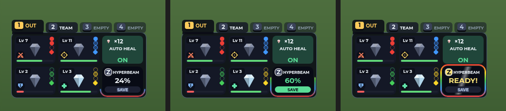

  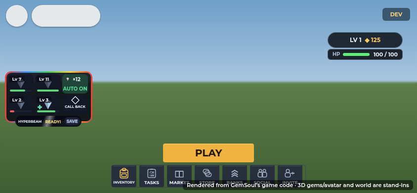
- **The blast** (`KaijuBeamServer`, 6.1 seconds, `KaijuBeam.timeline`).
  Since 2026-10-26 it all happens in front of you, seen from your own
  view: no cinematic camera.
  1. **Gather (1.8 s): the formation, in the air.** Each kaiju is held
     where it stands until its turn. Then they leap one after another,
     0.16 s apart, up into a V in the air ahead of you, 6 studs off the
     ground (*2026-10-26*, `KaijuBeam.Hover`), wide of the middle so your
     view stays clear (8 studs either side 7 ahead, then 13 either side 3
     ahead), facing where you aim (`KaijuBeam.Formation`,
     `KaijuBeam.Leap`); the support goes higher still over the V, 13 studs
     up. They hang there, held still, till the blast is over, then drop
     back down. Nothing can hurt them from their leap till they're let go
     (`KaijuServer.hurt`). **Everything about backs off**: every creature
     in reach or in the fight drops what it was winding up and backs away
     from you, crouched low and trembling (`KaijuMood` "Cower"), till the
     beam fires (`CowedUntil`, KaijuWilds' `cower`). Each leap takes
     0.62 s, and the further it goes the higher it arcs (up to 14 studs).
     A fighter does a front flip; the support spins. A streak of its colour
     trails behind it, and as it arrives a ring of its colour bursts round
     it in the air while a shockwave, cracks, a pillar of light and dust
     hit the ground under it. The server puts it in its exact spot as it lands
     (`KaijuServer.spot`, sent ahead to clients as `Ends`), so there's no
     pop. Once they're all down (1.25 s), they roar together, a breath
     apart: pillars of their colours shoot up and lines of light join them
     to each other and to you.
  2. **Charge (1.2 s).** They stand still and their auras flare: a
     shimmering shell, sparks rising and motes spiralling into their
     mouths. Each pours its element into one point 16 studs ahead of you,
     level with them (6 studs up).
     The orb there swells, crackles with lightning and pulls rings of light
     into itself.
  3. **Fire (2.6 s).** The beam fires from that point: 90 studs long and 10
     wide. Each kaiju's colour twists round it as a ribbon, with a star of
     light at the focus, a blaze at the far end and rock thrown up along
     it. **The biggest threat first** (`KaijuBeam.threat`: the toughest,
     and one already in a fight with you or your team counts 1.5 times):
     it holds on that one for a share of the blast (40% with up to three
     about, less the more there are: `KaijuBeam.dwell`), then **sweeps
     across the rest in one pass, as many as it can reach**: out to the
     nearer side's last one, then back across to the far side's, never back
     and forth (`KaijuBeam.order`, `sweep`, `direction`; up to 12). It
     takes the creatures within 60 studs and any your team is fighting (up
     to the beam's length), never one more than 80° off your aim; with none
     in front of you it fires straight ahead. **A boss in the fight** (a
     dungeon's or the Rift's) is the biggest threat there is
     (*2026-10-27*): it's found up to 150 studs off (`BossReach`), the
     team turns to face it, wherever it is, and the beam locks onto it
     first, then goes on from there across the rest in the same one sweep
     (its adds, anything else in the fight). The boss takes every pulse
     wherever the beam's turned. It lands 26 pulses (a tenth of a
     second apart, so nothing it sweeps past is skipped), each on
     every creature in the beam where it's turned then **and on every one
     in a fight with you or your team, wherever it is** (*2026-10-26*:
     one your team's on, one after you or one of them, a wild kaiju you
     started on; still within the beam's 90 studs of you).
     Altogether it deals 7 times your team's damage, added up
     (`KaijuBeam.damage`).
  4. **Recover (0.5 s).** They're let go and back to following you.

  The charge goes to zero when the blast starts. Nothing charges it again
  till the blast is over.

- **The show** (`KaijuBeamFx`, for everyone within 260 studs). The leaps
  are posed by `CreatureAnimation` (crouch, spring, tuck, land, from
  `BeamLeapAt` and `BeamLandAt`), and so is the roar (`KaijuMood` "Roar",
  in each kind's voice). Your camera stays yours (first person or not):
  it all happens in front of you. No text on screen (no title, no names):
  as it fires, a light flash, a colour grade and bloom. Everyone sees the beam turn the same way: the server sends
  its targets in turn (`Targets`). Nothing's left on the ground after:
  the dark scorched strip that used to lie along the beam's path and fade
  out after the blast is gone (*2026-10-27*; it read as a black streak at
  the end).

  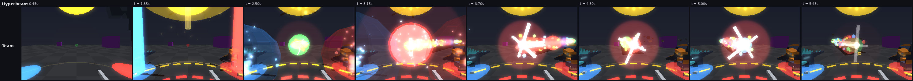
- **Not** without your team out, while it's still charging (it tells you
  the percentage), mid-blast, or in a kaiju battle. The beam doesn't break
  rocks, so it can't be used to skip the swings.

## Hunting

Your kaiju fights whether or not you do. Hunting puts your own combat kit
out, as in a spar but alone. The strip's HUNT button is gone (AUTO HEAL
took its place), so for now the HUD has no way to start a hunt; the server's
`Hunt` request and the hunt itself are unchanged. Only creatures can hit you, and
you can only hit creatures; a creature's finishing blow knocks you down for a
few seconds, as in a spar. Wild kaiju leave you and your kaiju alone until
you start a fight with one. Moon bugs don't: out past the core
they come through rifts at miners too ([frontier.md](frontier.md)), and
their finishing blow knocks you down the same way.

## In the Outpost

Wild kaiju roam the frontier, out past the Outpost's core and at least 140
studs from the landing pad. Moon bugs come through rifts round players out
past the core.

### Wild kaiju

Up to 30 roam the Outpost at once, in **packs of three** of a kind (each
its own element; the packs are different kinds where there are enough to
go round). They're within two levels of the strongest kaiju near them,
with half again the health of a kaiju of yours at their level: it takes
you and your kaiju together. They stand about your height (yours come up
to your knee). A ninth guards a Rift Vein (see
[The vein guardian](#the-vein-guardian)). Their names show from 160 studs
off (60 on a phone; see [Names over heads](#names-over-heads)).

Three packs in four **hold a patch** (see
[Claimed patches](#claimed-patches)): they den beside an outcrop and come
for whoever mines it. The rest roam free.

They go about their day:

- Each pack has a **den** out in the frontier, clear of the rocks, the
  buildings, the old workings, the ramps and the vein sites, at least 90
  studs from any other pack's. A pack holding a patch dens 10 to 14 studs
  off one of its rocks.
- Each kaiju wanders round its den (up to 34 studs), ambling at under half
  its speed, and stops to do things: **sniff** the ground (head down),
  **look about**, **lie down** for 8 to 16 seconds, or **roar**. Walking
  takes up about half its time, lying down about a quarter. The second of a
  pair keeps near the first, and gets up to follow when it wanders off.
- Every one to two minutes a free pack's den moves on 20 to 30 studs,
  roughly the way it was going, so it wanders about 150 studs across the
  quarry in ten minutes and you'll meet it somewhere new. A pack holding a
  patch stays on it.
- Come within 22 studs and it stops to look you over, turning to face you.
  Now and then (at most every 25 seconds) it roars at you, each kind in its
  own voice: a deep bellow, a raspy snarl, a rumble under a hiss, a
  chittering screech. Either way
  it leaves you be.
- It doesn't wander into the core, and it only sets off where the way is
  clear (nothing solid in a line to where it's going), so it doesn't push
  against masts or containers.
- One within 220 studs but off your screen gets an arrow at the screen's
  edge, with how far it is (the guardian's in red), so you can go and find
  them.

Your own kaiju does the same, in a small way. Stand still for 3 seconds and
it potters round you (within 6 studs): sniffs, looks about, lies down. It's
up and after you as soon as you move on.

A wild kaiju leaves you and your kaiju alone until you start a fight with
it. There are two ways:

- **Challenge it:** hold **F** beside it (within 20 studs; not E, your ability in first person), with your kaiju
  out or while you hunt. Your kaiju goes in. The Challenge button shows
  only while it's free: not while it's in a fight with anyone (until it's
  home and has calmed down) or being tamed.
- **Hit it** while you hunt.

Then it fights everyone who started on it, and their kaiju. **Its packmate
joins in** if it's within 40 studs: start on one of a pair and you'll often
face both. It doesn't go for anyone else near. It fights as above (its E too), and hits you
while you hunt. **With your team gone** (*2026-10-27*: all knocked out, or
called back mid-fight) it comes for you instead, pick in hand or not, out
past the core (`KaijuWilds` `exposed`); it used to stand there once your
kaiju were gone. Send your team back out and it goes back to them; run
past its leash and it gives up. Lead it more than 70 studs from its den and it walks back to
heal. Once it has been back 8 seconds with nobody fighting it, it forgets who
started on it, and goes about its day again.

One nobody fights burrows back after 7 to 15 minutes (each its own time, so
they don't all go at once and leave the quarry empty, as they used to every
ten minutes). Another comes up elsewhere 20 seconds after one burrows, 90
seconds after one is killed or tamed. One that falls through the floor is
put back at its den.

- **Kill it:** every kaiju that fought it gets 40 + 12 × its level EXP, and
  the player who (with their kaiju) did the most gets its Gemsoul.
- **Catch it:** it joins you, Gemsoul and all, **starting over at level 1**
  (*2026-10-27*; `Kaiju.Tame.Level`): a level 19 caught is a level 1 of
  yours, to level up from there.

### Claimed patches

Most packs (`Kaiju.Wild.Claim.Share`, 75%) den beside one of the
frontier's outcrops (the seams of two to five rocks, `Frontier.Outcrop`)
and hold it: the whole seam (rocks chained a step and a bit apart,
`Claim.Link`) is theirs, the den 10 to 14 studs off its middle, and any
other rock within 32 studs of the den too.

- **Their rocks roll luckier** (+8%, `Claim.Luck`) while any of the pack is
  standing: `OutpostServer.patchLuck` asks `KaijuWilds` as the gem is
  rolled. Beat or catch the pack and the luck goes with it.
- Mining a held rock is like mining the guarded vein: the **first swing
  stirs** the pack (every one of it looks round at you), the **second makes
  it growl**, and the **third brings the whole pack** down on you ("The
  pack holding this patch is coming for you!"). Two swings, then nothing
  for 30 seconds, and the count starts again. Once it's up, every swing at
  its rocks puts the miner on its list, and it goes for **a plain miner
  too**, on foot, as the guardian does, and their kaiju.
- The pack stays on its patch (its den never drifts). When the last of it
  is killed, caught or burrows away, the patch is nobody's: no extra luck,
  nothing stirs, and the pack that comes up in its place claims a patch of
  its own somewhere else.
- `OutpostServer.onRockSwing(position, player)` fires for every swing at any
  rock (its spot's position); `KaijuWilds.rockSwing` finds the pack holding
  it, if one does.

### The vein guardian

One of the three Rift Veins is guarded (its rocks are red-tinted and
luckier still, +110%, and its beam is red: see [frontier.md](frontier.md)).
A wild kaiju of level 16 to 20 keeps a short beat in front of it, a head
taller than you. It loses narrowly to a level-25 kaiju or to two level-10s,
and beats a kaiju of its own level.

- It paces up and down in front of its vein, sniffs about and naps (about
  half the time). It looks over anyone who comes close, and roars at them
  now and then. It doesn't attack them.
- The first swing at its vein's rocks stirs it (it looks round at you), the
  second makes it roar, and the **third swing** wakes it (two swings, then
  nothing for 30 seconds, and the count
  starts again).
- Awake, it goes for whoever woke it, and anyone else who mines its vein,
  **a plain miner too**, not only hunters. Its finishing blow kills a
  miner, and the critters rob them before they're back at base
  ([frontier.md](frontier.md)). And it fights their kaiju.
- Challenge it, fight it or catch it like any other wild kaiju. Killed, it
  also pays **40 coins** (within the 300 a day from critters).
- Lead it 70 studs from home and it walks back. Home 8 seconds with
  nobody fighting it, it forgets everyone and goes back to sleep: three
  swings again.
- It never burrows of old age. Beat it or catch it and the vein is yours
  until the vein moves on; then a fresh guardian sleeps at the new site. If
  the vein moves while its guardian is still about, the guardian goes with
  it.

### Catching

Players see **catch** everywhere (CATCH, CATCHING, CAUGHT!): "tame" read
like a chore, and catching is what everyone already knows. The code keeps
its old names (`Kaiju.Tame`, `KaijuTame`, `KaijuTaming`, `TameResult`), so
saves and remotes are unchanged.

Bring it to half its health or less **without killing it**. When it's
ready to be caught, it **glows gold** (a pulsing outline you can see
through rocks) with **READY TO CATCH** and the chance over it. Anyone within
140 studs sees that.

Press **C** on desktop or tap the **CATCH** pill on mobile, or tap (or
click) the gold **CATCH · %** on the kaiju's own plate over its head: it
catches that one. In a fight on a phone that's where your eye is; the pill
is up under the kaiju card. (The plate takes taps only while it says CATCH,
so it never blocks the camera otherwise; too far away, the server says
"Get closer to catch it.") It's a slim
dark pill with a gold rim (210 x 42 on a computer, 176 x 38 on a phone): a
gold disc (the C key, or a target on a touch screen), CATCH and the chance
on top, the kaiju's name and the tries left under them. It shows only when
an eligible kaiju is within range. Desktop C takes priority over the character-menu shortcut
while the prompt is visible, but not while typing. The prompt hides during
the cast, retry cooldown, menus, or when capacity/attempts are exhausted.
Catching is a **cast** of 2.5 seconds (`Kaiju.Tame`):

- A beam of gold light runs from your hand to it, and motes of light
  spiral in round it, closing in as the cast goes on. Everyone near sees
  this.
- It's **held**: it stops where it is and struggles against the hold
  (crouched, twisting, jaws snapping: the `Bound` pose). It can't move,
  fight back or be hurt, and your kaiju (anyone's) leaves it alone.
- Your **cast bar** says CATCHING and what it is, with the chance, and fills
  as it goes: "Stay close and don't get hit."
- The cast **breaks** if you're hit (by a critter, say), if you stray more
  than 38 studs from it, or if you leave the Outpost. A broken cast costs
  no try.
- At the end comes the roll, at its health then:

| Its health | Chance |
| --- | --- |
| 50% | 5% |
| 30% | 15% |
| 15% | 35% |
| 5% | 60% |
| 1 HP | nearly 80% |

The bar ends on the result: **CAUGHT!** (it's yours, in the kaiju panel),
**IT BROKE FREE** (a try spent), **IT FLED** (it burrowed away after the
third) or **CATCH BROKEN** (cut short). You start a cast from within 30
studs; tries are at least 2 seconds apart, and you catch one at a time
(and nobody else can catch one you're holding).

The hard part is not killing it. Every hit on a wild kaiju lands anywhere
from 60% to 140% of its usual damage, so one big hit can end the catch. To
hit gently, use its own element (it takes 75% from that); its weakness
element hits harder (125%). Recall your kaiju when it would finish the job.

### Moon bugs

Little creatures that tear through reality at you, in **swarms**: three or
four at a time in the Fringe, five or six at the Edge, more when it's
stirred up. They pour out of ragged tears in the air (up to three out of
each, one after another) that crackle for a second and a half first, then
seal. Each one alone is weak (36 health and a 1.92 bite at level 1, after
a 20% buff from 30 and 1.6; one used to have 60 and 4), so a swarm hits about as hard as one or two
used to, from all sides. Mining out past the Outpost's core draws them
(about 1 in 35 swings in the Fringe, 1 in 17 at the Edge), and now and
then the frontier tears open by itself and a swarm roams round it; see
[frontier.md](frontier.md). For now they're the brainrot characters shrunk
down: Tung Tung Tung Sahur, Tralalero Tralala, Brr Brr Patapim and
Bombardiro Crocodilo.
They're built light (no armour, nothing too small to see at their size),
since twenty can be about at once. Let your kaiju fight them, bonk them
with your pick, hunt them, or run back to the core, where they give up and
slip back through rifts of their own.

**Your team all down, they come for your gems.** With every kaiju of your
team knocked out out past the core, more critters come through, and they
turn gem snatchers: they lunge at you (LUNGE on the cast bar, a hard hit,
never a knock-down), and if you're killed they grab the newest gems of this
trip's haul and run giggling for a rift
that waits for them, the gem held up over their heads. Bonk one or knock it
out first and your gem flies back to you. See
[frontier.md](frontier.md#gem-raids-when-your-kaiju-are-all-down).

**A critter goes for a kaiju before a player.** If a kaiju is out within 30
studs of it, it goes for a kaiju, your own before anyone else's, the
critters about shared out evenly over the kaiju near (see
[Fighting as a team](#fighting-as-a-team)), and your kaiju go for them. So
your kaiju draw the critters off you while you mine. Recall them and they
come back for you.

**They fight for real** (`Kaiju.Bug`, `Kaiju.BugMoves`):

- **A bite winds up** (0.3 s, the body shows it coming), then it hops back
  out and circles a moment before it comes in again; your kaiju can parry it
  or punish it as it recovers.
- **The swarm pounces together.** Once three or more of its fighters are on
  one kaiju, every 4 to 7 seconds they all leap in at once, from up to 8
  studs out, whether they've got their breath back or not (`Kaiju.Bug.Rush`).
- **It works round behind you.** One on its own on a foe that's facing it
  circles toward its back, 40° a step.
- **Hurt, it turns wary.** Under 35% of its health it circles wider, takes
  1.8 times as long to come back in, and hops clear more (a quarter more of
  a chance).
- **It dodges.** A kaiju's blow it sees coming it hops clear of, by chance
  (3 in 10; Tralalero more than half the time), at most once every 2.5 s.
- **Each kind has its own move**, named on its cast bar, every 6 to 9 s:

  | | Move | What it does |
  | --- | --- | --- |
  | **Sahur** | Bat Slam | a ring round its feet in warning, then a slam: 2.2× a bite to all inside 6 studs, breaking guards, burning |
  | **Tralalero** | Shark Dash | from 4 to 16 studs off, a dash straight through its foe: 1.8× to everyone in the line, slowing |
  | **Patapim** | Spore Burst | a ring in warning, then spores round it: 1.3× to all inside 7 studs, poisoning, a cloud left behind |
  | **Crocodilo** | Carpet Bomb | three bombs round its foe, stunning |

- **Crocodilo is the swarm's ranged one, and only ranged.** It never
  bites. It keeps 14 studs off and lobs a bomb every 2.2 s (its Carpet Bomb
  from up to 24 studs). A ring shows where each will land, and it lands
  where its foe was: keep moving and it misses. Close in past 8 studs and
  it jets back out (every 2 seconds at most, untouchable for a moment as it
  goes). It **never comes alone**: only a swarm of three or more has one,
  at its back (7 in 10 swarms; one more for every five critters), and it
  hops out last, a moment after the rest (`Kaiju.wave`).
- **Your kaiju read their moves.** A slam or a dash reads as a heavy (they
  hop aside or brace), a burst or a lob as a cast.

Their level comes from where they came through: 1 to 4 in the Fringe, 9 to
13 at the Edge (tougher again: a quarter more health, a fifth more damage).
Each one gives every kaiju that fought it 2.5 + 0.8 per level EXP (half
again from the Edge; a quarter after your first 150 of the day), and whoever
did the most to it 1 coin from the Fringe or 2 from the Edge, up to 300 a
day. (One of a swarm: a swarm pays about what one critter used to.)
A kaiju left at home earns nothing from them.

## Mining levels you, not your kaiju

The rocks you break give your kaiju nothing. They used to give it a little
EXP each (`Kaiju.MineExp`, through `KaijuServer.mined` from
`OutpostServer.onRockMined`), and all three are gone. A rock gives you XP
alone, less the more you've mined lately ([levelling.md](levelling.md)).
Your kaiju still level while you mine by fighting the critters your swings
bring out past the core: those kills pay EXP as before.

## Healing

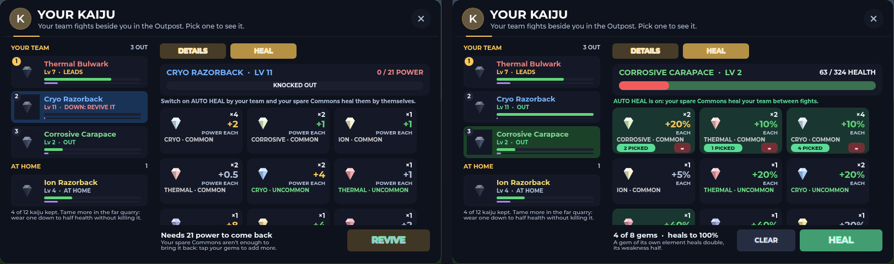

Gems from your pouch are what keep a kaiju going: they heal it, or bring it
back once it's down. They never give EXP (a kaiju grows by fighting beside
you). Up to 25 at a time (`Kaiju.Infuse`), only loose gems
in your pouch (none socketed in your gear), never a Gemsoul.

A gem's **power** is its rarity's, and its element matters:

| Gem | Power | Its own element (×2) | The element that beats it (×½) |
| --- | --- | --- | --- |
| Common | 1 | 2 | 0.5 |
| Uncommon | 2 | 4 | 1 |
| Rare | 4 | 8 | 2 |
| Ultra Rare | 8 | 16 | 4 |
| Legendary | 16 | 32 | 8 |

- **Healing** a hurt kaiju: Common and Uncommon gems heal 15% and 30% of
  maximum health at level 1, before element bonuses. Divide those shares
  by `1 + 0.05 * (level - 1)` as the kaiju levels up. At level 21 they heal
  7.5% and 15%; at level 41, 5% and 10%. Matching elements double healing;
  weakness elements halve it. Rare and higher healing is unchanged.
  The HEAL preview, manual healing and auto-heal use the same calculation.
- **Only out of danger** (`Kaiju.Danger`): not while any of your team out
  has fought in the last 4 seconds, and not with a critter or wild kaiju
  within 45 studs of you (`KaijuServer.inDanger`). HEAL says IN A FIGHT then
  (the server sets `KaijuDanger` on you), and the server refuses a heal sent
  anyway, for any of yours, out or at home, while you're in danger (since
  2026-10-26: gems heal only out of a fight; in one, the support does).
- **Not one that's down**: gems don't revive (see [Knocked out](#knocked-out)).

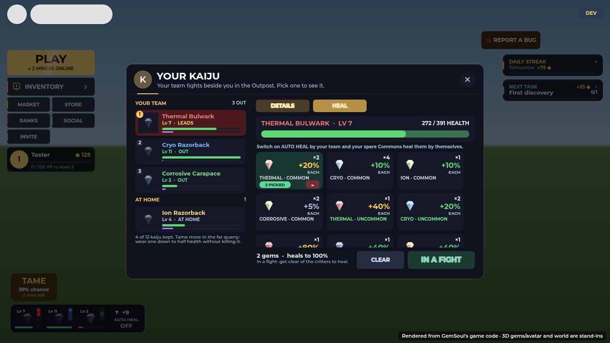

### Knocked out

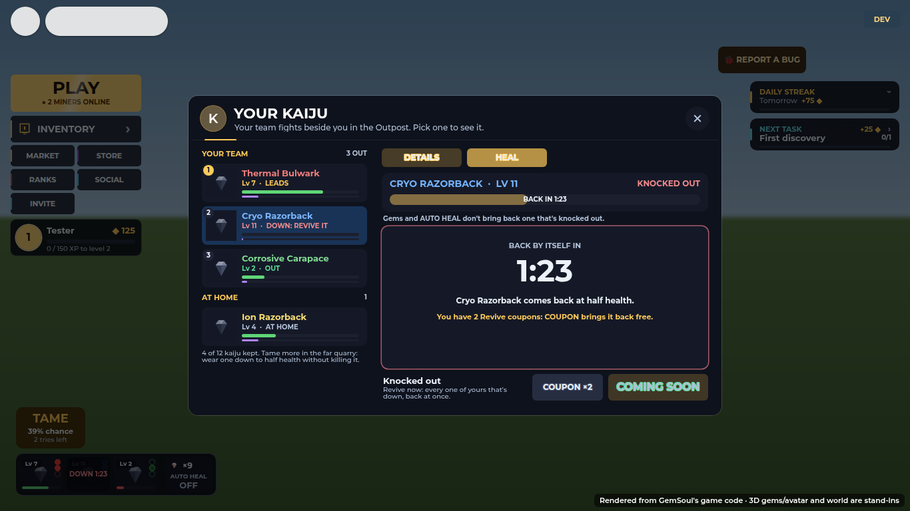

- **Back by itself** once its revive time is up: 60 seconds plus 8 a
  level (a level-11 kaiju waits 2:28), but **weak, at 15% of its health**
  (`Kaiju.Revive.Health`, `reviveSeconds`, `reviveIn`): heal it with gems.
  The gems needed depend on its level and their element (gems heal
  as much as they do any hurt kaiju). The server's upkeep wakes it ("Cryo
  Razorback is back on its feet, but weak: heal with gems before the next
  fight."), at home or out, and the time runs while you're offline too.
  The panel says so while it's down ("It comes back weak, at 15% health:
  heal it with gems.").
- **REVIVE** (R$ 25, the `KaijuRevive` developer product; coins while
  testing): every one of yours that's down, back now, at half health
  (`Kaiju.Revive.Bought`; a Revive coupon too). Paid for when none is
  down any more (it came back while the purchase went through), it becomes
  a Revive coupon instead, so nothing is lost.
- **COUPON**: a Revive coupon (one for every friend who joins on your
  invite) does the same for free. Kept when none is down.
- The HEAL tab shows a countdown in place of the gems (BACK BY ITSELF IN
  2:28), the strip's tile says DOWN 2:28, and the panel's line says when it's
  back.

### The HEAL tab

1. **At the top**, its name and level, and its health bar: what it has now,
   and, lighter, what it'll have after the heal (`63 / 324 HEALTH`). One
   that's down shows KNOCKED OUT and how long till it's back.
2. **Under that**, whether AUTO HEAL is on.
3. **Your gems**, a card for each rarity and element: the gem itself (a 3D
   view of one of them), how many you have, and what each heals (`+20%
   EACH`, gold for its own element, dim for its weakness). Commons come
   first, then rarer, its own element first in each.
   Tap a card for one more of it; **-** takes one off. The card says how
   many are picked.
4. **At the bottom**, what the heal does (`3 gems · heals to 100%`, or
   `4 of 8 gems` when it needs fewer than you picked), and **HEAL**
   (**FULL** when there's nothing to heal, **IN A FIGHT** while you're in
   one). **CLEAR** takes the
   picks off; with none picked, **AUTO PICK** puts them back.

Opened, it has your **spare Commons picked already**, as many as bring it to
full (`Kaiju.healPick`): one tap of HEAL does it. Spare means loose and not
named by a saved loadout. In each card the spare gems go first, then the
least valuable, so a heal spends what you'd miss least. The picks follow
its health (a fight, a heal) until you change them yourself. The server
takes only the gems it uses, and checks
every one is yours and loose (`KaijuServer.infuse`, `Kaiju.infusePlan`).

This replaced the INFUSE tab: a list of every stone, each with a tick box,
and PICK FOR ME.

### AUTO HEAL

Switched on (the strip's AUTO HEAL; `KaijuAutoHeal`, kept as the roster's
`AutoHeal`), your **spare Commons, then your spare Uncommons**, heal your
team by themselves (`Kaiju.AutoHeal.Tiers`, `Kaiju.autoHealPick`,
`KaijuServer`):

- **Commons first.** An Uncommon is taken only once every spare Common is
  used up: while one Common is left, even one too strong to fit, it waits
  rather than spend an Uncommon.

- **A hurt one**, only out of danger (`Kaiju.Danger`: no fight for 4
  seconds, no critter near). Only Commons that fit are used: it never spends
  one that would heal past full (`Kaiju.healPick`), so it can stop a little
  short.
- **Not one knocked out**: that one comes back by itself, or by REVIVE or a
  coupon.
- At most one round every 1.5 seconds (`Every`), all of the team that needs
  it in that round.
- **Never** a Rare or rarer gem, a gem a saved loadout names, or a Gemsoul.
  Only in the Outpost, out of fights, matches and expeditions.
- **Quiet**: the kaiju glows and the strip's count drops. Running out is
  said once ("Auto heal is out of spare Commons and Uncommons...").

It's **on by default** (`Kaiju.AutoHeal.Default`) for new saves and saves
without a preference. An explicit OFF choice stays off. Players can toggle
it in the kaiju HUD; only spare Commons and Uncommons are consumed.

## The arena (phase 2)

One kaiju against one, two players. Every match is for keeps: the winner's
kaiju gets EXP and the winner takes the loser's Gemsoul. The losing kaiju
goes with it.

Proposed guardrails:
- A kaiju fights there from level 5, and only against kaiju within three
  levels of it.
- The same two players can't stake against each other again for six hours.
- You can't stake your last kaiju.

## Phases

1. **Phase 1 (in the game now):** three kaiju out at once (the beta opens
   all three slots) from the starter roll, wild kaiju, taming, moon bugs,
   healing (and AUTO HEAL), recall, hunting.
2. **Phase 2:** slots opening with level (10, then 20), and the arena.

`Config.Features.Kaiju` turns all of it off.

## In the code

| Where | What |
| --- | --- |
| `Shared.Kaiju` | The rules: kinds, stats, EXP, health that stays (`health`), healing (`Infuse`, `infusePower`, `infusePlan`, `healPick`, `AutoHeal`, `autoHealOn`, `Danger`), knocked out (`Revive`, `reviveSeconds`, `reviveIn`), the starter roll (`RollVersion`, `rollsOwed`), taming, the hit spread, slots, Gemsouls and the levels their moves wake at (`MoveLevels`, `move`, `moves`), a kaiju's own moves, its role's (`kitMove`, `kitMoves`, `role`, `moveInfo`), its gem surge (`gemSurge`, `GemSurge`), how each move lands (`AbilityPlans`), the roster, sizes (`Scale`, and next to you: `size`), packs and a wild one's day (`Wild`, `Roam`, `mood`), fighting as a team (`Squad`), how critters fight and their moves (`Bug`, `BugMoves`) |
| `Shared.Squad` | Fighting as a side: sharing out foes (`assign`, `cost`), places round a shared foe (`slots`, `toward`), keeping clear (`apart`) |
| `Shared.KaijuFight` | How they fight: each kind's blows and timings, guard, parry and hops (`resolve`), what a foe reads off one, the brain's view |
| `Shared.KaijuRoster` | The 28 kinds beyond the first four: stats, where they roam (`Habitat`), their own kits and moves, fight styles and voices ([kaiju-roster.md](kaiju-roster.md)) |
| `Shared.KaijuModels` | The models: `build(kind, element)`, `scale(model, s)`; the trunk on a `Body` joint; a flyer's hover (`KaijuHover`) |
| `Shared.KaijuShapes` | The roster's 28 models, their hides (`Hides`) and hovers (`Hover`) |
| `Shared.CreatureMotion` | Their walk (`Stride`), arms (`Arm`), jaw and tail, wings (`Wing`) and heads (`Head`), and every kind's fight poses (`Fight`, `fight`, `apply`) |
| `Shared.GemTraits` | The moves a Gemsoul rolls (`SoulMoves`); an old one's seeded into them (`traitsOf`) |
| `Shared.KaijuRoles` | Each kind's role and the roles' own moves; how a kaiju fights by its role in a battle (see [kaiju-arena.md](kaiju-arena.md#roles-an-auto-battler)) |
| `Shared.Spar` | `Spar.hunting`: the kit out alone |
| `KaijuFighter` | A kaiju in a fight (yours or a wild one): reads its foe (a critter's wind-up too), asks the brain, winds up, strikes, guards, hops, casts its E, its Q in place of a blow, its R when hard pressed (`setMoves` after a level) and its gem surge when it's due (`GemSurge`), on its side of a shared foe and clear of its own (`Flank`, `Apart`); the attributes clients pose it by |
| `KaijuBattles` | Kaiju battles between two players (see [Kaiju battles](kaiju-elements-battles.md#kaiju-battles)), fought on the courts of the [Kaiju Arena](kaiju-arena.md) |
| `KaijuPitServer` | The Kaiju Arena downstairs: its stairs, pads, stakes and courts ([kaiju-arena.md](kaiju-arena.md)) |
| `KaijuServer` | Your team: the starter roll (`KaijuRoll`, `KaijuRollClaim`, kept in the profile's `KaijuRoll` till claimed; `KaijuRolled` once it is), the team out and back, each in its place (`KaijuSlot` on the model), following (pottering round you when you stand about) and fighting, hurt by element and its guard, its health kept in its record, knockout (down till its revive time is up: `Down` and `DownUntil` on the record, `KaijuDown_<id>` on you; `reviveAll` for REVIVE and coupons), danger (`inDanger`, `KaijuDanger` on you), recall, the team and its lead (`KaijuTeam`, `KaijuActive`), healing any of yours (`KaijuInfuse`), AUTO HEAL (`KaijuAutoHeal`, healing with spare Commons, then Uncommons, between fights); `all()`, `team(player)`, `pets()` (each player's lead) for the rest of the server |
| `KaijuWilds` | Wild kaiju in packs (dens, wandering, moods, `KaijuMood` on the model; a pack shares its foes), the vein guardian (`veinSwing`, `veinMoved`) and moon bugs: spawning (`spawnBug`: one out of a rift at its band's level, at its prey, or roaming a wandering rift), their brain, sharing out your kaiju, how they fight (bites, hops, dodges, their moves, bombs), slipping back through a rift, their pay, the pick's `bonk`, the spread on blows (`TakenScale`, applied by `Enemies.damage`), kills, taming (`KaijuTame`), who started a fight with each (`KaijuChallenge`, its Challenge prompt, or a hit) |
| `FrontierServer` | Where and when rifts open and moon bugs come through ([frontier.md](frontier.md)) |
| `KaijuAbilities` | Every move a kaiju casts: where it lands, on whom, and its look, all at its caster's size (`Size`; effects sent `"Sized"`); its R's shell, ward or mend (`soak`, applied by `KaijuServer.hurt` and, through `Soak`, `Enemies.damage`) |
| `SparServer` | `Hunt`: the kit out alone |
| `Shared.KaijuBeam` | The HYPERBEAM's rules: its charge (`Charge`, `gain`, `ready`), its timeline and phases, the formation and the leaps into it (`Leap`, `leap`, `leapHeight`, `arc`), the beam's reach (`hits`), the aim assist (`aim`), what it takes and how it swings (`threat`, `order`, `sweep`, `direction`) and its damage |
| `KaijuBeamServer` | The team's charge on your profile (`BeamCharge`; `KaijuCharge` and `KaijuSave` on you), SAVE CHARGE (`KaijuSaveCharge`), the blast (`KaijuBeam`): the formation, holding them still, the pulses, letting go |
| `KaijuHud` (client) | The kaiju card (a computer's three by two: the team and the support two by two, AUTO HEAL over the HYPERBEAM; a phone's two rows; on a computer AUTO HEAL over the HYPERBEAM's tile, its key Z on it), the team keys 1 to 4, CATCH, a wild kaiju's Challenge, the kaiju panel and its HEAL and TEAMS tabs, and the roll in the Outpost for a player still owed one |
| `KaijuRoll` (client) | The starter roll's screen, on the intro gem roll's reels (`KaijuRoll.Frame` frames the kaiju in each window): in the intro after the move reveal (`Intro.client`), and in the Outpost (`KaijuHud`) |
| `KaijuBeamHud` (client) | The HYPERBEAM: a tile, its rim the meter (the charge, READY, SAVE); on a computer on the kaiju card under AUTO HEAL, its key Z on it; on a phone a button of its own right of the team keys; Z / tap |
| `KaijuBeamFx` (client) | The blast on screen: the rune circle, each leap carried along its arc and slammed down, the roar, the auras, the streams and orb, the beam turning onto its targets in turn; your flash, grade and bloom, no camera takeover (`flight`; `tools/vfx_sim.luau`'s Hyperbeam renders it from your eyes) |
| `KaijuTaming` (client) | The gold glow and READY TO CATCH on a kaiju that can be caught, the tame's beam and motes (from `KaijuTameBy`, for everyone), the tamer's cast bar and its result (`TameResult`) |
| `CritterFx` (client) | A gem raid's snatchers on screen: their giggles and cackles with "hee hee!" over them, and a dropped gem flying back ("GOT IT BACK!") |
| `FxSize` (client) | How big the effect being drawn is: a creature's size, held while its effect draws (`run`), kept through its delays and frame loops (`keep`); `CombatFx`, `CombatSound`, `CombatVfx`, `MoveVfx`, `TriadVfx` and `ElementalDeath` draw at it |
| `CreatureAnimation` (client) | Moves kaiju in `workspace.Kaiju` and wild ones in `workspace.Enemies`: their walk, their fight poses and their moods (`KaijuMood`: `CreatureMotion.Moods`) |
| `KaijuView` (client) | Which way your camera looks along the ground, told to the server (`Remotes.KaijuView`) when it turns, so your team stands where you can see it (`Kaiju.leadSpot`) |

`tests/run_kaiju_roll.py` runs the roll's screen on a stand-in clock: the
reels (yours on the third cell, three different kaiju in sight while they
spin, each named with its rarity), the cards landing in turn with only
yours left in the window, the cards filled in (name, Gemsoul and rarity,
stats, what it's like, moves ready and asleep), each one dropping onto its
stage and settling, no button to press (no "meet your team"), the claim on
its own a moment after they're down, a failed one saying so with TRY AGAIN,
a click landing them all, and a phone's shorter cards.

Tests: `tests/run_kaiju.py` checks the rules (your team's order, filling
and size, the roll owed and its picks never repeating a kind and element)
and how they fight (each
kind's style, guard, parry, breaks, hops, reads, the brain's choices),
builds every kind in every element (joints, feet on the ground, part
budget, motions, every fight pose), and runs the server against stand-ins:
the starter roll (three, the same when asked again, nothing out before the
claim, the three rolled out as the team after, never twice, given anyway
after a while in the Outpost, and a player who took the old top-up roll
owed a full three once), every creature effect sent at its size (a pet's,
a wild one's, a critter's), your team (three out, one knocked out leaving the
others, recall and EXP for all of them, LEAD, SEND OUT, the checks on a new
team, a knocked-out one staying down and in its place, health kept with no
healing on its own, healing with gems (its own element's gems counting
double, only loose gems, never a socketed one, never mid-fight, never one
that's down), knocked out (back by itself at half health once its time by
level is up, not a moment before, weak at `Revive.Health` and `Weak`, a
weak one's 20% taking six Commons not two and no longer weak once full,
gems refused, `reviveAll` at `Revive.Bought` and not weak), AUTO HEAL (off till switched on, not
mid-fight, only spare Commons that fit, then an Uncommon once the Commons
are gone, never a Rare or one a loadout names, never a revive, out of
gems said once), fighting as a team (3 on 3 one each, 3 on 1 all
in from three sides, 2 on 3 one each and the collapse when one falls, 2 on 10
never doubled up with the critters five and five, two on one spot pushed
apart; a critter's bite winding up and hopping back out, its hop clear of a
blow coming, each kind's move landing where it should and nowhere else, a
bomb missing a kaiju that moved off; a pack on two kaiju taking one each and
on one flanking it; and twelve seconds of three kaiju on six critters walked
through), every move lands where it should (an R's shell, ward, mend, aura and
burst too), your kaiju's moves follow its level, its Q goes off in place of
a blow and waits its turn, its R goes up when it's hard pressed (not
before), a shell soaks blows till it breaks and a ward takes its share, on
your kaiju and a wild one, your kaiju comes out, fights with wind-ups,
is hurt by element, knocked out and revived, recalled, switched, wild
kaiju take the spread and pick their foes. A wild kaiju leaves a miner, a
hunter and your kaiju alone till someone challenges or hits it, and forgets
them once home; your kaiju (and its E) leaves it be till then. Its Challenge
prompt is off from the challenge till it forgets, and while it's being
tamed. Heavies break
guards, parries leave the attacker reeling, a wild kaiju hops from a
hunter's charged heavy, the E winds up on the cast bar, a whole duel
between two kaiju, kills pay their Gemsoul and EXP, taming (range, half
health, the cast holding it untouchable and still, breaking when you stray
or are hit without spending a try, your kaiju leaving it be, the roll at
the end, tries, burrowing, a full roster), moon bugs' coins and daily cap,
and the rifts: who they open round, the caps, a bug hopping out at its prey
(a miner too), giving up and slipping back. The vein guardian: its level,
health and where it sleeps, waking on the third swing at its own vein
(not another's), going for a plain miner, everyone mining its vein once
awake, not burrowing of old age, back to sleep, moving with its vein, and
its coins, with no new one until the vein moves. A wild kaiju's day: ten
simulated minutes in which each one walks and stops to sniff, look, rest or
roar, keeps to its range and out of the core and keep-out zones, keeps near
its packmate, while the dens move on; the guardian paces and naps; stopping
to look at someone close and leaving them be; your kaiju pottering round you
and following when you move. A packmate close by joining in when you
start on its mate (not one far off), and a wild kaiju never walking into a
wall. A critter going for your kaiju rather than you, your kaiju going for
it, the bites landing on the kaiju; recall it and the critter comes back to
you, and another miner's critter is drawn by your kaiju too. Defending
you: a ranged foe kiting off is let go once it's further than
`Kaiju.Follow.Chase` from where the fight began (and they come home), one
just short of that is kept; walking 70 studs off mid-fight they stay on
their foe; a critter on you, or on your support, takes them off a brute
elsewhere; they stand where your camera sees them (junk from a client
ignored); and 100 s at the Edge with the rifts open, none ever more than
65 studs off and a critter on you or your support with none of yours on it
for 8 s at most in all. A rock mined
with it out gives it EXP by the rock's size (none while it's down), and a
long session's rocks make a young kaiju a few levels. The Outpost for
fifteen minutes: a miner at
the Edge drawing critters while the wild kaiju roam and their lifetimes run
out; no brain errors, the critters within their caps, never a moment
without wild kaiju (the old fixed lifetimes left the quarry empty for 90
seconds every ten minutes), and nothing piling up.
`tests/run_fx_size.py` checks the client's effect size (held while an
effect draws, kept through its delays and frame loops, never lent to
another effect, clamped, a body's size by its height), and
`tests/run_hit_shake.py` a quarter-size kaiju's shake.
Enchants and names (`tests/kaiju_cases.luau`, `tests/kaiju_server_cases.luau`):
a gem of another element never enchants it, whatever its rarity, with the
right refusal ("an Ion gem", "an Ion kaiju"); one of its own does, any
rarity; `enchanted` gives a rarer gem's stats and surge and leaves the
kaiju as it was; an old enchant of another element keeps its rarity's stats
with no surge; on the server, a Thermal gem refused for a Cryo kaiju, a
Legendary Cryo one in (its stats, its surge, the old one back in the
pouch), not mid-fight, not someone else's. Names: `cleanName` on good names
(spaces tidied, accents, `-`, `'`, `.`) and bad ones (`_`, an emoji, tags,
only digits, too long), `nameOf`; on the server a name through the filter
(once), on its body out, someone else's kaiju refused, a filtered name
refused, the filter down refused, two renames at once refused, "" back to
its title.
The rules also check every Gemsoul's three moves (waking at 5 and 10),
every move's plan, an old Gemsoul's seeded Q and R, and each key's power;
and the gem surge: always its Gemsoul's E and its element's, with a plan to
cast it, none from a plain gem, a Legendary's much harder than a Common's.
`tests/kaiju_server_cases.luau` checks a kaiju casts it when it's due (named
on its cast bar, its own cast time, not again straight away, not while
stunned) and a wild one has its own; `tests/kaiju_roles_cases.luau` that
battles cast them, with the balance checked with every kaiju's gem surge in. `tests/kaiju_models_cases.luau` checks each mood's pose (a held kaiju
crouches and struggles). `tests/run_kaiju_taming.py` drives the taming
screen: a weakened kaiju near you glows with READY TO CATCH and its chance (a
healthy one, a far one, one being tamed or one out of the Outpost doesn't),
the glow pulses, a cast draws two beams from your hand and twelve motes
that close in, the bar fills, and it ends on CAUGHT! or CATCH BROKEN and
goes.
`tests/run_spar.py` covers hunting, and `tests/run_mobile_layout.py` the
card's place on every phone. `tests/run_body_health.py` covers health on
the body (the tint, the flash, the smoke, a heal, the glows left alone).
