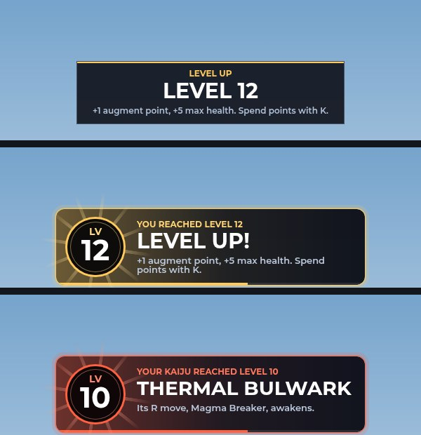
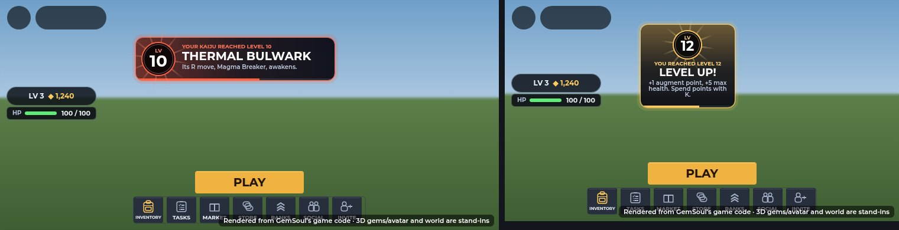
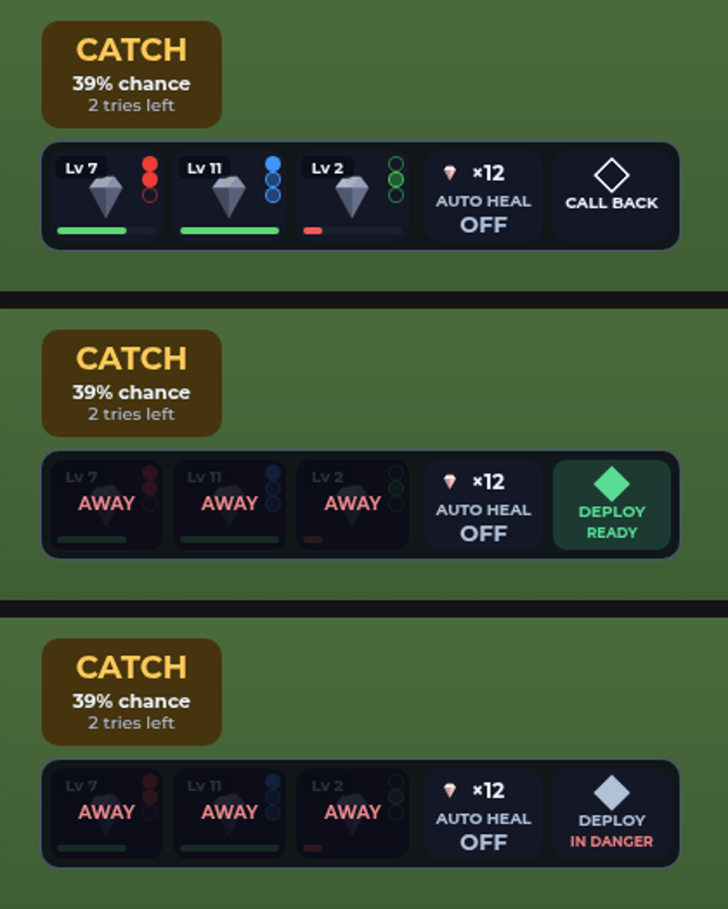
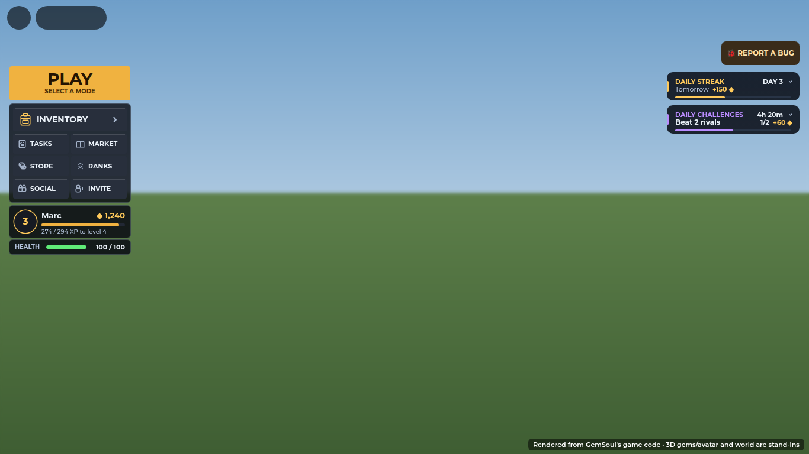
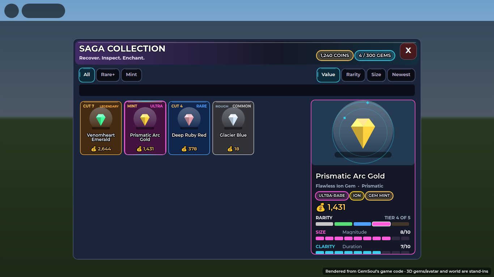
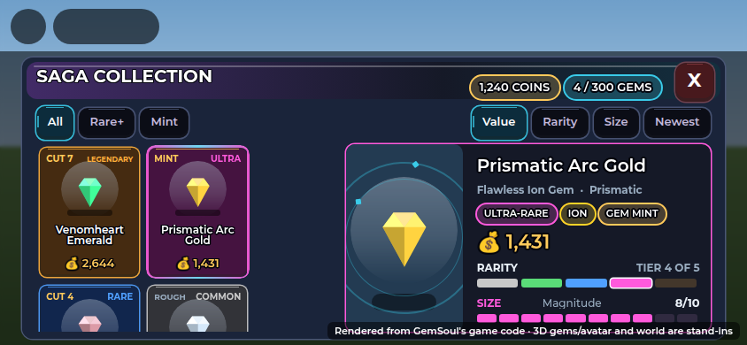

# Level ups, CALL BACK / DEPLOY, the lobby card and buttons, the gem card's value

A round of fixes and additions alongside the Rift (`docs/rift.md`). The
UI pictures are the client code rendered by the UI harness, not Roblox
screenshots.

## Level ups

`Client/LevelUpFx`, sent by the server through CombatFx so everyone near
sees them:

- **A miner's** (`Progress`): a column of amber light out of the ground,
  two rings running out over it, sparks spiralling up round the body, a
  flash, and the new level on a plate over the head. You also get your
  level-up card at the top of the screen (below).
- **A kaiju's** (`KaijuServer`): the same in its element's colour, at its
  size. Its card says what the level brought ("Its Q move, Tidal Crush,
  awakens." or "More health and damage.").
- Sounds: a climbing chime for a miner, higher and quicker for a kaiju
  (`tools/make_levelup_sounds.py`, `assets/sounds/combat/level_up.mp3`,
  `kaiju_level_up.mp3`; ids in `CombatSound` like the other combat sounds).
- Built from plain parts posed from one clock, gone after 2.6 seconds; it
  follows the body it's on. The plate's words are translated in place.

### Your level-up card

The old card was a flat dark strip with a thin line on top. The new one
(`LevelUpFx.banner`, `cardLayout`, `card`, `poseCard`):

- **A medal** on the left, with the new level in it. The old number rolls
  up out of it as the new one comes in, the medal pops, and sparks fly off
  it. Rays turn slowly behind it. It's amber for you and the element's
  colour for a kaiju.
- **The words:** YOU REACHED LEVEL 12 over **LEVEL UP!**. For a kaiju it's
  YOUR KAIJU REACHED LEVEL 10 over its name (the name shrinks to fit, and
  isn't translated). Under them goes what the level brought, on up to two
  lines.
- **The card:** dark glass washed with its colour from the medal's side,
  a rim and a soft halo in that colour, rounded corners, a shine running
  over it once. A line along its foot runs down while it stays.
- **Timing:** it drops in from above with a little overshoot, stays about
  3 seconds, then lifts and fades (3.8 s in all). One at a time, as before.
- **On a phone** it sits in the top middle, between the pick card and the
  toasts, clear of the loot card. Where there's room (300 points: 812-wide
  phones and up) it's side by side and 72 tall. On 667 and 736 it's the
  medal over its words. While it's up, the live feed steps aside
  (`MobileLayout.claimTop`).

These are the client code drawn by the UI harness, 1.6 s in. They aren't
Roblox screenshots.

## Kaiju levelling, slower

Kaiju were levelling too fast. Both sides of it are slower:

| | Before | Now |
| --- | --- | --- |
| EXP for a level | `80 x level^1.5` | `110 x level^1.65` (`Kaiju.ExpCurve`) |
| EXP per rock mined | Pebble 5, Boulder 8, Monolith 12, Geode 20 | 3, 5, 8, 13 |
| EXP per kill | `40 + 12 x level` | `26 + 8 x level` |

Level 5 to 6 now takes 1,563 EXP (was 894); level 10 to 11, 4,913 (was
2,529).

## CALL BACK / DEPLOY

The strip's AUTO HEAL button is split: **AUTO HEAL** and, beside it,
**CALL BACK**. Called back, your team folds into points of light that fly
to you, and the button reads **DEPLOY**. You can't deploy while you're in
danger: the button shows **IN DANGER** and the server answers "Not while
you're in danger: get clear of the fight first." Deployed, they open out of a shard
of light from you. Sounds: `call_back.mp3`, `deploy.mp3`.

## The lobby card and side buttons

- **Your health** is a bar under the player card (HEALTH, current / max).
  On phones it's a slim HP bar.
- **The side buttons** (PLAY, then INVENTORY and a grid of TASKS, MARKET,
  STORE, RANKS, SOCIAL, INVITE) are one panel with drawn icons and
  hairline dividers instead of loose chunky buttons. PLAY's subtitle reads
  SELECT A MODE, or how many are online and searching.

## The gem card

The pips no longer overlap the labels, on desktop or phones. The card now
shows everything that sets a gem's value:

- **Rarity** and its **TIER n OF 5**;
- **Size** (Magnitude), **Clarity** (Duration), **Cut** (Precision), each
  with its grade and a bar;
- **HOW ITS VALUE ADDS UP**: each grade's points times its weight (Size
  x10, Clarity x5, Cut x15: `Economy.GemWeights`), the grade points, the
  rarity's rate, and the value. A Prismatic Arc Gold: 265 points x 5.4 =
  1,431;
- what it does **IN A WEAPON**;
- Prismatic gems say so in the subtitle.

On phones (short screens) the header is compact, the search is hidden and
the stone sits beside the details.

## The Outpost

- **The searchlights** sweeping the sky outside the FOB are gone.
- **The neon strips** on the ground that marked the trails are gone.
- **Every mech is a Mole drill**: all eight bays in the garage.
- **You spawn facing a mech**: in the garage lane, looking at bay 04's
  Mole drill.
- **The Store's stands** show skins only (a suit alone, no sword or shield
  on the stand) and change every 12 seconds, turning faster.
- **Critters carry the real gem**: a thief holds the very gem it took over
  its head, drawn like the gem art, and drops that stone when you hit it.
- **Kaiju jump with you**: when you jump, your team hops after you one by
  one (0.1 s, then 0.16 s apart).
- **The Rift Veins' beams** are replaced by Rift Gates (`docs/rift.md`).

## Tests

| Suite | What it checks |
| --- | --- |
| `run_levelup_fx` | The column, the rings, the sparks, the flash, the plate, a kaiju's at its size, following its body, gone after 2.6 s, sent and drawn, its sounds. Your card: across the top middle on a computer; on every phone size on the screen, at the top, clear of the pick card, toasts and loot card; its words and a kaiju's name (not translated); the number turning over with sparks, the rays turning, the line running down, gone at the end; its Spanish |
| `run_kaiju` | The EXP curve and mining EXP; CALL BACK, DEPLOY and its danger check; kaiju jumping after you; `restoreAll` |
| `run_gem_metric` | A gem's worth: grades, weights, points, rate, value |
| `run_critter_fx` | The carried gem is the real gem |
| `run_store_displays`, `run_quarry_life`, `run_moon_quarry_scene`, `run_outpost` | The stands, no searchlights, Mole drills in every bay, the spawn facing one |
| `run_mobile_layout` | The lobby card and buttons on phones |
