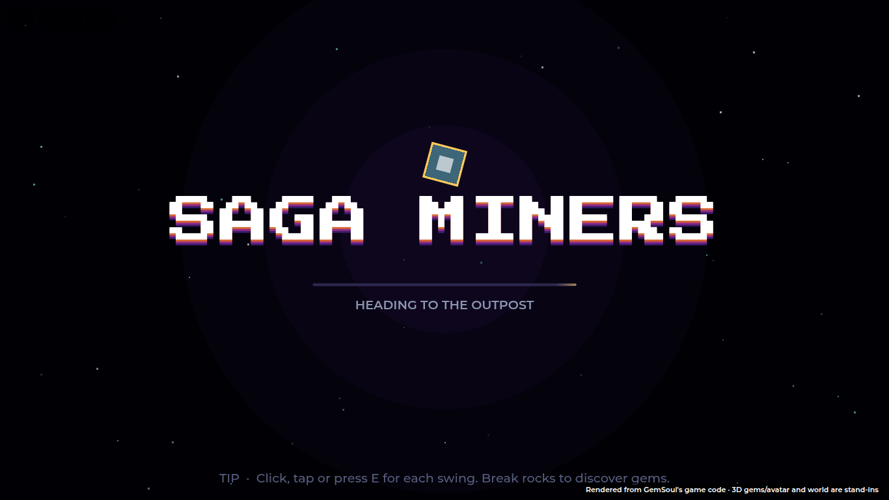
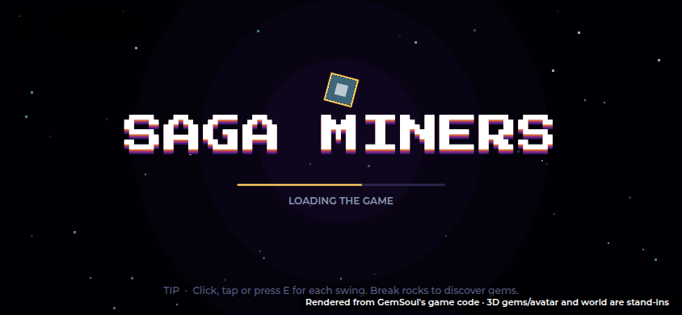

# Loading screens

Nothing is shown half loaded. The loading screen covers the view whenever it's
about to change and stays up until what's behind it is ready. That's at least
a moment (so it never just blinks) and never longer than a safety limit.



A phone held sideways gets the same screen, slightly bigger, with the tip
pinned to the bottom edge:



The status line says what it's waiting on: *Loading the game*, *Heading to the
Outpost*, *Loading the area*, *Landing*, and so on. The bar shows real progress
while joining and sweeps otherwise. Tips rotate every five seconds. The screen
takes clicks and taps, so nothing behind it is pressed by accident.

## When it shows

| Moment | Up until |
| --- | --- |
| Joining (from the very first frame, in place of Roblox's own) | the game is loaded, your miner has spawned, and the title screen is built with its art and music downloaded; at least 1.2 s |
| CLICK TO ENTER on the title | the starter intro is up with its images downloaded, or you're standing in the Outpost |
| The starter intro closing | your first fight's drop screen takes over, or you're in the Outpost |
| Going to the Outpost (lobby, unstuck, after the mine) | you're in the basin, on loaded ground, with the camera on you |
| A fight ending | you're back in the Outpost |
| A duel, raid or dungeon starting | you're in place (the Arena's own drop already has its own screen, so not that) |
| Respawning | you're back in the Outpost |
| The mine, down and back | you're standing in the mine, or back in the Outpost |
| Any other jump of 100+ studs in one frame | you've landed and the area round you has loaded |

## What "ready" means

What's behind counts as ready once it is either:

- a full-screen view of its own: the title, the intro once its images are
  down, or the Arena drop's screen; or
- the world, with all of these true: you're alive and somewhere you belong
  (the Outpost, a fight, the mine), within 80 studs of where you were headed,
  standing on loaded ground, with the camera on you, not still being moved,
  and the area's downloads finished (or 2.5 s spent waiting on them).

Every cover stays up at least 0.8 s and at most 12 s, so a stuck scene can't
hold you behind it.

## Where it lives

- `src/first/LoadingScreen.luau` (ReplicatedFirst): the screen itself, and the
  covers that want it up.
- `src/first/Loading.client.luau` (ReplicatedFirst): joining.
- `src/client/Modules/LoadingFlow.luau`: when each scene is ready. The other
  moments are watched by `LoadingFlow.start()`, run from `Lobby.client`.
- Scenes ask for it directly: the title (`Splash.client`), the intro
  (`Intro.client`), `OutpostScene` and `MineScene`.

It never stands in the game's way. If `ReplicatedFirst.LoadingScreen` is
missing from the place (for example, Rojo was already running when the project
file gained it, so it never synced) or it breaks, the game starts and runs
exactly as before, just without the cover. The console then says
`[LoadingFlow] no loading screen …`. In Studio, ReplicatedFirst should hold
`Orientation`, `LoadingScreen` and `Loading`; if it doesn't, restart
`rojo serve` and reconnect. A screen that errors while it's up takes itself
away.

To cover something new:

```lua
local cover = LoadingFlow.hold("Mine", { FadeIn = 0.25, Destination = LoadingFlow.home })
LoadingFlow.waitCovered(1) -- before moving anything
-- ...move the player; if the request fails: cover.cancel()
```

Tests: `tests/run_loading_screen.py` (lune).
