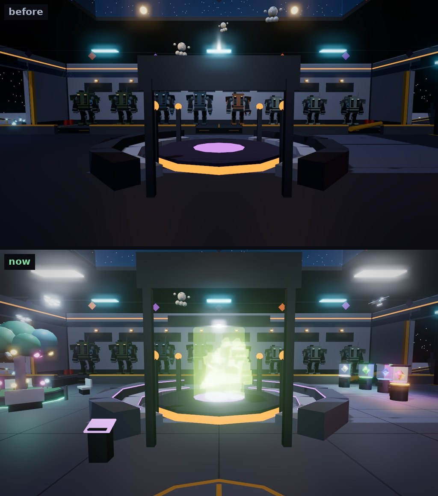
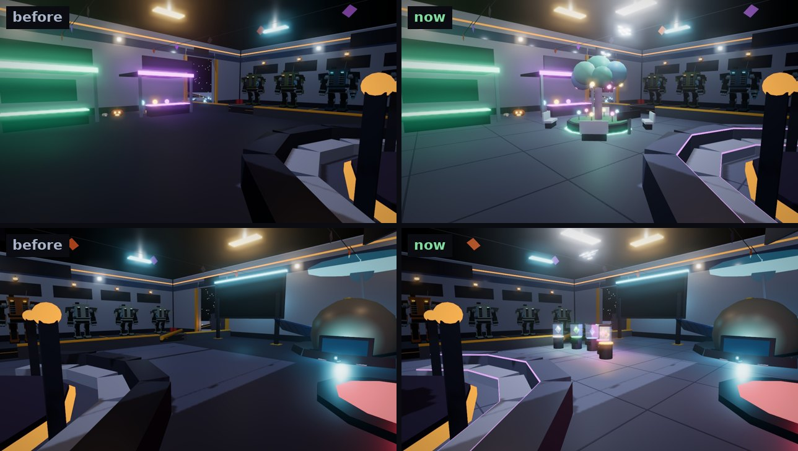
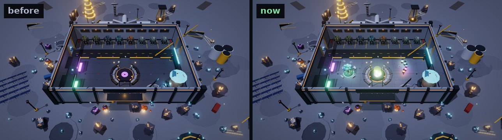
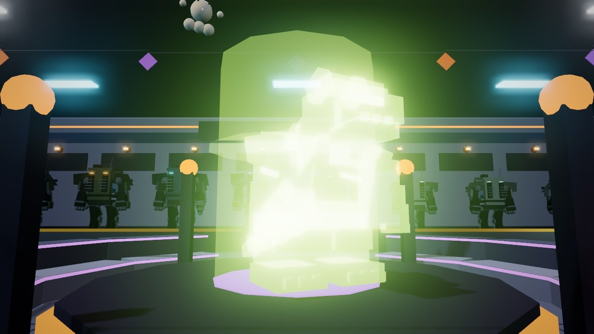
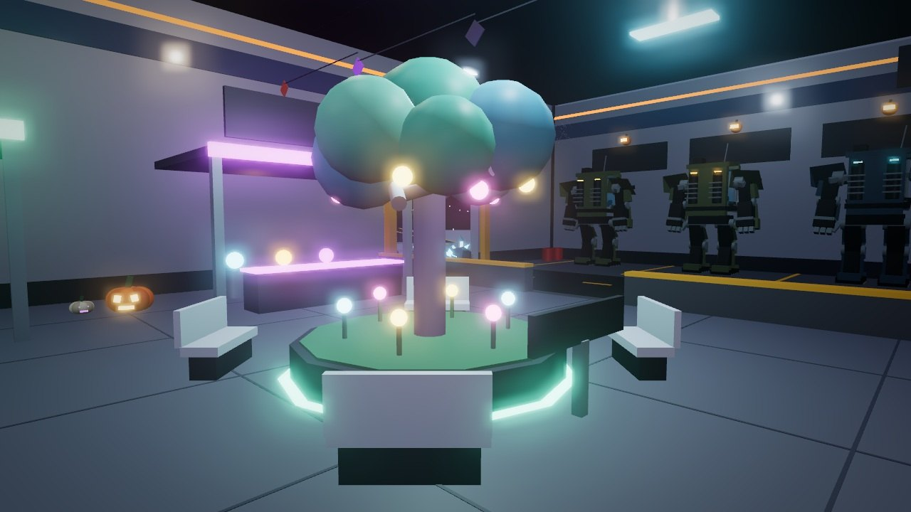
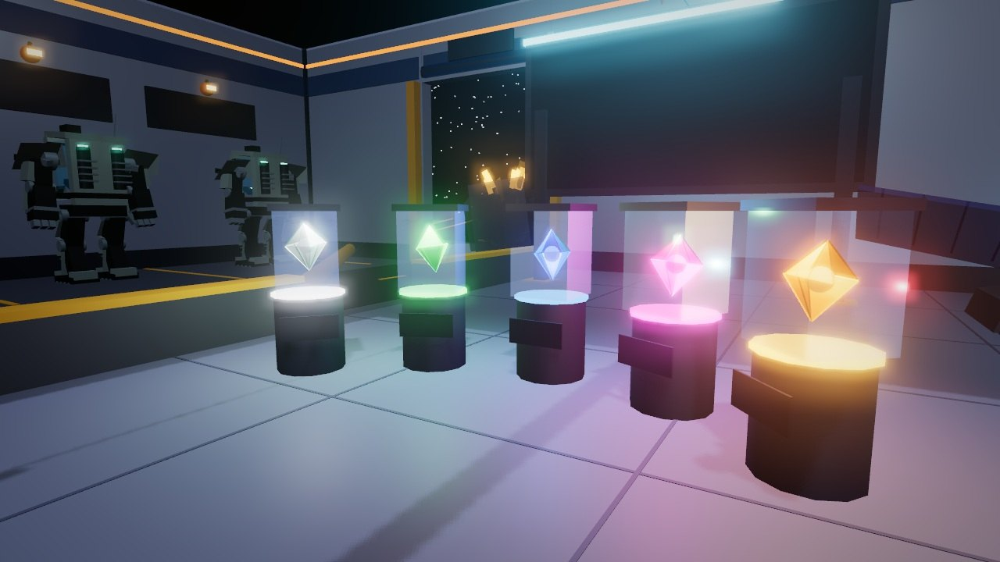

# The lobby: polished and filled in

*Since then (2026-10-22): plain one-word signs, and the Shelter's floor cleared (no PROBE-7 station, duel gate, stands or survey table; PROBE-7 and Brutus are crew; the Gem Gallery is next to the Market). See [plain-signs.md](plain-signs.md).*

This round makes the Shelter, the Outpost's lobby, nicer to stand in, and
gives it more to look at:

- a polished tiled floor, with a compass rose where you arrive;
- even lighting across the hall;
- a kaiju hologram on the arena stage;
- the Moon Garden, with benches you can sit on;
- the Gem Gallery, with the mining odds;
- drones overhead;
- a softer finish on the Outpost's light: neon glows, colours are a little
  richer.

The images are offline renders of the game's own code: the Shelter from
`OutpostWorld`, the moving parts from `ShelterLife`, lit by the Shelter's
own lamps. The renderer isn't Roblox's: it doesn't draw sign text,
particles, Roblox's bloom or the hologram's ForceField shimmer. Check the
look in a Studio playtest.

## The hall

**Floor.** The hall's floor was a dark slab. It is now pale, polished
tiles, with darker seams every 12 studs.

**Compass rose.** Where you arrive, a gold compass rose is set in the
floor, with a light at its heart.

**Light.** Six cool white panels now run down both sides of the
skylight. Before, the hall's corners sat in the dark, and only four amber
lamps and the arena's two hung lights lit the room.

**Arena stands.** They were black blocks. Now they're pale steel, each
tier's front edge lit violet. The KAIJU ARENA sign is raised, clear of
the hologram.

## The kaiju hologram

A kaiju in light stands on the kaiju arena's stage, turning slowly:

- **Every 12 seconds the next one flickers in.** A scan of light sweeps
  up through it. It goes through all 12 kaiju, each species in each
  element, and both change every time.
- **Its name hangs over it,** for example BULWARK and "FIRE KAIJU · ARENA
  OPENS SOON".
- **Everyone sees the same one.** It runs on the server's clock.
- **The projector's console** by the stage's way in has a **Next kaiju**
  prompt (E). It skips to the next kaiju for you alone.

The kaiju are the game's own models (`KaijuModels`), at 2.2 times size,
in the ForceField material. Their plates are tinted in the element's glow,
and their eyes and vents shine.

## The Moon Garden

*Since then (2026-10-20): the Moon Garden is the survey table. See [fob-serious.md](fob-serious.md#the-hall).*

The Moon Garden is on the west side of the hall, between the Store and
the Market:

- a planter ringed in teal light on the floor;
- a lunar tree with a teal canopy and glowing fruit;
- crystal flowers round the trunk;
- **four benches facing the tree, which you can sit on** (seats);
- fireflies drifting over it.

Its sign reads MOON GARDEN, TAKE A SEAT.

## The Gem Gallery

Five glass cases on lit plinths stand in an arc in front of the
leaderboard, one for each rarity, Common to Legendary:

- **The gems.** A gem in the rarity's colour turns and bobs in each case.
  The Legendary sparkles.
- **The odds.** Each plinth shows its rarity's odds out of every gem mined
  (60%, 25%, 11%, 3.5%, 0.5%). They're read from
  `GemRoller.MiningWeights`, so they stay right if the odds change.
- **The name.** GEM GALLERY, WHAT A ROCK CAN PAY floats over the middle
  case.

## Overhead

- **Drones.** Three maintenance drones fly slow loops round the hall, each
  with a blinking eye and a spotlight on the floor under it. They stay
  under the bunting and clear of the tree, the signs, the lamps and each
  other.
- **Dust.** Specks drift down through the skylight.

## The Outpost's look

**The finish** (`Scenes.OutpostFinish`, set as you enter the Outpost):

| | Before | Now |
| --- | --- | --- |
| Bloom | 0.08, size 20, threshold 2 | 0.3, size 24, threshold 1.6 |
| Grade: contrast / saturation | 0 / 0 | 0.08 / 0.08, a cool tint |
| Sheen on metal (specular) | 0.2 | 0.35 |

- **Bloom:** neon now glows softly round its edges: the Shelter's trims,
  the rocks' crystals, the hologram.
- **Grade:** a little contrast and colour, so the scene doesn't look flat.
- **Still the same:** there's no haze, so space stays black, and no lift
  in brightness. The scene test holds both.
- **Fixed:** the grade did nothing before in menu-only mode, because the
  server's space lighting makes no grade. The Outpost now makes its bloom
  and grade when they're missing.

**Future lighting.** `default.project.json` now sets Lighting's
Technology to Future. Lamps then light and shade the hall properly, and
metal and glass catch the light. If you publish from Studio rather than
from a Rojo build, set **Lighting > Technology** to **Future** there too.

## Cost

- **What the server builds** grows by 116 parts: 3,944 of the 4,000 budget.
  That's the floor seams, the compass rose, the panels, the garden, the
  gallery's plinths and the stands' edges. Six panel lights and five case
  lights were added.
- **What your own client draws** (`ShelterLife`): 177 parts.
  - The server sends none of them.
  - None collides except the console. None casts a shadow or can be
    clicked, so a click still swings at a rock.
  - They're there only while you're in the Outpost and within 320 studs of
    the Shelter.
  - They move 30 times a second, in one bulk move.

## Tests

| Suite | What it covers |
| --- | --- |
| `tests/run_shelter_life.py` (new) | The hologram: on the arena's stage, inside it and under its sign; one kaiju at a time; every kind in every element; none alike in a row; its name facing the door; the console's prompt. The gallery: a gem in each of the server's cases, staying in it; the odds on each plinth add up to every gem mined and face the hall; the Legendary sparkles. The garden: four benches round the fireflies. The drones: in the hall, under the bunting, clear of the tree, the sign, the lamps and each other, never jumping. Nothing clickable or shadowed; the part budget. |
| `tests/run_moon_quarry_scene.py` | The scenery budget (3,944 of 4,000); the finish made on a fresh entry and not overdone; the daytime grade, haze and rays reset on the way in |
| `tests/run_lang.py` | The console's prompt in Spanish |
