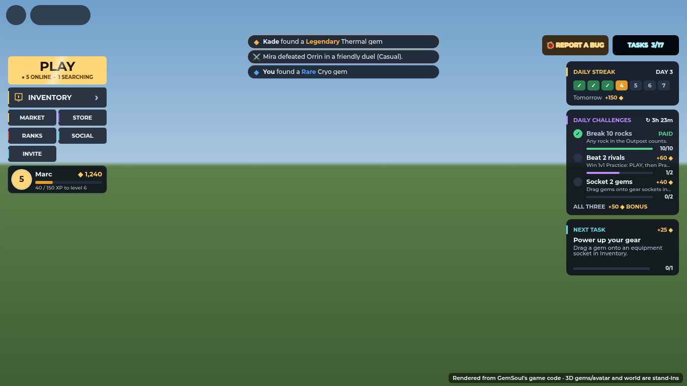
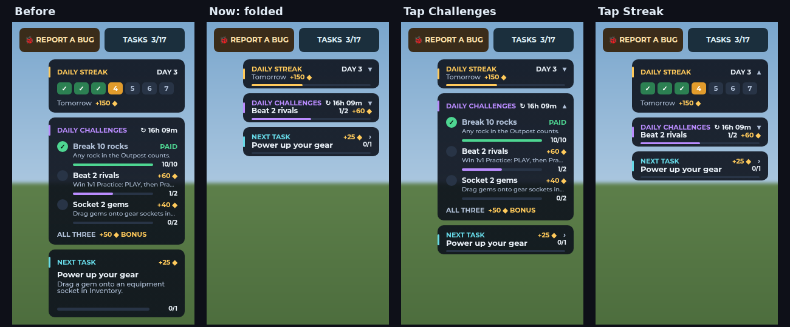
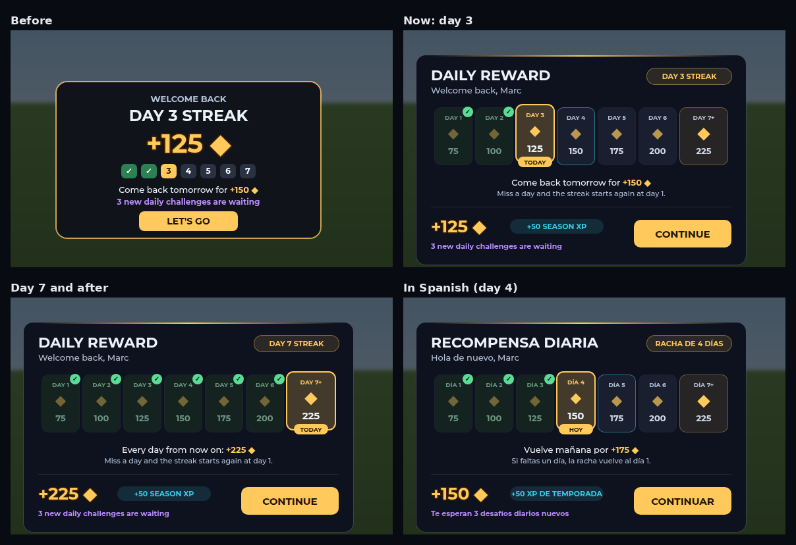
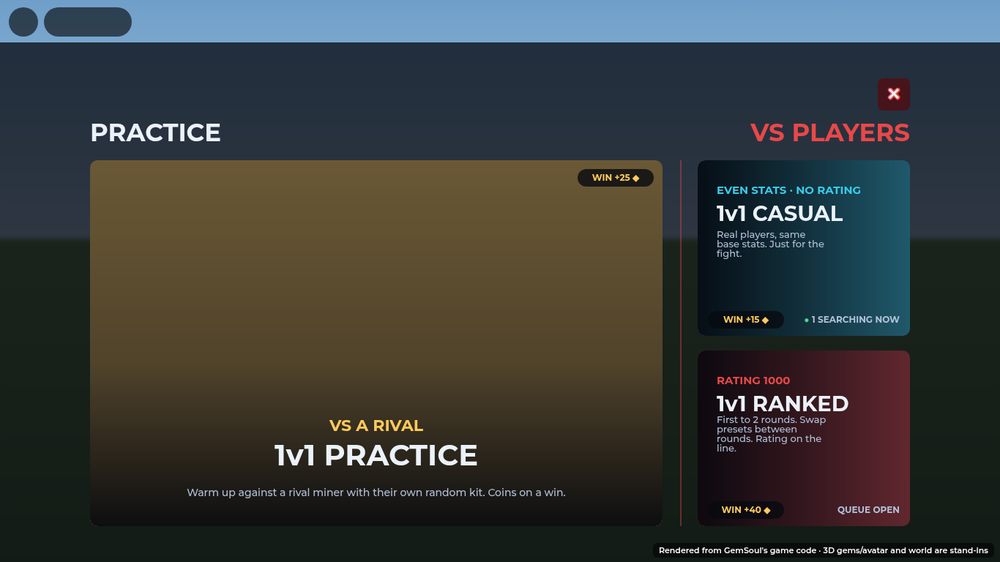
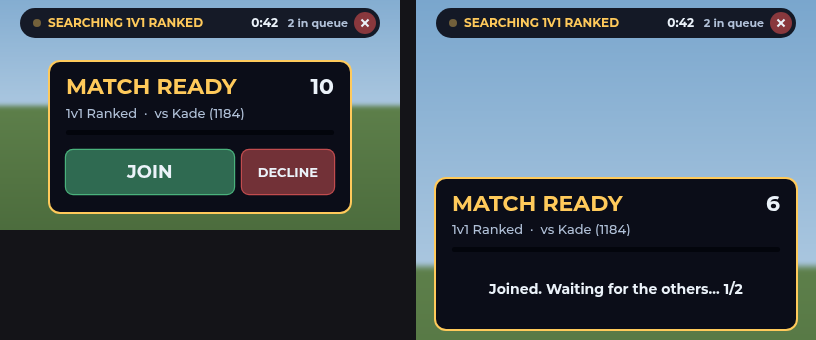
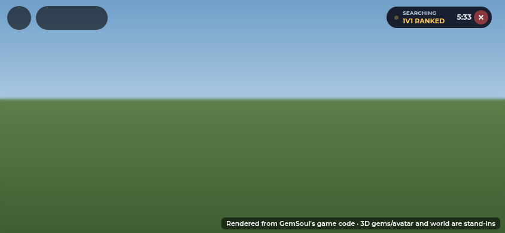
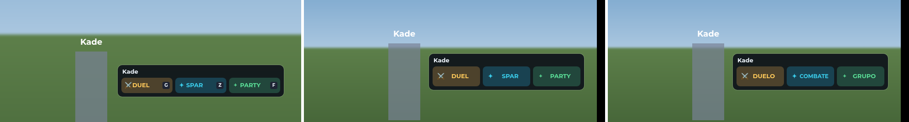
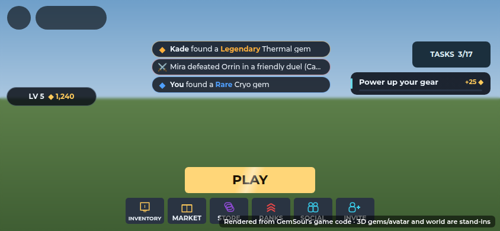

# The lobby

The Outpost is where players land between fights. The lobby screen should
answer three questions at a glance:
- **what do I do next?**
- **what do I get for it?**
- **who else is here?**

## Left: play and your miner

- **PLAY** shows how many miners are online and how many are searching for
  a 1v1. When you're alone it lists the modes instead. A band of light
  sweeps across it now and then.
- **INVENTORY**, then **SKINS** (blue: opens the Store; the shop front in the Outpost is still signed STORE), TASKS, MARKET, RANKS, SOCIAL and INVITE.
- **Your card**:
  - your level badge, name and coins;
  - the XP still needed for the next level ("40 / 150 XP to level 6").

## Right: the board

`src/client/Modules/LobbyBoard.luau`, under REPORT A BUG (on a computer
only: a phone's screen is kept for the game). Tasks aren't on it any more:
they open from the menu's TASKS tile (see [play-screen.md](play-screen.md)).

| Card | What it shows |
| --- | --- |
| Daily streak | The week of rewards, today's day, and what tomorrow pays |
| Daily challenges | Today's three: progress bars, the coins each pays, the bonus for all three, and how long until new ones |
| Next unlock | Only while a mode is still locked behind duels |

A challenge that finishes flashes gold on its row.

On a computer every card starts folded to a slim row: its title, one line
of what matters and a thin bar. Tap the streak or the challenges to open
that card; only one is open at a time, and tapping it again folds it.

| Card | Folded row |
| --- | --- |
| Daily streak | Tomorrow's reward, the week as a bar |
| Daily challenges | The next one still to do, its count and coins; the time until new ones |
| Next unlock | The mode and the duels still needed |

The arrow on a row is a "›" turned to point down (folded) or up (open).
Gotham has no "▾" or "▴", and they showed in game as empty boxes. The
challenges' row shows the time left on today's three on its own; the "↻"
it led with was a box too.

On a phone the board isn't shown at all: the top right is kept clear for
the game. The day's challenges are the Tasks window's **DAILY** page there
(and on a computer too), opened from the TASKS tile under PLAY.

## Daily challenges

Each player gets three challenges a day, one from each group. They're new
every day at midnight UTC.

| Group | Challenges |
| --- | --- |
| Mining | Break 10 rocks (40 ◆) · Mine 4 gems (50) · Find a Rare gem (75) |
| Fighting | Beat 2 rivals (60) · Cast 8 Surges (45) · Guard 12 hits (40) · 3 perfect guards (50) |
| Gear | Socket 2 gems (40) · Ready a Surge (30) · Land 30 hits (35) |

- **The bonus.** Clearing all three pays 50 more coins. A full day is
  160 to 225 coins.
- **Stable picks.** The picks come from the player and the day, so a rejoin
  or another server shows the same three.
- **Server-side counting.** Progress counts the same server events as Tasks
  (`PlayerData.training`), so nothing a client says counts.
- **Payment.** Each challenge pays once, with a toast:
  "DAILY CHALLENGE: Break 10 rocks +40 coins".
- **Network.** Progress reaches the lobby at most once a second
  (`Remotes.Challenges`). A fight counts every hit, and a full profile sync
  per hit would be heavy. The board redraws only while the lobby is on
  screen, and catches up as it shows.

The rules are `src/shared/DailyChallenges.luau`. A challenge is one table
row, so adding, retiring or re-pricing one is a one-line change. A retired id
in a saved day is skipped.

## Top: OUTPOST LIVE

`src/client/Modules/LobbyFeed.luau` keeps a short feed at the top of the
screen. It shows:
- Rare-or-better gems as they're mined ("Kade found a **Legendary** Thermal
  gem"), and yours ("**You** found…");
- duel results;
- players joining.

It shows three lines at most, each gone after 7 seconds. It only fills while
the lobby is on screen.

## Welcome back: the daily reward

The first time the lobby shows in a session, a banner shows the daily reward
the server just paid (`PlayerData.claimDaily`, marked on the player as
`DailyReward` and `DailyStreak`):

- **The week's track**: seven tiles, each with its day and its coins.
  - Days already collected are ticked.
  - Today is lit and marked TODAY.
  - Tomorrow has a teal edge.
- **What it pays**: day 1 pays 75 coins, and each day in a row adds 25.
  - Day 7 pays 225, and so does every day after it while the streak lasts.
    That's why its tile says "DAY 7+": it doesn't reset weekly.
  - Missing a day (UTC) starts the streak again at day 1.

| Day | 1 | 2 | 3 | 4 | 5 | 6 | 7 and after |
| --- | --- | --- | --- | --- | --- | --- | --- |
| Coins | 75 | 100 | 125 | 150 | 175 | 200 | 225 |

- **Below the track**: what tomorrow pays (from day 7 on, "every day from now
  on"), and the rule for a missed day.
- **At the bottom**:
  - today's coins and the +50 Season XP the claim also gives;
  - a nudge towards today's challenges;
  - CONTINUE.
- **The header**: the player's name, and the streak (NEW STREAK on day 1).

It closes on CONTINUE, a tap outside or after 8 seconds. The amounts come
from `Config.DailyRewardBase`, `DailyRewardPerStreak` and `DailyStreakMax`, so
the track follows any change to them.

## The PLAY menu

Each card shows what a win pays:

| Mode | Win |
| --- | --- |
| Practice | +25 ◆ (`Matchmaking.RivalWinCoins`) |
| Casual | +15 ◆ |
| Ranked | +40 ◆ |

Casual and Ranked also show how many players are searching right now. That
is counted from their `DuelQueue` attribute, with no extra server traffic,
and it refreshes every 2 seconds while the menu is open.

Between the two headings sits the **MATCH INVITES** switch (see below): ON by
default. Every invitation requires explicit acceptance.

## Lobby match invitations

Nobody should sit in an empty 1v1 queue while the lobby is full of players.
The rules are in `Shared/AutoQueue.luau`; `Systems/Duels.luau` applies them.

| | |
| --- | --- |
| **Invitations enabled (default)** | When a 1v1 queue has waited `CallAfter` seconds (8), available lobby players receive a Join / Not now offer. Nobody enters without accepting, including accounts with the old auto-queue setting enabled. |
| **What's in it for the fill-in** | The mode's win coins plus a `FillBonus` (+20 ◆); a called player's rating never drops from a match they were called into (a Ranked win still counts fully). The face-off says `CALLED IN: WIN +20 ◆`, the result card shows the bonus. |
| **MATCH INVITES: OFF** | Mutes unsolicited offers. The preference uses `DuelAuto`, saved in `profile.Duel.AutoQueue`. Offers normally expire after 15 seconds; expired, declined or unissued offers cannot start a match. Cancelling the queue withdraws offers. Availability is checked again on acceptance. |
| **Who counts as free** | In the Outpost (`Outpost` attribute), not searching, and none of: `CombatSession`, `MatchId`, `Expedition`, `RiftRun`, `DungeonQueue`, `DungeonId`, `KaijuBattle`, `Spar`, `SparDown`, `MechPilot`, `FirstFight`; and in the lobby at least `Settle` seconds (below). |
| **A moment after logging in** | *2026-10-27.* For `AutoQueue.Settle` (20) seconds after you first reach the lobby you're searching (auto queue, the SEARCHING tab is up) but asked nothing: no fill-in card, and your search isn't paired, so no MATCH READY (`entry.Hold`, `AutoQueue.holdUntil`). It used to pop both the moment you loaded in. Coming back from a fight or a dungeon later isn't held. |
| **One card at a time** | *2026-10-27.* Starting your own search takes down a fill-in card you had open (`FillInOver`), and MATCH READY takes down any left on the client. Before, you could get both at once: "Not now" on the fill-in only declined that card, and MATCH READY running out without a JOIN is what took you out of the queue. |
| **The bonus carries over** | *2026-10-27.* If the queue whose card came down is the one you're then paired with (within `CarryFor`, 60 s), you're called in for it all the same: MATCH READY says `+20 ◆ if you win`, the win pays the `FillBonus`, and a Ranked loss costs no rating. |

### MATCH READY

*2026-10-27.* Nobody is put in a queued duel without saying so. With auto
queue on, everyone in the lobby is searching, so two players (a desktop and
a phone in the same server, say) could be paired and dropped into a fight
without touching anything. Now a pairing asks first, like a queue pop in
other games:

- When the queue pairs two entries (`Duels.pairUp`), everyone in them gets
  a **MATCH READY** window: the mode, who it's against (name and rating), a
  countdown (`Matchmaking.ReadySeconds`, 15), **JOIN** and **DECLINE**.
  Nobody is moved yet.
- Everyone joins: the match starts as before.
- Someone declines, or lets the time run out: they leave the queue. The
  other side keeps searching, keeping its place, and the next player
  queued is paired with them.
- Someone cancels, leaves the game or gets busy while being asked: same, the
  other side keeps searching.
- A **fill-in** from the lobby (above) has said yes already, so only the
  player who was waiting gets MATCH READY, with the fill-in shown as joined.
- A **first fight** (`intro` queue) still starts at once: the new player
  has just pressed START for it.
- While a pairing is being asked, it holds an Arena lane, so a JOIN never
  finds the Arena full.

Server: `readyChecks` in `Systems/Duels.luau` (request `DuelReady`, id,
accept; Social events `MatchReady`, `MatchReadyState`, `MatchReadyOver`).
Client: `showReady` in `Client/Modules/SocialUI.luau`. After JOIN, the
window says who you're waiting on ("1/2").

### The first fight

A new player's first fight is the `intro` queue (request `IntroQueue`, only
for a save with no duel played; the PLAY menu can't enter it). The client
shows a FINDING YOUR FIRST OPPONENT card with the countdown:

1. Two new players in the queue pair at once, whatever their ratings: one
   fight (the `FirstFight` rule: even stats, unrated, paid like Casual),
   both with the first-fight hints (`FirstFight` attribute).
2. Alone after `Intro.CallAfter` seconds (5): available lobby players receive
   an invitation advertising +20 coins paid when the match starts. A helper
   must accept; the bonus is paid once per newcomer's first-fight record,
   never again at match end. The offer expires before the bot fallback.
3. Still alone after `Intro.BotAfter` seconds (15): the sparring rival steps
   in (`ArenaSessions.enterTraining`, the old flow).

Either way the fight counts as played, the hints come down when it ends
(the Funnel's "First fight" step), and the client heads to the Outpost.

*2026-10-23:* once they're back in the Outpost, the client puts them
straight into the **1v1 Casual** queue (`DuelQueue`, "casual"; a few tries,
since the server says no until they're standing in the lobby again), with
the toast "You're in the 1v1 queue: keep mining, you'll be called in when a
match is found." The search tab stays up while they follow the floor
arrows and mine (see **The search tab** below). A match found while they're in a mech takes them out of
it. It happens for anyone straight out of the intro, though the PLAY menu
still shows Casual locked until 3 duels.

## The search tab

*2026-10-27:* while you're queued, the search sits in a small tab up in
Roblox's top bar, at its right end, beside Roblox's own buttons, so it's off
the play area. It has a pulsing dot, SEARCHING over the mode (1V1 RANKED),
the time you've waited, and an X to leave the queue. Tap the tab itself to
open the Arena, which shows how many are waiting. It's 176 x 36 on every
screen; a long mode name (or its Spanish) shrinks to fit instead of being
cut off.

It used to be a 360-wide bar at the top middle of the screen. The tab lives
in its own screen (`QueueTab`, which ignores the top bar's inset) and moves
when Roblox's buttons do (`UiKit.topbar`, `UiKit.onTopbar`), so it never
covers them or the DEV button.

## Other miners: DUEL, SPAR, PARTY

Walk within 10 studs of another miner and one card appears beside them, at
chest height, with three buttons. Before, these were three of Roblox's own
prompt panels stacked over their head: hard to read, and on a phone they
covered the middle of the screen.

- **Click or tap** a button, or press its key: **G** to duel, **Z** to spar,
  **F** to invite to a party. A held key fills its button. A gamepad has a
  button for each (X, Y, B), so all three stay live together.
- **On a phone** the buttons are 44 points tall, and the keys aren't shown.
- It hides while a menu is open, during a fight, and when the lobby HUD is
  hidden.

The server still puts a prompt for each on the miner (`socialPrompts` in
`OutpostServer`). Their `Style` is Custom, so Roblox draws nothing. They decide
who's in range and take the keys. `PlayerCard` draws the card when they show,
and runs the same action as the key when a button is pressed.

## Chat: the bottom left, windowless

On a computer, the chat is a plain feed in the bottom left corner, like a
standard game's: lines stack up from the bottom with no box, no tabs and no
background (`ChatFeed`).

- **Where.** It sits above your kaiju's card and its CATCH button, and under
  the PLAY stack. It gets shorter on a low screen, so it never runs into
  either. On a short screen with a keyboard it takes the bottom left corner,
  left of the dock.
- **Lines.** The server's General chat, with each name in its own colour and
  yours in green. Joins and other system lines are grey, and loot lines are
  gold. Ten lines show at most. Each one stays 22 seconds, then fades.
- **Typing.** Press **/** or click "Press / to chat". The recent lines come
  back and a line opens to type in. **Enter** sends to everyone in the
  server. This goes through Roblox's General channel, so it's filtered.
  Escape, or an empty line, puts it away.
- **Elsewhere** (fights, dungeons, the intro, a phone), Roblox's own chat is
  on: its window and the top bar's chat button. Over a menu, neither shows.
  Speech bubbles over heads are on for everyone.

The old MMO chat box (`ChatFrame`) had tabs, channels and slash commands.
It is off for now with `Config.Features.ChatBox = false`. Setting it to
`true` brings the box back and turns the feed off. The server's channels
(`ChatChannels`) still run, so Trade, LFG and whispers return with the box.

## On a phone

- PLAY stands alone at the bottom centre, with the six buttons under it as
  icons.
- Level and coins sit at the top left, under the pick card.
- No "online" pill, no BUG button (SOCIAL has Feedback) and no chat box:
  Roblox's chat button in the top bar opens the chat, and words pop up as
  bubbles over heads. See [mobile.md](mobile.md#the-lobby-and-fights).
- The feed fits between the pick card and the task strip. It steps aside
  while the slim loot card holds the top middle (see
  [mobile.md](mobile.md#mining-in-the-outpost)).
- TASKS is small, with the task strip right under it, and PLAY is
  narrower and shorter.

## Tests

| Suite | Checks | What it covers |
| --- | --- | --- |
| `tests/run_daily_challenges.py` | 22,446 rules + 8 server | One per group; stable rolls; progress; paying once; the bonus; new days; old saves. The server side: progress pushes, payouts, notes and the bonus |
| `tests/run_chat_feed.py` | 57 | The real chat feed against chat and GUI doubles. Its place over the kaiju card, under the PLAY stack and on a short screen; names, your green and escaped markup; other channels kept out; system and loot lines; fading; ten shown and sixty kept; / and the hint; sending the trimmed line; Escape and empty lines; out of the Outpost, under a menu, in the intro and on a phone; the ChatBox switch |
| `tests/run_lobby.py` | 34 board + 36 feed | The real board and feed against GUI doubles. Board: cards per screen; folded rows, tapping one open (one at a time) and closed; the phone's choice, each as one slim strip; challenge rows; the bonus; the streak; unlock; no redraws while the lobby is hidden; opening Tasks. Feed: rare finds only; "You"; escaped names; three lines; duels; arrivals; a hidden lobby; the welcome once, with every day's coins on its track; Tasks stepping aside; stepping aside for a phone's loot card (and not on a computer) |
| `tests/run_duels.py` | 88 auto queue | The shared rules (who's free, the default, intro phases, the pick, the bonus); a lone Ranked queue pulls the closest-rated lobby player after `CallAfter`; a called loss costs no rating; a called win pays the bonus; busy lobby players are left alone; auto queue off gets one offer, accepting starts the match, cancelling withdraws it; two new players pair at once as a single FirstFight with hints; a lone new player gets a called veteran; nobody around brings the sparring rival |
| `tests/run_duels.py` | MATCH READY | A pairing starts nothing until everyone joins; the window names the other side; one JOIN doesn't start it; DECLINE leaves the queue and the other side keeps searching, paired with the next one queued; no answer in `ReadySeconds` leaves the queue; cancelling while asked hands the other side back to the queue; a fill-in's waiting player is asked with the fill-in shown joined; two auto-queued players are asked before they're paired |
