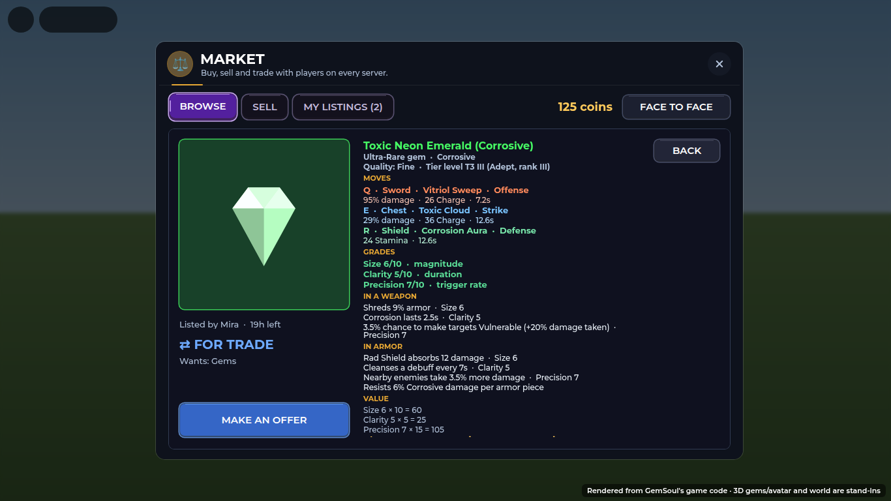
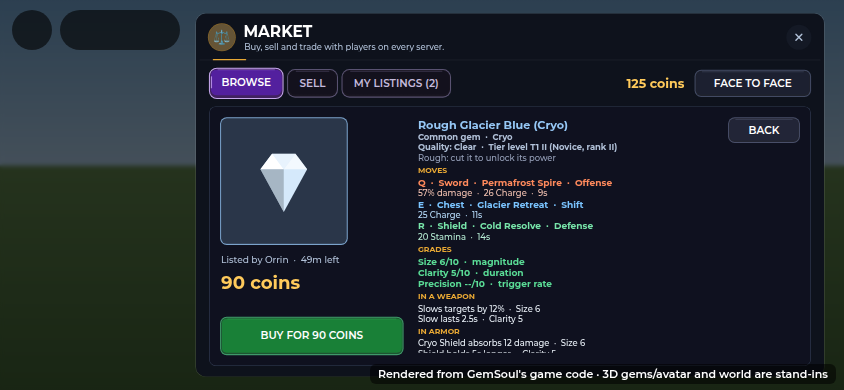

# The Market: a gem listing shows everything

A gem up for sale or trade used to show its rarity, one move (as if it
gave that move on Q, E and R), its three grades and its worth. Now the
listing (BROWSE, tap a gem) lists everything the gem window does:

- **What it is:** its name, rarity, element and Prismatic, its quality
  word (Flawless to Cracked) and its tier level, e.g. *T3 III (Adept,
  rank III)*. A rough stone says so: it has to be cut before it can be
  socketed.
- **MOVES:** the three it gives. Q on a sword, E on a chest, R on a
  shield, each with its type and its numbers at this gem (damage, cost,
  cooldown), in the key's colour.
- **GRADES:** Size, Clarity and Precision out of 10, and what each sets.
- **IN A WEAPON / IN ARMOR:** what it does in each, with the grade behind
  each line, and how much of its element it resists in each armor piece.
  A rough stone has no Precision yet, so it shows no Precision effects.
- **VALUE:** each grade's points (Size × 10, Clarity × 5, Precision ×
  15), the rarity's rate, and what it adds up to in coins.
- **Where it came from:** how it was found and when, and who mined it.

On a phone the same list scrolls beside the stone:

The list is `Shared/GemFacts` (`GemFacts.lines(gem)`), so another screen
can show the same. Every line has Spanish, including what gems do in a
weapon or armor (`GemConfig.lines`), which every gem card shows.

Tests: `tests/run_gem_facts.py` (every element and rarity, cut and rough:
the moves are the gem's own, the resist and value add up, and every line
but the name reads in Spanish).

(Renders: the client code drawn by the UI harness, not Roblox screenshots.)
