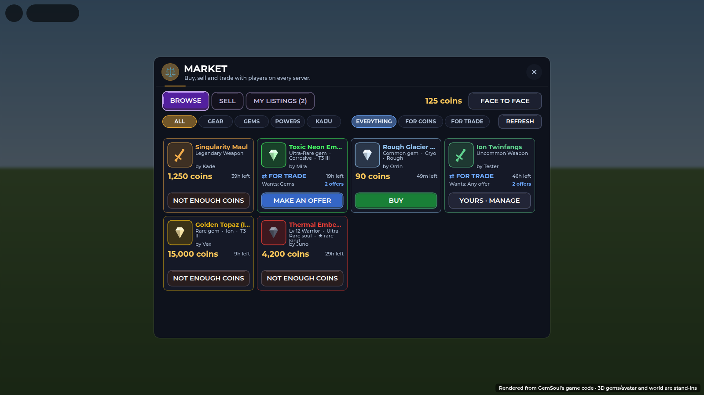

# The Market: kaiju for sale or trade

*2026-10-28.* Kaiju go on the Market like gear and gems
(`Shared.Market`, `Systems/MarketBoard`, `Modules/MarketBoardUI`).

- **Selling or trading one.** On the Market's **SELL** tab your kaiju
  are listed with your gear and gems (a **KAIJU** filter shows only
  them). Put one up for coins or for trade offers, the same as any item.
  It leaves your roster at once and waits in escrow until it sells, is
  traded, or comes back.
- **What can't go up.** A kaiju in the team that's out, or your support
  out: swap it out of that team first. You always keep at least one
  kaiju (`Market.whyNot`).
- **What moves.** The kaiju whole: its kind, element, level, EXP, name
  and Gemsoul (`{ Kind = "Kaiju", Record }`). It gets a new id in its new
  roster and joins the end of the line, like one caught (`Market.give`).
  A buyer with a full roster (`Kaiju.MaxOwned`) can't take one; one coming
  home from escrow always fits back.
- **On the board.** A kaiju card shows its 3D model, name, level, role,
  Gemsoul rarity, and **★ rare kind** for the roster's rarest batch
  (`Kaiju.batch`). Its detail shows its stats, its kind's blurb and its
  Gemsoul. A trade listing can ask for **Kaiju** (`Market.Wants`).
  Sorting and "Rare or better" read its Gemsoul's rarity, a step up for
  a rare kind (`Market.rank`).

| Test | What it covers |
| --- | --- |
| `tests/kaiju_cases.luau` (`run_kaiju.py`) | listing out of the roster, never the team out or your last one; the payload whole; given with a new id and placed in the line; a full roster refused; escrow coming home always fits |
| `tests/run_market.py` | the board's escrow, sales, trades and races, unchanged for gear and gems |
