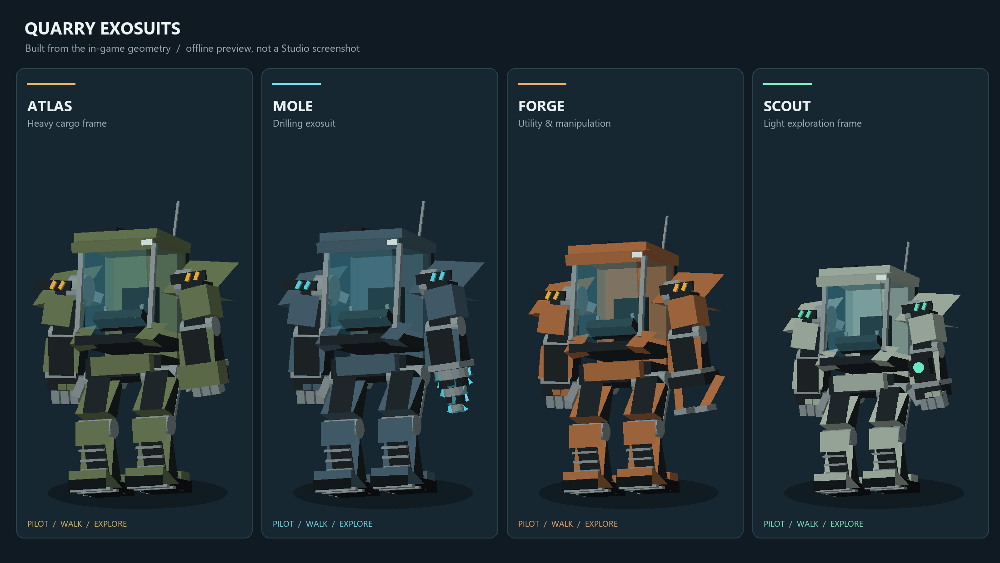

# Driving the mechs

The garage in the Outpost's Shelter has eight mechs of four kinds (Atlas Hauler, Mole
Drill, Forge Utility and Scout Pathfinder). Walk up to one and hold **E**
("Pilot") to climb into the cockpit. To drive:

- **W / S** (or the arrow keys) to go forward and back;
- **A / D** to turn. The mechs turn on the spot;
- **Space**, or the **HOP OUT** button, to hop out.

A gamepad's left stick works too. On a phone or tablet, tap **Pilot** and
drive with the **drive stick** at the bottom left, where Roblox's own
thumbstick sits: up drives forward, down backs up, sideways turns. HOP OUT
or the jump button gets you out. While you drive, the screen shows only HOP
OUT, at the bottom middle (in PLAY's place on a phone; PLAY hides while you
drive), and on a touch screen the drive stick. With a keyboard it reads "HOP OUT ·
SPACE". There used to be a driving card with the mech's name, its speed
and the controls, but it was in the way. An empty mech walks itself back
to its bay after 90 seconds.

## How it works

There are no Roblox seats, and no physics drive. The mech moves on your own
screen, the moment you press a key. The server only checks where it went and
tells everyone else.

Mechs were first driven through physics, then by the server through a
`VehicleSeat`. Both kept failing in live games, and no cause was ever found
from the logs. Every version depended on one of these:

- Roblox handing the physics to the right player;
- who sits in a seat (`Seat.Occupant`, `Humanoid.SeatPart`), which doesn't
  replicate;
- the seat's own controls, camera and jump-to-leave.

So all of them are gone.

None of that was what stopped the mechs after Oct 15, though. The pilot's
game treats some screens as menus: while one is open, the driving card hid
(HOP OUT does now).
The daily caches' screen (`StreakRewards`) was added to that list. That
screen is always switched on, with only its button hidden. Back then, a menu
also took away your controls and Space, so in the lobby every mech sat still
and nobody could jump out. Now a menu only hides HOP OUT. Your controls and
the way out work whatever is on the screen.

### On a phone

Driving on a phone used to go only through Roblox's thumbstick
(`ControlModule:GetMoveVector()`). A keyboard never needed it, since your
game reads the keys itself, so only phones could lose it. Three things could
stop a phone's mech while a computer's drove fine:

- **Roblox's controls switched off.** The menu camera and the scenes switch
  them off and on (`controls:Disable()`/`Enable()`). With them off, the
  thumbstick reads zero. Now the drive stick is the mech's own (a button in
  `DriveHud`, read straight by `VehicleDrive`), so it drives whatever state
  Roblox's controls are in. The drive stick comes before Roblox's thumbstick
  in the order your input is read: keys, then the drive stick, then the
  controls. Roblox's thumbstick still drives if you use it.
- **The controls failing to load once.** If `PlayerModule` failed to load the
  first time, it was never tried again, so the thumbstick was dead for the
  whole session. Now it tries again every 2 seconds.
- **Auto-jump.** On touch screens Roblox jumps you at whatever is in front
  of you as you push the stick (`Humanoid.AutoJumpEnabled`). In the cockpit
  that can be the mech's own bodywork, and a jump is the way out (or at least
  stands you up out of the pose). Auto-jump is off while you pilot and comes
  back when you get out.

The drive stick is 112 points wide, 20 in from the left and 16 up from the
bottom (`MobileLayout.Stick`). It's clear of the dock, HOP OUT, your coins,
the pick card and your teammates' cards at every phone size
(`tests/run_mobile_layout.py`). A touch on it is the stick's, not the
camera's. Drag past its rim and the knob stays on the rim. Let go, or open a
menu (which hides it), and the mech stops.

### Getting in

The Pilot prompt asks the server. If you're close enough, not busy and the
mech is free, the server:

1. sets your `MechPilot` attribute to the mech's `MechId` (like `Hauler1`);
2. sets the mech's `MechPilotId` attribute to your UserId;
3. welds your body's root to the mech's cockpit (`PilotWeld`), and sits you
   down for the pose.

Attributes replicate to every client, so every screen knows who pilots what
straight away. `Shared.MechPilot` reads them: `MechPilot.of(player)` gives the
mech's id, and `MechPilot.mech(player)` finds the mech (by its `OutpostMech`
tag).

### Driving

Your game (`VehicleDrive`) sees your `MechPilot` attribute and starts
driving. It prints `[Mech] Piloting <id>: driving from this screen`. Each
frame, before the camera moves, it:

1. works out the speed and heading from your input. The maths is
   `Outpost.drive` in `src/shared/Outpost.luau`;
2. moves the mech over the ground with `MechPilot.move`:
   - it sweeps the mech's **hull** ahead (`workspace:Blockcast`) and stops it
     0.4 studs short of anything solid. Players, creatures and rifts don't
     count;
   - it looks down for the ground (`workspace:Raycast`). It steps up anything
     up to 1.6 studs high (times the mech's scale), like a kerb or the Motor
     Pool's apron. It won't climb a higher ledge. Off a drop, it falls, under
     gravity;
   - with no ground found at all (still loading in, say), it keeps its
     height and carries on;
   - it stays inside the crater rim;
3. sets the chassis's `CFrame`. The chassis is anchored, so it goes exactly
   where it's put, and you go with it.

A cast that errors counts as nothing there, so nothing can hold the mech
still. Push into something for 1.5 seconds and the mech goes through it for
a second, with a "pushing through" message.

About 15 times a second while it moves, and once when it stops, your game
sends `MechMove(position, heading, speed, turn rate)`.

### The server's check

The server takes a move only from the mech's pilot, and only while they
aren't busy (a fight, a match, an expedition or an Arena drop). Then it
limits the move:

- no further than the mech could have gone since the last one (its top
  speed, with some slack for moves that arrive bunched up);
- no higher than two steps up at once, and no more than 60 studs down;
- inside the crater rim, and never far below the quarry floor.

It sets the chassis there and puts it on the model for every client:

- `MechPosition`: where it is;
- `MechMotion`: its heading, speed and turn rate (X, Y, Z).

They're only sent when they change. A mech with no moves for 1 second counts
as stopped.

### Everyone else's screen

`MechAnimation` glides each mech between the moves the server passes on. It
carries the mech on from the latest one for up to a quarter of a second, and
eases out any difference. If it's more than 12 studs off, it jumps there
instead. Once the mech stops, it's put exactly where the server has it. The
legs walk at its speed. Your own mech isn't glided: your screen drives it.

### Getting out

Space, jump (the phone's button too) or the HOP OUT button sends
`MechExit`. That works as soon as you're the pilot, even before driving starts,
and with a menu open. Only typing in the chat doesn't count. The server takes the weld away, clears both
attributes, stands you up and puts you down beside the mech's left leg. You
also get out if you die, respawn, leave the game, or start a fight, a match,
an expedition or an Arena drop. If anything else takes the weld away, or
changes your `MechPilot`, the server lets you go too.

`SeatExit` (used before fights and drops) also takes away any `PilotWeld` and
clears `MechPilot`, so nothing drags the mech along with you.

### Each mech's parts

- **Chassis**: an invisible box, the model's PrimaryPart. It's anchored, and
  it's the part that moves.
- **Cockpit**: an invisible block on the torso. The Pilot prompt is on it, and
  your body is welded 2 studs above its middle.
- **Hull**: an invisible box from 1.6 studs up. It's what's swept ahead, so a
  kerb under it doesn't stop the mech.
- **Foot**: an invisible ball underneath. You can't walk through it.
- Everything else is bodywork on joints, animated by `MechAnimation`.

## When a mech still won't move

Look in the Output (F9 in a live game) for `[Mech]` lines:

| Line | Where | What it means |
| --- | --- | --- |
| `[Mech] 8 mechs parked (no seats: the pilot's screen drives)` | server | The mechs were built with this version. If it's missing, the server is running old code: sync or publish again |
| `[Mech] <you> is piloting <id>` | server | The server made you the pilot |
| `[Mech] Piloting <id>: driving from this screen` | client | Your game started driving |
| `[Mech] <kind>: <you> has sat in it for 5 s and their screen hasn't moved it` | server | You're in, but your game never started driving. Your game gets a line about it too |
| `[Mech] <kind>: let <you> out (their screen never drove it)` | server | Still nothing after 12 s, so the server let you out rather than leave you stuck |
| `[Mech] Server isn't hearing this pilot: ...` | client | You're moving on your screen, but the server hasn't passed on a move for 4 seconds. Others can't see you move |
| `[Mech] couldn't park a <kind>: ...` | server | A mech failed to build |

If you're moving and the server hasn't answered for 2 seconds, you're told
once a ride: "The server isn't answering: others can't see you move." At 4
seconds your game sends one report per ride. Both count from when you set
off, if that's later than the server's last answer: standing still, nothing
is sent, so nothing comes back. (Before, the time stood still counted, so
setting off after a pause could look like a quiet server.) The server takes at most 3 per
ride, logs them with its own view and sends that view back to your Output.
The server's lines also go to Feedback → Reports (owners only).

| Piece | What it does |
| --- | --- |
| `src/shared/MechPilot.luau` | Who pilots what (attributes), the mech's state, and moving it over the ground |
| `src/server/World/OutpostMachines.luau` | Builds each mech: chassis, cockpit, hull, foot and bodywork |
| `src/server/Systems/OutpostVehicles.luau` | Parks the mechs (anchored), runs the Pilot prompt, gets you in and out, checks `MechMove`, sends empty mechs home |
| `src/server/Systems/SeatExit.luau` | Lets go of a pilot (and a seated player) before fights and drops |
| `src/client/Modules/VehicleDrive.luau` | Your input (keys, then the drive stick on a touch screen, then the controls), driving the mech, sending moves, HOP OUT, the drive stick and the camera |
| `src/client/Modules/MechAnimation.luau` | Glides everyone else's mechs between moves, and walks the legs |
| `Remotes.MechMove` | Client to server: `(position, heading, speed, turn rate)` |
| `Remotes.MechReport` | Client to server: the server isn't hearing you. Server to client: its view |
| `Remotes.MechExit` | Client to server: hop out (Space or jump) |

## Verification

- `tests/run_mech_pilot.py` (32 checks) runs `Shared.MechPilot` under lune:
  - who pilots what, from the attributes;
  - the mech's state from its model;
  - driving, steering and backing up;
  - stopping short of a rock, driving away, and pushing through;
  - passing over a pebble, stepping up and off a kerb;
  - stopping at a ledge, falling into a pit, and no ground loaded;
  - the crater rim.
- `tests/run_outpost_vehicles.py` (96 checks) runs the real server module:
  getting in and out, moves from the pilot only, the limits on a move, the
  silent-pilot log and letting them out, reports, letting go of pilots who die, respawn, leave or
  get busy, and going home.
- `tests/run_vehicle_transition.py` (66 checks, then the arena controls)
  runs the real client module under lune:
  - waiting for the mech to stream in, then driving;
  - sending moves, and stopping;
  - a wall and pushing through, and a failing cast;
  - a server that isn't answering (told once), setting off after a stand
    and turning on the spot (neither counts);
  - HOP OUT alone in its place, naming Space on a keyboard (no driving
    card);
  - an always-on screen, menus (they hide HOP OUT, nothing more);
  - getting out by Space, jump or HOP OUT, before driving starts and with a
    menu open, but not while typing;
  - being let go, a respawn and the camera;
  - Roblox's controls failing to load once (it tries again);
  - a touch screen: the drive stick in its place, driving forward and
    turning with Roblox's controls giving nothing, another finger ignored,
    stopping when you let go or a menu hides it, and auto-jump off in the
    cockpit and back after.
- `tests/run_mech_animation.py` checks the gliding, the legs, and that your
  own mech isn't glided.
- `tests/run_machines.py` and `tests/run_moon_quarry_scene.py` build every
  mech. They check there are no seats or drive constraints, the cockpit is
  there, only the foot and hull collide, and the hull starts 1 to 2 studs up.
- `tests/run_outpost.py` checks mining from the cockpit.
- `tests/run_insertion.py` checks a pilot is let go before an Arena drop.

These run the real modules against stand-ins. Roblox's own `Blockcast`,
`Raycast` and replication can only be checked in a live server.
