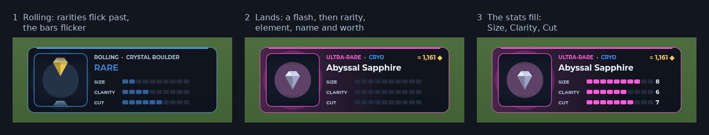
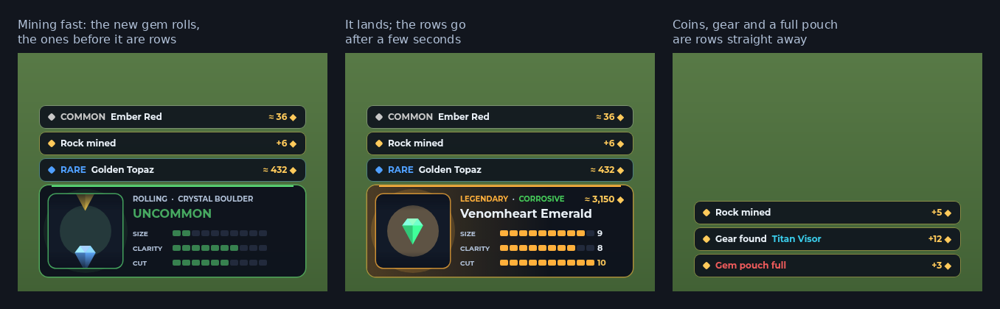
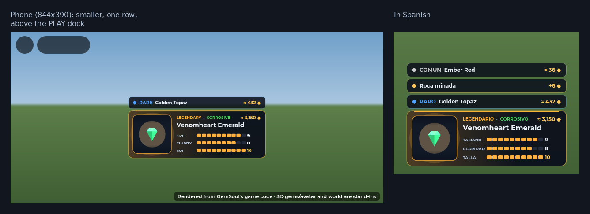

# Your mining finds

When you mine a rock in the Outpost, two things show the find:

- **Other players** see the box over your head (the shared lottery:
  `MiningWorldReveal`). They see your name, the reel and the result.
- **You** see your own loot card at the bottom of the screen
  (`MinerLoot`). The box over your own head is no longer drawn on your
  screen, so it doesn't block your view while you mine.

## The card

1. **Rolling.** Gems run through the window like a slot reel. The rarity
   name and colour change with each gem, and the Size, Clarity and Cut bars
   flicker. The header says what's rolling ("ROLLING · CRYSTAL BOULDER").
   It slows down, with a rising tick, to land on the rarity you rolled.
2. **It lands** on the gem you actually found, shown in 3D. You get:
   - a white flash, a punch and a burst of sparks;
   - the light behind it swells and a wash of the rarity colour comes in
     from the left;
   - the header reads rarity · element, the gem's name sits under it, and
     its worth is on the right ("≈ 1,161 ◆");
   - the rarity's reveal sound.
3. **The stats fill**, Size, then Clarity, then Cut, each to its number
   out of 10. A 10 shows in gold. The gem turns slowly in the window.

Rarer gems roll a little longer and stay up a little longer (a Common is
about 4 seconds in all, a Legendary about 5).

## Mining fast

Finds that come quickly stack:

- **A new gem** folds the card that's up into a one-line row: its rarity,
  name and worth. That skips the rest of that card's roll, because you've
  moved on. The new gem gets the card and rolls.
- **Every rock pays a gem**, so the only find without one is a rock that
  couldn't pay it (a full pouch: the server normally refuses that swing
  first). It becomes a red "Gem pouch full" row straight away, and the
  card stays.
- **Rows** stack above the card, newest nearest it. Each one goes after
  6 seconds. A desktop keeps 3 rows, a phone 1; with more than that, the
  oldest go first.
- **When you stop**, the last card folds into a row, then the rows go.

## Phones and Spanish

On a touch screen the card sits above the PLAY dock. On a phone (a screen
under 500 points tall) it's also drawn at 86% and keeps one row. It hides,
silently, while a menu or a fight has the screen, and it clears when you
leave the Outpost. While you drive a mech, the card moves up above the
mech's driving card (`MobileLayout.Drive`, shared with `VehicleDrive`), and
the Outpost's key hint at the bottom is hidden, since the driving card
lists the controls. The words are in the Spanish table
(rarities, elements, the stat names, the rocks, "Rock mined", "Gem pouch
full").

## Code

- `src/client/Modules/LootStack.luau`: what the card and the rows show
  over time. It's pure (no Roblox services), with its timings in
  `LootStack.Roll`, `Hold` and `RowLife`.
- `src/client/Modules/MinerLoot.luau`: draws it:
  - `push(loot)`, called from `OutpostScene.reveal` with the server's loot;
  - `setBlocked(on)`, called from `fitOutpostHud`;
  - `close()`, called when you leave the Outpost or go into a fight.
- `MiningWorldReveal.receive` skips packets whose `MinerId` is you.
- Tests:
  - `tests/run_loot_stack.py`: the stack's timing and order;
  - `tests/run_miner_loot.py`: the card, driven frame by frame, and above
    a mech's driving card;
  - `tests/run_world_mining.py`: now also checks that your own find is
    never drawn over your head, while others still get it.
