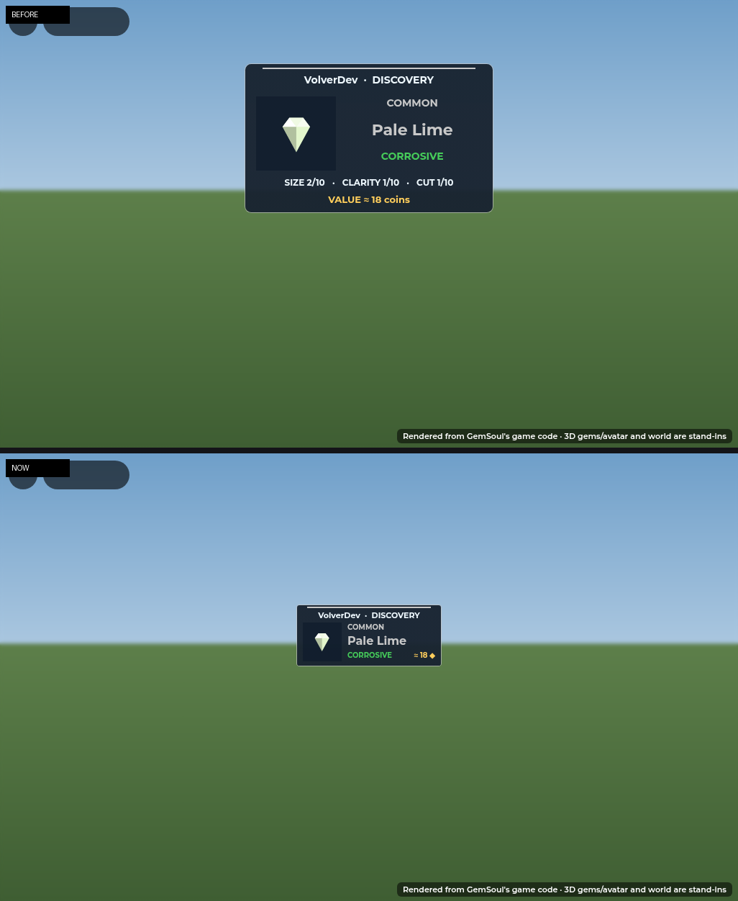
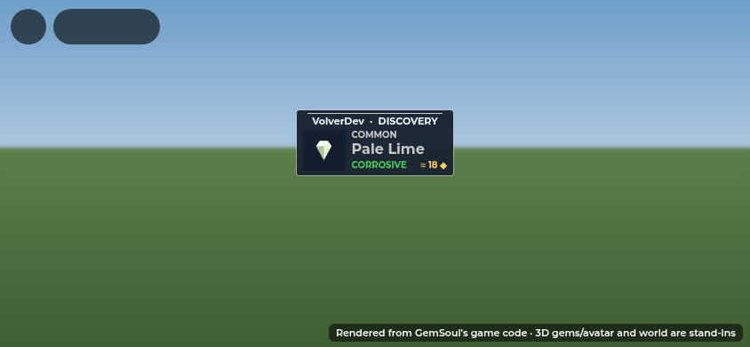
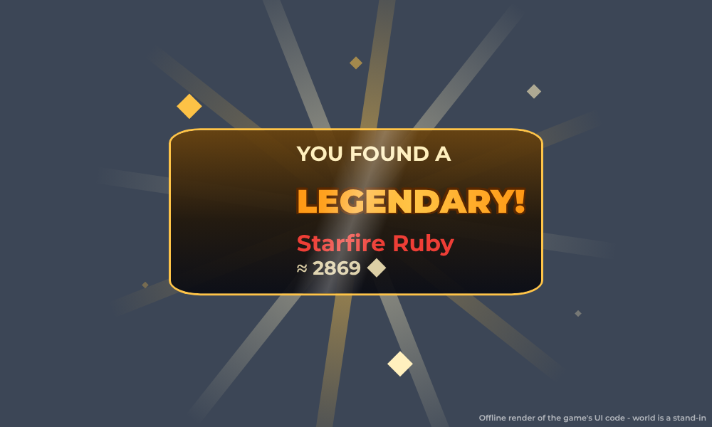
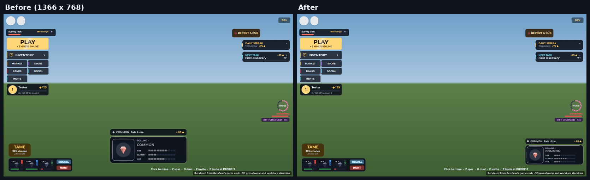
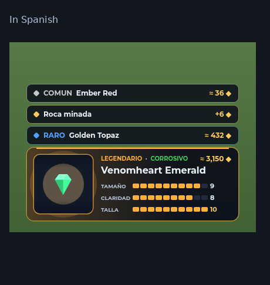

# Your mining finds

When you mine a rock in the Outpost, two things show the find:

- **Other players** see the box over your head (the shared lottery:
  `MiningWorldReveal`). They see your name, the reel and the result.
- **You** see your own loot card at the bottom of the screen
  (`MinerLoot`). The box over your own head is no longer drawn on your
  screen, so it doesn't block your view while you mine.

*2026-10-27:* the public box is a small tag now (`Roll.Tag`,
`Roll.displaySize`): 200 × 84 on a computer, 176 × 74 on a phone, never
more than 40% of the screen's width or a quarter of its height, down to
150 (140 on touch) wide further off. It was 344 × 206, too much of the
screen for someone else's find. While it rolls: the miner's name, a strip
of the reel and ROLLING · RARITY. Landed: the gem in a square on the left,
then its rarity, its name, its element and its worth (≈ coins). Its size,
clarity and cut are left to the miner's own loot card.

It shrinks gently with distance instead of becoming an unreadable
world-sized label. Its bottom sits above the miner's head, and it draws above geometry.
While it is visible, that miner's native overhead display, cosmetic title,
and party name are hidden locally; their name remains in the card header.
Original display states return on expiry, replacement, streaming changes,
leaving range, or entering combat.

## A Legendary: its window over your head

*2026-10-29:* mining a **Legendary** is a moment, for you and everyone near
(`LegendaryWindow`):

- a pillar of gold light shoots up out of you and fades, a shockwave ring
  runs 60 studs across the ground, sparks and confetti fly;
- a gold line draws across the air over your head and **snaps open into a
  window** (with a little overshoot, a pop): YOU FOUND A (someone else's:
  MARC FOUND A), **LEGENDARY!** bouncing in with a shine running through
  its letters, the gem itself turning on the left, its name in its
  element's colour and its worth;
- behind it rays wheel slowly, diamond sparkles twinkle round it, a shine
  sweeps across it and its gold frame pulses; a second shower of sparks
  as it opens;
- after about four seconds it folds back into the line and is gone (4.55 s
  in all: `LegendaryWindow.at` is the timeline).

It's a window in the world (a BillboardGui sized in studs, drawn over
everything), so it's as big over the miner near or far, and anyone within
220 studs sees it. Its sound is a deep boom, a rising "shwing" as it opens
and a bright chord of bells ringing out under sparkles (CombatSound's
`LegendaryWindow`, made by `tools/make_legendary_sounds.py`; built-in
pings stand in till it's uploaded).

Yours opens as your loot card lands (`MinerLoot.push`: at the card's
`LandAt`, so it still comes when you mine on and the card folds early).
Someone else's opens as the reel over their head lands
(`MiningWorldReveal`), and that small box steps aside for it: the window
says the same, bigger. A late onlooker doesn't get an old one replayed.

## The card

1. **Rolling.** Gems run through the window like a slot reel. The rarity
   name and colour change with each gem, and the Size, Clarity and Cut bars
   flicker. The header says what's rolling ("ROLLING · CRYSTAL BOULDER").
   It slows down, with a rising tick, to land on the rarity you rolled.
2. **It lands** on the gem you actually found, shown in 3D. You get:
   - a white flash, a punch and a burst of sparks;
   - the light behind it swells and a wash of the rarity colour comes in
     from the left;
   - the header reads rarity · element, the gem's name sits under it, and
     its worth is on the right ("≈ 1,161 ◆");
   - the rarity's reveal sound.
3. **The stats fill**, Size, then Clarity, then Cut, each to its number
   out of 10. A 10 shows in gold. The gem turns slowly in the window.

Rarer gems roll a little longer and stay up a little longer (a Common is
about 4 seconds in all, a Legendary about 5).

## Mining fast

Finds that come quickly stack:

- **A new gem** folds the card that's up into a one-line row: its rarity,
  name and worth. That skips the rest of that card's roll, because you've
  moved on. The new gem gets the card and rolls.
- **Every rock pays a gem**, so the only find without one is a rock that
  couldn't pay it (a full pouch: the server normally refuses that swing
  first). It becomes a red "Gem pouch full" row straight away, and the
  card stays.
- **Rows** stack above the card, newest nearest it (under it on a phone).
  Each one goes after 6 seconds. A computer keeps 2 rows, a phone 1; with
  more than that, the oldest go first.
- **When you stop**, the last card folds into a row, then the rows go.

## On a computer

The card used to sit in full in the middle of the bottom of the screen (360
x 124, three rows above it), right where you look while mining. It's now
larger and clearer (320 x 108) in the bottom right corner (`MinerLoot.Corner`),
above the key hints. The middle of the screen stays clear, and so does a
mech's HOP OUT at the bottom middle, so the card no longer moves when you
pilot. It keeps the Size, Clarity and Cut bars, smaller. Up to 2 rows
stack above it, as many as fit up to about halfway down plus 100, well
clear of the RIFT CHARGED tag (`FrontierHud`). On a short
window with no room above the card, its row waits until the card has gone
and then shows in its place.

## Phones and Spanish

On a phone or a tablet (a touch screen, or a window under 540 points tall)
the card is 232 × 72 points, with a larger 60-point reel, and sits in the top right, right under
the place toasts come up and right-aligned with it (`MobileLayout.loot`),
clear of the slim tab Roblox puts on a phone's right edge. It shows the
reel, then three lines beside it: the rarity and element, the gem's name
across the card's full width, and its worth. There are no stat bars. It
keeps one history row, showing it after the card closes when there isn't room
below without overlapping the party controls. The row uses the gem's rarity
colour. While a toast is long enough to wrap onto a
second line, the card moves down under it (`UiKit.toastBottom`,
`UiKit.onToastMoved`) and back up when it goes. The middle of the screen
and the PLAY dock stay clear. The live feed steps aside while the card is
up. See [mobile.md](mobile.md#the-top-right-toasts-and-your-loot).

The card hides, silently, while a menu or a fight has the screen, and it
clears when you leave the Outpost. While you drive a mech, the Outpost's
key hint at the bottom is hidden. The words are in the Spanish table
(rarities, elements, the stat names, the rocks, "Rock mined", "Gem pouch
full").

## Code

- `src/client/Modules/LootStack.luau`: what the card and the rows show
  over time. It's pure (no Roblox services), with its timings in
  `LootStack.Roll`, `Hold` and `RowLife`.
- `src/client/Modules/MinerLoot.luau`: draws it:
  - `push(loot)`, called from `OutpostScene.reveal` with the server's loot;
  - `setBlocked(on)`, called from `fitOutpostHud`;
  - `close()`, called when you leave the Outpost or go into a fight.
- `MiningWorldReveal.receive` skips packets whose `MinerId` is you.
- Tests:
  - `tests/run_loot_stack.py`: the stack's timing and order;
  - `tests/run_miner_loot.py`: the card, driven frame by frame; on a
    computer compact in the bottom right corner, two rows at most, clear of
    the RIFT CHARGED tag, the row waiting on a short window, staying put in a
    mech; and slim in the top right of a phone, under the toast's place
    (three lines that fit it, no bars, one row under it with no rarity
    name, moving down under a toast that wraps and back up, claiming the
    top);
  - `tests/run_world_mining.py`: now also checks that your own find is
    never drawn over your head, while others still get it.

## Every element at every rarity

Each element rolls every rarity at the same odds: the gem's rarity is
rolled first (`GemRoller`), then its element, evenly. The reels used to
make it look otherwise. Each one showed one preview gem per rarity, with
a fixed element per rarity, so every Legendary going past was Fire and
every Ultra Rare was Poison. Now the reels' gems get a random element too
(`GemRoller.reelGem`, `MiningRoll.elements`, seeded from the roll). The
loot card, the world billboard, the menu reveal and the cache lottery
build a gem look for each rarity and element as it's needed, and keep it.
`tests/frontier_cases.luau` rolls a large batch and checks every element
at every rarity, at the odds.
