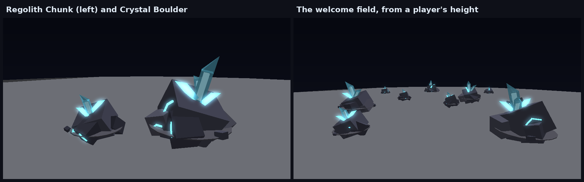
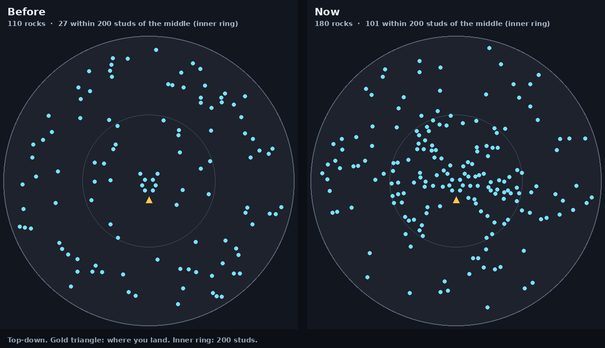
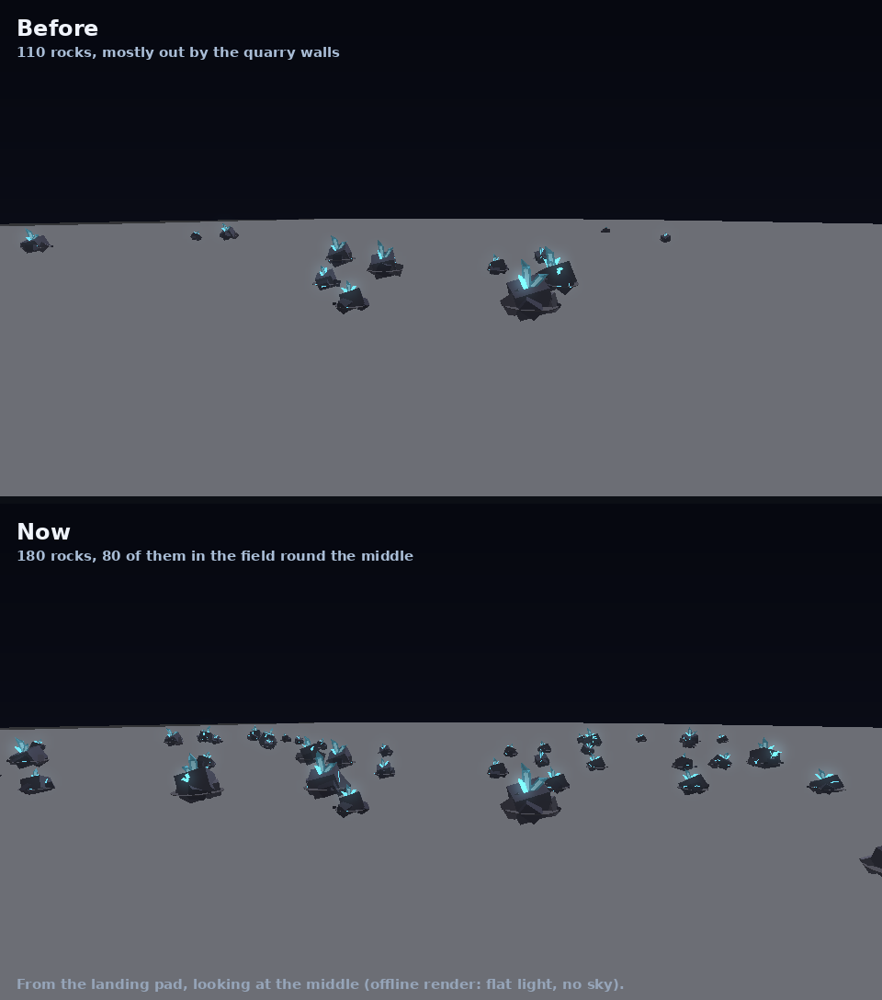

# The Outpost's mining rocks

The two rocks that grow in the Outpost, the Regolith Chunk and the Crystal
Boulder, are built from parts by `OutpostWorld.rock`. They no longer use
the imported kit rocks recoloured pale.

(An offline render: flat shading and a dark sky. In Studio the Outpost's
daylight makes the stone lighter and the crystals glow.)

## What they look like

- **Dark basalt.** Stone that stands out against the pale regolith: a
  tilted main chunk and stones heaped around it, each at its own angle and
  shade, sunk into a darker bed of disturbed ground.
- **A crystal cluster.** It bursts out of the top face. The tall crystal
  is glass with a glowing core and a pointed tip. Smaller ones fan out
  around it.
- **Ore veins.** Glowing cyan strokes with a bend, across the stone's
  sides.
- **Rubble.** A few stones and a loose chip of crystal at its foot.
- **The Crystal Boulder** is bigger. Its cluster is taller and has a
  second glass crystal, and a second, smaller cluster breaks out of the
  side that faces most upward.

Each one is laid out from its own random seed, so no two rocks match.

## What a rock pays

Every rock pays exactly one gem when it pops, so every rock ends in the
gem reel, a Common at worst. Rocks never pay coins or gear (armour). A
Crystal Boulder takes more swings than a Regolith Chunk, but its gem rolls
luckier (`Depth` in `Shared.Outpost.Sizes`).

Mined gems are mostly Commons, so the good ones are what keeps you mining
(`GemRoller.MiningWeights`; caches, drops and the starter spin keep the
usual 40 / 25 / 20 / 10 / 5):

| | Common | Uncommon | Rare | Ultra Rare | Legendary |
| --- | --- | --- | --- | --- | --- |
| A mined gem, before luck | 60% | 25% | 11% | 3.5% | 0.5% |
| In the core (the rocks' own luck) | 58% | 26% | 12% | 4% | 0.6% (1 in 170 rocks) |
| A guarded Rift Vein (the most luck) | 41% | 30% | 19% | 8% | 1.4% (1 in 72 rocks) |

Further out, the frontier's luck tilts every roll rarer (`docs/frontier.md`).

What Commons are for:
- **Coins.** `SELL COMMONS` in the GEMS window sells every spare one in two
  taps, at the shop's rate (a quarter of a gem's worth, `Config.MarketSellRate`).
  The shop always pays below worth; other players pay better on the market.
  "Spare" means loose and not named by a saved loadout
  (`GemInventory.spare`; the server's `SellSpare`).
- **Your kaiju.** Gems heal a hurt kaiju (a Common of its own element
  20% of its health) and revive one that's down (10 power plus 1 a level);
  they don't give EXP. Its HEAL tab has the spare Commons it needs picked
  already, and AUTO HEAL, switched on, spends spare Commons on the team by
  itself ([kaiju.md](kaiju.md#healing)).

A gem needs room in the pouch (300 gems, room for a long session's
Commons). With a full pouch the server refuses the swing before it lands:
"Gem pouch full (300)! Sell or socket gems to keep mining." The pick isn't
worn and the rock isn't chipped, so no rock is ever mined for nothing.

Coins still come from Tasks, daily challenges, fights and selling gems,
just not from the rocks.

## How many, and where

The quarry holds 180 rocks (`Outpost.NodeCount`), up from 110. Most of the
old ones grew out by the quarry walls, so the middle, where people mine
between fights, was nearly empty.

- **The welcome field:** 8 rocks just ahead of the landing pad.
- **The field round the middle:** 80 spots between 36 and 200 studs from
  the middle. They stay off the roads, the buildings and the lane from
  the pad.
- **The far quarry:** the other 92 rocks spread over the rest of the
  basin, out to the walls.

The server fills the welcome field first, then the field round the
middle, then the far quarry. A rock popped in the middle grows back in the
middle. Rocks stay at least 12 studs apart.

## Labels

A rock's name and HP bar show only within 24 studs. Once a rock is hit,
its label shows from up to 60 studs, so you can see who's mining it from
across the field. The label stays up until the rock pops.

## Contracts kept

- The main chunk is the `Body`: the model's PrimaryPart, the only part
  that collides or can be queried, and the parent of the mining prompt and
  the PointLight. The light brightens as the rock nears popping.
- The light is a small glow on the rock's own bed: its range is 1.4 times
  the rock's size and its brightness 0.5 (the Saga Monolith and Star Geode:
  1.8 times, at 0.7 and 1.4). The field round the middle holds about a
  hundred rocks. With the old lights (3 times the size, brightness 1.2)
  their pools overlapped, and the floor and the miners on it washed out
  cyan-white. The crystals are neon, so they still glow.
- The first child named `Crystal` sets the colour of the chips and flash
  on each hit.
- Budget: a Regolith Chunk is 19 parts and a Crystal Boulder 29. Only
  parts over 2 studs cast shadows, and the flat bed never does. The lobby
  holds at most 180 rocks (about 4,100 parts).

The Saga Monolith and the Star Geode, which don't grow in the lobby, keep
their old builder.

## Code and tests

- `src/server/World/OutpostWorld.luau`: `crystalRock` (the two everyday
  rocks), with helpers `shard` (one crystal), `vein` and `upFace`. `build`
  lays out the spots: `ArrivalSpots`, `NearSpots` (`NEAR_SPOTS`) and the
  rest (`ROCK_SPOTS` in all).
- `src/server/Systems/OutpostServer.luau`: `loot` (one gem, nothing
  else), the full-pouch check in `hit`, and `spawnNode` (which spot a
  rock grows on).
- `src/client/Modules/OutpostScene.luau`: `LABEL_NEAR` and `LABEL_MINED`,
  used in `refreshLabel`.
- `tests/run_moon_quarry_scene.py` builds 40 of each rock. It checks:
  - the Body is solid and nothing else blocks walking;
  - the light is there;
  - at least four crystals, with the first one the glow colour;
  - the part budget.

  It also lays out the quarry and fills it with the server's own
  `spawnNode`. It checks that the field round the middle has at least 70
  spots, that none is on the lane from the pad, that it fills first, and
  that a rock popped there grows back there.

  With every rock grown, it samples the floor round the middle every 4
  studs. The rocks' lights may reach at most 15% of it and add up to 0.6
  at most. They now reach 9% and peak at 0.38; the old lights reached 35%
  and stacked to 1.13.
- `tests/outpost_cases.luau` checks that a popped rock pays exactly one
  gem and no coins or gear. It also checks that a full pouch refuses the
  swing without wearing the pick or chipping the rock.
