# Phones

A phone held on its side is about 844 x 390 points, and the menus were drawn
for 1366 x 768. Scaled down to fit, the Inventory showed at about a third of
its size and the windows at about half. On a phone they are now laid out
for the short screen, and they keep clear of Roblox's own buttons at the top.
The desktop layouts are unchanged (checked pixel for pixel against renders
of the previous version).

| Before | After |
| --- | --- |
| 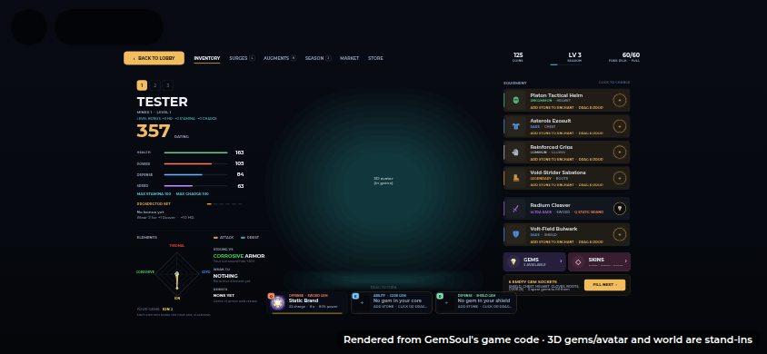 | 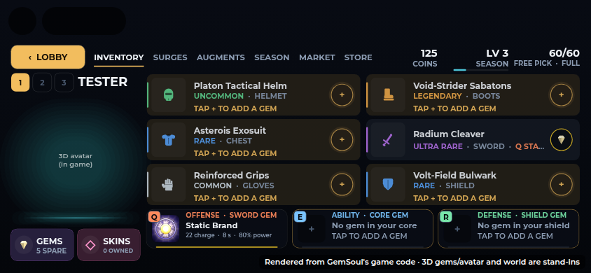 |

## What counts as a phone

`UiKit.short()` is true when the screen's **shorter side** is under 500
points (`UiKit.PhoneSide`): a phone, either way up. Before the camera knows
the screen size, a touch screen without a keyboard counts as one. Windows
read it once, when they're built.

It used to be the screen's height. The game turns phones sideways as it
opens (`first/Orientation`), but the screens built as it starts (the Store,
the Market, the Season Path, Social, the Surge Array and the kaiju panel)
could see the phone still upright for a moment, 391 x 847: not short. So
they laid out for a computer and then shrank that to fit the phone, and the
Store came out a third of its size, its text too small to read. Judged by
its shorter side, an upright phone is a phone too, and a tablet either way
up (744 points or more on its short side) never is. `tests/run_phone_layout.py` checks it on
phones, tablets and computers, either way up.

| The Store on a phone, before (a computer's layout, shrunk) | After (its phone layout) |
| --- | --- |
| 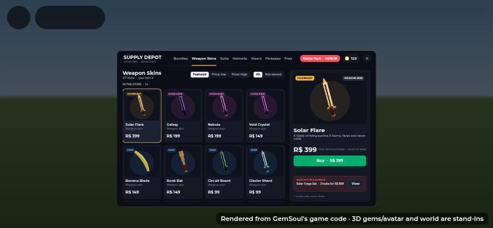 | 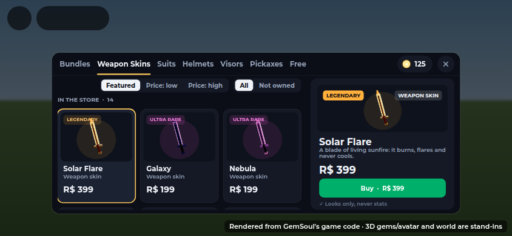 |

On a phone the Store's small print is also a size up (`UP` in `ShopUI`):
the rarity and owned tags, each card's name, kind and price, the sorting,
the section heads and the product page's tags and note. The product's
description stays at 12, since the longest are already two lines there.

These are offline renders of the game's UI code over a stand-in
background, not Roblox screenshots.

## The lobby and fights

The lobby and the fight screen are cleared down to what you use, like a
phone game should be.

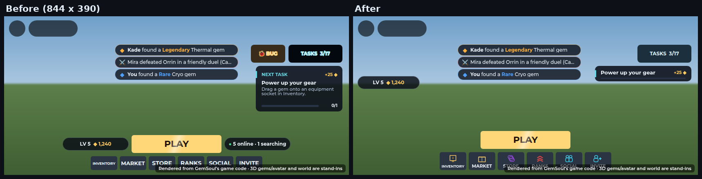

- **Chat is Roblox's.** On a phone or tablet (a touch screen without a
  keyboard) our chat box and its CHAT button are gone. Roblox's own chat
  takes over: the speech-bubble button in the top bar, with its unread
  count, opens the recent lobby chat, and what people say pops up as a
  bubble over their head (bubble chat is on for everyone). A computer gets
  the windowless chat feed in the bottom left (`ChatFeed`; see
  [lobby.md](lobby.md#chat-the-bottom-left-windowless)). The old chat box is
  off for now.
- **Level and coins** sit in a pill at the top right, with your health
  under it (`MobileLayout.wallet`, `MobileLayout.health`). See
  [Your kaiju, your pick and your party](#your-kaiju-your-pick-and-your-party).
- **The "online" pill is gone.**
- **PLAY is a green tile**, *2026-10-27*: the first of the row of tiles at
  the bottom, PLAY across it, where INVENTORY was. The big amber PLAY bar
  over the tiles is gone (a computer keeps it); its place stays for a
  mech's HOP OUT and the FIGHT / MINE switch beside it. **INVENTORY** is
  yellow, next along, and **RANKS isn't on a phone** any more (a computer
  keeps it). The row: PLAY, INVENTORY, TASKS, MARKET, STORE, SOCIAL,
  INVITE.

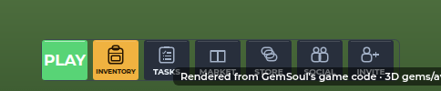
- **FIGHT / MINE** (your kit or your pick, the Y key on a keyboard) is a
  pill just left of PLAY's old place, level with it and a little taller (44 points),
  with its icon and word: ⚔ FIGHT with the pick out, ⛏ MINE with the kit
  out. It stays clear of Roblox's thumbstick; where there's little room
  beside PLAY it's narrower, down to round with just its icon. It used to
  be a round button down the left, under your kaiju's card
  (`MobileLayout.kitSwitch`).

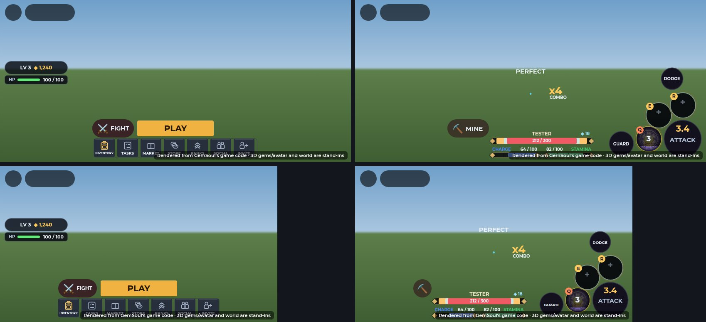

(The client code drawn by the UI harness, not Roblox screenshots.)
- **The tiles** are icons with their name small under them, 44 points
  tall (PLAY's is its word).
- **Tasks:** a TASKS tile in the dock (a clipboard), with a gold
  count of what's still to do. There's no TASKS button and no task or
  challenge strip in the top right: it's kept for toasts and your loot
  card (see [The top right](#the-top-right-toasts-and-your-loot)). The
  challenges are the Tasks window's DAILY page. See
  [play-screen.md](play-screen.md).
- **No BUG button** on a phone. The same form is SOCIAL's Feedback button.
- **The live feed** fits between your kaiju's row and the toasts' place
  where there's room for it (`MobileLayout.topGap`); on most phones the row
  takes that room and the feed stays off.

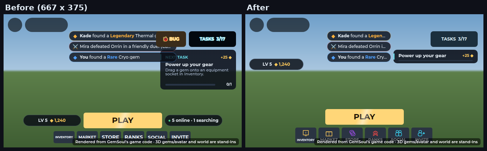

TASKS and REPORT A BUG looked greyed out (on every screen). Their buttons
are coloured by a gradient, and a gradient tints a button's own text too, so
their words came out nearly black. The words are now labels of their own.
(The offline renders don't draw that tint, so they show the old buttons
bright.)

### In a fight

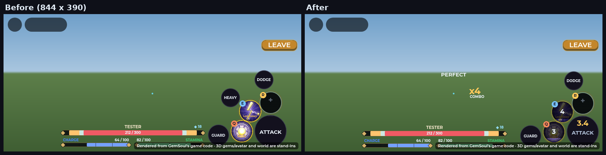

- **No HEAVY button.** Holding ATTACK already charges a heavy blow; ATTACK
  now swings each hand in turn, as a click does. The first fight's "HOLD
  ATTACK, release for a heavy" hint rings ATTACK.
- **The ring sits at the right edge**, under the right thumb: ATTACK in the
  corner, Q / E / R round it, GUARD and DODGE outside them.
- **No chat box** in a fight (Roblox's chat button is still in the top bar).
- **With your kit out in the Outpost**, MINE stays where FIGHT was, beside
  where PLAY was. Your health and stamina, and the moves over them, keep to
  its right, clear of the ring (`MobileLayout.vitals`), so they're narrower
  than in other fights (at least 200 points). On the smaller phones (667
  and 736 points wide) MINE is round with just ⛏ while the kit is out, from
  the same left edge, to leave them that much. Elsewhere they're as before.

### Mining in the Outpost

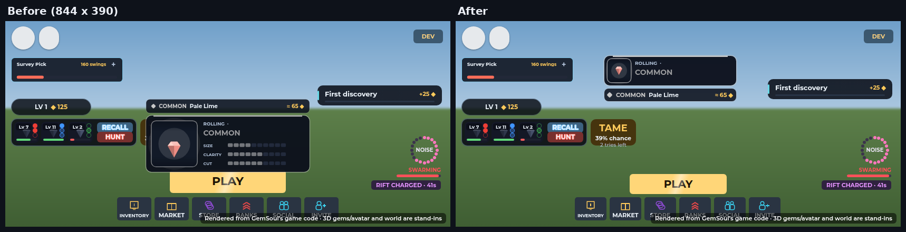

Mining with your kaiju out covered the middle of the screen. The loot card
sat over PLAY with its last find on top, and every creature's name and
health bar showed at full size from far off. Now the middle is left to
you, your kaiju and what's coming:

- **The loot card** is slim and sits in the top right, under the toasts'
  place (`MobileLayout.loot`; see
  [The top right](#the-top-right-toasts-and-your-loot)). It shows the reel,
  the rarity and element, the gem's name and its worth, but no stat bars.
  The last find sits as one row under it. The live feed steps aside while
  the card is up (`MobileLayout.claimTop`) and comes back when it goes.
  See [mining-loot.md](mining-loot.md#phones-and-spanish).
- **PLAY** is narrower and shorter (184 x 38), and so is the dock under
  it, so it takes up less of the bottom of the screen.
- **TASKS** moved into the dock (there's no button or strip at the top
  right now).
- **Nothing over creatures' heads**: no names or health bars over kaiju,
  wild kaiju or critters. Their bodies show how hurt they are
  (`BodyHealth`; see [play-screen.md](play-screen.md)).

  The names are smaller too. A computer keeps the longer distances (70,
  160 and 90), but there too your own kaiju go unnamed, and their bar shows
  only while hurt.

Each find is still in chat, and a full pouch still gets its message.

### Your kaiju, your pick and your party

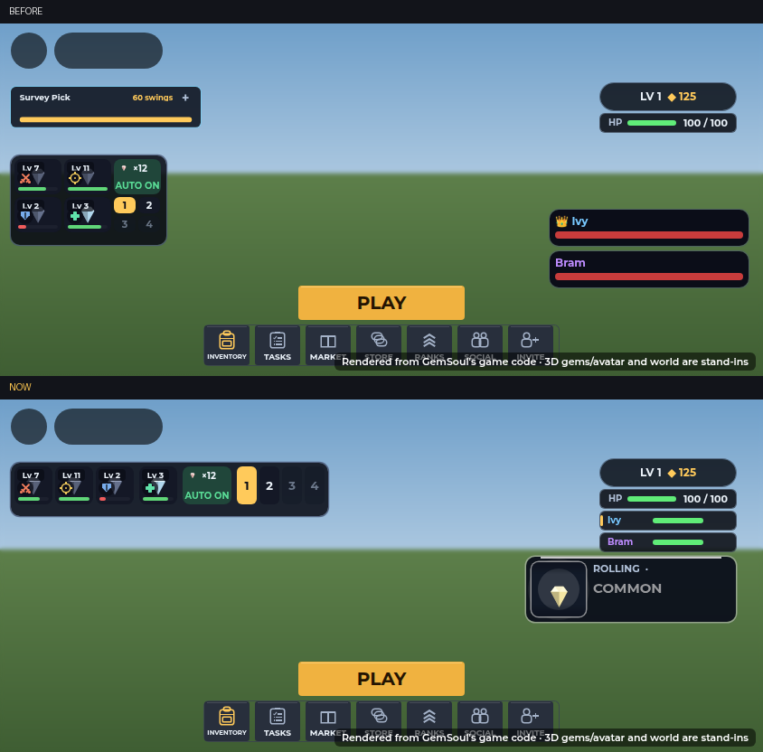

Teammates' cards were big red bars on the right side, over the middle of
the screen, and the pick card and your kaiju's card took two blocks down
the left. Now:

- **Your kaiju** are a small grid at the top left, in a fight too
  (`MobileLayout.kaiju`): the three fighters and the support in a row,
  AUTO HEAL a slim row under them. *2026-10-27:* it was one long row (351
  wide) that moved across the middle of the screen while you hunted.
- **The team keys 1–4** have their own row just above the move stick,
  under your left thumb (`MobileLayout.keys`; the team that's out is gold).
  There's no CALL BACK button: tap the team that's out to call it back,
  another team to send it out instead. See [kaiju.md](kaiju.md#your-team).
- **The HYPERBEAM** is a button of its own just right of the team keys,
  over the FIGHT / MINE switch (`MobileLayout.beam`): HYPERBEAM over its
  percent, SAVE along its bottom, its rim the meter. It used to be a pill
  on the kaiju card's bottom edge.
- **CATCH** comes up under your kaiju's card, as wide.
- **The swing bar** shows by the rock while you mine, *2026-10-27*: a
  small tag to the rock's right (a billboard on it, so it stays by the
  rock) with ⛏ and your swings left, dropping with each swing (it pops a
  little as it does), over a bar of them: the free pick's charge, or a
  bought pick's wear; red at none left. It comes with your first swing
  and goes 6 seconds after your last (`OutpostScene`'s `SwingBar`). It
  replaced the pick card popping up at the top as you mined: that card
  now shows only when you tap the swing bar (its charge and when the
  next swing is back), beside your kaiju's card (`MobileLayout.card`, at
  0.66 scale).
- **The foe list** comes up on the right in a fight, at the top where your
  coins and health sit (they hide while you fight), as many rows as fit
  above DODGE: two on most phones, one on the narrowest
  (`MobileLayout.foes`, `FoeBars`).
- **Teammates** are rows under your HP bar, the same size as it
  (`MobileLayout.party`): their name in their colour, a gold edge for the
  leader, and their health. Up to three.
- **Full screens** (the Inventory, the Store, the Market, Social, the
  kaiju panel and the like) hide the teammates' rows on a phone and on a
  computer, so they no longer draw over them.

When teammates' rows push the column down, the toasts' place and the loot
card move under it (see below).

### The top right: toasts and your loot

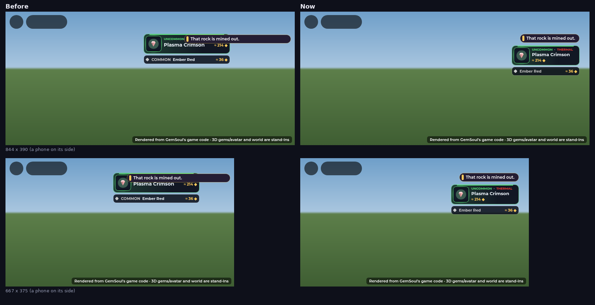

A toast ("That rock is mined out.") and the loot card used to share the top
right at the same height, so one sat on the other, and both were wider than
their words. Now they stack in one column on the right:

- **A toast** comes up in the top right (`MobileLayout.toast`): one at a
  time, one line, only as wide as its words (240 points at most, wrapping
  past that), left of the coins and after your kaiju's row. Where that
  leaves less than 170 points (667 and 736 wide), it goes under your
  health and teammates instead, right-aligned with them.
- **The loot card** sits under your health and teammates, right-aligned
  with them, and 196 points wide (it was 250). With three teammates on a
  short screen it'd reach the jump button, so it goes beside the column
  instead, where there's room. Its rarity, the gem's name and its
  worth are three lines beside the reel, so a long name still fits. Its row
  under it shows the gem's name in its rarity's colour, with no rarity
  name, so the name isn't cut off. While a toast wraps onto a second line,
  the card steps down under it, and back up when the toast goes.
- The live feed in the top middle stops short of the toasts' place.

`tests/mobile_layout_cases.luau` checks, on every phone size, that the toast
and the card (with its row) stay on the screen, clear of Roblox's tab, of
each other, of the pick card, the coins, the dock, the teammates' rows and
your kaiju's row, with no teammates, one and three. It checks the same for FIGHT / MINE: just left of PLAY and level
with it, room for its word, clear of PLAY, the tiles, Roblox's thumbstick
and jump button, the cards and the fight's ring. It also checks that the
fight's vitals and moves keep right of it and clear of GUARD, and that
without it they're as they were.

## The Inventory

When the full 1600 x 840 layout would show at under 70% of its size, the
Inventory is built compact instead (`chooseLayout` in `InventoryV2`), at
990 x 380:

- **The stats card is a sheet.** The miner's column on the left keeps
  miner 1 / 2 / 3, the name, the 3D miner and the GEMS / SKINS buttons;
  over the miner, **STATS · 212** (your rating on it) opens the full stats
  card as a sheet over the screen (rating, the four stats, max stamina and
  charge, your armor set and its bonus, what you're strong against, weak
  to and resist), scrolling if it runs long. Tap outside it or × to close.
- **Every stat of a piece on its card.** A tapped piece's card lists all
  its stats beside its perk's name (`+12 Health · +8 Defense · +5%
  Critical`), since there's no hover card on a touch screen; trying a
  spare on shows that piece's stats in gold.

  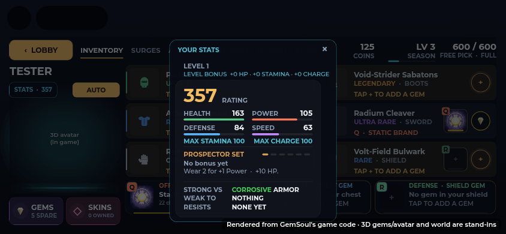
- **Equipment in two columns of three rows**, with the Q / E / R gem cards
  under them. A tapped piece opens in their place.
- **Larger text.** The small print (under 13 px on desktop) is drawn at
  13 px, and the wallet's captions shrink to fit rather than spill.
- **A tap opens a piece** (there's no hover tooltip on a touch screen).
- **The Gem Vault, the Wardrobe and the triad intro** are drawn for the full
  layout, so on a phone they open on a full-screen layer of their own,
  scaled as large as the screen allows.

The tabs along the top shrink together if their words run longer than the
row (Spanish does), so they never run into the coins.

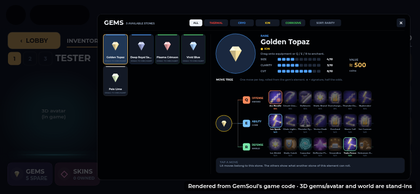

## The windows

Each of these is shorter on a phone, so it scales up larger:

| Window | Desktop | Phone | What gives |
| --- | --- | --- | --- |
| Market | 900 x 640 | 900 x 520 | Smaller picture when inspecting; the Sell form drops its details box |
| Store | 1100 x 660 | 860 x 340 | Its own layout: tabs in a slim header, a three-column grid beside a compact product page, narrower squad kits, a shorter bundle sheet |
| Season Path | 1000 x 560 | 760 x 440 | A shorter XP bar; the note under the track |
| Social | 1060 x 600 | 860 x 340 | Its own layout: one section at a time (Miners, Party, Arena, Friends, Chat) under tabs in the header |
| Surge Array | 1060 x 600 | 1060 x 520 | The gem pouch scrolls; the loadout card moves up beside it |

Every `IronUi.window` also uses nearly all the screen's height on a phone
(16 points spare, not 40).

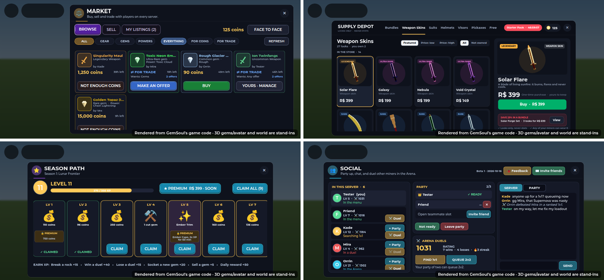

### Roblox's buttons

Roblox draws its own buttons in a strip along the top of the screen: the
Roblox button, then a pill with its menu, chat and voice, on the left. On a
phone the strip is 58 points tall, and its buttons reach about 265 points in
from the screen's left edge on a notched phone (about 205 on one without a
notch). A tap there goes to Roblox, never to us, so nothing of ours may sit
under them.

A screen that leaves the strip alone (a `ScreenGui`'s default) starts below
it. The windows, the Inventory and a few overlays draw over it
(`IgnoreGuiInset`), and those keep themselves clear of the buttons:

| Helper | What it does |
| --- | --- |
| `UiKit.topbar(width)` | The strip's height, where Roblox's buttons end, and where its free part ends on the right (less the DEV button's room) |
| `UiKit.clearTopbar(screen, size)` | A centred box that would reach under the buttons moves beside them or shrinks to fit below them, whichever leaves it bigger. A box already clear stays as it is |
| `UiKit.onTopbar(fn)` | Calls `fn` when the strip changes: Roblox draws its buttons, opens or closes its menu, or the DEV button comes. Returns a function that stops it |
| `UiKit.reserveTopbar(width)` | Keeps the strip's right end for our own button (DEV) |

**Why the Wardrobe sat under them.** Roblox fills in
`GuiService.TopbarInset` a moment after our screens are built. Until then it
reads empty, so a screen laid out at once (the Inventory's pop-ups, the
Wardrobe and the Gem Vault among them, and the Store) placed itself as if
there were no buttons, and never looked again. The Wardrobe's title and
first tab sat under Roblox's buttons, and its ✕ under the DEV button. Now:
- an empty reading assumes the usual strip (58 tall, buttons to 290);
- every screen laid out around the strip lays itself out again when Roblox
  fills it in (`UiKit.onTopbar`);
- it applies on every screen size, not only phones. On a desktop or tablet a
  window that reaches the top is moved down a little.

**What uses it:**
- every `IronUi.window`, the Store and its offer pop-ups;
- the Inventory and its pop-ups (Gem Vault, Wardrobe);
- the dashboard (its top margin is the strip's real height, not a fixed 54);
- the 1v1 panel between rounds;
- the mine's top bar (just below the strip where it would reach the buttons);
- the tutorial's card and SKIP (just below the strip);
- the loading guide preview.

**The DEV button** (testers, touch screens) sits at the strip's right end,
centred on it, and keeps that end (`UiKit.reserveTopbar`). A window that
reaches into the strip stops short of it, so it can't cover a close button.

**Tests.** `tests/run_topbar.py`:
- checks the rules on six screens (phones, a tablet, a desktop) with seven
  window sizes: before and after Roblox draws its buttons, with DEV, and
  with Roblox's menu opened wide;
- checks that every screen drawn over the strip uses these helpers or is a
  listed full-screen cover with nothing in the strip: the loading screen, the
  title screen, the drop pod's flash, damage numbers and the spar flash.

**Renders.** 24 phone renders were drawn with Roblox's buttons and the DEV
button in place: at 844 x 390, at a notched phone's 726 x 390 safe area and
at 667 x 375, each both as the buttons appear and after.

- **Before:** with the strip still empty, 10 screens (13 renders) had
  something of ours under Roblox's buttons or DEV: the Wardrobe, the Gem
  Vault, every Store tab, the Starter offer, the Season Path, Social, the
  Market, the Surge Array, the Augment tree and the mine's top bar. On most
  of them the ✕ sat under DEV.
- **After:** no button or text is under either, on any of them. What is
  left in the strip is backdrop: the intro's dark band and the title
  screen's art.

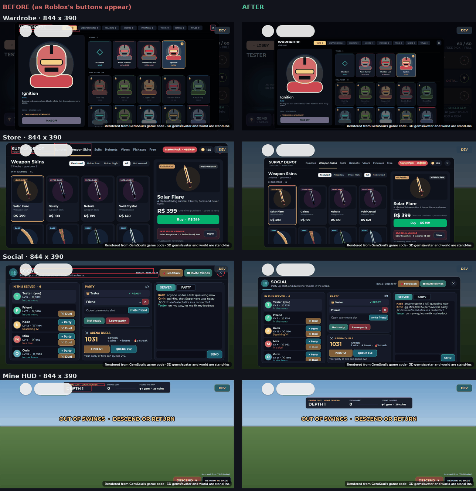

### Scale on a phone

How large each screen shows (1 = as drawn), before and after. These renders
assumed Roblox's buttons end 188 points from the left; they reach about 265,
so the windows that reach the top now shrink a little more to sit below
them (see Roblox's buttons, above).

| Screen | 844 x 390 | 667 x 375 |
| --- | --- | --- |
| Inventory | 0.36 → 0.82 | 0.34 → 0.64 |
| Gem Vault, Wardrobe | 0.36 → 0.46 | 0.34 → 0.43 |
| Market | 0.55 → 0.70 | 0.52 → 0.59 |
| Store | 0.57 → 0.62 | 0.55 → 0.58 |
| Season Path | 0.62 → 0.69 | 0.60 → 0.63 |
| Social | 0.58 → 0.69 | 0.56 → 0.59 |
| Surge Array | 0.58 → 0.62 | 0.56 → 0.59 |
| Augments | 0.50 → 0.53 | 0.48 → 0.44 |

The Augment tree keeps its size. On the smaller phone it gives a little to
get out from under Roblox's buttons, which it used to sit under.

## Helpers

| Helper | What it does |
| --- | --- |
| `UiKit.short()` | True on a phone on its side |
| `UiKit.clearTopbar(screen, size)` | Keeps a centred window clear of Roblox's buttons: returns a further scale and a Position |
| `UiKit.topbar(width)`, `UiKit.onTopbar(fn)`, `UiKit.reserveTopbar(width)` | The strip Roblox's buttons sit in, a call when it changes, and room in it for DEV (see [Roblox's buttons](#roblox-s-buttons)) |
| `UiKit.fit(label)` | Keeps a one-line label at its size, shrinking it only when its words don't fit |
| `UiKit.shrinkRow(row, list)` | Shrinks a row laid out side by side to its parent's width when its contents outgrow it |
| `MobileLayout.kaiju(screen)`, `kaijuCells(card)` | Your kaiju's small grid at the top left, where its tiles and AUTO HEAL go, and CATCH under it |
| `MobileLayout.keys(screen)` | The team keys 1–4: a row just above the move stick |
| `MobileLayout.beam(screen)` | The HYPERBEAM's own button: just right of the team keys, level with their bottom |
| `MobileLayout.card()` | The pick card's place: beside your kaiju's card |
| `MobileLayout.foes(screen, viewY)` | The fight's foe list: top right, down to just over DODGE |
| `MobileLayout.party(screen, rows)`, `setPartyRows(n)`, `onParty(fn)` | Teammates' rows under your HP bar, how many are up, and a call when that changes |
| `MobileLayout.toast(screen)` | A toast's place on a phone: left of the coins, `Toast.W` (240) at most, one line (`Toast.H`); `Under` when it goes under the column instead |
| `MobileLayout.loot(screen)` | Where the slim loot card goes on a phone: under your health and teammates; `Beside` when it goes beside them |
| `MobileLayout.topGap(screen)` | The room left at the top middle (the live feed and the level-up card) |
| `UiKit.toastBottom()`, `UiKit.onToastMoved(fn)` | How far down a phone's toast reaches, and a call when that changes (the loot card moves under one that wraps) |
| `MobileLayout.claimTop(owner, on)`, `topClaimed()`, `onTop(fn)` | Who has the top (the loot card), so the feed can step aside |
| `BodyHealth.watch(model)` | A creature's health on its body, not over its head |

## Also fixed

- The Starter Pack banner (desktop too): the price, the old price and the
  saving in one row were wider than the price box. The saving now sits in
  the box's corner.

## How the renders are made

As in [ui-style.md](ui-style.md): Lune runs the client modules against
stand-in Roblox services, writes the GUI tree as JSON, and a headless browser
draws it. 3D models and the world are placeholders. For a phone the
stand-ins give the screen at 844 x 390 (and 667 x 375).

Roblox's buttons are drawn at their real size and place: the Roblox button
and the menu pill, 44 points tall, to about 262 points across on 844 x 390.
The DEV button is drawn at its place too. Each screen the windows draw over
the strip is given its full height; the others start below the strip.
The renderer lists any button, text or box of ours under either one. Each
screen is drawn twice: as Roblox's buttons appear (`TopbarInset` empty) and
after.
