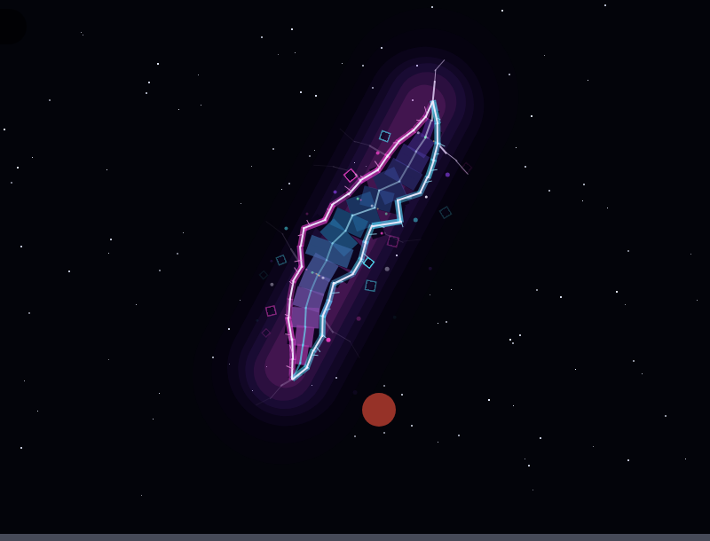
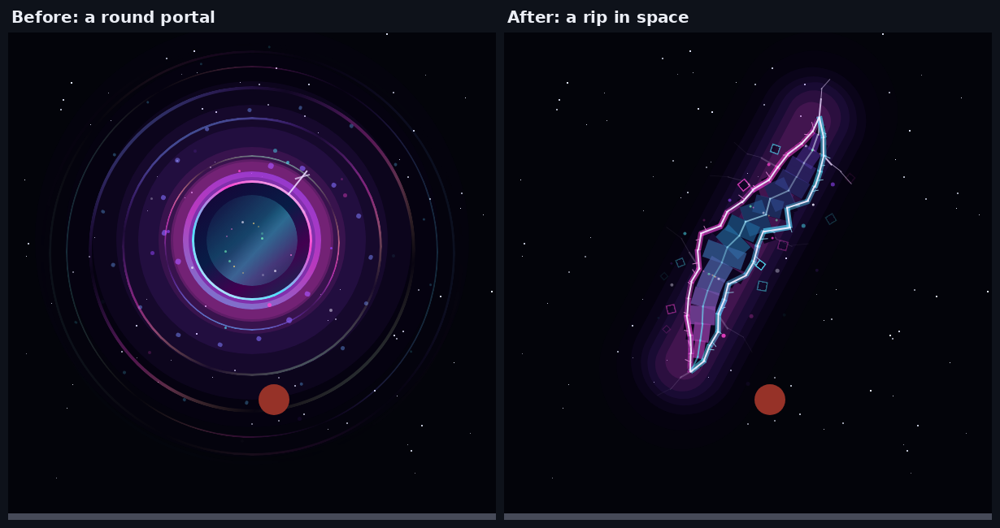
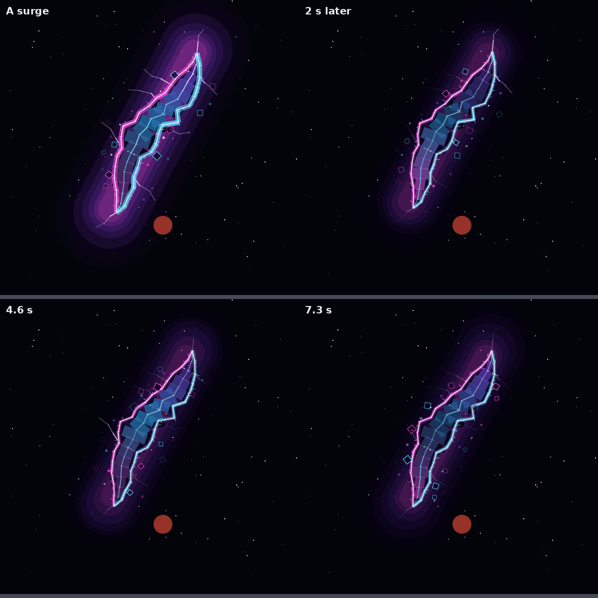

# The Outpost's backdrop: the crater rim and the rift

## The crater rim always loads

The quarry is ringed by a natural crater rim (`craterRim` in
`src/server/World/OutpostWorld.luau`). It's a continuous slope of wedge
triangles from 470 to 770 studs out, cresting about 105 studs high.

With streaming on, Roblox only sends a player the parts near them: up to
1,024 studs at best, and less on a phone or when the map is busy. From
most of the quarry, the rim's far side is 900 to 1,200 studs away, so it
never loaded and the horizon was flat. The jagged peaks before it stood
closer in (480 to 540 studs), so they mostly made it.

The rim's model (`NaturalCraterRim`) is now `Persistent`, like the sky's
planets: every player gets it whole when they join, wherever they stand.
That's about 1,500 parts, sent once.

Its triangles were checked offline. All 1,440 wedges have two corners
exactly on the rim's ring points and the third at the right foot point,
so the rim is built correctly; it just wasn't being sent.

`tests/run_moon_quarry_scene.py` fails if the rim or the sky can stream.

## A rift in the sky

Another dimension showing through a rip in space: a rift high in the north
sky, past the red moon. It's drawn by each player's own client
(`src/client/Modules/SkyRift.luau`); the server sends nothing.

It used to be a round portal of rings. It's now a tear:

What it's made of:
- **The tear.** A long, jagged rip leaning like "/", pointed at both ends.
  Each side is torn to its own ragged width (`SkyRift.tear`). Inside is the
  other side: light flowing slowly along it, a bright filament down its
  middle, and stars in pink, green and gold.
- **Torn edges.** White-hot lines, frayed with loose threads, glowing
  magenta down one side and cyan down the other, flickering.
- **Haze.** A violet glow spilling out round it into the black.
- **Cracks.** Fractures running on into space from both ends and from its
  sides. They're faint, and flash now and then.
- **Shards.** Pieces of the sky breaking off its edges, spinning slowly
  away and fading.
- **Seepage.** Sparks leak from its edges and drift out and down, and
  glowing motes (3D particles) spill out all along it toward the quarry.
- **Surges.** Every 9 seconds it flares: the edges blaze and thicken, the
  glow swells and every crack lights at once.

(Offline renders of the rift's picture over a stand-in sky. In game it
hangs 2,600 studs out, and the tear is about 21 degrees long.)

### Where it is

`SkyRift.Offset` puts it 34 degrees up in the north, above the red moon
and beyond every body in the sky. It leans away from the red moon, so its
lower tip passes well to the moon's left. The tear clears every planet.
The red moon is closer, and passes in front of its glow.

### Cost

It's one BillboardGui of about 260 frames (the round one had about 110),
updated 30 times a second while you're in the Outpost, and one particle
emitter at 5 a second. Anywhere else it's hidden and nothing runs.

### Code and tests

- `src/client/Modules/SkyRift.luau`:
  - `mount`, `show` and `step` put it in the sky and run it;
  - `draw` builds the picture in any square frame (the billboard, or a
    preview);
  - `tear`, `surge`, `mote`, `shard` and `crack` are the shape and the
    timing, as plain functions.
- `src/client/Modules/OutpostScene.luau` mounts it on the first frame in
  the Outpost, shows it only while you're there, and steps it.
- `tests/sky_rift_cases.luau` (`tests/run_sky_rift.py`) checks that:
  - it's high in the north, behind the stars, and its tear is 15 to 30
    degrees long;
  - the tear is pointed at both ends, leans like "/", stays in the picture,
    is never wider than `Width`, and is torn (its width keeps changing,
    and its two sides differ);
  - drawn where the rift's picture sees them, the gas giant, the home
    world and the red moon are all clear of the tear, and those positions
    still match `OutpostWorld`;
  - sparks and shards stay in the picture, never pop in or out, and only
    show outside the tear; shards spin;
  - a surge lasts about a second, every 9;
  - each crack flashes between 5% and 30% of the time.
