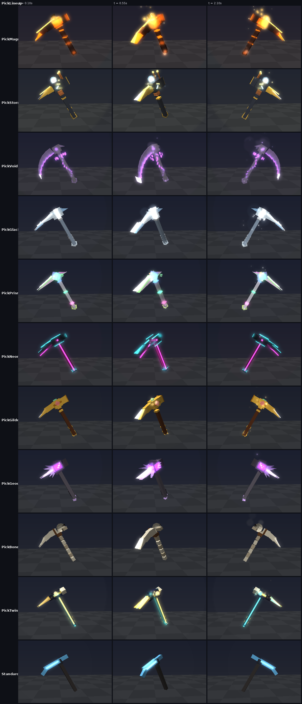
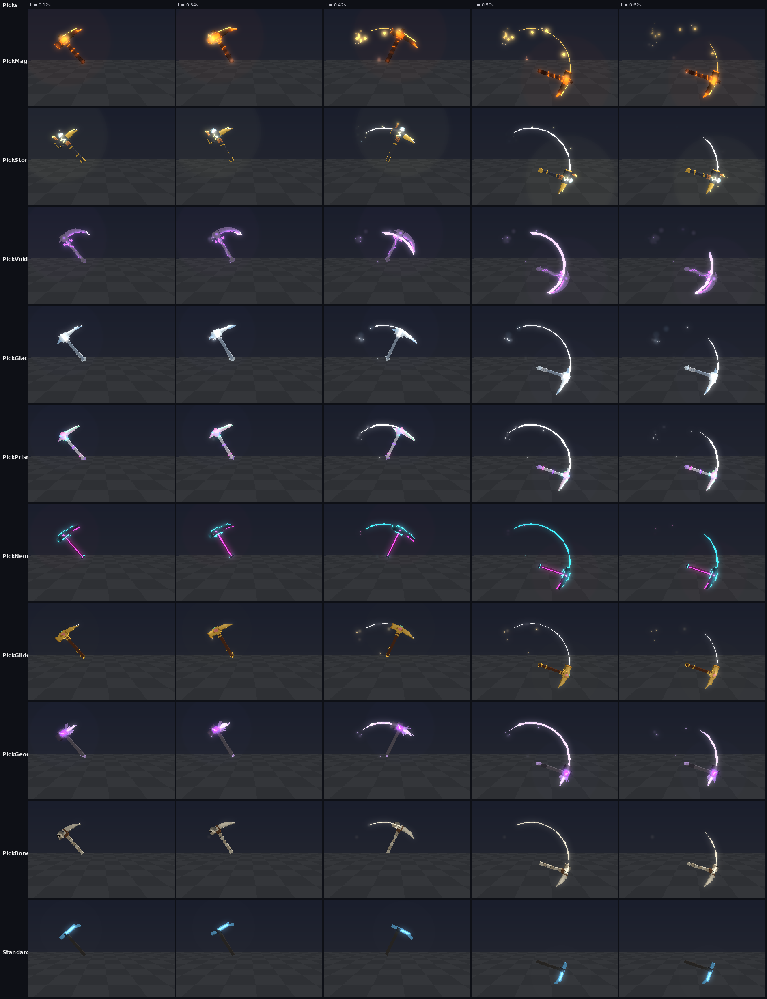
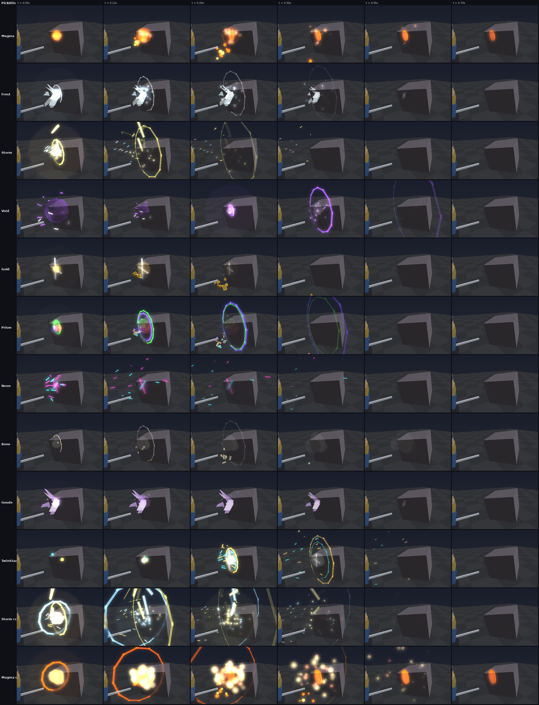

# Pickaxe skins (2026-10-14)

Ten pickaxe skins, a new cosmetic kind (`Pick`). A skin changes how your pick
looks and how its hits land. It never changes what it does: the pick you mine
with (Survey, Titan or Plasma) keeps its swings and power. With no skin, you
hold that pick in its own colour, as before.

| Skin | Rarity | How you get it | The look | Its hit on a rock |
| --- | --- | --- | --- | --- |
| Magma Heart | Legendary | R$ 199 | Basalt split open on lava; smoulders, drips embers | Lava spatters out, a molten splash glows on the rock |
| Stormbreaker | Legendary | R$ 199 | Thunder hammer-pick: gold spike, copper coil, tesla prongs, a crackling orb | Lightning cracks down from the sky onto the hit |
| Void Reaper | Legendary | R$ 199 | Night-glass scythe on a black haft, runes and a violet spiral | The rock folds in on the hit, then a violet shockwave |
| Glacier Fang | Ultra Rare | R$ 149 | A jagged icicle the length of your arm, steaming cold | A crown of ice shards bursts out, snow falls |
| Prism Shard | Ultra Rare | R$ 149 | Cut diamond; every crystal cycles through the rainbow | Rainbow flashes, shards and rings |
| Neon Runner | Rare | R$ 99 | Matte black cut with hot pink and cyan light | Pink and cyan sparks streak off; an X marks the hit |
| Gilded Prospector | Ultra Rare | Masterwork Crate | Polished gold, rubies and an emerald | Coins pop out spinning, a star glints |
| Amethyst Geode | Rare | Geode Crate | A rough rock knocked open, an amethyst cluster for a spike | Amethyst crystals snap out of the rock |
| Bone Crusher | Uncommon | Geode Crate | A tusk lashed to a spine, a skull for a hammer | Bone chips and a puff of dust |
| Twin Star | Legendary | Invite 2 friends (never sold) | Night-blue, twin gold and teal prongs, two stars circling the head | A gold star and a teal one crash together and burst |

Each skin has its own particles, light, and a trail that streaks through every
swing. A critical hit adds the most to its effect. Everyone at the Outpost sees
your skin and your hits. Another miner's hits use fewer pieces than your own.

## Where they show

- **Outpost:** the pick in your hand (the server builds it, so everyone sees it).
- **Expeditions:** the pick you dig with.
- **Shop:** a new **Pickaxes** tab, with each pick turning in 3D.
- **Wardrobe:** a new **PICKAXES** tab beside Suits and Weapon Skins. Each miner
  holds its own pick, as with suits and skins. The Inventory's SKINS button
  counts them.
- While testing (`Config.TestCosmeticPrice`), every pick also costs 25 coins and
  goes straight into your hand.

Each Robux skin needs its own Developer Product before it can be sold. Paste its
id in `Store.RobuxProducts` (until then, the slot is 0).

## Renders

Close up, turning: the profile, three-quarters, and the far side.

Each pick swung down through a rock, with its trail.

Each skin's hit on a rock, with critical hits for Storm and Magma.

These come from the VFX harness (`tools/vfx_sim.luau` scenarios `PickLineup`,
`Picks` and `PickHits`, drawn by `tools/vfx_render.py`). It draws a simple
stand-in for Roblox, so in game, neon glows more and glass and ice show their
textures.

## Code

| File | What it does |
| --- | --- |
| `src/shared/PickaxeLooks.luau` | Builds every pick (each skin, and the standard tier look) |
| `src/client/Modules/PickImpacts.luau` | Each skin's hit effect |
| `src/shared/Cosmetics.luau` | The nine `Pick` cosmetics; picks belong to each miner |
| `src/server/Systems/OutpostServer.luau` | The Outpost pick, rebuilt when you change skin |
| `src/client/Modules/MineScene.luau` | The expedition pick |
| `src/client/Modules/OutpostScene.luau` | Plays the hitter's effect on every hit |
| `src/server/Systems/Equipment.luau` | The 3D previews for the Shop and Wardrobe |
