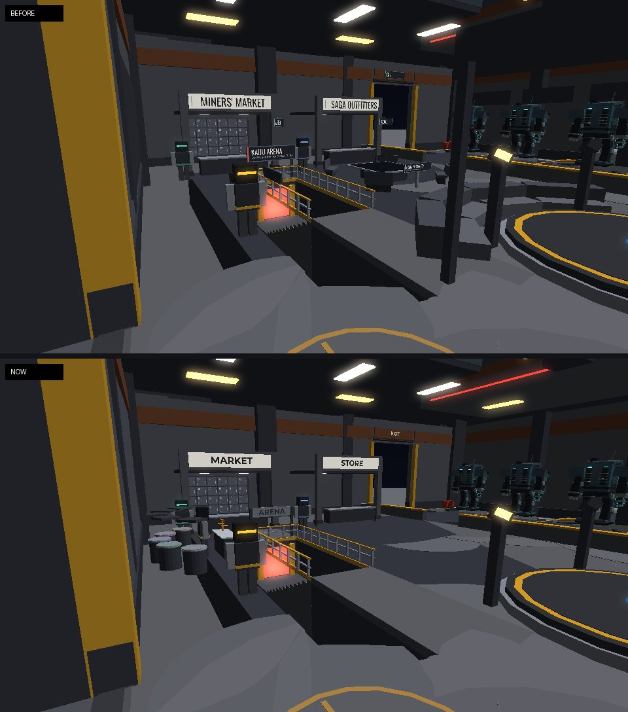
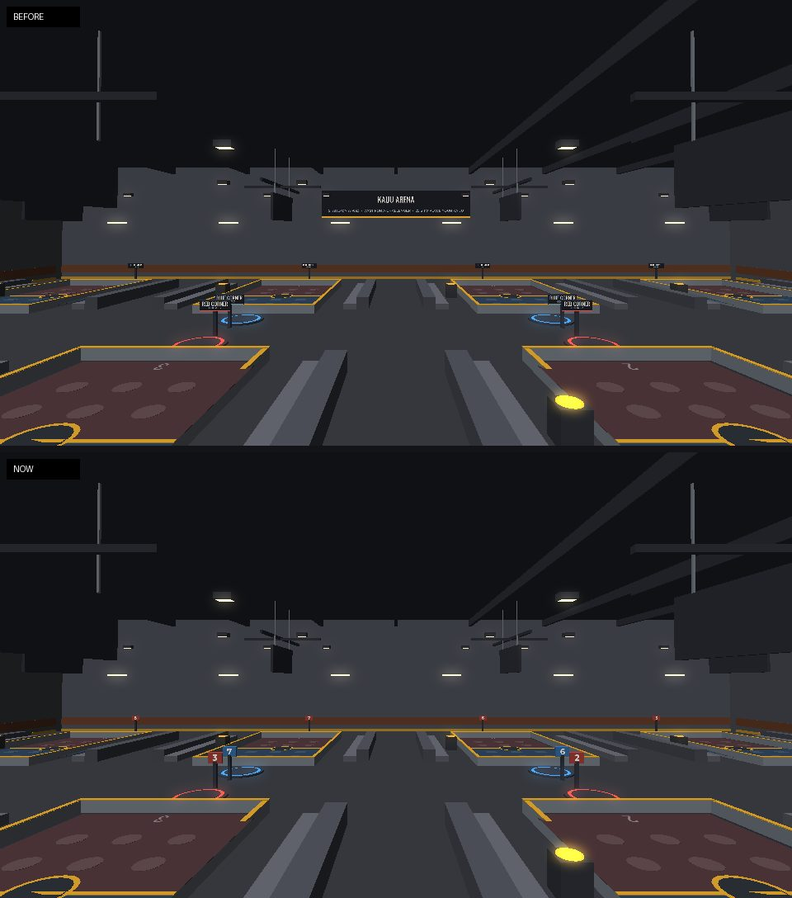
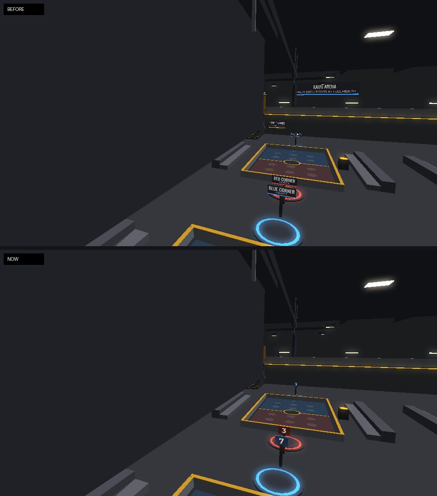
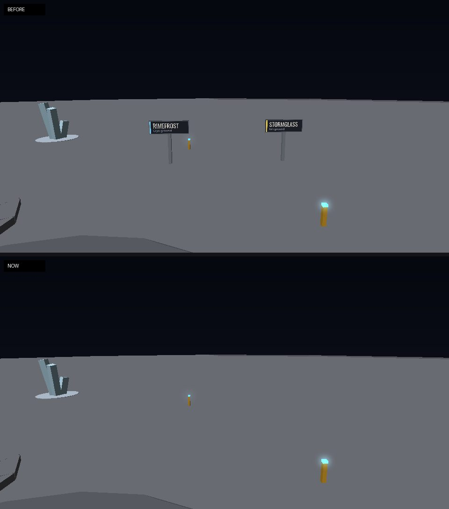
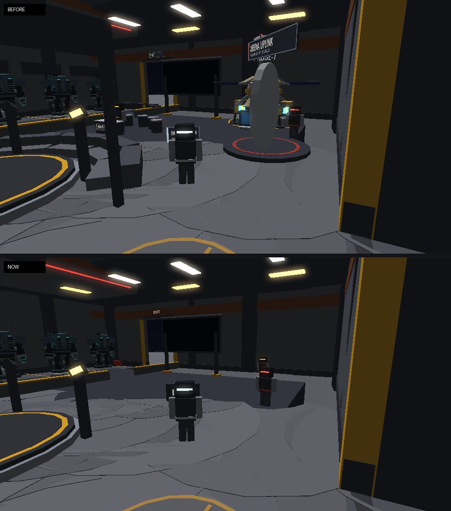
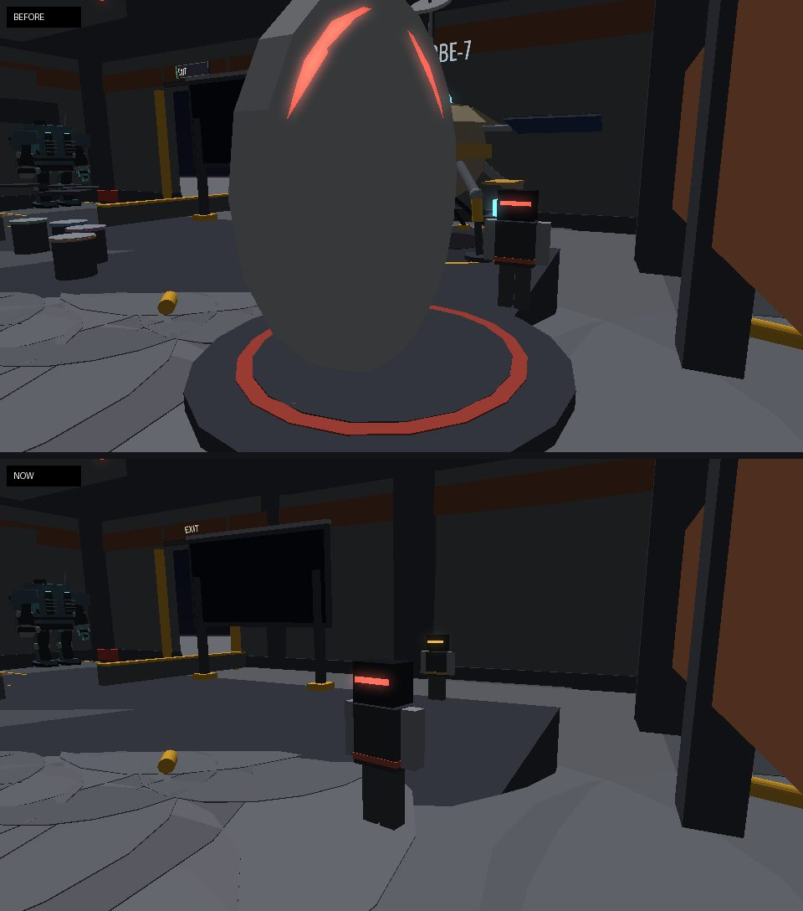
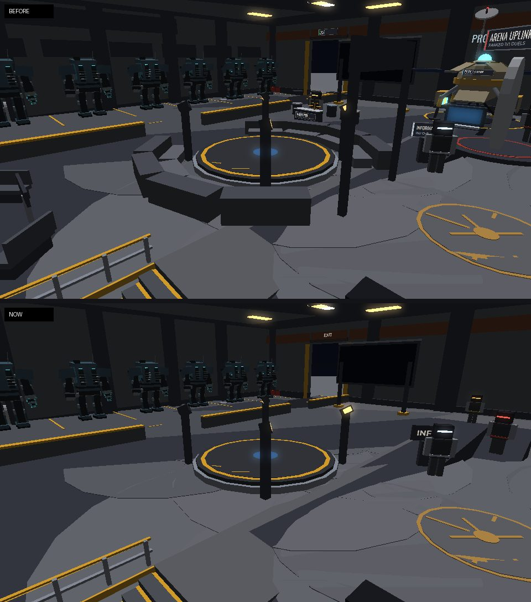

# Plain signs, and a clearer Shelter floor

*Since then (later on 2026-10-22): PROBE-7 removed, Brutus given a bounty booth (BOUNTIES is a sign word now), the leaderboard rebuilt as the Hall of Fame. See [hall-of-fame.md](hall-of-fame.md).*

2026-10-22. Two changes to the same building:

- **The signs** say where a place is, in one word, and nothing else. The
  Shelter's, the Kaiju Arena's downstairs and the quarry's.
- **The Shelter's floor** loses four things. These were removed:
  - the PROBE-7 station;
  - the white duel gate;
  - the stands round the hologram stage;
  - the survey table and its benches.
- **The crew stand there instead.** PROBE-7 is now a crew robot by the east
  wall, where its station stood, and sells refills. Brutus stands where the
  gate was, for duels.
- **Ilsa's gem desk and the Gem Gallery** moved next to the Market.

The renders below are offline stand-ins built from the game's own parts and
sign GUIs (`OutpostWorld`, `KaijuPitWorld`), not Roblox screenshots. The crew
are drawn as plain figures in their station colour, where the server puts
them.

## The signs

A sign is a word the HUD already uses: **STORE**, **MARKET**, **ARENA**,
**EXIT**, **INFO**, **SHELTER**, **QUARRY**, and the bay and court numbers.
It is painted on the wall or on a bare steel plate, so these are gone:

- a line under the name;
- a colour bar down the side;
- invented names (SAGA OUTFITTERS, MINERS' MARKET, ARENA UPLINK, MECH
  GARAGE);
- taglines ("STAND ON A PAD TO BATTLE", "EVERY KAIJU FIGHTS AT FULL HEALTH",
  "DOWNSTAIRS: TAKE THE WEST STAIRS").

| Where | Before | Now |
| --- | --- | --- |
| Store / Market shopfronts | SAGA OUTFITTERS, MINERS' MARKET, a ◆ mark and blade signs | **STORE**, **MARKET** on the lightbox |
| The stairs down | KAIJU ARENA board with a line, then KAIJU ARENA / DOWNSTAIRS: KAIJU BATTLES over the doorway | one steel plate, **ARENA** |
| Garage | MECH GARAGE banner, BAYS 01-08 | each bay's number painted over it, **EXIT** over each door |
| The hall | FIELD GUIDE board, the survey table's name, the GEM BUYER desk sign, ARENA UPLINK | none (INFO-9's kiosk says **INFO**) |
| Shelter outside | SAGA SHELTER / FORWARD OPERATING BASE | **SHELTER** painted over the door, **QUARRY** inside it |
| Downstairs | KAIJU ARENA boards with taglines, HOW IT WORKS, UP TO THE SHELTER, ARENA GUIDE, RED/BLUE CORNER · COURT n | **EXIT** over the way up, **INFO** on COACH-4's screen, each corner's plate in its colour with the court's number |
| The quarry | a sign either side of every spoke naming the biome (ASHFALL, Thermal ground...) | none |

**No title cards.** Crossing into a band (the Core, the Fringe, the Edge)
or a biome no longer puts its name across the screen
(`Client.FrontierHud`). The biomes keep their ground, light and fog; they
have no `Label` or `Line` any more (`Shared.Frontier.Biomes`). The Rift
Vein's news keeps its banner ("RIFT VEIN ...").

The leaderboard's title is **LEADERBOARD**.

## The Shelter's floor

- **PROBE-7** is a crew robot by the east wall, where its station stood
  (`site.Crew`, id `Probe`; `Shared.Vendors.Probe`, gold visor). Talk to it
  (E) and its first option, **Open the Exchange**, opens the refills
  (`Client.Dialogue` `actions.Exchange`, `OutpostScene.openProbe`). It
  answers "How do refills work?" too. The Exchange still opens by itself
  when your swings run out.
- **Brutus** stands where the duel gate was. His first option, **Find me a
  duel**, opens the Arena (`actions.Duels`).
- **No station or gate prompts.** `site.Probe` and `site.Gate` are gone, and
  so are their prompts (PromptKind `Probe` and `Gate`). The Store and Market
  counters keep theirs.
- **The stage** keeps its disc, the projector, the hologram and the
  floodlights. The two tiers of stands round it are gone.
- **The survey table** is gone, with its benches and its scan
  (`Client.ShelterLife` no longer draws `SurveySweep`).
- **Ilsa and the Gem Gallery** are next to the Market, between it and the
  door, along the south wall:
  - the five cases are in an arc round (-44, 46) in the Shelter's frame,
    11 out, from 40° to 140° (`GALLERY` in `OutpostWorld`, the same as
    `ShelterLife.Gallery`): Common at the east end, Legendary by the
    Market;
  - Ilsa's desk faces the hall, and she stands behind it with the cases at
    her back;
  - the cases stay clear of the stairs' well and the wall.

The crew are now seven: Ilsa, Brutus, Tamsin, Borin, Garrick, INFO-9 and
PROBE-7. Each stands at least 12 studs from the others.

## Spanish

New entries:

| English | Spanish |
| --- | --- |
| PROBE-7, Refills | PROBE-7, recargas |
| Open the Exchange | Abrir el Intercambio |
| How do refills work? | ¿Cómo funcionan las recargas? |

PROBE-7's greeting and reply are in Spanish too. The painted words stay in
English, like the rest of the world's signs; the translator covers the
screen and the prompts.

## Tests

| Suite | What it checks |
| --- | --- |
| `run_signage` (new) | Builds the Outpost and the arena hall. For every word on a surface: it's one of the allowed words or a 1-2 digit number, one word to a sign, none of the old taglines or names. How many signs carry each word. Bay numbers painted 01-08. No `Sign` boards or colour `Bar`s left. No biome signs or `Crossroads`. No title cards in `FrontierHud`, but the Rift Vein banner kept. No "Uplink" in the crew's lines |
| `run_shelter_life` | No survey table, duel gate or probe station built, and no stands round the stage. PROBE-7 and Brutus stand where those were. The gallery's cases are next to the Market, clear of the wall and the stairs' well, with Ilsa at the gallery. The gems still sit in their cases and the odds plaques face the hall |
| `run_outpost` | Seven crew, PROBE-7 among them. PROBE-7 opens the Exchange first and Brutus finds a duel first. No `Probe` or `Gate` prompts |
| `run_moon_quarry_scene` | No signs in the quarry; the site hands out no Probe or Gate |
| `run_frontier` | Biomes have no `Label`/`Line`; no zone title cards; the vein's banner kept |

## Also in this round

- **Reviving a kaiju costs more gems.** One that comes back by itself is
  back at 10% health and weak: gems heal it at a third of their power until
  it's full again. From 10% that's about 27 Commons where a well kaiju takes
  9. See [kaiju.md](kaiju.md#knocked-out).
