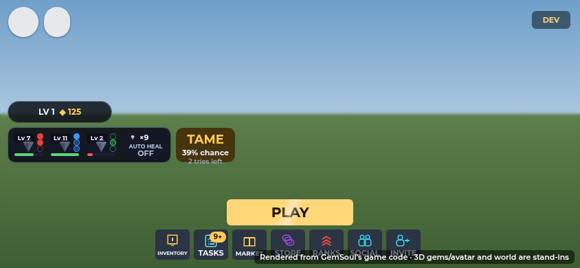
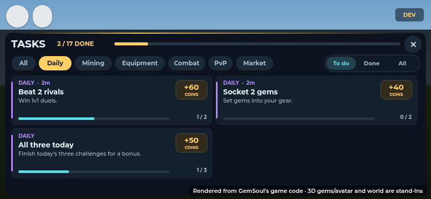
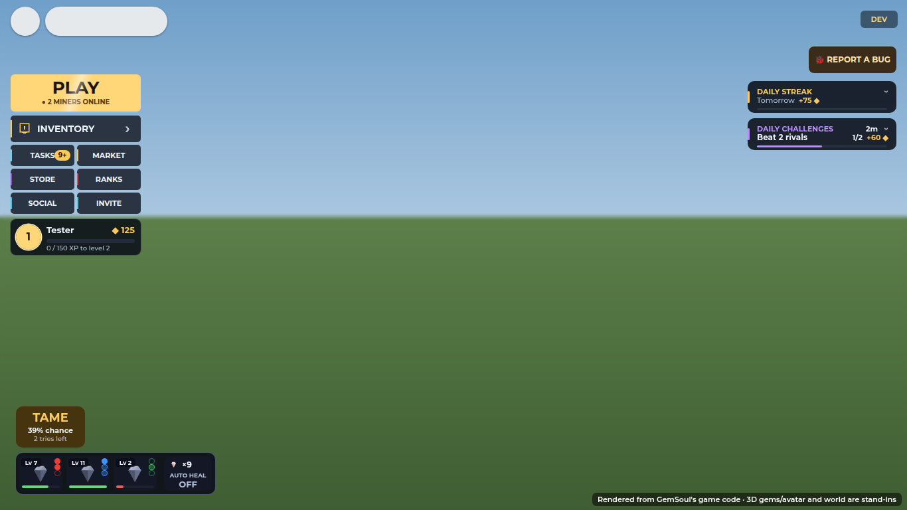
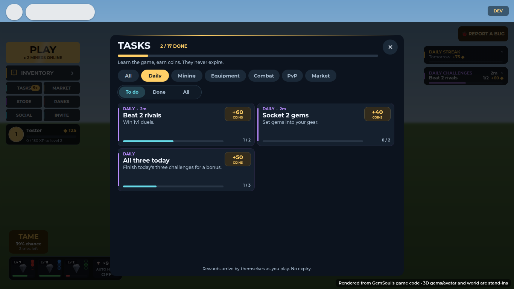
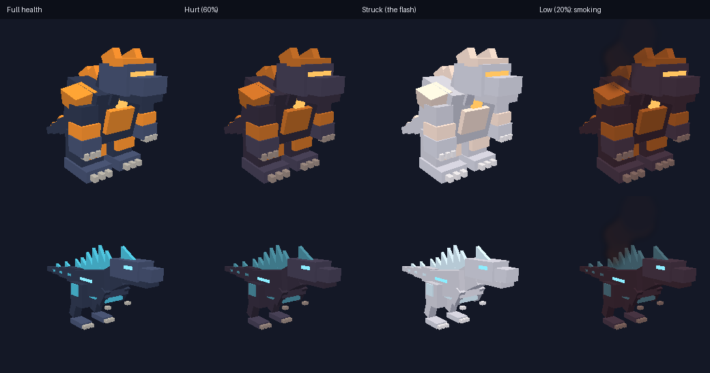
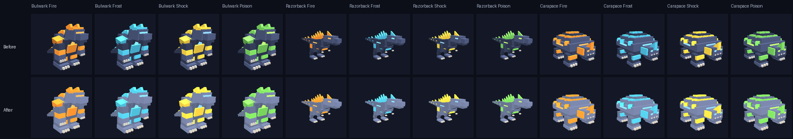

# The play screen: kept for the game

What's on screen while you play in the Outpost was getting in the way of the
action, on a phone most of all. This round clears it:

- Tasks moved into the menu. There's no TASKS button in the corner.
- Health shows on the creatures' bodies, not in bars over their heads.
- The noise meter is gone.
- Kaiju portraits in the kaiju UI are brighter.
- Your kaiju finish a fight even when you walk off to mine.

The screenshots are offline renders of the game's own UI code. The world,
avatar and 3D gems are stand-ins. The kaiju images are an offline
approximation of the lighting, not Roblox screenshots.

## Tasks: in the menu, not on the play screen

The TASKS button at the top right is gone, and so is everything about tasks
on the play screen:

- the phone's slim strip under it (the next task, then the day's challenge);
- the NEXT TASK card on a computer's board.

**TASKS is a tile in the menu** (`LobbyUI`), with a clipboard icon:

- On a phone it sits in the dock under PLAY, between INVENTORY and MARKET.
- On a computer it's the first of the small buttons under INVENTORY. There
  are six of them now, which fills the two columns.
- A gold badge counts what's still to do: tasks not yet paid plus today's
  challenges not yet done. It shows "9+" past nine.
- Tapping it opens the Tasks window (`TrainingRewards.client`, through its
  `OpenTasks` event), on the page with something left to do.

**Today's challenges are in the Tasks window too**, as its **DAILY** page.
There are three cards, each with its progress, its coins and the time until
new ones come. A fourth card, "All three today", pays the bonus. They show
under "All" as well. The window sets an `Open` attribute with the count
behind the badge.

On a phone the top right is now empty: no button and no strip. The lobby's
board (`LobbyBoard`) is off on a phone. On a computer it stays, under REPORT
A BUG, which moved into the corner TASKS had. The board keeps the daily
streak, the challenges row and the next unlock.

`MobileLayout` lost `tasks()` and `board()`. The phone's slim loot card now
spans the top right of the pick card, always full height. The short card,
which used to sit above the strip on a small phone, isn't needed any more.

Also fixed: in the Tasks window, tapping a category chip or the To do / Done
/ All switch threw an error. The scroll reset ran before the list existed.

## Health on the body

There are no names or health bars over the heads of your kaiju, other
players' kaiju, wild kaiju or critters. Before, in a fight they piled up over
the action. Each creature's body now shows its own health
(`src/client/Modules/BodyHealth.luau`):

| | What you see |
| --- | --- |
| Outlined | A glowing outline round its body in its health's colour: green when it's well, amber from 60%, red from 30%, with a faint wash of the colour over it. A wild kaiju is always outlined, even well, and seen through rocks (up to 320 studs) so you can find it and see how close it is to being caught; so is a critter running off with your gem. Anything else once it's hurt, within 150 studs. |
| Hurt | Its colours sink a little toward a scorched red-black as its health drops (30% of the way at none: the outline says the rest) |
| Struck | A white flash on every blow that lands (0.08 s), and its outline flares |
| In danger | Below 30% it smokes: a dark wisp off its back, sized to it |
| Healed | Its colours come back, its outline greener |

- Roblox draws 31 outlines at most, so at most 10 creatures are outlined at
  once: the wild kaiju (and gem snatchers) first, then the nearest hurt ones
  (`BodyHealth.choose`). Gear's gem outlines keep 16 (`OutlineBudget`).
  One glowing gold to be caught keeps its gold glow instead.
- A player mending in the lobby gives off a soft green shimmer
  (`BodyHealth.mend`, from `HealthRegen`'s `LobbyMend`).

- Glowing parts (eyes, element glows) keep their light, so a kaiju still
  reads as its element.
- Only your screen changes. The server's colours aren't touched.
- `KaijuHud` hands it every creature it finds.
- Your own team's health is on the team strip.
- In a fight, `FoeBars` no longer draws a bar over these creatures. Your
  locked target still shows in its list.
- The server stopped making the kaiju nameplate (`KaijuPlate`). The
  `Nameplates` module is retired.

## No noise meter

The noise ring and the stirred-up row under it are off the HUD
(`FrontierHud`). The frontier still stirs up the longer you mine; the
critters coming are the sign. You're still told once as it reaches each
stage. The RIFT CHARGED tag stays, at the right of the screen, after you
help clear a wandering rift.

## Brighter kaiju in the kaiju UI

The kaiju looked dim in the team strip, the kaiju panel and the roll cards.
Their slate hide (RGB 46, 54, 74) reads fine in the world. But a portrait is
a ViewportFrame, with no sky and no sun bouncing off the ground, so the hide
sat near black on the dark tiles.

Portraits now share one setup, `KaijuModels.Portrait` (`KaijuHud` and
`KaijuRoll` both use it):

- brighter light, from the camera's side;
- the hide lifted 40% toward a light blue-grey (`KaijuModels.forPortrait`);
- the element plates, claws and glows keep their colours;
- kaiju in the world are unchanged.

## Your kaiju see a fight through

Before, a fight was dropped once its foe was more than 40 studs from you.
Walk off to mine mid-fight and your kaiju would leave it to follow you, or
be put back beside you past 90 studs.

Now a kaiju in a fight stays on its foe until the foe is down
(`Kaiju.Follow.Battle`):

- It keeps going however far you walk, up to 150 studs.
- It also takes on whatever comes at it out there.
- Past 150 studs it gives up and is put back beside you.
- Out of a fight nothing changed: it runs back past 45 studs and is put
  back beside you past 90.
- Recall still pulls them out of a fight.

## Tests

| Suite | What it covers |
| --- | --- |
| `tests/run_body_health.py` (new) | The tint curve; the flash, including overlapping flashes; smoke when low; a heal; glows and hidden parts left alone; parts that stream in later; a creature gone gets its colours back; outlines (green to red, who gets one in the budget, a wild kaiju's through rocks, the flare on a blow, none once down); the mending shimmer |
| `tests/run_kaiju.py` | Walking off mid-fight: it stays on its foe past the leash and the teleport range, gives up past Battle, and takes the fight up again |
| `tests/run_lobby.py` | The board without a task card, and none on a phone |
| `tests/run_mobile_layout.py` | Seven tiles in the dock, TASKS among them; nothing else at the top right; the full loot card |
| `tests/run_miner_loot.py` | A small phone's loot card is full height, with its row under it |
| `tests/run_frontier.py` | The noise ring stays off the HUD |
| `tests/run_lang.py` | The new Spanish lines |
