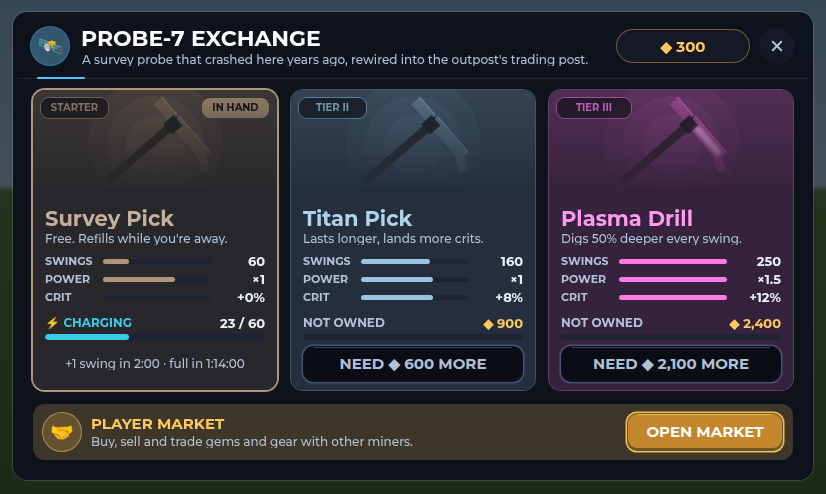
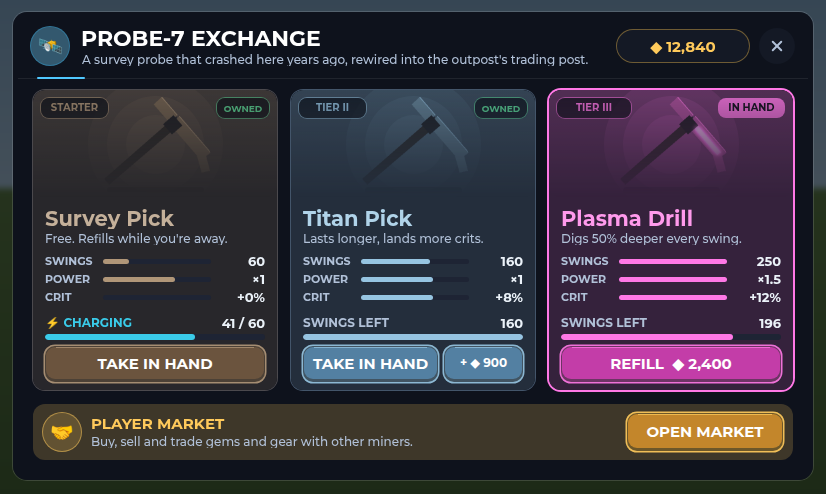

# PROBE-7 Exchange

PROBE-7 is the crashed survey probe on the Outpost's east side. Walk up and
press E to open its window, where you can buy, refill and swap picks, or open
the player market.

## The window

- **One card per pick.** Each shows:
  - the pick itself in 3D, in its tier's colour (a pick skin is looks
    only);
  - its tier (STARTER, TIER II, TIER III) and a line about it;
  - Swings, Power and Crit as bars against the best pick, so they're easy
    to compare.
- **The pick in your hand** has a lit border and an IN HAND tag. Other picks
  you own are tagged OWNED.
- **Your coins** sit at the top right, beside the close button. They update
  while the window is open.
- **The player market** is the strip under the cards. Tap it or OPEN MARKET.

## What a card offers

| Card | Shows | Button |
| --- | --- | --- |
| The free Survey Pick | Its charge, live, and when the next swing comes | TAKE IN HAND (when it isn't in your hand) |
| A pick you don't own | NOT OWNED and its price | BUY |
| The pick in your hand | Swings left | REFILL ◆ price (adds a full load of swings) |
| A pick you own but aren't holding | Swings left | TAKE IN HAND, and + ◆ price to top it up |

When you can't afford a pick, its button is greyed out and says how much
you're short, for example "NEED ◆ 600 MORE". Tapping it explains that too.

## Phones

On a short screen (a phone on its side, under 500 points tall) the window
is as wide as the screen. Its cards are shorter: a smaller pick, no line
about it. It's drawn at about full size, so the text stays readable and the
buttons are 40 points tall. It sits below Roblox's buttons at the top. The
window redraws if the screen turns or resizes while it's open.

## Spanish

Every word is in the Spanish table. Names, buttons and tags shrink to fit
when the Spanish runs longer.

## The close button

Every window built with `IronUi.window` (this one, and the others that share
it) now draws its X from two crossed bars. Gotham has no "✕" character, so
in the game it showed as an empty box.

## Code and tests

- `src/client/Modules/OutpostScene.luau`: the window (`drawProbe`,
  `pickCard`, `cardFooter`, `marketBanner`, `pickView`).
- `src/client/Modules/ProbeLayout.luau`: where everything sits on each
  screen (`design`) and what each card offers (`offer`). It has no Roblox
  dependencies, so it's tested on its own.
- `src/shared/Outpost.luau`: each pick's `Tag` and `Blurb`.
- `src/client/Modules/IronUi.luau`: the drawn close X, and `Resize`, which
  gives a window a new design size (the phone layout).
- `tests/probe_layout_cases.luau` (run with `tests/run_probe_layout.py`)
  checks:
  - on ten screen sizes, from 1920 x 1080 down to 568 x 320, the cards,
    stats, buttons and market fit;
  - phones draw the window at 90% or more, with buttons at least 36 points
    tall;
  - each card's offer;
  - every pick has a tag and a one-line blurb.
