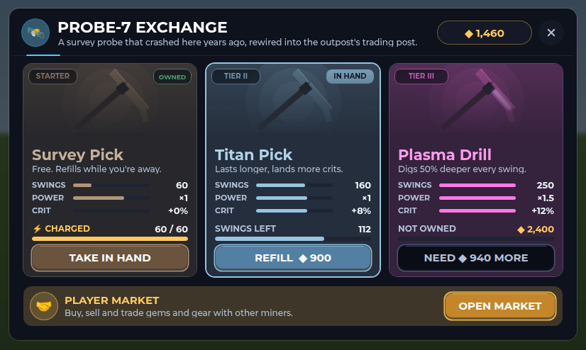
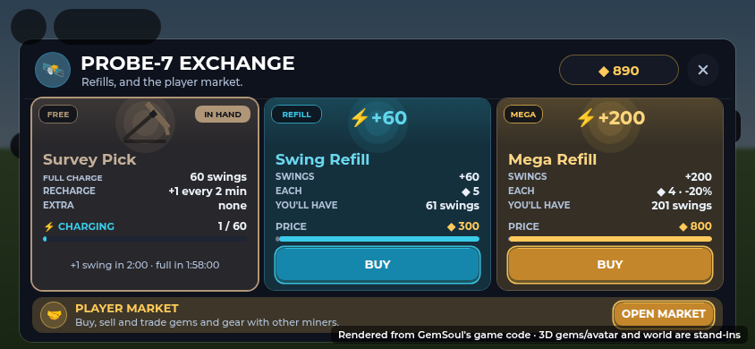
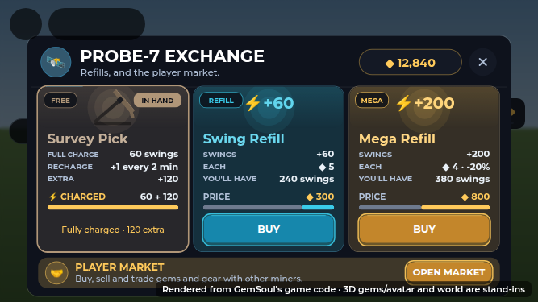
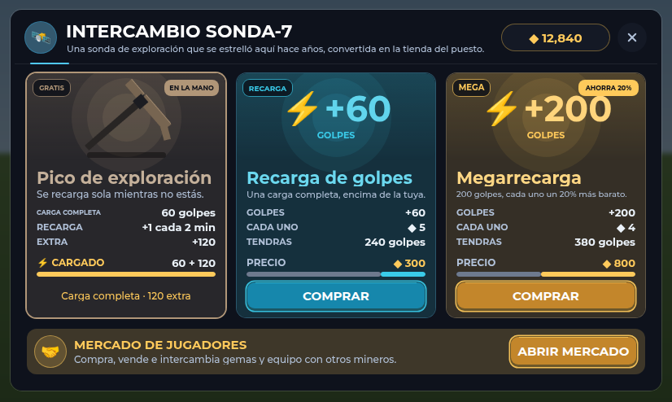

# PROBE-7 Exchange

*Since then (2026-10-22): PROBE-7 is gone. Its window is SWING REFILLS, opened from Garrick or the REFILLS button. See [hall-of-fame.md](hall-of-fame.md#probe-7-removed).*

PROBE-7 is the crashed survey probe on the Outpost's east side. Walk up and
press E, or run out of swings, to open its window. There you can buy refills
(more swings for your pick, for Robux) or open the player market.

The screenshots are from before refills moved to Robux. The cards now show
"R$ 100" and "BUY · R$ 100" where they show coins, and "ABOUT ≈ 130 rocks"
where they show the price of each swing.

## Your pick and its swings

Everyone mines with the free Survey Pick. Each swing spends one of its
swings. Its full charge is **600 swings**, about 130 rocks: a long session,
long enough for your kaiju to fight the critters your swings bring and level
up beside you (`docs/kaiju.md`). It recharges by itself, one swing every
12 seconds, so it's full again two hours after you empty it. The Probe
doesn't sell other picks. It sells refills.

## Refills (Robux)

| Refill | Swings | Robux | About |
| --- | --- | --- | --- |
| Swing Refill | +600 (a full charge) | R$ 100 | 130 rocks |
| Mega Refill | +2,000 | R$ 225 | 430 rocks (32% less a swing) |

- Each refill is a Developer Product (`Store.RobuxProducts.SwingRefill` and
  `SwingMega`). BUY opens Roblox's purchase prompt. When the receipt goes
  through, `StoreServer` puts the swings on your pick
  (`OutpostServer.addSwings`), once per purchase. If the Outpost isn't
  running, the receipt waits instead of being spent.
- Until a product's id is set, its button says "COMING SOON". While testing
  (`Config.TestCosmeticPrice`), refills can be bought for coins through the
  store's `BuyProduct`.
- A refill adds its swings on top of what you have, past the full 600. The
  window shows that as "600 + 2,000".
- Bought swings are spent first. The free pick starts recharging again once
  it's back under 600.
- Refills stack, so you can buy as many as you like.
- Each refill card shows:
  - the swings it adds;
  - about how many rocks that is;
  - what you'll have after buying, as a number and on the bar (grey for
    what you have, the refill's colour for what it adds);
  - BUY and its Robux.

The free pick's card shows:
- its charge, live;
- when the next swing comes and when it'll be full;
- any extra swings you've bought.

Your coins sit at the top right and update while the window is open. Coins
are for the player market, the banner under the cards. You earn them by
selling gems: mining pays mostly Commons, and `SELL COMMONS` in the GEMS
window sells every spare one at once, at the shop's rate (a quarter of
their worth).

### Picks from before

The Probe used to sell the Titan Pick and the Plasma Drill. A save that still
holds one gets its swings as extra swings on the free pick, the next time it
loads. A Plasma Drill's swings count 1.5 times, for its old power.

## Running out

With no swings left, a swing at a rock says when the next free swing comes
and opens the Probe: "Free pick recharging: +1 swing in 0:09. Buy a refill at
PROBE-7 to keep mining."

## Phones

On a short screen (a phone on its side, under 500 points tall) the window
is as wide as the screen. Its cards are shorter: no line under the name, and
a refill's saving moves into its "about" row. It's drawn at about full size,
so the text stays readable and the buttons are 40 points tall. It sits below
Roblox's buttons at the top, and redraws if the screen turns while it's open.

## Spanish

Every word is in the Spanish table. Names, buttons and tags shrink to fit
when the Spanish runs longer.

## The close button

Every window built with `IronUi.window` draws its X from two crossed bars
(`IronUi.cross`, which every other close button now uses too). Gotham has
no "✕" character, so in the game it showed as an empty box.

## Code and tests

- `src/shared/Outpost.luau`:
  - `Refills` and `RefillOrder` (what the Probe sells);
  - `Picks` (the free pick only);
  - `LegacyPicks` and `legacySwings` (picks a save still holds).
- `src/server/Systems/OutpostServer.luau`:
  - `addSwings` (a refill's swings on the pick, on top of its charge;
    `StoreServer` calls it for a receipt);
  - `record`, which turns old picks into swings.
- `src/shared/Store.luau`: the refills' products (`RobuxProducts`,
  `refill`, `contents`), and `src/server/Systems/StoreServer.luau`, which
  grants them.
- `src/client/Modules/OutpostScene.luau`: the window (`drawProbe`,
  `pickCard`, `refillCard`, `marketBanner`), and `buyRefill` (Roblox's
  prompt, then your swings again once the receipt lands).
- `src/client/Modules/ProbeLayout.luau`: where everything sits on each
  screen, and what a bigger refill saves. It has no Roblox dependencies, so
  it's tested on its own.
- `src/client/Modules/ChargeMeter.luau`: `count` and `status` show extra
  swings ("600 + 2,000", "Fully charged · 2,000 extra"). They're used by
  the dashboard and the Inventory too.
- `tests/outpost_cases.luau` checks that:
  - refills are Robux products, not sold for coins, each cheaper by the
    swing than the one before;
  - the free charge is 100 rocks or more and full within two hours;
  - a refill's swings go on the pick, take no coins, and stack past the
    full charge;
  - picks can't be bought;
  - an old save's Titan and Plasma swings become extra swings.
- `tests/skins_store_cases.luau` checks a refill's receipt: its swings
  land once (a retried receipt adds none), refills stack, and with no
  Outpost the receipt isn't granted.
- `tests/probe_layout_cases.luau` (`tests/run_probe_layout.py`) checks that:
  - the window fits on ten screen sizes;
  - phones draw it near full size with tappable buttons;
  - the savings and every card's line are right.
