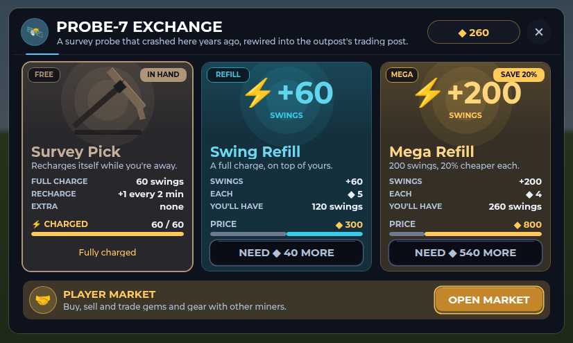
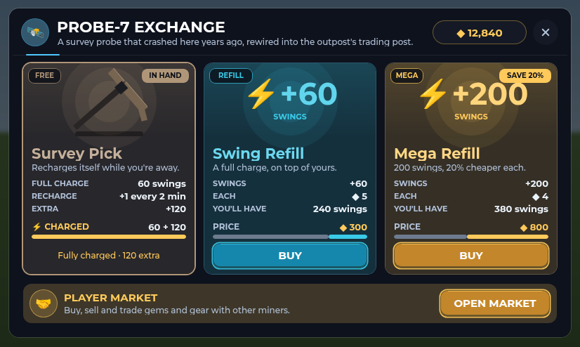

# PROBE-7 Exchange

PROBE-7 is the crashed survey probe on the Outpost's east side. Walk up and
press E, or run out of swings, to open its window. There you can buy refills
(more swings for your pick) or open the player market.

## Your pick and its swings

Everyone mines with the free Survey Pick. Each swing spends one of its
swings. It recharges by itself, one swing every 2 minutes, up to its full
charge of 60. The Probe doesn't sell other picks. It sells refills.

## Refills

| Refill | Swings | Price | Each swing |
| --- | --- | --- | --- |
| Swing Refill | +60 (a full charge) | ◆ 300 | ◆ 5 |
| Mega Refill | +200 | ◆ 800 | ◆ 4 (20% less) |

- A refill adds its swings on top of what you have, past the full 60. The
  window shows that as "60 + 120".
- Bought swings are spent first. The free pick starts recharging again once
  it's back under 60.
- Refills stack, so you can buy as many as you like.
- Each refill card shows:
  - the swings it adds;
  - the price of each swing;
  - what you'll have after buying, as a number and on the bar (grey for
    what you have, the refill's colour for what it adds);
  - BUY.
- When you can't afford a refill, its button is greyed out and says how
  much you're short, for example "NEED ◆ 40 MORE".

The free pick's card shows:
- its charge, live;
- when the next swing comes and when it'll be full;
- any extra swings you've bought.

Your coins sit at the top right and update while the window is open. The
player market is the banner under the cards.

### Picks from before

The Probe used to sell the Titan Pick and the Plasma Drill. A save that still
holds one gets its swings as extra swings on the free pick, the next time it
loads. A Plasma Drill's swings count 1.5 times, for its old power.

## Running out

With no swings left, a swing at a rock says when the next free swing comes
and opens the Probe: "Free pick recharging: +1 swing in 1:42. Buy a refill at
PROBE-7 to keep mining."

## Phones

On a short screen (a phone on its side, under 500 points tall) the window
is as wide as the screen. Its cards are shorter: no line under the name, and
a refill's saving moves into its "each" row. It's drawn at about full size,
so the text stays readable and the buttons are 40 points tall. It sits below
Roblox's buttons at the top, and redraws if the screen turns while it's open.

## Spanish

Every word is in the Spanish table. Names, buttons and tags shrink to fit
when the Spanish runs longer.

## The close button

Every window built with `IronUi.window` draws its X from two crossed bars
(`IronUi.cross`, which every other close button now uses too). Gotham has
no "✕" character, so in the game it showed as an empty box.

## Code and tests

- `src/shared/Outpost.luau`:
  - `Refills` and `RefillOrder` (what the Probe sells);
  - `Picks` (the free pick only);
  - `LegacyPicks` and `legacySwings` (picks a save still holds).
- `src/server/Systems/OutpostServer.luau`:
  - `buyRefill` (the `OutpostBuyRefill` request: near the Probe, paid in
    coins, swings added on top);
  - `record`, which turns old picks into swings.
- `src/client/Modules/OutpostScene.luau`: the window (`drawProbe`,
  `pickCard`, `refillCard`, `marketBanner`).
- `src/client/Modules/ProbeLayout.luau`: where everything sits on each
  screen, how short you are of a price, and what a bigger refill saves. It
  has no Roblox dependencies, so it's tested on its own.
- `src/client/Modules/ChargeMeter.luau`: `count` and `status` show extra
  swings ("60 + 120", "Fully charged · 120 extra"). They're used by the
  dashboard and the Inventory too.
- `tests/outpost_cases.luau` checks that:
  - a refill only sells at the Probe, charges its price and adds its swings;
  - refills stack past the full charge;
  - picks can't be bought;
  - a refill you can't afford takes nothing;
  - an old save's Titan and Plasma swings become extra swings.
- `tests/probe_layout_cases.luau` (`tests/run_probe_layout.py`) checks that:
  - the window fits on ten screen sizes;
  - phones draw it near full size with tappable buttons;
  - prices, savings and every card's line are right.
