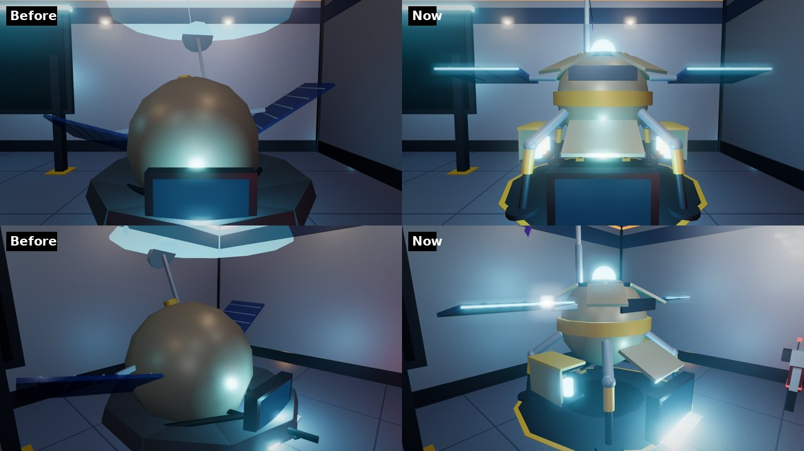
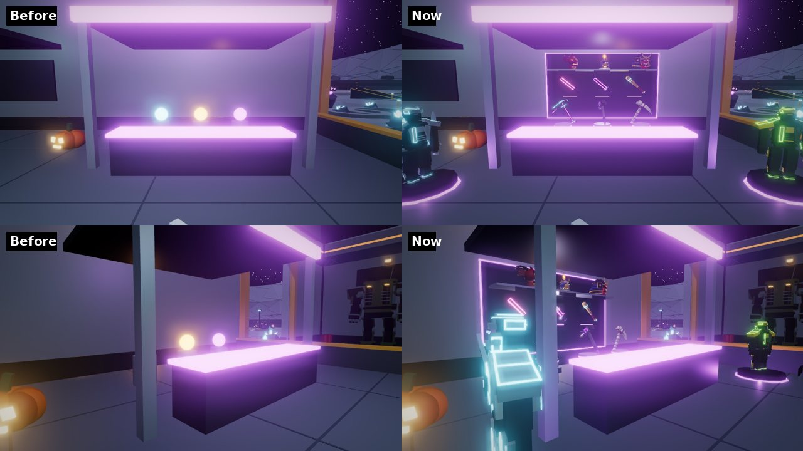
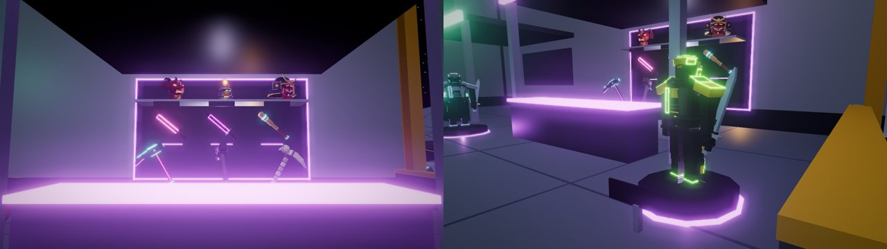
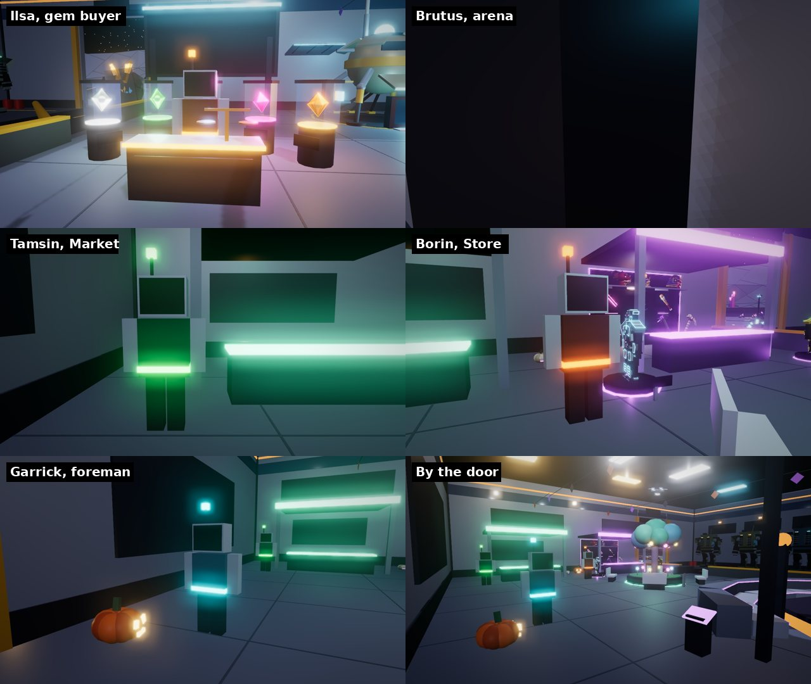
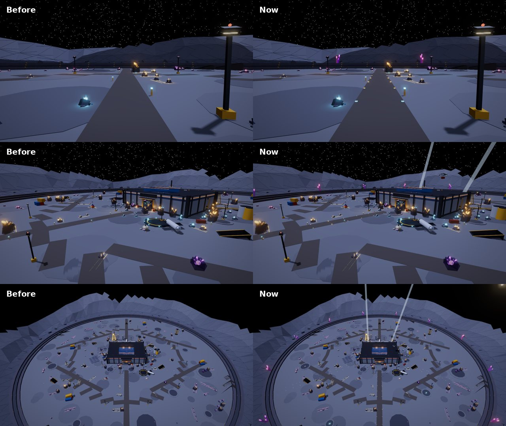
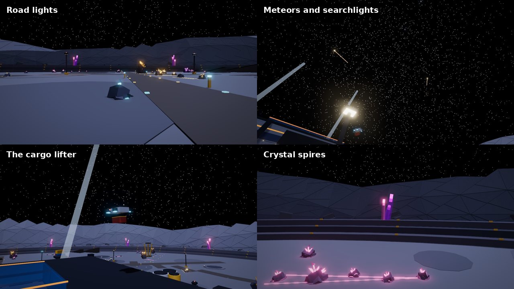

# PROBE-7, the Store's stands, the crew and the quarry

*Since then (2026-10-22): plain one-word signs, and the Shelter's floor cleared (no PROBE-7 station, duel gate, stands or survey table; PROBE-7 and Brutus are crew; the Gem Gallery is next to the Market). See [plain-signs.md](plain-signs.md).*

This round changes the Outpost's lobby and the quarry round it:

- **PROBE-7** is now the probe itself, landed and unfolded into the station.
- **The Store** shows what it sells: real suits, helmets, weapon skins and
  pickaxes on stands, changing every 40 seconds.
- **The crew:** the old town's shopkeepers work in the Shelter now:
  - **Ilsa** buys your gems;
  - **Brutus** runs the arena;
  - **Tamsin** runs the Market;
  - **Borin** runs the Store;
  - **Garrick** knows the quarry.
- **The quarry** comes alive:
  - lights run out along the roads in each band's colour;
  - searchlights sweep the sky and meteors streak over the crater;
  - a cargo lifter flies between the landing pad and the north outpost;
  - dust devils wander, vents burst and ore rides the conveyor;
  - crystal spires stand on the crater's rim.

The images are offline renders of the game's own code:

- the Shelter and the quarry from `OutpostWorld`;
- the crew from `Builder.vendor`;
- the Store's stands from `StoreDisplays`, dressed with the Shop's own
  previews (`Equipment.cosmeticPreview`, built offline on a stand-in body);
- the quarry's life from `QuarryLife`.

The renderer isn't Roblox's. It doesn't draw:

- text: signs, plates, or the robots' faces, whose screens show as dark
  plates;
- particles: the dust devils and the vents' vapour;
- Roblox's bloom.

Check the look in a Studio playtest.

## PROBE-7: the probe that became the station

PROBE-7 was a sphere on a pad. Now it's the probe that brought the first
miners' supplies, opened up where it came down:

- **Landing legs.** It stands on four legs over its scorched landing pad.
  Each has a knee, a hazard-striped sleeve and a foot.
- **The top** split into four petals that peeled back round a glowing core.
- **The hatch** folded down over the terminal. The terminal (the Exchange,
  E) is where it was.
- **The side bays** opened into racks of glowing swing-refill cells.
- **The solar wings** swung out level, and **the mast** telescoped up to a
  dish with a red beacon.
- **Its name,** PROBE-7, turns slowly over the core (`ProbeSign`, turned by
  `OutpostScene`).

## The Store's stands

The three glowing orbs behind the counter are gone. In their place
(`Client.StoreDisplays`):

| Where | What |
| --- | --- |
| A lit back wall behind the counter | Four helmets on the top shelf, turned to show their shape. Four weapon skins hung on the slant under them. |
| Plinths between the counter and the wall | Four pickaxes, turning, so you see the head in profile as they come round. |
| Turntables in front of the Store | Four suits, life size, turning: two either side of the counter. |
| Turntables in front of the Market | Two more suits, one by each of its columns. |

*2026-10-28:* the wall went from three to four of each, and the suits from
two to six (four round the Store, two by the Market), so 18 things are on
show instead of 11. See [shopfronts.md](shopfronts.md#the-makeover-2026-10-28).

- **They're the real things.** Each stand shows the Shop's own 3D preview
  of the cosmetic: the same model the Shop shows, the way it looks when
  worn. Animated skins move here too (`LiveLooks`).
- **They change.** Every 40 seconds each stand moves on to the next of its
  kind that the Store sells. The stands of one kind never show the same
  thing at once. Over a few minutes every suit, helmet, weapon skin and
  pickaxe on sale comes round. Exclusives aren't shown: they can't be
  bought.
- **Everyone sees the same,** on the server's clock.
- **A plate** under each stand names the item and gives its price
  (R$ 199).
- **Talking to Borin** ("Open the Store") asks which aisle you want, then
  opens the Store there: Suits, Helmets, Picks, Weapon skins or Bundles.

## The crew

The old town's shopkeepers keep their names, faces and colours (they come
from `Shared.Vendors`). Each stands beside the station they run, not at its
counter, so their **Talk** prompt (E) doesn't sit on top of the counter's.

| Who | Where | What they do |
| --- | --- | --- |
| **Ilsa**, gem buyer | Behind the GEM BUYER desk in the Gem Gallery, the cases behind her | **"What will you give me for my gems?"** She counts your spare Commons and Uncommons and names her price for each lot. One tap sells a lot. Spares are the loose gems no loadout uses. She'll also take any gem you pick, and explains what makes a gem valuable. |
| **Brutus**, arena master | Beside the Arena Uplink | "Find me a duel" opens the Arena. He explains win streaks: your 1st win in a row restores a tenth of your swings, the 5th a quarter, the 10th half, and ten in a row wins the tournament. |
| **Tamsin**, trade broker | By the Market | Opens the player Market and explains how listing and offers work. |
| **Borin**, outfitter | By the Store's north suit turntable | Opens the Store at an aisle. A skin is looks only. |
| **Garrick**, foreman | By the door | Where the best rocks are (the Fringe from 150 studs out, the Edge from 300, the three Rift Veins, one guarded), what the critters are, and where to get swings back. |

- **Ilsa's offers are the Market's rates** (`Crafting.marketPrice`). The
  server checks every sale again.
- **She buys from her desk.** Selling gems now works by Ilsa as well as by
  Tamsin. In the beta's menu-only mode, selling works from anywhere, as
  before.
- **Spanish.** Every line, option and appraisal is in Spanish. The roles
  are worded so they carry no gender: compra de gemas, guía de la arena,
  agente de comercio, estilista, capataz de minería.

## The quarry

All drawn by your own client (`Client.QuarryLife`), timed by the server's
clock, so everyone sees the same:

| | What it does |
| --- | --- |
| **Road lights** | Set in both edges of the six haul roads, every 24 studs, none on a jump ramp or the ring road's crossing. Each is lit in its frontier band's colour: cyan in the core, gold in the Fringe from 150 studs out, rose at the Edge from 300. A pulse runs out along every road every 2.4 seconds, so the way out, and how rich the ground gets, reads from afar. |
| **Searchlights** | Two beams from the north outpost sweep slowly round the sky, always well up. |
| **Meteor showers** | Every 45 seconds five meteors streak over the crater, high up, each a white-hot head with a trail. |
| **The cargo lifter** | A 100-second round trip. It rests on the landing pad with its container, lifts off and flies north over the Shelter (well above the skylight). It lowers to hover at the north outpost, turns round, and flies back to land. Nav lights blink; its engines glow while it flies. |
| **Dust devils** | Three swirls of dust wander the basin, out past the Shelter and inside the crater's benches. |
| **Vents** | Vapour bursts from cracks in four craters, 5 seconds every 26, one at a time. They're clear of every rock and road. |
| **Ore** | Crystal ore rides the conveyor from the drill rig to the habitats. |
| **Crystal spires** | Twelve clusters of glowing rose and violet crystal on the crater's top bench, between its ramps, so the rim catches the eye from the Shelter. |

## Cost

- **What the server builds.**
  - Scenery: 3,988 of the 4,000 budget (3,944 before). The new PROBE-7 is
    bigger. Ilsa's desk is 8 parts. The Store's six orb parts are gone.
  - The crew: five robots of 10 parts each, built outside the scenery
    count, like the town's.
- **What your own client draws.** None of these collides, casts a shadow
  or can be clicked, so a click still swings at a rock. They're there only
  while you're in the Outpost.
  - **The Store's stands:** 32 parts, plus whatever they show. That's
    about 900 parts with two suits up, since a suit is a whole dressed
    mannequin; with the six suits of 2026-10-28, nearer 2,500. The
    turntables move them all in one `BulkMoveTo` a frame.
    - They're drawn only within 200 studs of the Store, and turn only
      within 90.
    - They change one stand at a time.
    - The next turn's previews are asked for ahead of time. The server
      builds each preview once and keeps it, as it does for the Shop.
  - **The quarry's life:** 250 parts. The road lights change only within
    360 studs of you. Everything moves 20 times a second, in one bulk
    move.

## Tests

| Suite | What it covers |
| --- | --- |
| `tests/run_store_displays.py` (new) | Four helmet, four skin, four pick and six suit stands (three, three, three and two before 2026-10-28; the Market's two kept to the Market). Only what's on sale, each coming round, never two alike at once, changing only on the turn. Each preview placed on its stand at its kind's size, facing the hall, wherever the server built it. Clear of the back wall, the counter, the Shelter's walls and the crew, at every turn of the turntables. Turntables never meet. Plates name and price it. Nothing clickable, solid or shadowed. |
| `tests/run_quarry_life.py` (new) | Road lights on the server's roads, off the ramps and the ring crossing, in their bands' colours, pulsing outward. The lifter resting on the pad, hovering at the outpost, never jumping or spinning, clear of everything standing and high over the Shelter. Searchlights well up and sweeping. Meteors every shower, high and falling. Dust devils in the basin. Vents clear of rocks and roads, one at a time. Spires on the top bench, off the ramps. Ore on the conveyor. The part budget. |
| `tests/run_outpost.py` | The five crew members built where the Shelter puts them: in the hall, on the floor, clear of the spawn, the Uplink's pad, the counters and each other. Every option a reply or an action the dialogue has. |
| `tests/run_moon_quarry_scene.py` | The scenery budget (3,988 of 4,000) |
| `tests/run_lang.py` | The crew's lines, options and appraisals in Spanish |
